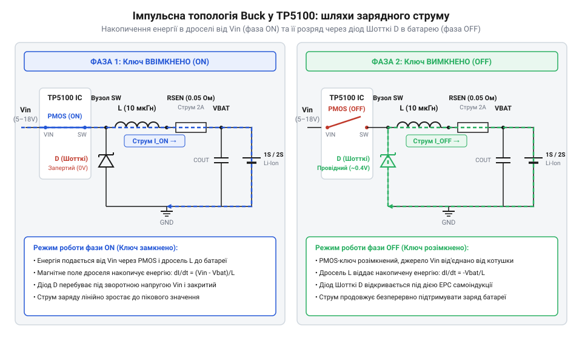
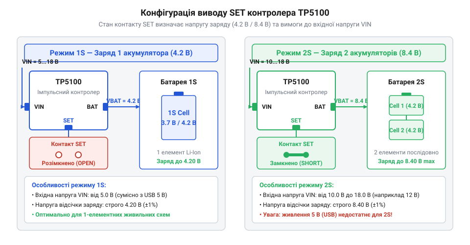
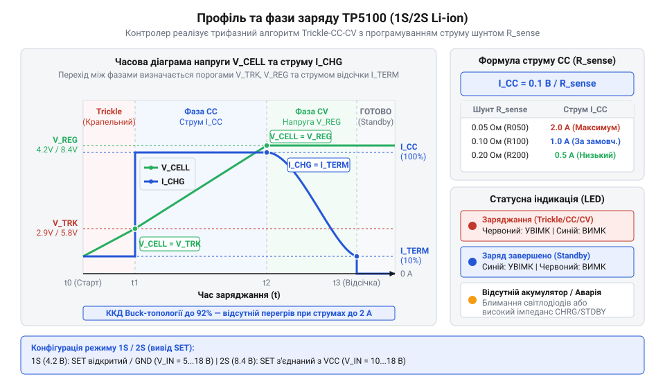

# TP5100 — заряд 1S/2S

<preknowlist>
- [TP4056](root:cat-hw-power/tp4056) — принцип роботи класичного лінійного контролера заряду @@en|1S@@ та його теплові обмеження при підвищенні струму
- [BMS 2S/3S/4S із балансуванням](root:cat-hw-power/bms-multicell) — концепція пасивного балансування послідовних елементів та захист від міжкоміркового дисбалансу
</preknowlist>

## Перегрів лінійного заряду за високих струмів

Заряджання акумулятора струмом понад 1 А або від джерела 9–12 В через [класичний лінійний контролер](root:cat-hw-power/tp4056) швидко призводить до перегріву мікросхеми. Лінійний регулятор працює як керований опір, де надлишок напруги падає на внутрішньому силовому транзисторі. Втрати потужності описуються залежністю:

```
P_loss = (U_in - U_bat) · I_charge
```

Для вхідної напруги `U_in = 9.0` В, напруги акумулятора `U_bat = 3.6` В та струму `I_charge = 1.0` А втрати становлять `P_loss = (9.0 - 3.6) · 1.0 = 5.4` Вт. Компактний корпус @@en|SOP-8@@ (від англ. @@en|Small Outline Package@@) має опір кристал-довкілля близько 120 °C/Вт, тому розсіювання 1 Вт розігріває кристал понад 140 °C. За цієї межі вмикається захист @@en|thermal throttling@@ (від англ. @@en|throttle@@ — обмежувати потік), який знижує струм заряду для запобігання пошкодженню напівпровідника. Обмеження пасивного відведення тепла роблять лінійний метод неефективним, що вимагає переходу на понижувальну імпульсну топологію @@en|Buck converter@@ (від англ. @@en|buck@@ — протидіяти).

## Принцип імпульсного зниження напруги TP5100

Зарядний контролер @@en|TP5100@@ працює за схемою понижувального імпульсного перетворювача @@en|Buck converter@@ із ККД понад 90%. Замість безперервного лінійного розсіювання тепла його внутрішній силовий @@en|MOSFET@@-транзистор працює у ключовому режимі на частоті близько 400 кГц.

У фазі відкритого ключа струм протікає через @@en|MOSFET@@ у накопичувальний дросель @@de|Drossel@@ та акумулятор, накопичуючи енергію в магнітному полі. У фазі закритого ключа транзистор вимикається, а накопичена енергія підтримує струм через зовнішній діод Шотткі @@en|Schottky diode@@. В омічному режимі відкритий ключ має мінімальний опір `R_DS(on)`, тому втрати на кристалі @@en|TP5100@@ незначні навіть за струмів до 2 А.


*Силовий тракт перетворює високу вхідну напругу на зарядний струм із ККД понад 90% завдяки високочастотному ключуванню та відновленню енергії.*

На відміну від комбінованого [модуля вихідного живлення](root:cat-hw-power/mh-cd42-charger), цей силовий каскад оптимізований саме для холодного заряджання високоємних комірок.

## Перемикання конфігурацій між 1S та 2S

Контролер @@en|TP5100@@ заряджає одноелементні (@@en|1S@@, 4.2 В) та двоелементні (@@en|2S@@, 8.4 В) збірки. Режим обирають станом виводу @@en|SET@@: для 4.2 В його залишають плаваючим, а для 8.4 В — підтягують до шини живлення `U_in`, що перемикає подільник опорної напруги.


*Підключення виводу SET для вибору режимів 1S та 2S.*

Для роботи понижувача @@en|Buck converter@@ вхідна напруга `U_in` має перевищувати напругу акумулятора `U_bat` щонайменше на 1.0–1.5 В (технологічний запас @@en|headroom@@). У режимі @@en|1S@@ пристрій працює від 5 В USB, але для @@en|2S@@ (8.4 В) напруги 5 В недостатньо, тому `U_in` має становити від 9 В до 18 В.

## Задання струму та фази заряду

Зарядний струм `I_ch` задають шунтом `R_s`. Компаратор `@@en|TP5100@@` утримує напругу `V_sense = 0.1` В:

```
R_s = V_sense / I_ch
= 0.1 / I_ch
```

Для струму `I_ch = 2.0` А необхідний опір `R_s = 0.1 / 2.0 = 0.05` Ом, а втрати потужності становлять `P_R = I_ch² · R_s = 0.2` Вт.

Контролер реалізує трифазний алгоритм відновлення елементів:

1. Крапельний заряд `@@en|Trickle Charge@@`: при `U_bat` нижче 2.9 В (`@@en|1S@@`) або 5.8 В (`@@en|2S@@`) струм обмежується до `0.1 · I_ch`. 2. Стабільний струм `@@en|Constant Current@@`: після досягнення порогу вмикається повний струм `I_ch`. 3. Стабільна напруга `@@en|Constant Voltage@@`: за досягнення 4.2 В або 8.4 В контролер фіксує напругу та плавно знижує струм до 10% від початкового.


*Послідовний перехід між фазами відновлення, стабілізації струму та напруги.*

Індикацію реалізовано через виводи з відкритим стоком `@@en|open drain@@`.

## Межі безпеки та експлуатаційні ризики

Під час заряджання збірок @@en|2S@@ контролер @@en|TP5100@@ вимірює лише сумарну напругу (8.4 В) і не має балансування комірок.

За дисбалансу одна комірка досягає 4.2 В раніше, проте струм подається до спільних 8.4 В. Це спричиняє її перезаряд понад 4.25 В, виділення газів і тепловий розгін @@en|thermal runaway@@ (від англ. @@en|runaway@@ — неконтрольований розгін) з ризиком займання.

Тому режим @@en|2S@@ вимагає обов'язкових [зовнішніх платарних балансирів](root:cat-hw-power/bms-multicell) або [одноелементної плати захисту](root:cat-hw-power/pcb-1s-protection) для кожної комірки.

Для температурного захисту до виводу @@en|TS@@ підключають @@en|NTC-терморезистор@@ (від англ. @@en|Negative Temperature Coefficient@@ — негативний температурний коефіцієнт), який зупиняє заряд поза межами 0–45 °C.