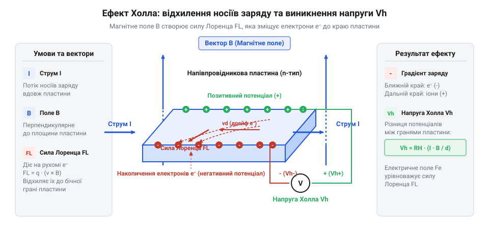
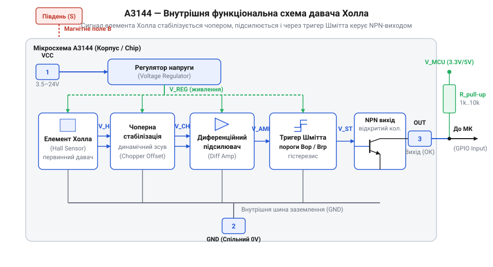
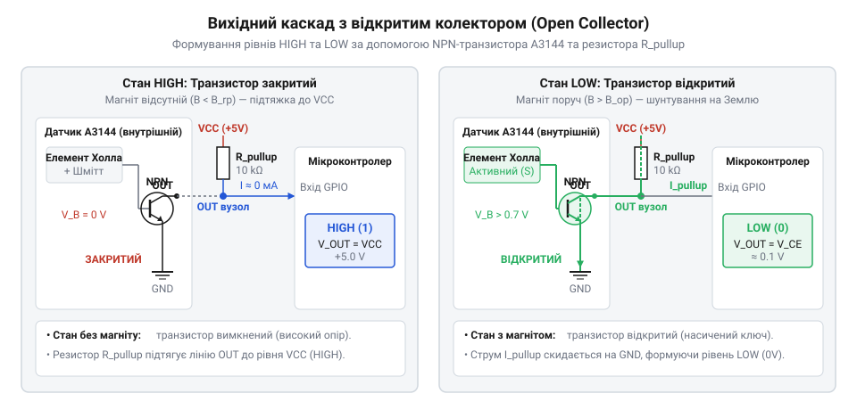

# A3144 — модуль давача Холла

<preknowlist>
- [KY-021 — міні герконовий давач](root:cat-hw-sensors/ky-021-reed) — Принцип роботи механічних герконів, явище дребезгу контактів та обмеження механічного перемикання під дією магнітного поля.
- [KY-003 / KY-024 — давач Голла](root:cat-hw-sensors/ky-003-hall) — Базові уявлення про застосування ефекту Холла в модулях сумісних із платами Arduino.
</preknowlist>

## Дребезг і знос механічних кінцевиків

Будь-яка система автоматизації починається з потреби визначити положення рухомих деталей або зафіксувати момент досягнення крайньої точки. У найпростіших конструкціях для цього застосовують механічний @@en|кінцевий вимикач@@ (англ. limit switch) — кнопковий перемикач, на який фізично тисне важелем рухомий вузол механізму. Проте при підвищенні швидкості роботи або експлуатації у завадоактивному середовищі механічні контакти стають джерелом непереборних системних проблем.

При фізичному зіткненні двох металевих пружних пластин виникає @@en|дребезг контактів@@ (англ. contact bounce). Замість одноразового стрибка напруги при замиканні вихідний сигнал протягом кількох мілісекунд хаотично розмикається й замикається десятки разів. Для входів @@en|мікроконтролер@@ це виглядає як серія високочастотних імпульсів. Якщо система зчитує оберти або рахує деталі за допомогою апаратних переривань, кожен такий дребезг призводить до хибних спрацьовувань та спотворення розрахунків.

Окрім електричного шуму, механічний контакт піддається безперервному фізичному та термічному зносу. Під час зіткнення металевих контактних пластин кінетична енергія удару викликає швидку пружну деформацію мікронерівностей на їхніх поверхнях, після чого накопичена сила пружності відштовхує контакти назад, спричиняючи їх багаторазове відскочення та пружний @@en|дребезг контактів@@. Водночас у момент замикання чи розмикання кола під навантаженням площа зв'язку звужується до кількох мікроскопічних точок перехідного опору. Величезна густина струму в цих мікроконтактах миттєво розігріває метал до плавлення, а при утворенні мікроскопічного повітряного проміжку висока напруженість електричного поля іонізує газ і викликає дуговий розряд. Ця високотемпературна мікродуга випаровує та переносить метал між контактами, спричиняючи ерозію поверхонь, їх точкове зварювання або швидке окиснення контактних майданчиків під дією тертя, пилу й мастила, що призводить до втрати провідності. Спроба ізолювати контакти від зовнішнього руйнівного середовища реалізована у пристроях типу @@uk|геркон@@ (від герметизований контакт). Такі класичні [механічні герконові давачі](root:cat-hw-sensors/ky-021-reed) або варіанти у [скляній колбі](root:cat-hw-sensors/ky-025-reed) повністю усувають вплив забруднення та окиснення завдяки інертному газу, але їхні внутрішні тонкі феромагнітні пелюстки під дією магнітного поля все одно зазнають пружної деформації, повторного дребезгу й неминучої механічної втоми металу через мільйони циклів спрацьовування.

Для високонадійного обладнання потрібен повністю @@en|твердотілий давач@@ (англ. solid-state sensor) без жодної рухомої деталі. Безконтактний спосіб зчитування магнітного поля дозволяє відокремити чутливий електронний елемент від механічної частини міцним герметичним корпусом, повністю усуваючи фізичне зношення та проблему механічного дребезгу контактів.

## Ефект Холла у напівпровідниковому елементі

Перехід від механічного контакту до безконтактного виявлення магніту вимагає фізичного явища, що перетворює параметри магнітного поля безпосередньо в електричну величину. У модулі @@en|A3144@@ цим фундаментальним явищем є @@en|ефект Холла@@ (названий на честь фізика Едвіна Холла, англ. Hall effect).

Уявімо тонку напівпровідникову пластину, через яку у поздовжньому напрямку протікає постійний керуючий струм `I`. Носії заряду — електрони або дірки — рухаються уздовж пластини зі впорядкованою швидкістю. Якщо перпендикулярно до площини напівпровідника прикласти зовнішнє магнітне поле з індукцією `B`, на кожен рухомий заряд починає діяти @@nl|сила Лоренца@@ (названа на честь фізика Хендріка Лоренца, нідерл. Lorentzforce). Вона відхиляє траєкторію носіїв заряду до одного з бічних країв пластини.

У результаті перерозподілу носіїв на бокових бічних гранях напівпровідника виникає різниця електричних потенціалів — поперечна @@en|напруга Холла@@ `Vₕ`. Розрахунок цієї напруги описує вираз:

```
Vₕ = (Rₕ × I × B) ÷ d      [визначення напруги Холла]
```

де позначено такі величини:
- `Vₕ` — поперечна напруга Холла (у вольтах);
- `Rₕ` — коефіцієнт Холла для даного матеріалу (у кубічних метрах на кулон);
- `I` — струм живлення пластини (в амперах);
- `B` — перпендикулярна складова магнітної індукції (у теслах);
- `d` — товщина напівпровідникового кристала (у метрах).


*Схема розділення електричних зарядів у напівпровіднику під дією поперечного магнітного поля, що приводить до виникнення поперечної напруги Холла.*

З отриманого рівняння видно, що вихідна напруга `Vₕ` прямо пропорційна індукції магнітного поля `B`. Однак у реальних кремнієвих кристалах мікросхеми @@en|A3144@@ згенерована напруга має надзвичайно малу амплітуду — порядок кількох мікровольт або мілівольт. Крім того, значення `Vₕ` зазнає дрейфу через температурні зміни провідності напівпровідника та внутрішні шуми. Докладніше про [історію відкриття ефекту](root:cat-hw-sensors/a3144-hall-module/hist-a3144-hall-effect-discovery-and-evolution.md) та його подальший розвиток написано в окремому матеріалі. Непосередньо подавати первинний аналоговий сигнал `Vₕ` на цифровий вхід @@en|мікроконтролер@@ неможливо, адже логічний рівень не розпізнає мікровольтові зміни.

## Диференціальний підсилювач та тригер Шмітта

Щоб перетворити слабку напругу Холла `Vₕ` на впевнений цифровий сигнал без завад, усередині кристала мікросхеми @@en|A3144@@ інтегровано цілий вимірювально-перетворювальний тракт.


*Структурна схема функціональних блоків A3144, яка показує шлях сигналу від первинного елемента Холла до вихідного транзистора.*

Першим етапом обробки є @@en|диференціальний підсилювач@@ (англ. differential amplifier). Він приймає потенціали з протилежних країв пластини Холла і підсилює лише їхню різницю, відсікаючи синфазні завади. Проте сам по собі підсилювач не здатен усунути власний паразитний зсув напруги напівпровідникової пластини, викликаний кристалічними дефектами, механічними напруженнями та технологічними допусками. При зміні температури цей зсув динамічно плаває, утворюючи температурний дрейф нуля, який без корекції повністю спотворив би мікровольтовий корисний сигнал. Для нейтралізації цього явища у кристалі @@en|A3144@@ задіяно схему @@en|динамічна компенсація зсуву@@ (англ. Dynamic Offset Cancellation), побудовану на основі @@en|чоперна стабілізація@@ (англ. chopper stabilization, від англ. chop — переривати, періодично перемикати). Внутрішній високочастотний генератор через матрицю ключових транзисторів періодично змінює напрямок проходження струму живлення крізь пластину Холла на 90 градусів, почергово міняючи місцями контакти живлення та знімання сигналу. Оскільки паразитна напруга зсуву зумовлена фіксацією геометричної асиметрії кристала і зберігає свій знак відносно орієнтації струму, а корисна напруга Холла змінює фазу відповідно до напрямку вектора струму, наступне віднімання сигналів двох суміжних фаз повністю взаємознищує статичний зсув та його температурний дрейф. У результаті диференціальний підсилювач отримує очищену різницю потенціалів і формує масштабований аналоговий сигнал, амплітуда якого точно відстежує зміну магнітного поля незалежно від нагрівання мікросхеми.

Проте самого підсилювача недостатньо для стабільного перемикання. Якби аналоговий сигнал порівнювався зі сталим порогом у звичайному компараторі, то при повільному наближенні магніту або при наявності вібрацій вихідний рівень почав би хаотично коливатися між логічним нулем і одиницею на межі спрацьовування.

Для усунення цього ефекту підсилений сигнал подається на @@en|тригер Шмітта@@ (названий на честь винахідника Отто Шмітта, англ. Schmitt trigger), який реалізує магнітний @@el|гістерезис@@ (від грец. hysterein — відставати, запізнюватися). Гістерезис розділяє точки перемикання на два незалежні магнітні пороги:

```
B_hys = B_op - B_rp        [величина магнітного гістерезису]
```

де визначено такі параметри:
- `B_op` — поріг спрацьовування @@en|Bop@@ (англ. Magnetic Operating Point), при досягненні якого індукцією південного полюса магніту тригер змінює стан і вмикає вихідний транзистор;
- `B_rp` — поріг відпускання @@en|Brp@@ (англ. Magnetic Release Point), нижче якого індукція має впасти, щоб тригер повернувся у початковий стан;
- `B_hys` — ширина зони гістерезису.

Завдяки тому, що `B_op` суттєво більше за `B_rp`, будь-які дрібні коливання магнітного поля чи вібрації деталі у проміжку між `B_rp` та `B_op` не викликають перемикання виходу. Модуль @@en|A3144@@ є уніполярним перемикачем — він реагує виключно на південний полюс магніту. Для детального вивчення розрахунків рекомендуємо розібрати [математичний опис порогів](root:cat-hw-sensors/a3144-hall-module/math-a3144-magnetic-thresholds-and-hysteresis.md) спрацьовування та гістерезису.

На відміну від аналогових давачів або [модулів типу KY-003](root:cat-hw-sensors/ky-003-hall), тригер Шмітта в мікросхемі @@en|A3144@@ гарантує фронти перемикання цифрового сигналу тривалістю у частки мікросекунди независимо від швидкості наближення магніту. У задачах вимірювання швидкості обертання такі характеристики дозволяють будувати високонадійні вузли, розібрати які допомагають [проєкти кінцевих вимикачів](root:cat-hw-sensors/a3144-hall-module/proj-a3144-rpm-tachometer-and-limit-switch.md) та тахометрів. Загальну схемотехніку виходів та живлення розкриває [інтерфейсна залізна довідка](root:cat-hw-sensors/a3144-hall-module/api-a3144-hardware-wiring-and-pinout.md).

## Схемотехніка виходу з відкритим колектором

Після перетворення магнітного поля у тригері Шмітта постає завдання схемотехнічного зняття цифрового сигналу з мікросхеми @@en|A3144@@. Внутрішня логіка вже сформувала рішення про наявність чи відсутність магніту, проте вихідний каскад давача розроблений таким чином, щоб забезпечити гнучке узгодження з довільними електричними рівнями зовнішніх пристроїв.

Вихідний вузол мікросхеми @@en|A3144@@ виконаний за схемою з @@en|відкритим колектором@@ (англ. open collector) на основі @@en|NPN-транзистора@@. Емітер цього внутрішнього транзистора жорстко з'єднаний із спільною шиною заземлення GND, а колектор виведено безпосередньо на зовнішню ніжку `OUT`. Внутрішнього зв'язку між колектором та лінією живлення `V_CC` всередині кристала немає.


*Принципова схема вихідного каскаду з відкритим колектором, що пояснює формування логічного нуля при насиченні транзистора та логічної одиниці через резистор підтяжки.*

Коли до сенсора наближається магніт і індукція перевищує поріг `B_op`, тригер Шмітта відкриває внутрішній @@en|NPN-транзистор@@, переводячи його у режим насичення. Транзистор працює як замкнений ключ, примусово притискаючи вихідний контакт `OUT` до землі GND. Напруга на виході падає до напруги насичення колектор-емітер `V_CE_sat` (близько 0.2–0.4 В), що сприймається цифровим входом @@en|мікроконтролер@@ як логічний нуль (`0`).

Якщо магніт віддаляється і індукція спадає нижче порогу `B_rp`, внутрішній транзистор закривається. Колекторний перехід розмикається, і вихідний контакт переходить у стан високого імпедансу (@@en|Hi-Z@@, від англ. high impedance — високий опір). У цьому стані кристал взагалі не подає напругу на вихід `OUT`. Без зовнішнього елемента колу вихідний провід залишається в невизначеному підвішеному стані, чутливому до будь-яких наводок.

Щоб сформувати стабільну логічну одиницю (`1`) при закритому транзисторі, між виходом `OUT` та шиною живлення необхідно встановити зовнішній @@en|підтягувальний резистор@@ (англ. pull-up resistor, від англ. pull up — підтягувати догори). Коли транзистор закритий, струм через вихід не протікає, і резистор притягує напругу на лінії `OUT` до рівня живлення `V_CC`. Коли транзистор відкривається, резистор обмежує струм, що протікає від `V_CC` через насичений транзистор на землю GND.

Розрахунок номіналу підтягувального резистора `R_pullup` виконують з огляду на два обмеження:

```
R_pullup_min = (V_CC - V_CE_sat) ÷ I_O_max      [мінімальний опір підтяжки]
```

де позначено такі величини:
- `V_CC` — напруга живлення лінії підтяжки (у вольтах);
- `V_CE_sat` — напруга насичення відкритого транзистора (у вольтах, зазвичай 0.2 В);
- `I_O_max` — гранично допустимий струм вихідного транзистора (в амперах, для A3144 становить 25 мА).

Нижня межа `R_pullup_min` захищає транзистор від перегріву та виходу з ладу при відкриванні. Верхня межа обмежена вхідними струмами витоку @@en|мікроконтролер@@ та паразитною ємністю лінії, яка разом із резистором утворює RC-фільтр і затягує фронти нарастання сигналу. На практиці обирають номінали в діапазоні від 1 кОм до 10 кОм (типово 4.7 кОм).

Головна перевага @@en|відкритого колектора@@ полягає у простоті узгодження логічних рівнів. Якщо модуль @@en|A3144@@ живиться від напруги 5 В, його вихід `OUT` можна підтягнути резистором до лінії 3.3 В контролера. При закритому транзисторі на вхід контролера надійде безпечна напруга 3.3 В, що запобігає пошкодженню портів. Щоб переглянути [параметри апаратного інтерфейсу](root:cat-hw-sensors/a3144-hall-module/api-a3144-hardware-wiring-and-pinout.md) та цокольовку, зверніться до електричної довідки. Подібний принцип підтяжки застосовують і інші [промислові цифрові сенсори](root:cat-hw-sensors/ss41f-hall).

## Уніполярна чутливість до південного полюса

Після налаштування електричного виходу виникає питання просторового розміщення давача відносно магніту. Практичні випробування показують, що модуль @@en|A3144@@ може чітко відпрацьовувати проходження одного магнітного маркера, але повністю ігнорувати інший, повернутий протилежним боком.

Модуль @@en|A3144@@ є @@en|уніполярним давачем@@ (англ. unipolar sensor). Уніполярність означає, що внутрішня схема реагує на наявність векторного магнітного поля лише одного визначеного напрямку — а саме на @@en|південний полюс@@ (англ. South pole, позначення S).

Усередині пластикового корпусу напівпровідниковий кристал Холла орієнтований паралельно до лицьової скошеної грані (боку з маркуванням). Коли до цієї лицьової поверхні наближається @@en|південний полюс@@ магніту, силові лінії магнітної індукції `B` проникають у кристал перпендикулярно до його площини від лицьового боку до тильного. Така орієнтація створює позитивне значення вектора індукції відносно опорної осі давача. Як тільки індукція досягає порогу `B_op`, тригер Шмітта перемикається й відкриває вихідний транзистор.

Якщо повернути магніт @@en|північним полюсом@@ (англ. North pole, позначення N) до маркованого боку сенсора, силові лінії підуть у протилежному напрямку, створюючи негативну індукцію (`-B`). Уніполярний тригер Шмітта мікросхеми @@en|A3144@@ порівнює сигнал лише з позитивним пороговим значенням `B_op`. Негативна індукція не здатна викликати спрацьовування, тому вихідний транзистор залишається закритим (стан логічної одиниці). Аналогічно, прикладання південного полюса з тильного боку корпусу дає негативний вектор індукції всередині кристала і не викликає перемикання.

Для безпомилкового проективання механічних вузлів дотримуються трьох правил:

1. **Орієнтація магнітного маркера:** На рухому деталь магніт монтують так, щоб при русі повз давач до його маркованої грані був обернений виключно південний полюс S.
2. **Робочий повітряний зазор:** Магнітна індукція спадає з відстанню зворотньо пропорційно кубу відстані. Повітряний зазор між магнітом і корпусом давача обирають таким, щоб у точці найближчого зближення індукція гарантовано перевищувала поріг `B_op`, але залишався запас на механічний люфт.
3. **Траєкторія руху:** Найкращу чіткість перемикання забезпечує тангенціальний рух (проліт магніту повз грань сенсора). При такому русі перпендикулярна складова поля швидко зростає до максимуму і так само стрімко спадає нижче порогу `B_rp`, формуючи крутий фронт сигналу.

Щоб детально розрахувати відстані спрацьовування, скористайтеся матеріалом про [математичний опис порогів](root:cat-hw-sensors/a3144-hall-module/math-a3144-magnetic-thresholds-and-hysteresis.md) та гістерезису. На відміну від уніполярних перемикачів, існує клас пристроїв, де застосовують [двополярні цифрові давачі](root:cat-hw-sensors/ss41f-hall), які змінюють стан лише при почерговому прикладанні південного та північного полюсів.

## Побудова надійних вузлів зчитування обертів

Поєднуючи схемотехніку відкритого колектора та просторову орієнтацію магнітів, можна будувати вузли вимірювання частоти обертання та позиціонування. Проте в реальних умовах робочі вали двигунів створюють потужні електромагнітні завади, а висока швидкість обертання вимагає правильної організації програмної обробки сигналів @@en|мікроконтролер@@.

При відсутності магніту вихідна лінія утримується у стані логічної одиниці через вихідний @@en|підтягувальний резистор@@. Довгі сигнальні дроти працюють як антени, вловлюючи високочастотні наводки від комутації обмоток електродвигунів. Ці наводки можуть короткочасно знижувати напругу на лінії нижче порогу логічної одиниці, створюючи хибні імпульси в лічильнику обертів.

Для придушення імпульсних завад застосовують апаратну та програмну фільтрацію:

1. **Фільтруючий конденсатор:** Паралельно виходу `OUT` та землі GND безпосередньо біля давача або входу мікроконтролера підключають керамічний конденсатор ємністю від 1 нФ до 10 нФ. Разом із резистором підтяжки він утворює ФНЧ-фільтр, який шунтує високочастотні завади на землю.
2. **Блокувальний конденсатор живлення:** Між контактами `V_CC` та GND мікросхеми @@en|A3144@@ монтують керамічний конденсатор ємністю 0.1 мкФ для нейтралізації просідань напруги живлення при імпульсних навантаженнях.
3. **Екранування ліній:** При довжині кабелю понад 0.5 м використовують кручену пару (сигнал та GND) або екранований провід.

Обробку сигналу на боці @@en|мікроконтролера@@ реалізують через @@en|апаратне переривання@@ (англ. hardware interrupt). Вхідний порт налаштовують на спрацьовування за спадаючим фронтом сигналу (режим FALLING, перехід `1 → 0`). Саме в момент наближення південного полюса транзистор відкривається і швидко притискає лінію до землі, що гарантує фіксацію події з мікросекундною точністю без витрати ресурсів процесора на постійне опитування входу.

Гранична частота перемикання внутрішнього тригера A3144 досягає 100 кГц, що значно перевищує швидкість будь-яких механічних валів. При проективанні цифрового тахометра на обертовий диск зазвичай встановлюють кілька магнітних маркерів для підвищення роздільної здатності на малих обертах. Критично важливо монтувати всі магніти дисків однаковим полюсом (південним S) назовні.

Розрахунок частоти обертання вала виконують за виразом:

```
RPM = (f_interrupts × 60) ÷ N_magnets      [розрахунок частоти обертання]
```

де позначено такі параметри:
- `RPM` — частота обертання вала (в обертах за хвилину);
- `f_interrupts` — частота зафіксованих апаратних переривань (у герцах);
- `N_magnets` — кількість південних магнітних полюсів, встановлених на диску.

Готові схеми розробки [практичних проєктів тахометрів](root:cat-hw-sensors/a3144-hall-module/proj-a3144-rpm-tachometer-and-limit-switch.md) та безконтактних кінцевих вимикачів зі зразками коду винесені в окремий матеріал. У порівнянні з тим, як працюють [класичні механічні геркони](root:cat-hw-sensors/ky-021-reed) або аналогово-цифрові [модулі типу KY-003](root:cat-hw-sensors/ky-003-hall), твердотільний вузол на A3144 із завадозахистом та апаратними перериваннями забезпечує довговічну роботу обладнання без зносу контактів і без втрати імпульсів.
