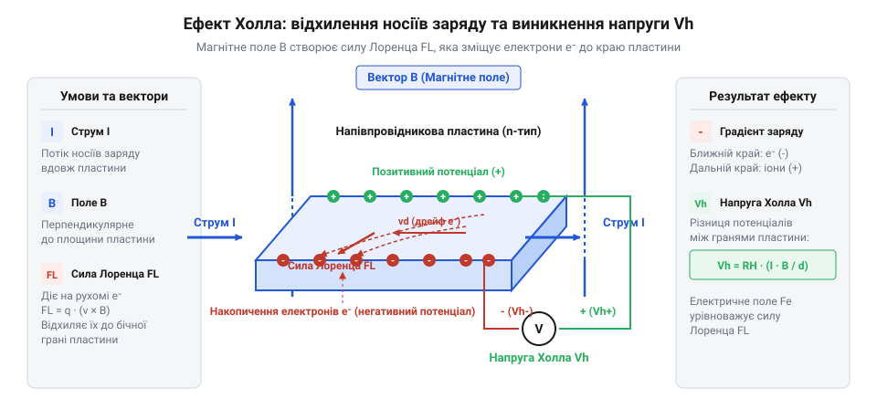
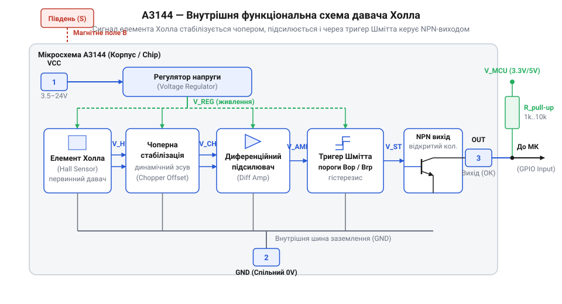
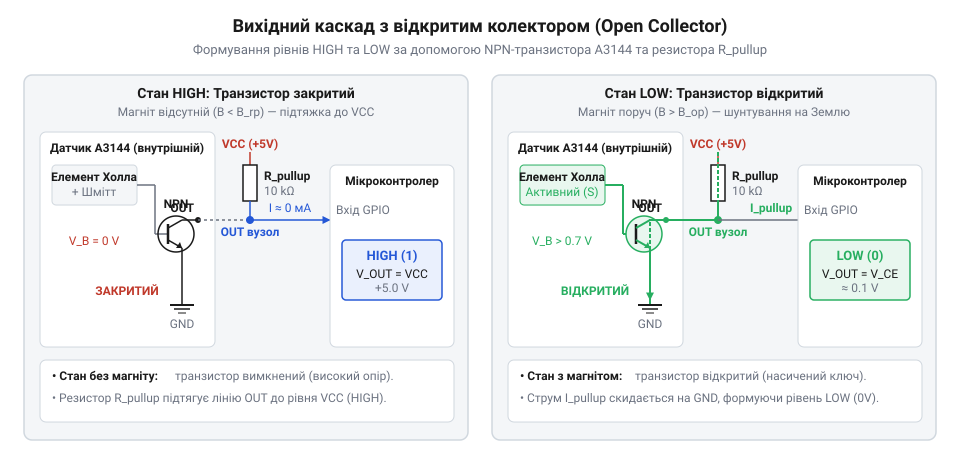

# A3144 — модуль давача Холла

<preknowlist>
- [KY-021 — міні герконовий давач](root:cat-hw-sensors/ky-021-reed) — Принцип роботи механічних герконів, явище дребезгу контактів та обмеження механічного перемикання під дією магнітного поля.
- [KY-003 / KY-024 — давач Голла](root:cat-hw-sensors/ky-003-hall) — Базові уявлення про застосування ефекту Холла в модулях сумісних із платами Arduino.
</preknowlist>

## Дребезг і знос механічних кінцевиків

Контроль положення механізмів чи підрахунок обертів за допомогою механічних кнопок або [герконових датчиків](root:cat-hw-sensors/ky-021-reed) супроводжується неминучою проблемою. Під час зіткнення металеві контакти пружинять, створюючи @@en|брязкіт@@ (англ. *contact bounce* — дребезг контактів) — серію хаотичних імпульсів замість одного чіткого перемикання. Мікроконтролер сприймає це як множинні клацання, що збиває підрахунок деталей чи виклики апаратних переривань. Крім того, фізичний знос, окиснення та мікродугові розряди швидко виводять механіку з ладу. Цифровий давач @@en|A3144@@ позбавлений рухомих частин: це твердотільний напівпровідник, який реагує на магніт без фізичного контакту.

## Ефект Холла у напівпровідниковому елементі

В основі роботи сенсора лежить @@en|ефект Холла@@ (англ. *Hall effect* — на честь фізика Едвіна Холла). Коли крізь напівпровідникову пластину протікає струм живлення, а перпендикулярно до неї діє магнітне поле, на носії заряду впливає @@en|сила Лоренца@@ (англ. *Lorentz force*). Вона відхиляє електронний потік до однієї з бічних граней пластини.


*Сила Лоренца зсуває рухомі заряди до бічної грані, утворюючи поперечну напругу Холла.*

На накопичених зарядах виникає поперечна @@en|напруга Холла@@, яка прямо пропорційна магнітній індукції. Проте ця первинна напруга становить лише одиниці мікровольт, тому цифровий вхід мікроконтролера не здатний зафіксувати її безпосередньо.

## Диференціальний підсилювач та тригер Шмітта

Щоб перетворити слабкий сигнал на чіткі цифрові рівні, усередині чипа @@en|A3144@@ інтегровано первинне оброблення сигналу. Внутрішній @@en|диференціальний підсилювач@@ масштабує напругу, а @@en|чоперна стабілізація@@ (від англ. *chopper* — переривач) нейтралізує температурний дрейф нуля.


*Підсилювач і тригер Шмітта з гістерезисом перетворюють аналоговий сигнал сенсора на стабільний цифровий рівень.*

Потім підсилений сигнал надходить на @@en|тригер Шмітта@@ (англ. *Schmitt trigger*). Він має магнітний @@en|гістерезис@@ (від грец. *hysteresis* — запізнення): вихід вмикається при досягненні порогу спрацьовування `Bop`, а вимикається лише при зниженні поля до порогу відпускання `Brp`. Завдяки такій різниці порогів вібрації або повільний рух магніту не викликають хаотичних завад на виході.

## Схемотехніка виходу з відкритим колектором

Вихідний каскад мікросхеми @@en|A3144@@ побудовано за схемою з @@en|відкритим колектором@@ (англ. *open collector*). Усередині стоїть @@en|NPN-транзистор@@, колектор якого виведено назовні без зв'язку з внутрішнім живленням.


*Внутрішній NPN-транзистор притискає вихід до землі під дією магніту, а підтягувальний резистор повертає високий рівень за його відсутності.*

Коли магніт поруч, транзистор відкривається і з'єднує вихід із землею `GND`, формуючи логічний нуль. Без магніту транзистор закривається, переводячи вихід у стан @@en|Hi-Z@@ (від англ. *High Impedance* — високий імпеданс). Щоб отримати логічну одиницю, між виходом і живленням мікроконтролера підключають @@en|підтягувальний резистор@@ номіналом `10 кОм`. Це дає змогу безпечно узгоджувати давач із контролерами на 3.3 В або 5 В.

## Уніполярна чутливість до південного полюса

Мікросхема @@en|A3144@@ є @@en|уніполярним давачем@@ (від лат. *unus* — один та *polus* — полюс), тобто реагує виключно на південний полюс магніту (`S`), прикладений до її плоскої маркованої грані. Північний полюс (`N`) або наближення південного полюса з тильного боку корпус ігнорує, на відміну від [біполярних датчиків Холла](root:cat-hw-sensors/ss41f-hall). Для найчіткішого перемикання магніт орієнтують південним полюсом до лицьового боку чипа, а його рух спрямовують тангенціально (збоку впоперек грані), що забезпечує найкрутіший фронт зміни магнітного потоку.

## Побудова надійних вузлів зчитування обертів

У реальних пристроях давач працює поруч із двигунами, які створюють електромагнітні завади. Для захисту сигнальної лінії паралельно виходу встановлюють керамічний конденсатор ємністю `0.1 мкФ` безпосередньо біля модуля. У мікроконтролері зчитування організовують через апаратне переривання за спадаючим фронтом напруги (перехід з високого рівня в низький). При побудові @@en|тахометра@@ (від грец. *tachos* — швидкість та *metreo* — вимірюю) частоту обертання обчислюють за формулою:

```
f = N / (m * t)     [кількість імпульсів ділиться на число магнітів та час]
```

Де `N` — кількість зафіксованих спадаючих фронтів за час `t`, а `m` — кількість магнітів на валу. Відсутність механічного тертя забезпечує безвідмовну роботу тахометрів та кінцевих вимикачів протягом багатьох років.
