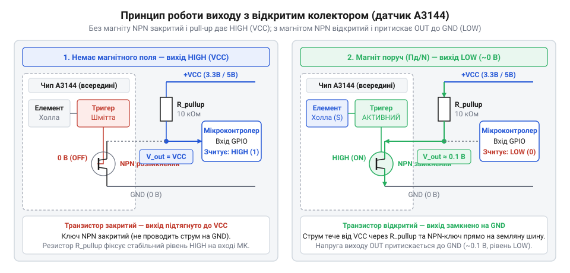
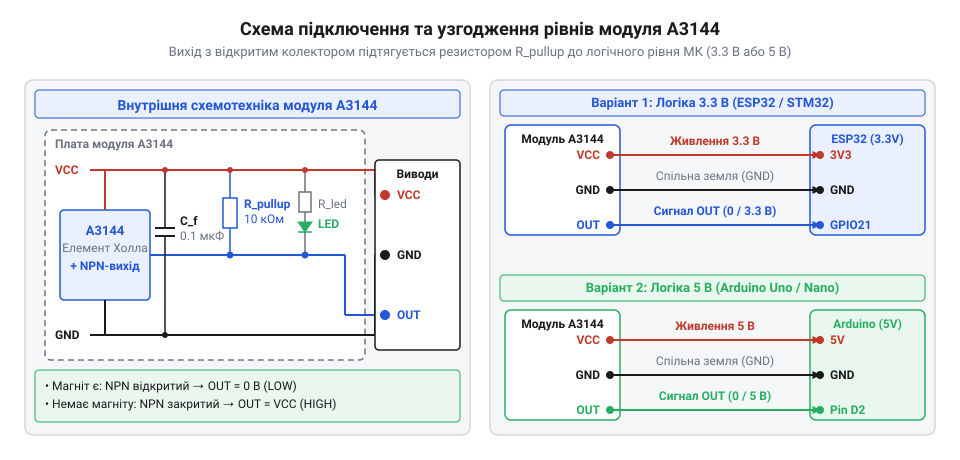

# Залізна схемотехніка: розводка ніжок, підтяжка виходу та живлення модуля A3144

<preknowlist>
- [KY-003 / KY-024 — давач Голла](root:cat-hw-sensors/ky-003-hall) — Базові уявлення про застосування ефекту Холла в готових платах модулів.
- [SS41F — цифровий давач Холла](root:cat-hw-sensors/ss41f-hall) — Принцип роботи цифрового порогового давача з дискретним виходом.
</preknowlist>

## Невизначений стан плаваючого цифрового входу

Підключення первинного напівпровідникового давача безпосередньо до вхідного порту мікроконтролера часто спричиняє непередбачувану поведінку системи. Коли електрична лінія не має чіткої прив'язки до джерела напруги або землі, вихідний каскад опиняється у стані @@en|високого імпедансу@@ (англ. *high impedance*, від лат. *impedio* — перешкоджати), відомому як @@en|High-Z@@. У цьому стані фізичний провідник діє як антена: він накопичує статичний заряд та вловлює навколишні @@en|електромагнітні завади@@.

У результаті потенціал на цифровому вході хаотично коливається між `0 В` та напругою живлення. Коли цей плаваючий потенціал опиняється в проміжній пороговій зоні, вхідний буфер мікроконтролера на базі @@en|CMOS@@ потрапляє в нелінійний режим. У цьому стані комплементарні p-канальний та n-канальний транзистори вхідного каскаду відкриваються одночасно. Пряме з'єднання лінії живлення із землею через відкриті напівпровідникові канали викликає @@en|наскрізний струм@@ (англ. *shoot-through current*), який спричиняє перевитрату енергії та розігріває кристал. Навіть дрібні електромагнітні наведення навколо порогу спрацьовування змушують буфер постійно змінювати вихідний стан, що викликає лавину хибних переривань у мікроконтролері. На відміну від контактних пристроїв, де застосовують [геркон у скляній колбі](root:cat-hw-sensors/ky-025-reed), чи інтегральних датчиків, як-от [цифровий давач Холла](root:cat-hw-sensors/ss41f-hall), дискретний сигнал із відкритим каскадом вимагає примусового схемотехнічного фіксування логічного рівня. Щоб забезпечити стабільне зчитування станів, вихідну лінію необхідно притискати до фіксованої напруги за допомогою зовнішнього елемента.

## Вихідний каскад з відкритим колектором

Модуль давача Холла @@en|A3144@@ має три основні контактні виводи: @@en|VCC@@ для подачі живлення, @@en|GND@@ для підключення до спільного проводу та @@en|OUT@@ для знімання цифрового сигналу. Внутрішня схемотехніка виходу побудована на основі @@en|NPN-транзистора@@ (від англ. *transfer resistor* — перехідний опір), увімкненого за схемою з @@en|відкритим колектором@@ (англ. *open collector*, від лат. *collector* — збирач). Колекторний вивід транзистора виведено напряму на контакт @@en|OUT@@ без жодного внутрішнього з'єднання з шиною @@en|VCC@@, а емітер жорстко підключено до @@en|GND@@.

Коли до лицьового боку корпусу @@en|A3144@@ наближається південний полюс магніту, первинний елемент Холла фіксує зростання магнітної індукції. Внутрішній @@en|тригер Шмітта@@ перемикається тоді, коли рівень індукції досягає порогу спрацьовування `B_OP` (від англ. *operating point* — точка спрацьовування). У цей момент тригер відкриває вихідний @@en|NPN-транзистор@@ у стан насичення та з'єднує вивід @@en|OUT@@ із землею @@en|GND@@, знижуючи напругу на виході до низького логічного рівня `V_OL ≈ 0.2–0.4 В`. При віддаленні магніту давач не вимикається одразу на позначці `B_OP`, а утримує транзистор відкритим до падіння індукції нижче порогу відпускання `B_RP` (від англ. *release point* — точка відпускання). Різниця між цими порогами утворює @@en|магнітний гістерезис@@ (від грец. *hysteresis* — відставання), який відсікає вплив дрібних флуктуацій поля та вібрацій біля межі спрацьовування, запобігаючи утворенню хибних імпульсів.

За відсутності магнітного поля @@en|NPN-транзистор@@ повністю закривається. Електричний контакт між @@en|OUT@@ та @@en|GND@@ розривається, і лінія виходу переходить у стан @@en|High-Z@@. Оскільки внутрішнього джерела напруги на виході немає, модуль самостійно не формує високий логічний рівень. Без зовнішнього струмового кола потенціал лінії @@en|OUT@@ знову стає невизначеним.


*Принципова схема вихідного каскаду з NPN-транзистором та підтягувальним резистором.*

## Розрахунок підтягувального резистора вихідної лінії

Для формування високого логічного рівня за закритого транзистора між виводом @@en|OUT@@ та шиною живлення вмикають зовнішній @@en|підтягувальний резистор@@ (англ. *pull-up resistor*, від лат. *resisto* — опиратися) `R_pullup`. Вибір опору цього резистора є компромісом між завадостійкістю кола, струмом споживання та швидкістю наростання фронту сигналу.

Зменшення опору (наприклад, до `1 кОм`) забезпечує так звану сильну підтяжку. Це пришвидшує заряджання паразитної ємності сполучної лінії `C_line` та гарантує високу завадостійкість. Проте під час спрацьовування давача відкритий @@en|NPN-транзистор@@ змушений пропускати більший струм `I_OL = VCC / R_pullup`, що збільшує енергоспоживання системи. Збільшення опору до `10 кОм` або використання внутрішніх резисторів мікроконтролера (`20–50 кОм`) мінімізує струм, але утворює з паразитною ємністю кабелю @@en|RC-ланцюг@@, який завалює прямокутні фронти імпульсів на високих частотах перемикання.

Мінімально припустимий опір резистора `R_min` розраховують за гранично допустимим струмом колектора відкритого транзистора `I_OL_max`:

Верхнє обмеження опору `R_max` визначається двома фізичними чинниками: допустимим спадом напруги на постійному струмі та швидкістю заряджання ємності лінії. У статичному стані, коли транзистор давача закритий, цифровий вхід мікроконтролера споживає незначний @@en|струм витоку@@ (англ. *leakage current*, від англ. *leak* — протікати) `I_leak`. Цей струм створює на підтягувальному резисторі спад напруги `I_leak × R_pullup`, через що потенціал на виводі зменшується порівняно з напругою живлення `VCC`. Щоб мікроконтролер надійно розпізнавав високий логічний рівень, напруга на його вході не повинна опускатися нижче мінімальної порогової напруги високого рівня `V_IH_min`. У динамічному режимі закривання транзистора викликає процес заряджання паразитної ємності лінії `C_line` через резистор `R_pullup`. Формований @@en|RC-ланцюг@@ визначає @@en|час наростання фронту@@ (англ. *rise time*) `t_r`, який для прямокутних імпульсів становить `2.2 × R_pullup × C_line`. Якщо цей час перевищує максимально допустимий інтервал `t_r_max`, прямокутний сигнал спотворюється, і високі частоти перемикання втрачаються. Максимально допустимий опір `R_max` обчислюють як найменше значення між статичною та динамічною межами:

```
R_max = min((VCC - V_IH_min) ÷ I_leak, t_r_max ÷ (2.2 × C_line))
      = min((5.0 - 3.5) ÷ 0.000001, 0.000001 ÷ (2.2 × 50 × 10⁻¹²))  [підстановка для VCC = 5 В, V_IH_min = 3.5 В, I_leak = 1 мкА, C_line = 50 пФ, t_r_max = 1 мкс]
      = min(1 500 000, 9090)                                        [обчислення статичної та динамічної меж в Омах]
      = 9.09 кОм                                                    [максимально припустимий опір за часом наростання фронту]
```

Розрахунок показує, що саме динамічна ємність лінії `C_line` разом із вимогами до швидкості фронту `t_r_max` жорстко обмежує опір підтяжки згори значенням близько `9.1 кОм`, тоді як витік струму входу дозволив би резистор до `1.5 МОм`. Тому підтяжка опором `10 кОм` є граничною для довгих ліній чи високих частот, а опір `4.7 кОм` забезпечує необхідний запас за швидкістю наростання сигналу.

```
R_min = (VCC - V_OL) ÷ I_OL_max
      = (5.0 - 0.4) ÷ 0.005      [підстановка для VCC = 5 В та безпечного струму I_OL = 5 мА]
      = 920 Ом                    [мінімальний безпечний опір підтяжки]
```

На практиці для ліній зв'язку довжиною до `0.5 м` оптимальним вибором є опори `4.7 кОм` або `10 кОм`. Вони забезпечують круті фронти сигналу та не перевантажують вихідний каскад давача.

## Узгодження логічних рівнів живлення та сигналу

Модуль @@en|A3144@@ розрахований на широкий діапазон напруги живлення від `4.5 В` до `24 В`, що робить його універсальним для промислових та аматорських систем. Головною перевагою схемотехніки з @@en|відкритим колектором@@ є повна електрична ізоляція між напругою живлення самого давача та напругою логічного сигналу на виході.

При підключенні модуля з живленням `5 В` до мікроконтролерів із логічним рівнем `3.3 В` (наприклад, @@en|ESP32@@ або @@en|STM32@@) @@en|підтягувальний резистор@@ `R_pullup` підключають не до `5 В`, а до шини `3.3 В` платформи. Коли вихідний @@en|NPN-транзистор@@ закритий, напруга на лінії @@en|OUT@@ піднімається рівно до `3.3 В`, що унеможливлює пошкодження вхідних портів @@en|GPIO@@ мікроконтролера. Під час відкривання транзистора лінія притискається до `0 В`, утворюючи повноцінний логічний нуль.

Серйозний ризик виникає тоді, коли при живленні модуля напругою `5 В` у програмі мікроконтролера помилково вмикають внутрішню програмну підтяжку @@en|INPUT_PULLUP@@ до шини `5 В` або використовують зовнішній @@en|підтягувальний резистор@@, підключений до 5-вольтового живлення. У такому разі на вхідний вивід @@en|GPIO@@ мікроконтролера з логікою `3.3 В` (наприклад, @@en|ESP32@@ або @@en|STM32@@) потрапляє потенціал `5 В`, який перевищує допустиму напругу живлення чипа. Це змушує відкриватися вбудовані захисні діоди порту, через які струм з лінії `5 В` починає витікати безпосередньо у внутрішню шину `3.3 В` платформи. Внаслідок цього виникає ефект паразитного живлення мікроконтролера, збої в роботі суміжної периферії та небезпека теплового пробою вхідного каскаду @@en|GPIO@@.

Для платформ із 5-вольтовою логікою (наприклад, @@en|Arduino@@ Uno) резистор `R_pullup` з'єднують із шиною `5 В`. Допускається також використання вбудованого програмного підтягування `INPUT_PULLUP`, проте для виносних датчиків із довгими проводами завжди рекомендується встановлювати зовнішній дискретний резистор безпосередньо біля плати мікроконтролера.


*Схема підключення модуля A3144 до мікроконтролерів із логікою 3.3 В та 5 В.*

## Фільтрація живлення та індикація спрацьовування

Для забезпечення стабільної роботи модуля в умовах імпульсних завад шину живлення необхідно шунтувати. Паралельно виводам @@en|VCC@@ та @@en|GND@@ безпосередньо на платі модуля встановлюють розв'язувальний керамічний @@en|конденсатор@@ (від лат. *condensare* — згущувати) ємністю `0.1 мкФ` (100 нФ).

Цей @@en|конденсатор@@ фільтрує високочастотні сплески напруги та компенсує локальні падіння потенціалу під час внутрішнього перемикання компаратора давача. Без фільтрації імпульсні завади в колі живлення можуть викликати ложні спрацьовування тригера Шмітта навіть за відсутності магнітного поля.

Більшість планок модулів @@en|A3144@@ додатково оснащені вбудованим індикатором на основі @@en|світлодіода@@ (англ. *LED*, від грец. *di* — дво- та *hodos* — шлях). @@en|Світлодіод@@ підключають послідовно з @@en|струмообмежувальним резистором@@ опором близько `1 кОм` між шиною @@en|VCC@@ та лінією @@en|OUT@@. При появі магнітного поля відкритий @@en|NPN-транзистор@@ замикає коло на землю, і @@en|світлодіод@@ засвічується. Це дозволяє візуально контролювати спрацьовування давача без підключення осцилографа чи логічного аналізатора, додаючи до загального споживання модуля додатково `2–3 мА` струму під час активності.
