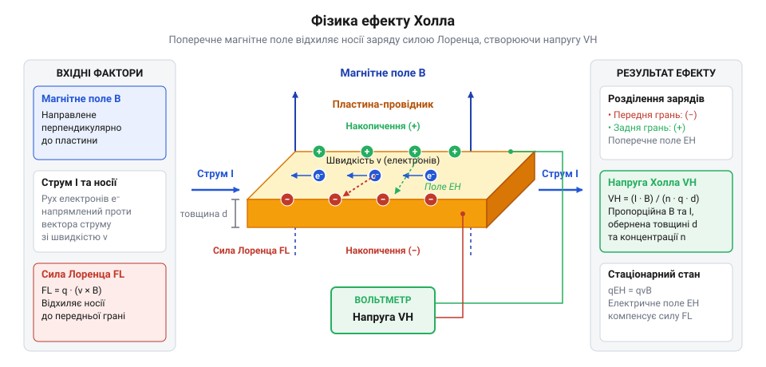
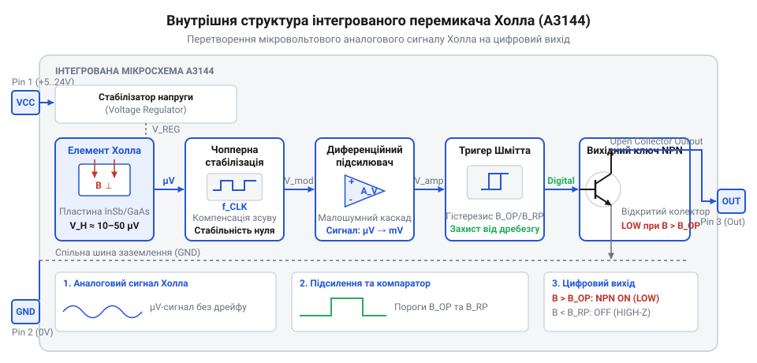

# Від виявлення ефекту Холла до інтегрованих напівпровідникових перемикачів

<preknowlist>
- [KY-025 — геркон у скляній колбі](root:cat-hw-sensors/ky-025-reed) — принципи функціонування механічних герконових контактів та їхні обмеження щодо зношування й швидкодії
- [KY-003 / KY-024 — давач Голла](root:cat-hw-sensors/ky-003-hall) — загальне уявлення про практичне застосування модулів Холла у платах розширення мікроконтролерів
</preknowlist>

## Механічні обмеження та відкриття Едвіна Холла

До появі електронних магнітних сенсорів безконтактне перемикання опиралося на [механічні герконові перемикачі](root:cat-hw-sensors/ky-025-reed). Усередині герметичної скляної колби розміщувалися пружні феромагнітні контакти, які замикалися під дією зовнішнього магнітного поля. Проте механічні системи стикалися з непереборними фізичними обмеженнями: обмеженою швидкодією (одиниці мілісекунд), неминучим механічним зношуванням контактних груп під час іскріння та явищем деренчання контактів при перемиканні.

У 1879 році американський фізик @@en|Едвін Холл@@ у лабораторії Університету Джонса Гопкінса проводив експерименти, намагаючись перевірити гіпотезу, яку висунув @@en|Джеймс Клерк Максвелл@@. Максвелл припускав, що магнітне поле діє безпосередньо на сам провідник зі струмом, а не на рухомі електричні заряди всередині нього.

Щоб з'ясувати істину, Холл розмістив тонку пластину з золотого листа у сильному магнітному полі, перпендикулярному до напрямку електричного струму, і виміряв різницю потенціалів між її бічними гранями. Виявилося, що під дією магнітного поля на бічних гранях пластини дійсно виникає поперечна напруга — явище, яке отримало назву @@en|ефект Холла@@.

Фізичний механізм цього явища описується дією електромагнітних сил. Коли носії заряду рухаються крізь провідник зі швидкістю дрейфу, на них діє @@en|сила Лоренца@@, спрямована перпендикулярно як до вектора струму, так і до вектора магнітної індукції. Сила Лоренца змушує електрони відхилятися до однієї з бічних граней пластини. Внаслідок цього на одній грані накопичується надлишок негативного заряду, а на протилежній утворюється його нестача (позитивний заряд). Зміщення зарядів триває доти, доки створене ними внутрішнє поперечне електричне поле не збалансує дію магнітної сили. Сформована поперечна різниця потенціалів — це @@en|холлавська напруга@@.

U_H = R_H × (I × B / d)       [розрахунок холлавської напруги через струм і поле]
    = (1 / (n × q)) × (I × B / d) [підстановка коефіцієнта Холла через концентрацію носіїв]

де R_H — @@en|коефіцієнт Холла@@, I — струм у провіднику, B — індукція магнітного поля, d — товщина пластини, n — об'ємна концентрація носіїв заряду, а q — заряд електрона.

Головним інженерним бар'єром металевих елементів виявилася висока концентрація вільних електронів у металах (n ≈ 10²⁸ m⁻³). Оскільки @@en|коефіцієнт Холла@@ обернено пропорційний концентрації носіїв n, вихідна @@en|холлавська напруга@@ в металах складала лише частки мікровольта (μV). Наприкінці XIX століття за відсутності електронного підсилення такий слабкий сигнал губився у шумах і не міг використовуватися для практичного керування чи вимірювання.

*Відхилення носіїв заряду під дією магнітного поля утворює поперечну різницю потенціалів на протилежних гранях провідника.*

## Перехід до напівпровідників і подолання мікровольт

Понад пів століття @@en|ефект Холла@@ залишався лабораторним методом дослідження властивостей металів. Переломний момент стався у середині XX століття з ростом фізики твердого тіла та появою перших матеріалів, класифікованих як @@en|напівпровідник@@ (германій, кремній, антимонід індію InSb, арсенід індію InAs).

У напівпровідникових матеріалах концентрація вільних носіїв заряду n на кілька порядків нижча, ніж у металах (n ≈ 10¹⁵ - 10¹⁸ cm⁻³). Оскільки @@en|холлавська напруга@@ U_H обернено пропорційна n, зменшення кількості носіїв підняло вихідну напругу з мікровольт (μV) до десятків і сотень мілівольт (mV). Крім того, такі сполуки як антимонід індію мали надзвичайно високу @@en|рухливість носіїв заряду@@, що забезпечувало швидкий відгук навіть на слабкі магнітні поля.

Проте перехід на @@en|напівпровідник@@ створив нові інженерні виклики:

1. @@en|температурний дрейф@@ — у напівпровідниках концентрація носіїв заряду та їхня рухливість суттєво залежать від температури. При нагріванні вихідний сигнал зміщується навіть за постійного магнітного поля.
2. Початкове зміщення напруги — дефекти кристалічної ґратки та несиметричність контактів викликали наявність паразитної напруги на виході навіть за відсутності магнітного поля.
3. Аналогова природа сигналу — вихідні мілівольти плавно змінювалися пропорційно полю й вимагали складних зовнішніх схем узгодження для роботи з цифровою логікою.

## Інтеграція підсилювача та тригера на кристалі

Використання дискретних напівпровідникових пластин вимагало громіздких зовнішніх плат із транзисторами для підсилення мілівольт і компенсації температури. Наприкінці 1960-х років розвиток планарної технології дозволив об'єднати сенсорний елемент та електронне обв'язування на єдиній монолітній кремнієвій матриці — з'явилася @@en|інтегральна схема@@ Холла.

Монолітна структура цифрового перемикача об'єднала чотири ключові блоки: первинний напівпровідниковий елемент Холла для сприйняття магнітного поля, @@en|диференційний підсилювач@@ для підсилення мілівольтового сигналу та пригнічення синфазних завад, (від нім. Trigger — спусковий гачок) @@de|тригер Шмітта@@ для формування дискретного виходу та вихідний транзисторний ключ із схемотехнікою @@en|відкритий колектор@@. Безпосередня передача аналогового сигналу з підсилювача створювала б хибні перемикання й брязкіт виходу через електричні шуми та флуктуації магнітного поля поблизу порогу спрацьовування. Щоб забезпечити чітку двопозиційну комутацію, @@de|тригер Шмітта@@ використовує @@en|позитивний зворотний зв'язок@@, який подає частину вихідного сигналу назад на свій вхідний вузол. Коли підсилена напруга Холла зростає й досягає верхнього порогу спрацьовування `B_OP`, позитивний зворотний зв'язок миттєво змінює стан схеми й стрибком зміщує внутрішній поріг порівняння вниз до рівня відпускання `B_RP`. Різниця між цими порогами створює магнітний (від грец. hystēresis — відставання) @@el|гістерезис@@, який утворює зону нечутливості. Усередині цієї зони дрібні шуми й флуктуації поля не здатні змінити стан виходу, що повністю усуває завади та брязкіт сигналу. Ціною цього є втрата чутливості до дрібних змін магнітної індукції, які не перевищують ширину гістерезису. Схема ламається, якщо при віддаленні магніту залишкове поле не опускається нижче порогу `B_RP`: у цьому разі тригер залишається заблокованим у включеному стані й не фіксує наступні події.

1. Напівпровідниковий елемент Холла, що сприймає магнітну індукцію.
2. @@en|диференційний підсилювач@@ — підсилює мілівольтовий сигнал пластини й пригнічує синфазні завади та початкове зміщення.
3. (від англ. trigger — спусковий гачок) @@en|тригер Шмітта@@ — перетворює плавний аналоговий сигнал на чіткі логічні рівні. Він додає (від грец. hystēresis — відставання) @@el|гістерезис@@: поріг спрацьовування B_OP вищий за поріг відпускання B_RP. Це усуває брязкіт і хибні перемикання сигналу, коли магніт перебуває на межі чутливості.
4. Вихідний транзисторний ключ — схема типу @@en|відкритий колектор@@, що дозволяє напряму комутувати навантаження чи підключатися до входів мікроконтролерів.

Саме так з'явилися уніполярні перемикачі серії @@en|A3144@@. Вони відкриваються при наближенні південного полюса магніту й закриваються при його віддаленні. На відміну від аналогових рішень, де відгук залишається лінійним (як у [модулях давача Холла](root:cat-hw-sensors/ky-003-hall)), або дискретних елементів на кшталт тих, які використовують [дискретні цифрові давачі](root:cat-hw-sensors/ss41f-hall), інтегровані перемикачі забезпечують мільйони циклів спрацьовування без зношування й швидкодію до десятків кілогерц.

Історично виведення таких інтегрованих схем на ринок супроводжувалося міфами щодо авторства. Хоча поширене уявлення пов'язує появу перших датчиків виключно з твердотілими клавіатурами компанії Honeywell Micro Switch 1968 року, створення напівпровідникових перемикачів було результатом паралельних досліджень багатьох лабораторій, які шукали надійну заміну механічним контактам.

*Інтеграція підсилювача, тригера Шмітта та транзисторного ключа на одному кристалі перетворює слабкий аналоговий відгук на завадостійкий цифровий сигнал.*

## Поява серії A3144 та уніполярний перемикач

Промислове виробництво тривалий час потребувало надійного способу зчитування обертів та положення валів. Традиційні [механічні герконові контакти](root:cat-hw-sensors/ky-025-reed) та подібні елементи у [мініатюрних герконових модулях](root:cat-hw-sensors/ky-021-reed) швидко зношувалися від іскріння й мали обмежену швидкодію. Інженерним відповідником цій потребі стала поява інтегрованої мікросхеми @@en|A3144@@ від компанії @@en|Allegro MicroSystems@@. У цьому монолітному датчику реалізували @@en|unipolar switch@@ (від лат. *unus* — один, *polus* — полюс; уніполярний перемикач) алгоритм спрацьовування: кристал реагує виключно на один магнітний полюс (зазвичай південний). Коли напруженість поля перевищує поріг включення `B_OP`, вихідний транзистор відкривається і формує низький рівень сигналу. При віддаленні магніту та падінні поля нижче порогу виключення `B_RP` вихід повертається у високий стан, а різниця між цими порогами утворює гістерезис `B_HYS`, який усуває брязкіт сигналу на межі спрацьовування.

Щоб забезпечити легке поєднання датчика з різними цифровими системами, вихід @@en|A3144@@ спроєктували за схемою @@en|open collector@@ (від англ. *open* — відкритий, *collector* — колектор; відкритий колектор). Внутрішній транзистор працює лише як керований ключ на спільний провід при спрацьовуванні: коли магнітне поле перевищує поріг, транзистор відкривається і швидко розряджає лінію. Зовнішній @@en|pull-up@@ (від англ. *pull up* — підтягувати; підтягувальний резистор) підтягує вихід до напруги живлення логіки мікроконтролера (наприклад, 3.3 В або 5 В), коли транзистор закритий. Це звільнило розробників від використання узгоджувачів рівнів і зробило сенсор основою для стандартних плат розширення, таких як [модулі давача Холла](root:cat-hw-sensors/ky-003-hall). Проте така схема створює інженерний компроміс між швидкодією та струмовим навантаженням. Швидкість наростання фронту сигналу під час розмикання ключа визначається часом заряджання паразитної ємності лінії через підтягувальний резистор. Занадто великий опір підтяжки затягує відновильний процес і завалює передній фронт імпульсу, що обмежує граничну частоту зчитування швидких обертів. Занадто малий опір забезпечує крутий фронт, але змушує відкритий транзистор пропускати високий струм виходу, що призводить до його перегріву та нездатності опустити потенціал до логічного нуля. Детальні технічні характеристики, принципову схему та особливості практичного застосування ви знайдете в матеріалі про [уніполярний цифровий перемикач Холла A3144](root:cat-hw-sensors/a3144-hall-module).

## Розвінчання міфів та реальна хронологія

Масове поширення напівпровідникових магнітодавачів породило низку історичних міфів. Найпоширеніша помилка приписує Едвіну Холлу винахід сучасних мікросхем. Утім, у 1879 році фізик виявив лише фундаментальний ефект у тонкій золотій пластинці, тоді як до появи першої монолітної кремнієвої схеми минуло майже дев'ять десятиліть. Інша омана стверджує, що датчики Холла від початку створювалися як універсальні перемикачі для широкої електроніки. Насправді перші серійні напівпровідникові сенсори створив підрозділ @@en|Micro Switch@@ корпорації @@en|Honeywell@@ у 1968 році суто для безконтактних клавіатур ЕОМ, де потрібна була повна відсутність брязкіту контактів.

Реальна хронологія свідчить, що еволюція магнітометрії була результатом тривалої роботи корпоративних лабораторій. У 1970–1980-х роках компанії @@en|Honeywell@@ та @@en|Sprague Electric@@ (чиє напівпровідникове крило згодом утворило @@en|Allegro MicroSystems@@) адаптували напівпровідникові елементи для автомобільної промисловості — давачів розподільника запалювання та систем @@en|ABS@@ (від англ. *anti-lock braking system* — антиблокувальна система гальм). Саме тоді з'явилася спеціалізація ключових алгоритмів: уніполярні, двополярні та бістабільні перемикачі, прикладом яких є [двополярні давачі Холла](root:cat-hw-sensors/ss41f-hall). Розвиток монолітних структур дозволив поєднати елемент Холла не лише з тригерами, а й з вимірювальними підсилювачами, що відкрило шлях до створення пристроїв на кшталт [вимірювачів струму Холла](root:cat-hw-sensors/acs712-current-sensor-module). Отже, серія @@en|A3144@@ стала результатом поетапної промислової адаптації технології, а не раптовою поодинокою інновацією.
