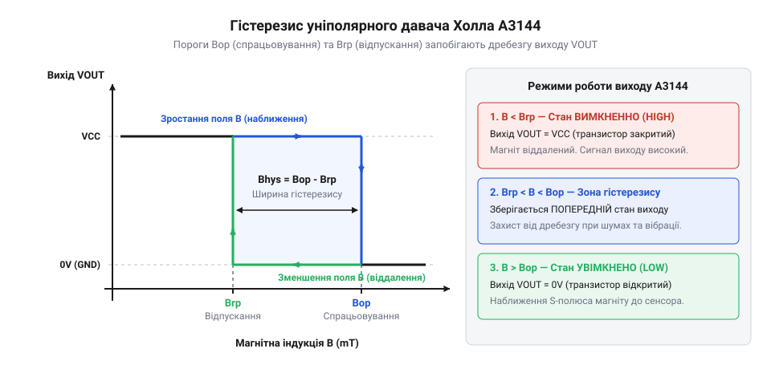

# Математичний опис порогів спрацьовування та гістерезису

<preknowlist>
- [KY-003 / KY-024 — давач Голла](root:cat-hw-sensors/ky-003-hall) — Принцип роботи цифрового виходу з відкритим колектором та принципова схема підключення модуля.
</preknowlist>

## Проблема деренчання сигналу при вібраціях

У практичних задачах автоматизації інтегральний @@en|давач Холла@@ @@en|A3144@@ найчастіше застосовують для фіксації положення рухомих деталей або вимірювання швидкості обертання валів. Постійний магніт закріплюють на рухомому елементі, і при кожному його наближенні до мікросхеми вихідний компаратор змінює свій стан, формуючи цифровий сигнал для зовнішнього @@en|мікроконтролер@@. Як описує базовий [модуль давача Холла](root:cat-hw-sensors/ky-003-hall), вихід пристрою побудовано за схемою з відкритим колектором, що дає змогу легко формувати прямокутні логічні імпульси.

Уявімо спрощену математичну модель, у якій внутрішня схема давача має лише один фіксований поріг порівняння `B_th`. Коли магніт наближається, нормальна складова магнітної індукції `B` зростає, і в момент досягнення умови `B ≥ B_th` вихід давача миттєво перемикається з високого логічного рівня у низький. Коли магніт віддаляється і значення індукції спадає нижче `B_th`, вихід повертається у початковий високий стан.

Однак реальне механічне обладнання завжди має люфти, радіальне биття та технологічні вібрації. Якщо магніт зупиниться або рухатиметься повільно саме в околиці критичної відстані, де індукція поля близька до `B_th`, найменші механічні коливання призведуть до того, що індукція `B` буде хаотично перетинати поріг `B_th` десятки разів на секунду.

Для виходу компаратора це означає постійну зміну стану між логічним нулем та одиницею. Виникає @@en|брязкіт сигналу@@ (англ. signal chatter) — високочастотна серія хибних імпульсів. На відміну від механічних контактів, де [герконові давачі](root:cat-hw-sensors/ky-021-reed) зазнають фізичного пружного відскоку пелюсток, у напівпровідниковому сенсорі цей шум має чисто електронну та магнітну природу. Зовнішній лічильник імпульсів зафіксує сотні хибних обертів вала замість одного.

Звідси випливає фундаментальний висновок: єдиний поріг спрацьовування принципово не здатний відрізнити корисне переміщення магніту від дрібних вібрацій та зовнішнього шуму. Щоб усунути нестабільність, система повинна мати дві роздільні точки перемикання: одна для ввімкнення виходу при зростанні поля, а друга — для його вимкнення при спаданні.

## Пороги індукції та петля гістерезису

Розділення точок перемикання реалізується за допомогою внутрішнього компаратора зі спеціальною характеристикою — @@en|тригер Шмітта@@ (названий на честь винахідника Отто Шмітта, англ. Schmitt trigger). Він формує магнітний @@el|гістерезис@@ (від грец. hysterein — відставати, запізнюватися), розділяючи реагування давача на два незалежні пороги індукції.

Перший поріг — поріг спрацьовування @@en|Bop@@ (англ. Magnetic Operate Point). Коли індукція південного полюса магніту `B` зростає і досягає значення `B ≥ B_op`, тригер змінює стан і вихідний транзистор вмикається, переводячи цифровий вихід у низький рівень (логічний 0). 

Другий поріг — поріг відпускання @@en|Brp@@ (англ. Magnetic Release Point). Щоб вихідний транзистор закрився і вихід повернувся у високий рівень (логічна 1), індукція має зменшитися до значення `B ≤ B_rp`.

Різниця між цими порогами визначає ширину зони гістерезису `B_hys`:

```
B_hys = B_op - B_rp        [визначення ширини гістерезису]
```

де позначено такі величини:
- `B_hys` — ширина магнітного гістерезису (у теслах або гаусах);
- `B_op` — поріг індукції спрацьовування (у теслах або гаусах);
- `B_rp` — поріг індукції відпускання (у теслах або гаусах).


*Залежність стану цифрового виходу давача від індукції магнітного поля B з двома порогами Bop та Brp.*

Як видно з графіка, графічна залежність стану виходу від індукції утворює прямокутну петлю. Якщо після досягнення `B_op` індукція починає коливатися через вібрації у межах інтервалу від `B_rp` до `B_op`, стан виходу залишається незмінним — низьким. Перемикання відбудеться лише тоді, коли сигнал гарантовано вийде за межі петлі гістерезису. 

Модуль @@en|A3144@@ є уніполярним сенсором: його пороги `B_op` та `B_rp` лежать виключно у позитивній області індукції південного полюса магніту. Це відрізняє його від [двополярних давачів SS41F](root:cat-hw-sensors/ss41f-hall), яким для зміни стану потрібна зміна полярності поля. Для мікросхеми @@en|A3144@@ типові паспортні значення становлять `B_op ≈ 3.5 ÷ 4.5` мТл, `B_rp ≈ 2.5 ÷ 3.5` мТл, що дає ширину гістерезису `B_hys ≈ 1.0 ÷ 1.5` мТл (1 мТл = 10 Гаус).

Знаючи порогові значення магнітної індукції в теслах, ми можемо перейти від абстрактних електричних параметрів до аналітичного розрахунку реальних геометричних відстаней спрацьовування.

## Залежність індукції від відстані й орієнтації

Щоб пов'язати магнітну індукцію `B` з відстані `r` між магнітом та сенсором, скористаємося дипольною моделлю постійного магніту. Для циліндричного @@en|неодимового магніту@@, аксіально намагніченого уздовж осі, на відстанях `r`, що перевищують розміри самого магніту, індукція на його головній осі описується виразом:

```
B(r) = (μ₀ × m) ÷ (2 × π × r³)      [індукція на осі магнітного диполя]
```

де позначено такі величини:
- `B(r)` — індукція магнітного поля на осі магніту (у теслах);
- `μ₀` — магнітна стала, що дорівнює `4 × π × 10⁻⁷` (у генрі на метр);
- `m` — магнітний дипольний момент магніту (в ампер-квадратних метрах);
- `r` — геометрична відстань від центра магніту до кристала сенсора (у метрах).

Чудовий кристал мікросхеми @@en|A3144@@ чутливий лише до нормальної складової поля, що перпендикулярна площині його корпусу. Якщо вісь магніту відхилена від нормалі сенсора на кут `θ`, ефективна індукція визначається проєкцією:

```
B_n(r, θ) = B(r) × cos(θ)      [врахування кута орієнтації]
```

де `θ` — кут між вектором магнітної індукції та нормаллю до поверхні давача.

Виразимо геометричну відстань `r` як функцію від індукції `B`, перетворивши вихідну дипольну формулу:

```
r(B) = ∛((μ₀ × m) ÷ (2 × π × B))      [відстань як функція індукції]
```

Підставивши у це рівняння паспортні пороги `B_op` та `B_rp`, отримуємо дві критичні геометричні відстані:

```
r_op = ∛((μ₀ × m) ÷ (2 × π × B_op))      [критична відстань ввімкнення]
```

```
r_rp = ∛((μ₀ × m) ÷ (2 × π × B_rp))      [критична відстань вимкнення]
```

Оскільки поріг спрацьовування більший за поріг відпускання (`B_op > B_rp`), критична відстань ввімкнення завжди менша за відстань вимкнення (`r_op < r_rp`). При наближенні магніту давач увімкнеться на відстані `r ≤ r_op`, а при віддаленні вимкнеться лише тоді, коли відстань перевищить `r ≥ r_rp`. 

Різниця `Δr = r_rp - r_op` утворює просторову зону гістерезису. Вона визначає геометричний допуск, у межах якого механічні переміщення деталі не викликають хибних спрацьовувань.

## Обчислення робочої зони та тривалості імпульсів

У динамічних системах, таких як тахометри або лічильники деталей, магніт рухається повз давач @@en|A3144@@ з лінійною швидкістю `v`. Для правильного налаштування зчитувальної електроніки необхідно знати просторові межі робочої зони та тривалість сформованого цифрового імпульсу.

Коли магніт проходить уздовж чутливого елемента на фіксованій робочій висоті `r_min`, індукція поля перевищує поріг `B_op` на певній просторовій дузі тривалістю `L_active`. Давач переходить у низький стан при вході в зону `r ≤ r_op` і повертається у високий стан при вихід за межі `r ≥ r_rp`.

Обчислимо тривалість активного низького імпульсу `t_pulse` на виході давача при відомій швидкості руху `v`:

```
t_pulse = L_active ÷ v      [тривалість вихідного імпульсу]
```

де позначено такі параметри:
- `t_pulse` — тривалість активного логічного імпульсу (у секундах);
- `L_active` — геометрична довжина зони спрацьовування з урахуванням порогів (у метрах);
- `v` — лінійна швидкість переміщення магніту відносно давача (у метрах на секунду).

Внутрішня електронна схема @@en|A3144@@ має власний час відгуку порядка `t_resp ≈ 2 × 10⁻⁶` с (2 мікросекунди), що забезпечує граничну частоту перемикання до `500` кілогерц. Проте на практиці головне обмеження накладає алгоритм зчитування в @@en|мікроконтролер@@. Тривалість імпульсу `t_pulse` повинна перевищувати період опитування входу або час обробки переривання `t_mcu`:

```
t_pulse ≥ t_mcu      [умова надійного зчитування імпульсу]
```

Крім того, отримане значення просторового гістерезису `Δr = r_rp - r_op` задає межу стійкості до механічних вібрацій. Якщо амплітуда радіального биття вала `Δx_vib` задовольняє умову:

```
Δx_vib < r_rp - r_op      [критерій захисту від вібрацій]
```

то механічні вібрації поблизу сенсора гарантовано не призведуть до повторного @@en|дребезг сигналу@@.

## Моделювання поля для захисту від завад

У реальних умовах експлуатації параметри магнітної системи зазнають дрейфу під впливом зовнішніх чинників. Для забезпечення безумовної надійності вузла зчитування математичну модель розраховують із гарантованим запасом магнітної індукції.

Основними дестабілізуючими чинниками є:
1. @@en|температурний дрейф@@: неодимові магніти втрачають близько `0.12%` індукції на кожен градус Цельсія підвищення температури. Водночас поріг спрацьовування `B_op` мікросхеми @@en|A3144@@ може змінюватися до `±15%` у робочому діапазоні від `-40` до `+85` градусів Цельсія.
2. Зовнішні магнітні завади від силових кабелів або електродвигунів.
3. Похибки механічного складання та знос підшипників, що змінюють робочий зазор `r`.

Визначимо розрахункову індукцію магніту `B_design` на максимальній робочій відстані `r_max` з урахуванням коефіцієнта запасу `K_saf`:

```
B_design(r_max) = K_saf × B_op_max      [розрахункова індукція з запасом]
```

де позначено такі величини:
- `B_design(r_max)` — необхідна індукція поблизу давача при найбільшому зазорі (у теслах);
- `K_saf` — коефіцієнт запасу надійності (зазвичай обирають `K_saf = 1.5 ÷ 2.0`);
- `B_op_max` — максимальне паспортне значення порогу спрацьовування з урахуванням температури (у теслах).

Практичний алгоритм математичного проєктування завадостійкого вузла зчитування складається з чотирьох кроків:
1. Визначити максимальний можливий механічний зазор `r_max` з урахуванням технологічних допусків.
2. Знайти верхнє значення порогу спрацьовування `B_op_max` за специфікацією @@en|A3144@@.
3. Розрахувати необхідний магнітний момент `m` неодимового магніту так, щоб індукція `B_design(r_max)` забезпечувала коефіцієнт запасу `K_saf ≥ 1.5`.
4. Перевірити, чи перевищує просторовий гістерезис `Δr` максимальну амплітуду механічних вібрацій `Δx_vib`.

Такий математичний підхід гарантує безвідмовну роботу сенсорного вузла у всьому діапазоні температур і швидкостей без хибних спрацьовувань.
