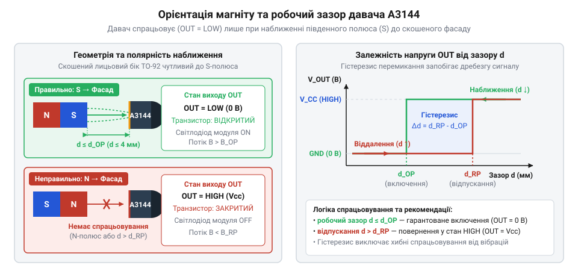
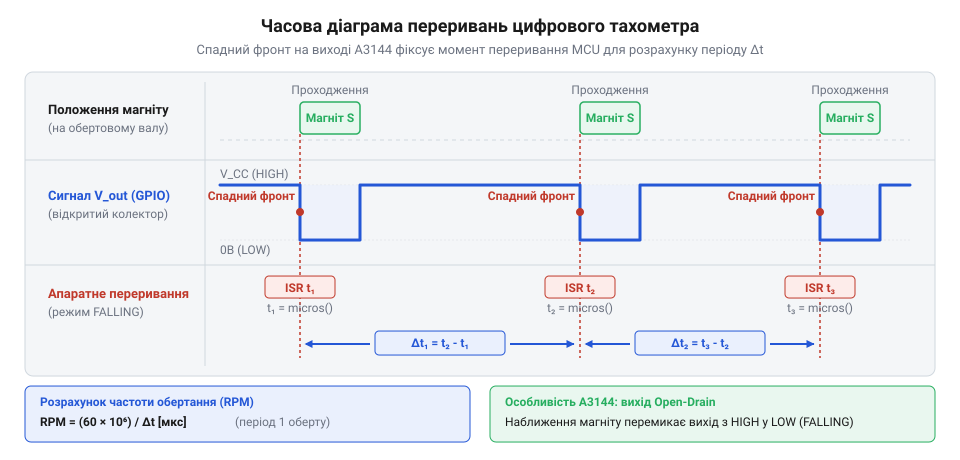

# Практичні проєкти: тахометр обертів та кінцевий вимикач на A3144

<preknowlist>
- [KY-003 / KY-024 — давач Голла](root:cat-hw-sensors/ky-003-hall) — базові принципи ефекту Холла та принципова схема цифрового модуля
- [SS41F — цифровий давач Холла](root:cat-hw-sensors/ss41f-hall) — класифікація цифрових давачів за типом перемикання та чутливістю до полярності магніту
</preknowlist>

## Проблема механічного зносу й завад

У механізмах автоматики, таких як ЧПУ-верстати, робототехнічні маніпулятори чи лінії сортування, постійно виникає потреба фіксувати досягнення рухомим вузлом крайньої точки. Традиційно для цього використовували механічні кнопки та мікроперемикачі — @@en|limit switch@@ (від англ. *limit* — межа та *switch* — перемикач). Проте при контактному замиканні пружні металеві контакти неминуче вібрують при вдарянні. Це явище створює [контактний брязкіт](root:hw-digital/contact-debounce) — @@en|contact bounce@@ (від англ. *bounce* — відскок, брязкіт), через який мікроконтролер замість одного чіткого переходу бачить серію з десятків хибних хаотичних імпульсів за частки мілісекунди.

Окрім електричного шуму, механічні контакти піддаються прискореному зносу. Постійне тертя, втомна деформація пружин та іскріння при розмиканні кола призводять до пригорання та виходу вимикача з ладу. Навіть герметичні [герконові давачі](root:cat-hw-sensors/ky-021-reed) або скляні [геркони в колбі](root:cat-hw-sensors/ky-025-reed) зі сплавними контактами піддаються механічному зношуванню пелюсток від частих ударів і мають обмежений ресурс спрацьовувань.

Альтернативою механіці є оптичні давачі (щілинні оптичні пари). Вони не мають контактного брязкоту, але стають незахищеними у реальних виробничих умовах. Пилюка, дрібна стружка, масляний туман або пряме сонячне засвічення перекривають оптичний канал, викликаючи хибні зупинки чи пропуск зчитування позиції.

Наприклад, у деревоборобних фрезерних верстатах або металообробних верстатах із ЧПУ оптичні енкодери швидко виходять із ладу через осідання тирси та змащувально-охолоджувальної рідини (ЗОР). У таких завадомістких середовищах магнітне зчитування виявляється єдиним надійним варіантом, оскільки силові лінії магнітного поля безперешкодно проникають крізь шар дерев'яного пилу або оливну плівку.

Виходом із цієї суперечності є перехід від контактних і світлочутливих систем до магнітної детекції на основі ефекту Холла — @@en|Hall effect@@ (від прізвища фізика Едвіна Холла, @@en|Edwin Hall@@). Цифровий магнітний давач не містить жодних рухомих деталей, повністю монолітний та герметичний, а також нечутливий до оптичних забруднень, води й пилу. Він сприймає проникне магнітне поле через суцільний пластиковий корпус, перетворюючи наближення магніту на чіткий цифровий логічний сигнал без контактного брязкоту.

## Фізична взаємодія давача з магнітом

Для побудови надійної магнітної системи позиціонування необхідно враховувати фізичні особливості чутливого елемента. Напівпровідниковий інтегральний давач A3144 належить до класу однополярних (юніполярних) цифрових перемикачів. На відміну від двополярних або аналогових пристроїв, таких як [перемикачі серії SS41F](root:cat-hw-sensors/ss41f-hall) або [вимірювачі струму Холла](root:cat-hw-sensors/acs712-current-sensor-module), кристал A3144 розпізнає лише один магнітний полюс — південний (@@en|South pole@@, S-полюс).

При проєктуванні вимірювальних вузлів важливо враховувати температурний дрейф порогів `B_OP` та `B_RP`. Зі зростанням температури корпусу мікросхеми від `-40 °C` до `+85 °C` чутливість кристала Холла знижується, унаслідок чого пороги спрацьовування й відпускання можуть зміщуватися на `5..15 Гс`. Для компенсації цього ефекту робочий зазор розраховують із запасом індукції відносно найнесприятливішої температурної точки.

Чутлива зона мікросхеми розміщена під скошеною лицьовою поверхнею корпусу TO-92S з маркуванням. Якщо до цієї грані наближати магніт південним полюсом, вектор магнітної індукції — @@en|magnetic flux density@@ — перетинає кристал у прямому напрямку. Коли напруженість поля перевищує поріг спрацьовування `B_OP` (від англ. @@en|operate point@@), внутрішній компаратор переключається, відкриваючи вихідний NPN-транзистор. Оскільки вихід виконано за схемою з [відкритим колектором](root:hw-digital/open-drain-output) — @@en|open collector@@ (від англ. *open* — відкритий та *collector* — колектор), логічна лінія виводу примусово підтягується до заземлення GND, формуючи низький рівень — @@en|active low@@.

При віддаленні магніту індукція знижується. Проте транзистор закривається не одразу при досягненні `B_OP`, а при нижчому значенні — порозі відпускання `B_RP` (від англ. @@en|release point@@). Для мікросхеми A3144 типове значення порогу спрацьовування `B_OP` становить близько `35..70 Гс` (`3.5..7.0 мТл`), тоді як поріг відпускання `B_RP` лежить у межах `10..50 Гс` (`1.0..5.0 мТл`). Різниця між цими порогами визначає магнітний гістерезис — @@en|hysteresis@@ (від грец. *hysteresis* — запізнення, відставання), який для A3144 становить не менше `5..20 Гс`:
```
B_HYS = B_OP - B_RP
```
Гістерезис запобігає дребезгу вихідного сигналу, якщо механічний вузол зупинився рівно на граничній відстані від давача і зазнає дрібних вібрацій.


*Орієнтація південного полюса магніту відносно давача A3144 та діаграма зміни вихідного сигналу при зміні робочого зазору.*

Якщо ж повернути магніт північним полюсом до маркованого боку давача або наближати південний полюс із тильного боку корпусу, інвертований напрямок магнітних ліній не зможе подолати поріг `B_OP`. Давач залишатиметься у вимкненому стані, а його вихід за рахунок зовнішнього підтягувального резистора — @@en|pull-up@@ — утримуватиме напругу живлення VCC. Робочий повітряний зазор регулюють так, щоб у крайній точці руху магніт створював індукцію, яка завідомо перевищує `B_OP` з урахуванням товщини захисного корпусу.

## Безконтактний кінцевий вимикач крайнього положення

Для побудови безконтактного кінцевого вимикача модуль A3144 підключають до цифрового порту вводу мікроконтролера. Оскільки внутрішній транзистор давача лише замикає вихід на землю, лінія сигналу потребує підтягування до шини VCC. При використанні готових модулів [Hall-давачів серії KY-003](root:cat-hw-sensors/ky-003-hall) підтягувальний резистор номіналом 10 кОм уже змонтовано на платі, але для окремої мікросхеми A3144 можна також активувати внутрішній підтягувальний резистор мікроконтролера. Якщо ж довжина сигнального кабелю між давачем і мікроконтролером перевищує 1 метр, номінал зовнішнього підтягувального резистора рекомендується зменшити до `1..2.2 кОм`. Це пришвидшує перезаряд ємності довгого кабелю при розмиканні транзистора і суттєво підвищує завадостійкість лінії від наведень силових дротів.

Під час позиціонування каретки чи вала наближення магніту викликає миттєвий спад напруги з VCC до 0 В (падіння напруги на відкритому транзисторі становить близько 0.17 В). Оскільки швидкість перемикання кристала становить одиниці мікросекунд, для надійного фіксування події доцільно використовувати [апаратні переривання EXTI](root:hw-arch/interrupt-driven-io) — @@en|EXTI@@ (від англ. *external* — зовнішній та *interrupt* — переривання). Переривання налаштовують на спрацьовування за спадним фронтом — @@en|falling edge@@.

У структурах конфігурації C-драйвера параметри вхідного виводу та режимів переривання визначаються так:
:::code proj-a3144-rpm-tachometer-and-limit-switch/c/a3144.h 43-66

Коли спрацьовує апаратне переривання, мікроконтролер припиняє виконання основного циклу і переходить до процедури обробки — @@en|ISR@@ (від англ. *interrupt* — переривання, *service* — обслуговування, *routine* — програма). Щоб відфільтрувати можливі високочастотні завади від електродвигунів чи наведень кабелів, у функції обробника `a3144_exti_isr_handler` реалізовано часове програмне придушення завад — @@en|debounce@@:
:::code proj-a3144-rpm-tachometer-and-limit-switch/c/a3144.c 26-58

Якщо стан лінії фіксується як низький, прапорець `approach_flag` встановлюється в `true`, а лічильник спрацьовувань збільшується. Це дозволяє головній програмі в неблокувальному режимі опитувати стан кінцевого вимикача, зупиняти двигун або змінювати напрямок руху без затримок у циклі. Збереження точності вимірювання часових інтервалів між послідовними спрацьовуваннями готує цей самий цифровий вузол для виконання наступного завдання — вимірювання швидкості обертання вала.

## Обробка імпульсів через апаратні переривання

При вимірюванні швидкості обертання вала ротора магніт, закріплений на шківі, перетинає чутливу зону давача Холла за частки мілісекунди. Якщо швидкість вала становить 6000 обертів за хвилину, ротор робить 100 обертів за секунду, і тривалість проходження магніту повз давач не перевищує 0.5 мілісекунди. За звичайного періодичного опитування стану цифрового виводу у циклі програми — @@en|polling@@ (від англ. *poll* — опитувати) — мікроконтролер неминуче пропускатиме короткі спади напруги під час виконання інших обчислень чи оновлення дисплея. Пропущений імпульс спотворює розраховану швидкість або спричиняє повну втрату контролю обертів.

Мінімальна межа вимірювання швидкості @@en|RPM@@ визначається не лише часовим таймаутом відсутності обертання, а й розрядністю системного таймера, який вимірює інтервал часу між сусідніми імпульсами. При використанні 16-бітного таймера мікросекундного відліку максимальний інтервал до переповнення лічильника — @@en|timer overflow@@ — становить `65535 мкс` (`65.5 мс`), що відповідає нижній межі вимірювання швидкості близько `915 RPM` при одному магніті на оберт. Для контролю повільних механізмів без переповнення регістру застосовують 32-бітний таймер або мілісекундний відлік системного часу, де переповнення настає лише через `49.7` доби безперервної роботи.

Для миттєвої детекції швидких подій проходження магніту використовують периферію [зовнішніх апаратних переривань EXTI](root:hw-arch/interrupt-driven-io) — @@en|EXTI@@. Коли південний полюс магніту наближається до виводу A3144, відкритий колектор мікросхеми примусово розряджає лінію на землю (стан @@en|active low@@), формуючи крутий спадний фронт — @@en|falling edge@@. Переривання миттєво призупиняє виконання головного циклу `main`, фіксує часову позначку — @@en|timestamp@@ (від англ. *time* — час та *stamp* — позначка) — у мікросекундах та запускає підпрограму обробки переривання — @@en|ISR@@.


*Часова діаграма сигналів давача A3144 із позначенням моментів генерування переривань за спадним фронтом та обчислення періоду обертання вала.*

У підпрограмі обробки `ISR` зафіксований час порівнюється з моментом попереднього спрацьовування. Це дозволяє відфільтрувати високовольтні завади від силових двигунів через часовий [програмний дебаунсинг](root:hw-digital/contact-debounce) — @@en|debounce@@. Часовий поріг фільтрації обирають із розрахунку максимальної розрахованої швидкості вала: для систем із граничною швидкістю `6000 RPM` (один оберт за `10 мс` при `N=1` магніті) інтервал дебаунсингу задають на рівні `1..2 мс`, що відтинає високочастотний цифровий шум і не блокує реальні вимірювальні імпульси. Якщо часовий інтервал між імпульсами більший за мінімально допустимий поріг, система обчислює різницю часу `dt` та збільшує загальний лічильник імпульсів.

У C-драйвері обробка спадного фронту виконується в контексті переривання, а конфігураційні параметри задають кількість імпульсів на один оберт ротора:
:::code proj-a3144-rpm-tachometer-and-limit-switch/c/a3144.h 25-31

Для симуляції проходження магніту у тестових сценаріях апаратне переривання викликається при зміні логічного стану вхідного виводу:
:::code proj-a3144-rpm-tachometer-and-limit-switch/c/main.c 55-64

Об'єктно-орієнтований C++ реалізує статичний місток обробника переривань, збереження часової позначки `timestamp` у мікросекундах та атомарну фіксацію прапорця нового імпульсу:
:::code proj-a3144-rpm-tachometer-and-limit-switch/cpp/A3144Tachometer.cpp 53-80

## Алгоритм тахометра та розрахунок обертів

Отриманий у підпрограмі переривання часовий інтервал `dt` між двома послідовними проходженнями магніту є базовим квантом даних для побудови цифрового тахометра — @@en|tachometer@@ (від грец. *tachos* — швидкість та *metron* — вимірювач). Щоб перетворити виміряний час у кутову швидкість, виражену в обертах за хвилину — @@en|rotations per minute@@ (@@en|RPM@@), необхідно врахувати кількість магнітів `N`, закріплених на валу (параметр @@en|pulses per revolution@@).

Якщо на валу встановлено `N` магнітів, один повний оберт ротора відповідає `N` імпульсам. Тривалість одного повного оберту `T` дорівнює:
```
T = dt × N
```
Частота обертання в обертах за секунду визначається як `1 / T`. Перемноживши це значення на 60 секунд, отримуємо підсумкову формулу розрахунку @@en|RPM@@ через інтервал `dt_ms` у мілісекундах:
```
RPM = (60000 / dt_ms) / N
```
Якщо вимірювання часу виконується у мікросекундах `dt_us`, чисельник становить 60000000 мікросекунд на хвилину.

Параметри периферійного виводу, кількість магнітів та часові межі задаються в конфігураційній структурі:
:::code proj-a3144-rpm-tachometer-and-limit-switch/cpp/A3144Tachometer.hpp 15-20

Проте при зупинці вала нові імпульси від давача Холла припиняють надходити. Якщо обчислювати швидкість лише в момент виклику переривання, показання @@en|RPM@@ назавжди залишаться рівними останній розрахованій швидкості перед зупинкою. Для усунення цієї проблеми в неблокувальному циклі оновлення реалізовано часовий таймаут — @@en|timeout@@ (від англ. *time* — час та *out* — вичерпання). Якщо системний час з моменту останнього імпульсу перевищує задану межу, розрахована швидкість скидається у нуль.

Для згладжування флуктуацій та пульсацій швидкості при нерівномірному обертанні вала застосовують цифровий фільтр ковзного усереднення — @@en|moving average filter@@. Алгоритм зберігає кільцевий буфер останніх `K` значень інтервалів `dt` або розрахованих `RPM`, обчислюючи їхнє середнє арифметичне на кожному кроці, що запобігає резким стрибкам показань у системі автоматичного керування.

Для безпечної передачі даних між апаратним перериванням та головним циклом програми змінні стану захищають модифікатором @@en|volatile@@ (від латин. *volatilis* — змінний) у C або атомарними типами — @@en|atomic@@ (від грец. *atomos* — неподільний) — у C++. Додатково можна зареєструвати функцію зворотного виклику — @@en|callback@@ — для сповіщення зовнішніх систем про оновлення швидкості.

Обчислення швидкості та обробка таймауту зупинки в C-драйвері виконуються у неблокувальній функції `a3144_process`:
:::code proj-a3144-rpm-tachometer-and-limit-switch/c/a3144.c 60-81

У C++ драйвері обчислення @@en|RPM@@ з використанням мікросекундного таймера та атомарних змінних організовано у методі `update`:
:::code proj-a3144-rpm-tachometer-and-limit-switch/cpp/A3144Tachometer.cpp 82-109

Періодичний вивід розрахованої швидкості та стану безконтактного вимикача у головному циклі програми демонструє роботу цифрового тахометра в реальному часі:
:::code proj-a3144-rpm-tachometer-and-limit-switch/c/main.c 82-90
