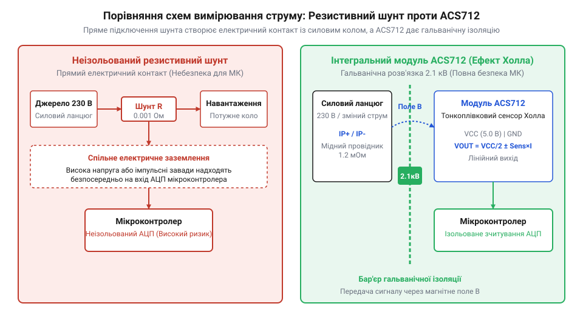
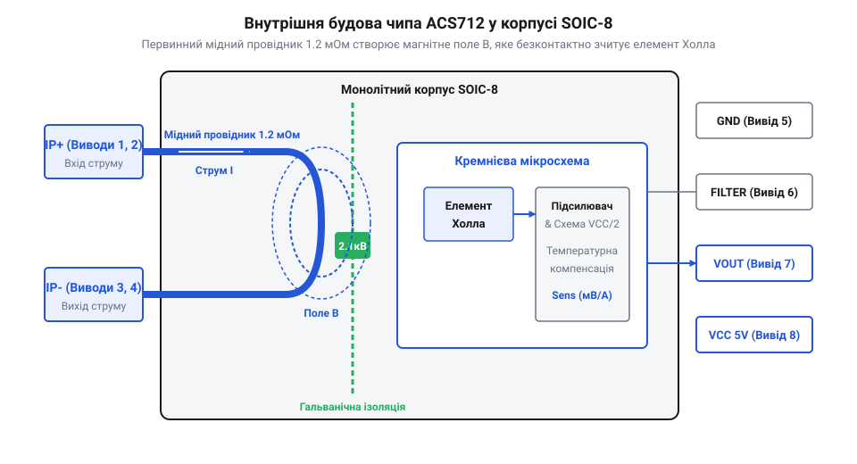
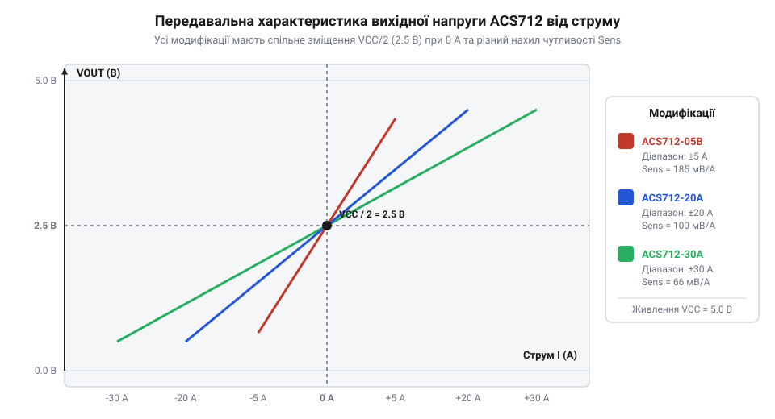

# Модуль давача струму Холла ACS712 (GY-712)

<preknowlist>
- [A3144 — модуль давача Холла](root:cat-hw-sensors/a3144-hall-module) — фізичні основи ефекту Холла та генерація напруги у напівпровіднику
</preknowlist>

## Обмеження шунтів та прямого вимірювання

Вимірювання струму в електричному колі вимагає оцінки кількості заряду, що проходить крізь провідник за одиницю часу. Найпростіший спосіб полягає в тому, щоб розірвати коло й вставити в нього вимірювальний резистор відомого номіналу — @@en|resistive shunt@@ (від англ. *shunt* — відхиляти напрямок). Коли крізь такий шунт протікає струм, на його виводах створюється спад напруги, пропорційний величині струму за законом Ома. Проте виділення теплової потужності при проходженні струму неминуче нагріває матеріал шунта, змінюючи його вихідний опір через @@en|temperature coefficient of resistance@@ (від англ. *temperature coefficient of resistance* — температурний коефіцієнт опору). Величина цього коефіцієнта безпосередньо залежить від матеріалу резистивного елемента: якщо звичайна мідь (@@en|copper@@) має високий коефіцієнт порядку 3900 ppm/°C, то спеціалізовані термостабільні сплави, такі як манганін (@@en|manganin@@) або константан (@@en|constantan@@), демонструють значно меншу залежність — від 10 до 30 ppm/°C. Проте навіть у шунтах із прецизійних сплавів при тривалому проходженні великого струму накопичується тепло, оскільки обмежене відведення енергії не встигає компенсувати її джоулеве виділення. Постійне зростання температури на десятки градусів Цельсія під тривалим високим навантаженням викликає помітний @@en|thermal drift@@ (від англ. *drift* — відхилятися, зсуватися) вимірюваного сигналу: плавне підвищення опору шунта штучно завищує обчислений спад напруги при незмінному струмі, спричиняючи накопичення систематичної похибки вимірювача з часом. З цієї причини при роботі з великими струмами або високими напругами пряме резистивне вимірювання стикається з двома фундаментальними фізичними обмеженнями: тепловими втратами та відсутністю електричного розділення.

Перша проблема резистивного шунта полягає у виділенні тепла та терморезистивному дрейфі. Оскільки проходження струму неминуче викликає нагрівання вимірювального резистора, його опір `R` починає змінюватися відповідно до температурного коефіцієнта опору (@@en|temperature coefficient of resistance@@). Підвищення температури під тривалим навантаженням призводить до додаткового відхилення вимірюваного спаду напруги від пропорційного значення струму. Розрахунок втрат потужності `P` здійснюється на основі струму `I` та опору `R` за формулою:

```text
P = I² · R      [закон Джоуля — Ленца]
```

З цього виразу видно, що потужність розсіювання зростає квадратично від струму. Для вимірювання струму `I` значення `10 А` через шунт із опором `R` значення `0.1 Ом` втрата потужності `P` становитиме `10 Вт`. Такий елемент перетворюється на потужний обігрівач, вимагає масивного радіатора і знижує енергоефективність системи. Зменшення опору шунта до `1 мОм` знижує втрати до `0.12 Вт`, але створює іншу перешкоду: спад напруги при струмі `10 А` становить лише `10 мВ`. Для обробки такого мікровольтного сигналу аналогово-цифровим перетворювачем (АЦП) мікроконтролера потрібні складні операційні підсилювачі з високою точністю.

Друга й найбільш критична проблема — відсутність @@en|galvanic isolation@@ (від прізвища італійського фізика Luigi Galvani). Оскільки вимірювальний шунт увімкнений безпосередньо в силове коло, вимірювальна схема й мікроконтролер мають спільну електричну точку з навантаженням. Якщо коло працює під високою напругою (мережа змінного струму `230 В` або високовольтна батарея), будь-який пробій або коротке замикання негайно потрапляють на низьковольтний мікроконтролер, виводячи його з ладу.


*Порівняння схем вимірювання струму за допомогою неізольованого резистивного шунта та інтегрального модуля ACS712 із гальванічною розв'язкою показує повне електричне розділення силового кола й мікроконтролера.*

Потреба вимірювати високий струм без втрат потужності та з повною безпекою для керівної електроніки привела до безконтактних методів. За законом Ампера, будь-який провідник зі струмом створює навколо себе магнітне поле, напруженість якого прямо пропорційна величині цього струму. Оцінюючи параметри магнітного поля безпосередньо поблизу провідника, можна точно розрахувати струм у колі без фізичного контакту між силовою та вимірювальною частинами. Детально про те, як [еволюція вимірювання струму](root:cat-hw-sensors/acs712-current-sensor-module/hist-acs712-hall-current-sensing-evolution.md) пройшла шлях від громіздких трансформаторів до напівпровідникових елементів, показує, що саме @@en|Hall effect@@ (від імені американського фізика Edwin Hall) став основою для створення компактних давачів струму.

## Будова та магнітопровід модуля ACS712

Інтегральний давач струму ACS712 поєднує силовий провідник із низьким опором та аналогову вимірювальну схему в одному монолітному корпусі @@en|SOIC-8@@ (англ. @@en|Small Outline Integrated Circuit@@). На відміну від дискретних компонентів, де магнітне поле вимірюється ззовні провідника, в ACS712 вимірювальний елемент та струмоведуча доріжка виготовлені як єдина інтегральна структура. Внутрішня топологія корпуса розділена на дві функціональні зони: силовий тракт займає виводи 1, 2 (`IP+`) та 3, 4 (`IP-`) з одного боку чипа, а низьковольтна вимірювальна схема розміщена на протилежному боці. Силовий тракт утворено вбудованим первинним провідником (@@en|primary conductor@@) з міді опором лише `1.2 мОм`. Цей провідник має вигнуту геометрію шпильки (@@en|hairpin@@), яка спрямовує струм по тісному U-подібному контуру та фокусує лінії магнітної індукції `B` безпосередньо перпендикулярно до чутливої зони кристала Холла (@@en|Hall element@@). Виводи 8 (@@en|VCC@@) та 5 (@@en|GND@@) живлять внутрішню схему напругою `5.0 В`. Вивід 6 (@@en|FILTER@@) з'єднаний із виходом внутрішнього підсилювача через резистор номіналом `1.7 кОм`, що при підключенні зовнішнього керамічного конденсатора `C_FILTER` на землю утворює однополюсний аналоговий фільтр низьких частот (@@en|RC low-pass filter@@). Такий фільтр пригнічує високочастотний шум підсилювача та дозволяє підбором ємності налаштовувати смугу пропускання (@@en|bandwidth@@) сигналу в діапазоні до `80 кГц`. Виміряне значення виводиться у вигляді пропорційної напруги через вивід 7 (`VIOUT`), а просторове рознесення силових і сигнальних кіл мінімізує наводки та гарантує гальванічну ізоляцію (@@en|galvanic isolation@@).

Основою силового тракту мікросхеми є вбудований первинний провідник — @@en|primary conductor@@. Виводи 1, 2 (позначені як `IP+`) та виводи 3, 4 (позначені як `IP-`) з'єднані всередині корпуса суцільною мідною пластиною з надзвичайно низьким електричним опором `1.2 мОм` (`0.0012 Ом`). Провідник має розраховану петлеподібну геометрію, яка фокусує магнітне поле B безпосередньо над кристалом. Завдяки такому малому опору спад напруги на давачі є мінімальним, а теплові втрати при проходженні максимального струму не перевищують кількох десятих вата. Для пригнічення шуму підсилювача до виводу `FILTER` (pin 6) підключають зовнішній фільтруючий конденсатор `C_FILTER` на землю, що утворює з внутрішнім резистором `1.7 кОм` фільтр низьких частот.


*Внутрішня струмоведуча доріжка мікросхеми ACS712 розміщена поруч із напівпровідниковим елементом Холла, забезпечуючи перетворення вимірюваного струму на пропорційне магнітне поле без прямого електричного контакту.*

Безпосередньо над мідним провідником, але надійно ізольовано від нього шаром діелектрика, розташовано тонкоплівковий напівпровідниковий елемент Холла — @@en|Hall element@@. Коли крізь первинний провідник протікає вимірюваний струм, навколо нього виникає магнітне поле з напрямком за правилом правої руки. Магнітні лінії пронизують напівпровідникову пластину під прямим кутом, створюючи напругу Холла, пропорційну індукції магнітного поля та струму в провіднику.

Кремнієвий кристал ACS712 містить також вбудований низькошумний підсилювач та схему температурної компенсації. Головною перевагою такої конструкції є високий рівень безпеки. Фізичний зазор між первинним мідним провідником та вимірювальним кремнієвим кристалом забезпечує @@en|galvanic isolation@@ з електричною міцністю ізоляції до `2.1 кВ RMS` при частоті `60 Гц` протягом однієї хвилини. На відміну від простих дискретних компонентів, таких як [модуль давача Холла A3144](root:cat-hw-sensors/a3144-hall-module) або [аналоговий давач KY-003](root:cat-hw-sensors/ky-003-hall), мікросхема ACS712 самостійно генерує вимірювальне магнітне поле за рахунок струму, що протікає через її внутрішній провідник.

## Характеристики чутливості та нульове зміщення

Для вимірювання струму в обох напрямках — як постійного (DC), так і змінного (AC) — вихідний каскад давача не може мати нульову напругу при відсутності струму. Якби при рівні `0 А` на виході було `0 В`, пристрій не зміг би показати зворотний напрямок струму, оскільки напруга живлення мікроконтролера не буває від'ємною. Для вирішення цієї задачі в ACS712 реалізовано @@en|bidirectional current sensing@@ (від лат. *bi-* — двоякий та англ. *direction* — напрямок). Опорний рівень сигналу й коефіцієнт передачі жорстко прив'язані до напруги живлення `VCC`, формуючи @@en|ratiometric output@@ (від лат. *ratio* — відношення та грец. *metron* — міра). Через таку залежність від напруги живлення пропорційно змінюються одразу дві величини: нульова точка спокою `VCC / 2` та чутливість підсилювача `Sens`. Наприклад, при зниженні живлення `VCC` від номінальних `5.0 В` до `4.8 В` вихід без струму зсувається з `2.5 В` до `2.4 В`, а чутливість версії `185 мВ/А` пропорційно зменшується до `177.6 мВ/А` (оскільки становить `185 × (4.8 / 5.0)`). Якщо мікроконтролер обчислює струм за фіксованими константами `2.5 В` та `185 мВ/А`, цей зсув викликає хибну похибку вимірювання на `100 мВ` (близько `0.54 А` для версії `185 мВ/А`) плюс додаткову похибку масштабу під навантаженням. Крім того, високочастотні пульсації шини живлення @@en|power supply ripple@@ (від англ. *power supply* — джерело живлення та *ripple* — пульсація) від імпульсних перетворювачів викликають швидку модуляцію зсуву нуля та підсилення, створюючи на аналоговому виході вимірювальний шум при оцифруванні АЦП. Для компенсації дрейфу живлення АЦП мікроконтролера повинен використовувати напругу `VCC` як опорну `Vref`: тоді `VCC` у чисельнику вихідної напруги та знаменнику шкали АЦП скорочуються. Якщо ж використовується стабільна опорна напруга, похибку усувають раціометричною компенсацією в коді — вимірюють поточну `VCC` окремим каналом і перераховують зсув та чутливість під час обчислень, а високочастотні пульсації пригнічують фільтрацією.

При відсутності вимірюваного струму в первинному провіднику внутрішній підсилювач давача формує на виході напругу, яка дорівнює половині напруги живлення мікросхеми: `VCC / 2`. При стандартному живленні `VCC = 5.0 В` ця точка становить точно `2.5 В`. Такий рівень називається @@en|quiescent voltage@@ (від англ. *quiescent* — спокійний, неактивний). Коли струм протікає від виводів `IP+` до `IP-` (умовний позитивний напрямок), вихідна напруга зростає вище `2.5 В`. Якщо ж струм змінює напрямок і тече від `IP-` до `IP+`, вихідна напруга пропорційно зменшується нижче `2.5 В` у бік `0 В`. Проте оскільки елемент Холла реагує на будь-який вектор магнітної індукції, зовнішні магнітні завади від близьких силових провідників або трансформаторів створюють паразитні наводки. Це накладання зовнішнього поля викликає похибку зміщення нульової позначки та зміну реальної чутливості давача під навантаженням.


*Передавальна характеристика вихідної напруги давача ACS712 показує лінійну залежність від струму з опорною точкою VCC/2 при нульовому струмі для трьох версій чутливості.*

Крутизна нахилу цієї передавальної характеристики визначається коефіцієнтом, який називається @@en|sensitivity@@ (від лат. *sensus* — відчуття). Чутливість вимірюється у мілівольтах на один ампер (`мВ/А`) або вольтах на ампер (`В/А`) і показує, на скільки мілівольт змінюється вихідна напруга при зміні струму на `1 А`. Виробник випускає мікросхему ACS712 у трьох стандартних модифікаціях:
- **ACS712-05B:** діапазон `±5 А` із чутливістю `185 мВ/А` (`0.185 В/А`).
- **ACS712-20A:** діапазон `±20 А` із чутливістю `100 мВ/А` (`0.100 В/А`).
- **ACS712-30A:** діапазон `±30 А` із чутливістю `66 мВ/А` (`0.066 В/А`).

Математичний зв'язок вихідної напруги `Vout` із первинним струмом `Ip` виражається прямою лінійною залежністю:

```text
Vout = (VCC / 2) + (Sens × Ip)

Ip = (Vout - (VCC / 2)) / Sens
```

Ознайомитися з повною [математичною моделлю чутливості](root:cat-hw-sensors/acs712-current-sensor-module/math-acs712-sensitivity-and-rms-calculation.md) та виведенням рівнянь можна у відповідному теоретичному розрахунку.

## Зчитування АЦП та розрахунок RMS струму

Для отримання числових значень струму в програмі аналоговий вихід `VOUT` модуля ACS712 підключають до аналогового входу мікроконтролера. Внутрішній @@en|analog-to-digital converter@@ (АЦП, від лат. *analogus* — відповідний та *digitus* — палець) перетворює напругу `Vout` у цифровий код `ADC_code`. Цей процес вимірювання відбувається не безперервно, а окремими зрізами через рівні проміжки часу, темп яких визначає @@en|sampling rate@@ (частота дискретизації, від лат. *discretus* — переривчастий). Якщо робити вибірки сигналу занадто рідко, АЦП пропускає швидкі зміни напруги між замірами, через що у підсумкових цифрових даних утворюються фальшиві низькочастотні коливання, яких у реальному струмі не було. Таке спотворення спектра називають @@en|aliasing@@ (аліасинг, від англ. *alias* — псевдонім або маскування), оскільки високі частоти маскуються під низькі. Щоб усунути це накладання частот і зберегти реальну форму хвилі, частота дискретизації має бути щонайменше удвічі вищою за найвищу частотну складову вимірюваного сигналу, що стверджує @@en|Nyquist-Shannon sampling theorem@@ (теорема дискретизації Найквіста — Шеннона). При вимірюванні струму імпульсних джерел живлення або нелінійних навантажень сигнал містить вищі @@en|harmonics@@ (гармоніки, від грецьк. *harmonikos* — співзвучний) до 40-ї гармоніки (`2 кГц`), тому для точного обчислення діючого значення без аліасингу частоту замірів АЦП вибирають не менше `5..10 кГц` або застосовують апаратний аналоговий ФНЧ на виводі `FILTER`.

Величина цього коду залежить від параметра @@en|ADC resolution@@ (роздільна здатність АЦП). Для класичного 10-бітного АЦП діапазон чисел становить від `0` до `1023` (всього `1024` дискретних рівнів). При опорній напрузі `Vref = 5.0 В` кожен крок АЦП відповідає напрузі близько `4.88 мВ`, що визначає ціну найменшого розряду @@en|LSB@@ (від англ. *least significant bit*). Цей шум дискретизації обмежує точність при вимірюванні малих струмів: один крок АЦП відповідає дискретності близько 26 мА для версії 185 мВ/А та 74 мА для версії 66 мВ/А. Обчислення миттєвої напруги `Vout` із коду АЦП виконується за формулою:

```text
Vout = (ADC_code × Vref) / ADC_max

I_inst = (Vout - V_zero) / Sens
```

При вимірюванні змінного струму (AC) синусоїдальної форми з частотою `50 Гц` струм постійно змінює свій напрямок і величину `50` разів на секунду. Щоб оцінити корисну потужність змінного струму, необхідно обчислити його @@en|root mean square@@ (RMS, середньоквадратичне значення, від англ. *root mean square* — корінь із середнього квадрата).

Алгоритм розрахунку RMS полягає в тому, що протягом цілої кількості періодів мережі (наприклад, за `20 мс` для одного періоду `50 Гц` або `40 мс` для двох) робиться серія швидких вимірювань миттєвого струму `I_k`. Кожне значення підноситься до квадрата, обчислюється середнє арифметичне квадратів, після чого з отриманого результату добувається квадратний корінь:

```text
I_rms = √( (1 / N) × ∑[k=1 to N] I_k² )
```

Високочастотний шум аналогового тракту додатково згладжують, застосовуючи @@en|moving average filter@@ (фільтр ковзного середнього).

Детальні параметри виводів та схему підключення показує [довідник апаратної розводки](root:cat-hw-sensors/acs712-current-sensor-module/api-acs712-hardware-wiring-and-pinout.md) вимірювального модуля. Щоб побудувати повноцінний ватметр або автоматичний захист від перевантаження за струмом, скористайтеся матеріалом про [практичні проєкти моніторингу](root:cat-hw-sensors/acs712-current-sensor-module/proj-acs712-power-monitor-and-overcurrent-switch.md) на мікроконтролері.
