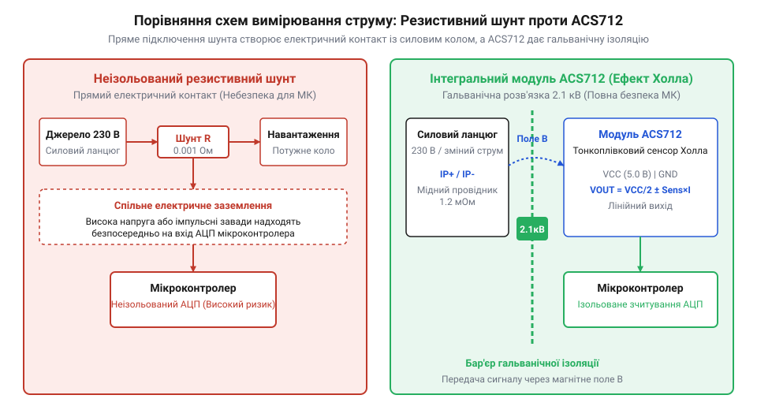
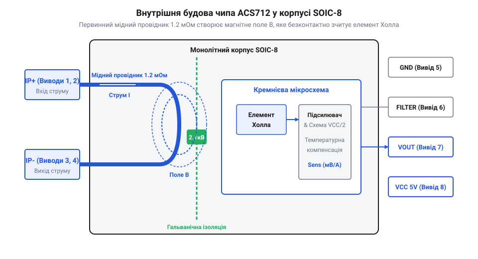
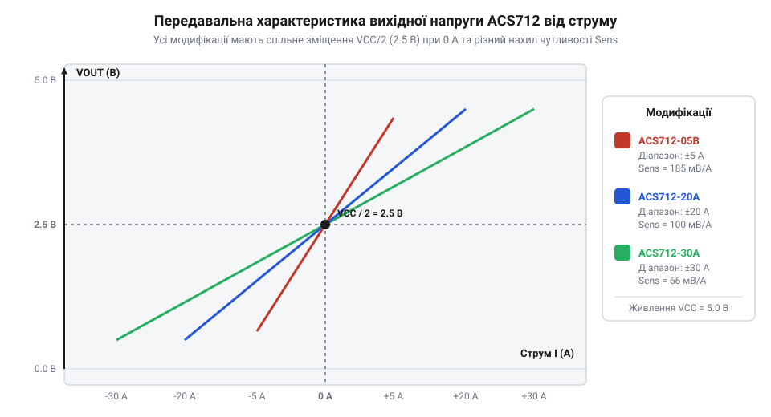

# Модуль давача струму Холла ACS712 (GY-712)

<preknowlist>
- [A3144 — модуль давача Холла](root:cat-hw-sensors/a3144-hall-module) — фізичні основи ефекту Холла та генерація напруги у напівпровіднику
</preknowlist>

## Обмеження шунтів та безконтактне вимірювання

Для контролю струму в силових колах класично застосовують @@en|резистивний шунт@@ (від англ. *shunt* — відхилення) — низькоомний резистор, увімкнений безпосередньо в розрив провідника. Проте зі зростанням навантаження теплові втрати на шунті швидко збільшуються, а прямий електричний контакт загрожує пошкодженням мікроконтролера при стрибках напруги.


*Послідовний шунт створює втрати тепла та не захищає мікроконтролер, тоді як давач Холла забезпечує ізоляцію через магнітне поле.*

Безконтактний метод долає ці обмеження завдяки використанню фізичних принципів, які працюють і в [модулях давачів Холла](root:cat-hw-sensors/a3144-hall-module). Будь-який струм створює навколо провідника пропорційне магнітне поле. Коли це поле пронизує напівпровідникову пластину, на рухомі носії заряду діє @@en|сила Лоренца@@ (від англ. *Lorentz force* — за ім'ям фізика Хендріка Лоренца), яка відхиляє їх до однієї з граней. У результаті накопичення зарядів на протилежних боках виникає @@en|поперечна різниця потенціалів@@ — @@en|напруга Холла@@, пропорційна індукції магнітного поля. Вимірювання цього поля через @@en|ефект Холла@@ (від англ. *Hall effect* — за ім'ям фізика Едвіна Холла) дає змогу визначити величину струму без фізичного з'єднання силового та вимірювального кіл.

## Будова чипа ACS712 та гальванічна розв'язка

Інтегральний давач @@en|ACS712@@ об'єднує силовий провідник і первинний перетворювач у монолітному корпусі @@en|SOIC-8@@. Вимірювальний струм проходить крізь вбудовану мідну доріжку з опором лише `1.2 мОм`, що зводить теплові втрати до мінімуму.


*Струм протікає крізь внутрішній мідний провідник, створюючи магнітне поле, яке зчитується інтегрованим елементом Холла.*

Прямо над мідним провідником розміщено напівпровідниковий елемент Холла, відокремлений шаром діелектрика. Ця конструкція забезпечує @@en|гальванічна розв'язка@@ (від італ. *Galvani* — імені вченого Луїджі Гальвані) до `2.1 кВ RMS` між силовими виводами та вимірювальною мікросхемою.

## Нульове зміщення та чутливість виходу

Вихідний аналоговий сигнал давача залежить від величини та напрямку струму. Для вимірювання постійного та змінного струму вихідний рівень за відсутності струму встановлюється на @@en|напруга спокою@@ `VCC / 2` (зазвичай `2.5 В`). Прямий струм збільшує напругу до `VCC`, а зворотний — зменшує до `0 В`.


*Вихідна напруга лінійно відхиляється від точки спокою VCC/2 залежно від напрямку струму та чутливості конкретної моделі.*

Вихідна напруга `V_out` залежить від вимірюваного струму `I`, коефіцієнта чутливості `S` та опорної напруги спокою `V_zero`:

```
V_out = V_zero + (I × S)    [до напруги спокою додається зсув пропорційний струму]
```

У формулі символ `V_out` означає вихідну напругу, `V_zero` — напругу спокою `VCC / 2`, `I` — вимірюваний струм, а `S` — чутливість (`185 мВ/А` для моделі `5 А`, `100 мВ/А` для `20 А`, `66 мВ/А` для `30 А`). Для обчислення струму `I` з виміряної напруги `V_out` вираз перетворюють:

```
I = (V_out - V_zero) / S    [різниця напруги відносно спокою ділиться на чутливість]
```

З виразу видно, що відхилення напруги від рівня спокою прямо пропорційне струму, а його знак визначає напрямок протікання.

## Зчитування АЦП та обчислення струму

Мікроконтролер вимірює напругу давача за допомогою @@en|АЦП@@ (аналогово-цифровий перетворювач). При 10-бітному АЦП та живленні `5 В` напрузі спокою відповідає код `ADC_0 = 512`. Для обчислення миттєвого струму `I` з поточного коду `ADC_raw` від нього віднімають код спокою `ADC_0`, перераховують різницю в напругу через крок `V_step = VCC / 1024` і ділять на чутливість `S`:

```
I = ((ADC_raw - ADC_0) × V_step) / S    [різниця кодів переводиться в напругу й ділиться на чутливість]
```

Тут `ADC_raw` — поточний код зчитування, `ADC_0` — код за відсутності струму, а `V_step` — величина молодшого розряду АЦП у вольтах. Отримане значення `I` показує миттєвий струм у даний момент часу.

При вимірюванні змінного струму миттєві значення безперервно змінюються. Щоб визначити ефективний струм, обчислюють @@en|RMS@@ (від англ. *Root Mean Square* — середньоквадратичне значення): роблять серію вибірок АЦП за період, підносять кожне значення до квадрата, знаходять їхнє середнє та добувають квадратний корінь.
