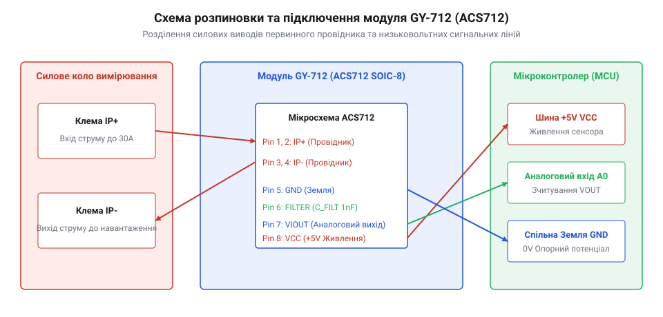

# Схемотехніка, розводка виводів та підключення модуля ACS712 (GY-712)

<preknowlist>
- [KY-003 / KY-024 — давач Голла](root:cat-hw-sensors/ky-003-hall) — Загальні поняття про аналоговий вихід давача Холла.
</preknowlist>

## Призначення виводів та сигнальна розводка

Вимірювання струму у високовольтних або потужних кола́х вимагає гальванічного розв'язання між силовою частиною та чутливою мікроконтролерною електронікою. Модуль @@en|GY-712@@ на базі мікросхеми @@en|ACS712@@ вирішує це завдання завдяки вбудованому провіднику з низьким опором `1.2 mΩ` та аналоговому давачу, який використовує @@en|Hall effect@@ (ефект Холла — виникнення різниці потенціалів у провіднику зі струмом під дією магнітного поля).

Силова група містить клеми `IP+` та `IP-` (у мікросхемі це виводи 1, 2 та 3, 4). Вимірювальний струм проходить безпосередньо крізь внутрішній мідний провідник, створюючи магнітне поле без електричного контакту з внутрішньою сигнальною схемою. Це забезпечує гальванічну ізоляцію до `2.1 kV RMS`.

Низьковольтна сигнальна група модуля містить чотири контакти:
- `VCC` — живлення аналогової схеми напругою `5.0 V`.
- `GND` — спільний вивід сигнального заземлення.
- `VOUT` — аналоговий вихід напруги, пропорційний струму. За відсутності струму напруга дорівнює `VCC / 2` (`2.5 V`), що дає змогу фіксувати як позитивний, так і негативний (змінний) струм. Внутрішній операційний підсилювач (@@en|op-amp@@) виводу `VOUT` має низький вихідний опір @@en|output impedance@@ (близько 1-2 Ом), що забезпечує швидке перезаряджання вхідної ємності аналогово-цифрового перетворювача (@@en|ADC@@), однак під час підключення зовнішніх резистивних дільників для узгодження з рівнем 3.3 В його слід враховувати у загальному імпедансі сигналу.
- `FILTER` — вивід для підключення зовнішнього фільтруючого конденсатора `C_FILTER` на мікросхемі (pin 6). Вбудований резистор `1.7 kΩ` разом із `C_FILTER` утворює фільтр низьких частот для обмеження смуги пропускання та зменшення рівня шумів.

Вихідний сигнал `VOUT` формується внутрішнім операційним підсилювачем (@@en|op-amp@@) і подається на @@en|ADC@@ (аналогово-цифровий перетворювач) мікроконтролера. Порівняно з простими логічними давачами, якими є [давач Холла KY-003](root:cat-hw-sensors/ky-003-hall), модуль @@en|ACS712@@ видає безперервний лінійний сигнал, пропорційний силі струму.


*Призначення силових і сигнальних виводів модуля GY-712 та базова схема ввімкнення в силовий і вимірювальний ланцюги.*

## Схеми підключення та живлення

Мікросхема @@en|ACS712@@ має пропорційний (@@en|ratiometric@@, від англ. *ratio* — співвідношення) вихід: опорна точка нульового струму (`VCC / 2`) та коефіцієнт чутливості напряму залежать від стабільності напруги живлення. Для запобігання хибному зсуву нульової позначки вивід `VCC` необхідно живити від стабілізованого джерела `5.0 V`.

Більшість сучасних мікроконтролерів (наприклад, @@en|ESP32@@ або @@en|STM32@@) працюють із логічними рівнями та опорною напругою АЦП `3.3 V`. Оскільки вихідний діапазон `VOUT` може досягати `4.5 V` при максимальному струмі, пряме підключення загрожує пошкодженням входу АЦП. Для безпечного узгодження рівнів застосовують резистивний дільник напруги (@@en|voltage divider@@) та захисний діод Шотткі (@@en|Schottky diode@@).

```
VOUT (5V) ────[ R1 = 10 kΩ ]────┬────> До АЦП (3.3V)
                                │
                         [ R2 = 20 kΩ ]
                                │
                                ┴ GND
```

Співвідношення опорів `R1` і `R2` масштабує вихідну напругу з діапазону `0.5 V – 4.5 V` до безпечних `0.33 V – 3.0 V`. Захисний діод Шотткі (наприклад, @@en|BAT54@@), увімкнений між входом АЦП та лінією `3.3 V`, відсікає коротковчасні сплески напруги. Детальний алгоритм [обчислення RMS струму](root:cat-hw-sensors/acs712-current-sensor-module/math-acs712-sensitivity-and-rms-calculation.md) для дискретних вибірок АЦП розкрито в окремому розрахунку.

Для запобігання наведенню сильних імпульсних завад силовий ланцюг високого струму та низьковольтне сигнальне заземлення `GND` слід розділяти. Неприпустимо пускати зворотний силовий струм навантаження через загальну шину заземлення мікроконтролера — розведення виконують за топологією «зірка» в єдиній точці з'єднання заземлень.

## Захист від завад та топологія плати

Оскільки @@en|ACS712@@ працює на основі вимірювання магнітного потоку, він чутливий до зовнішніх магнітних полів. Сильнострумові провідники, розташовані поруч із корпусом мікросхеми, створюють паразитна магнітне поле, що спричиняє похибку вимірювання.

Під час проектування друкованої плати (@@en|PCB@@, англ. *printed circuit board*) дотримуються таких правил топології:
- **Мінімізація зовнішніх полів:** силові доріжки підводять до клем `IP+` та `IP-` паралельно одна одній або перпендикулярно до чутливої осі внутрішнього елемента Холла. Заборонено утворювати замкнені витки чи контури силового струму безпосередньо під корпусом мікросхеми.
- **Фільтрація живлення:** блокувальний керамічний конденсатор (@@en|decoupling capacitor@@) ємністю `0.1 µF` розміщують якомога ближче до виводів `VCC` та `GND` (на відстані не більше `3 mm`). Це пригнічує високочастотні пульсації джерела живлення.
- **Вибір ємності C_FILTER:** для отримання максимальної смуги пропускання `80 kHz` підключають конденсатор `1 nF`. Якщо вимірюють постійний або низькочастотний змінний струм (`50 Hz`), ємність збільшують до `47 nF` або `100 nF`, що зрізає високочастотний шум АЦП.
- **Ширина силових доріжок:** провідники силового кола `IP+`/`IP-` повинні мати достатню ширину та товщину мідного шару (наприклад, не менше `3 mm` для струму `5 A` при товщині міді `35 µm`) для запобігання локальному перегріву та дрейфу параметрів через температурний коефіцієнт.

Для пристроїв, які працюють у високовольтних мережах, альтернативним методом безконтактного перемикання виступає [герконовий давач KY-021](root:cat-hw-sensors/ky-021-reed), тоді як @@en|ACS712@@ забезпечує точне безперервне вимірювання струму.
