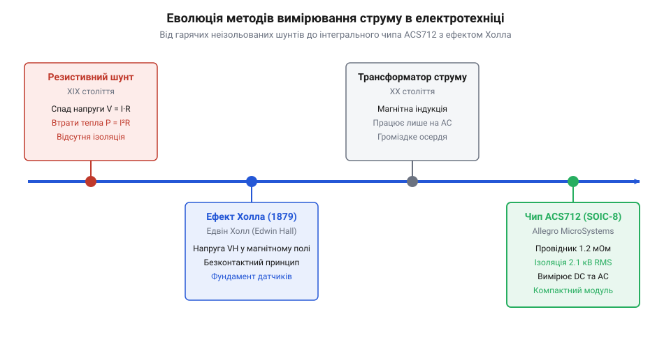

# Еволюція вимірювання струму від шунтів до мікросхеми ACS712

<preknowlist>
- [KY-003 / KY-024 — давач Голла](root:cat-hw-sensors/ky-003-hall) — Принцип роботи базового напівпровідникового елемента Холла.
</preknowlist>

## Обмеження резистивних шунтів і трансформаторів

Контроль електричного струму є базовою задачею в силовому обладнанні та електромережах, але виміряти його безперервно й без втрат виявилося складно. Найдавнішим розв'язком став @@en|резистивний шунт@@ (від англ. *shunt* — пускати в обхід), який вмикають послідовно в розрив кола. Спад напруги на відомому опорі пропорційний струму за @@en|законом Ома@@.

Проте із зростанням навантаження виявилися два критичних обмеження шунтів. Перше — це втрати потужності на нагрів. За @@en|законом Джоуля-Ленца@@ тепловий виділ зростає пропорційно квадрату струму:

```
P = I² × R     [теплова потужність дорівнює добутку квадрата струму на опір]
```

Навіть при опорі 0.01 Ом струм у 50 А перетворює 25 Вт електроенергії на некорисне тепло, що вимагає громіздких радіаторів. Друге обмеження — відсутність ізоляції. Вимірювальний прилад гальванічно з'єднаний із силовою лінією, тому потенціал високої напруги потрапляє прямо на чутливу вимірювальну схему.

Для змінного струму цю проблему розв'язав @@en|трансформатор струму@@ (від лат. *transformare* — перетворювати). Його первинна обмотка створює змінне магнітне поле, яке індукує струм у вторинній обмотці через спільний @@en|магнітопровід@@, що забезпечує надійну @@en|гальванічну ізоляцію@@ (від імені італійського вченого Луїджі Гальвані, *Luigi Galvani*). Проте робота на низьких частотах висуває жорсткі вимоги до фізичних габаритів пристрою. Щоб навести необхідну @@en|електрорушійну силу@@ й уникнути @@en|магнітного насичення@@ сердечника при низьких промислових частотах 50–60 Гц, @@en|магнітопровід@@ мусить мати велику площу поперечного перерізу та значну масу заліза. Чим нижча частота, тим більший об'єм феромагнетика потрібен для перенесення магнітного потоку без перенасичення. На постійному ж струмі частота дорівнює нулю, магнітний потік не змінюється у часі й не індукує струм у вторинній обмотці, роблячи трансформатори масивними на низьких частотах і повністю безпорадними в колах постійного струму.

## Відкриття ефекту Холла та перші напівпровідникові давачі

Пошук безконтактного методу вимірювання постійного струму привів інженерів до явища, яке у 1879 році відкрив американський фізик Едвін Холл (Edwin Hall). Він помітив, що під дією перпендикулярного магнітного поля носії заряду в тонкій металевій пластині зміщуються до бічної грані під дією сили Лоренца.

Унаслідок цього виникає @@en|поперечна різниця потенціалів@@ — @@en|напруга Холла@@, яка лінійно залежить від величини струму та магнітної індукції. Тривалий час @@en|ефект Холла@@ застосовували лише в лабораторіях через мікровольтовий рівень сигналу в металах. Революція відбулася із появою напівпровідникових матеріалів у середині XX століття, де менша концентрація носіїв збільшила вихідну напругу в тисячі разів і дозволила створити перші [дискретні напівпровідникові давачі Холла](root:cat-hw-sensors/ky-003-hall).


*Від класичних шунтів і трансформаторів до напівпровідникових мікросхем: еволюція вимірювання струму забезпечила компактність та високу гальванічну ізоляцію.*

Для вимірювання струму в провіднику кристал давача розташовували у вузькому зазорі зовнішнього феромагнітного кільця — @@en|магнітопроводу@@. @@en|Магнітопровід@@ концентрував магнітне поле струму безпосередньо на чутливому елементі. Таке рішення забезпечувало безконтактний контроль і працювало на постійному струмі, проте конструкція залишалася масивною, вразливою до зовнішніх завад і вимагала складного ручного збирання.

## Інтеграційний прорив Allegro MicroSystems і поява ACS712

Справжній інженерний прорив на початку 2000-х років здійснила компанія @@en|Allegro MicroSystems@@, об'єднавши первинний провідник і чутливий елемент у спільному мікроелектронному корпусі. Так з'явилася мікросхема @@en|ACS712@@.

Всередині стандартного поверхнево-монтованого корпусу @@en|SOIC-8@@ (від англ. *Small Outline Integrated Circuit* — малогабаритна інтегральна схема) розміщено мідну доріжку з опором усього 1.2 мОм. Силовий струм протікає крізь цю доріжку, утворюючи пропорційне магнітне поле без помітного нагріву. Безпосередньо над провідником усередині корпусу закріплено кремнієвий @@en|давач Холла@@ з малошумним підсилювачем, який ізольований від силового провідника шаром діелектрика.

Така монолітна конструкція забезпечує @@en|гальванічну ізоляцію@@ до 2.1 кВ @@en|RMS@@ (від англ. *Root Mean Square* — середньоквадратичне значення) між вимірювальним і силовими колами. Вихідний сигнал виводиться як аналогова напруга, орієнтована на прямий зв'язок із мікроконтролерами без додаткових осердь чи зовнішніх підсилювачів.
