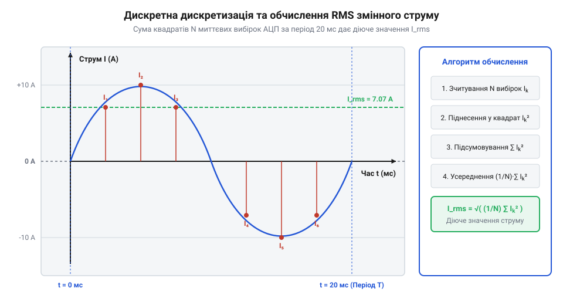

# Математична модель чутливості та розрахунку RMS струму ACS712

<preknowlist>
- [KY-003 / KY-024 — давач Голла](root:cat-hw-sensors/ky-003-hall) — Фізичний принцип виникнення напруги Холла.
</preknowlist>

## Модель двоспрямованого зміщення VCC/2

Вимірювання постійного та змінного струму в силових колах вимагає узгодження двополярного сигналу з однополярним діапазоном напруги, який приймає мікроконтролер. Чип @@en|ACS712@@ використовує вбудований [давач Холла](root:cat-hw-sensors/ky-003-hall) для перетворення магнітного поля струму на аналогову напругу. Щоб фіксувати струм, який протікає в обох напрямках, вихідна напруга модуля за відсутності навантаження зміщена в середину діапазону живлення `VCC / 2` — зазвичай це 2.5 В при живленні 5 В.

Коли струм дорівнює нулю, вихідна напруга становить `VCC / 2`. Додатний струм збільшує напругу вище цього рівня, а від'ємний — зменшує. Пропорційність цього перетворення визначає коефіцієнт чутливості @@en|Sens@@, значення якого залежить від модифікації чипа @@en|ACS712@@: 185 мВ/А для версії 5 А, 100 мВ/А для версії 20 А та 66 мВ/А для версії 30 А. Проте номінальне значення @@en|Sens@@ визначено для температури 25 °C і виявляє @@en|температурну нестабільність@@ (від англ. *thermal instability* — зміна параметрів під дією температури). Внутрішній елемент Холла та підсилювач чипа виготовлені з напівпровідника, де рухливість носіїв заряду змінюється від нагрівання. Додатково проходження великого струму через вимірювальний провідник викликає @@en|самонагрів@@ (від англ. *self-heating* — нагрівання власною потужністю) кристала. Підвищення температури змінює коефіцієнт підсилення внутрішньої схеми, викликаючи відхилення чутливості від паспортної на кілька відсотків. У результаті обчислене значення струму отримує похибку при тривалій роботі або високому навантаженні.

Для розрахунку миттєвого струму `I` через виміряну вихідну напругу `V_out` застосовують рівняння лінійної залежності:

```
V_out = (VCC / 2) + Sens × I
I = (V_out - (VCC / 2)) / Sens    [вираження струму через напругу]
```

Якщо напругу зчитує @@en|АЦП@@ (від англ. *ADC, Analog-to-Digital Converter* — аналогово-цифровий перетворювач) з роздільною здатністю `ADC_max` (наприклад, 1023 для 10-бітного перетворювача), від зчитаного цифрового коду `ADC_val` віднімають код нульового зміщення `ADC_zero = ADC_max / 2`:

```
I = (ADC_val - ADC_zero) × VCC / (ADC_max × Sens)    [обчислення струму за кодом АЦП]
```

Отримане значення `I` описує миттєву величину та напрямок струму в провіднику.

## Дискретне обчислення RMS змінного струму

При вимірюванні змінного струму миттєве значення постійно змінює знак і величину, тому звичайне арифметичне усереднення вибірок за період дає близький до нуля результат. Щоб отримати реальну теплову потужність струму, обчислюють @@en|RMS@@ (від англ. *Root Mean Square* — середньоквадратичне значення) струму `I_rms`.

У математичній моделі @@en|RMS@@ для неперервного сигналу `I(t)` є квадратним коренем із середнього значення квадрата струму за період `T`. Для мікроконтролера, який отримує дискретні вибірки через @@en|АЦП@@, неперервний інтеграл замінюють сумою `N` вибірок `Iᵢ`:

```
I_rms = √( (1 / N) × ∑ᵢ₌₁ᴺ Iᵢ² )    [дискретне інтегрування квадратів вибірок]
```


*Дискретний вибірковий контроль фіксує миттєві точки хвилі, квадрат значення яких підсумовується для обчислення діючого значення струму.*

Для мережі з частотою 50 Гц період синусоїди становить `T = 20 мс`. Вікно дискретизації вибірок має бути строго кратним цьому періоду (наприклад, 20 мс або 40 мс), щоб уникнути похибок відсікання хвилі. Дискретне обчислення за сумою квадратів однаково точне як для чистої синусоїди, так і для викривлених сигналів або сигналів з @@en|ШІМ@@ (від англ. *PWM, Pulse-Width Modulation* — широтно-імпульсна модуляція).

## Фільтрація шуму та компенсація дрейфу нульової точки

Реальні вимірювання за допомогою @@en|ACS712@@ супроводжуються тепловим шумом давача та дрейфом напруги живлення @@en|VCC@@. Це призводить до того, що реальна напруга спокою `V_zero` відхиляється від теоретичного значення `VCC / 2`, створюючи похибку навіть при відсутності струму.

Для компенсації дрейфу застосовують програмне калібрування: при включенні пристрою без навантаження роблять `M` вибірок @@en|АЦП@@ та обчислюють фактичний нуль:

```
V_zero = (1 / M) × ∑ⱼ₌₁ᴹ V_out[j]    [усереднення напруги спокою]
```

Отриманий нульовий рівень `V_zero` підставляють у формулу миттєвого струму замість `VCC / 2`. Високочастотний шум згладжують алгоритмом @@en|ковзне середнє@@ (від англ. *Moving Average*), де поточне значення є середнім для останніх `K` вибірок:

```
I_smooth[k] = (1 / K) × ∑ₘ₌₀ᴷ⁻¹ I[k - m]    [фільтрація ковзним середнім]
```

Похибка дискретизації визначається ціною найменшого розряду @@en|LSB@@ (від англ. *Least Significant Bit* — найменший значущий розряд) @@en|АЦП@@. Для 10-бітного @@en|АЦП@@ при 5 В один крок `ΔV ≈ 4.88 мВ`. Для версії @@en|ACS712@@ з чутливістю `Sens = 66 мВ/А` мінімальний крок струму `ΔI = ΔV / Sens ≈ 74 мА`, а для версії 185 мВ/А — близько 26 мА. Усереднення накопичених вибірок зменшує цю похибку квантування.
