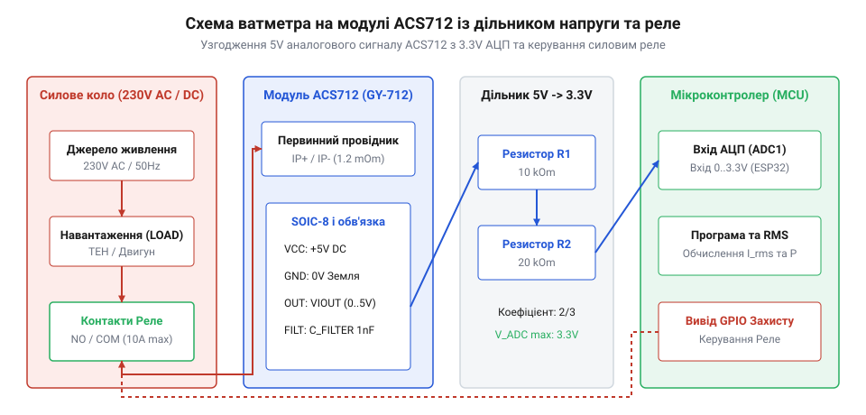

# Розробка ватметра та реле захисту від перевантаження на ACS712

<preknowlist>
- [KY-003 / KY-024 — давач Голла](root:cat-hw-sensors/ky-003-hall) — Загальний принцип роботи аналогових давачів Холла.
</preknowlist>

## Схемотехнічне узгодження ACS712 з мікроконтролером

Використання модуля давача струму Холла `@@en|ACS712@@` (англ. *Hall effect current sensor* — давач струму на ефекті Холла, на честь фізика Едвіна Холла) у системах моніторингу електроспоживання вимагає правильного узгодження аналогових сигналів із вхідними каскадами мікроконтролерів. Модуль живиться напругою `5.0 В` і генерує вихідний аналоговий сигнал `V_OUT` зі зсувом нульового рівня `V_CC / 2` (тобто `2.5 В` при відсутності струму). При вимірюванні максимального позитивного струму напруга на виході зростає до `4.5 В`. Якщо підключати такий модуль безпосередньо до 3.3-вольтового аналогово-цифрового перетворювача (`@@en|ADC@@`, від англ. *analog-to-digital converter* — аналогово-цифровий перетворювач, з лат. *analogus* — пропорційний та *digitus* — лічба), наприклад мікроконтролерів `@@en|ESP32@@` або `@@en|STM32@@`, напруга понад `3.3 В` перевищує гранично допустимий рівень аналогового порту `V_max = 3.6 В` і може пошкодити внутрішній захисний діод `@@en|ESD protection diode@@` (англ. *electrostatic discharge* — електростатичний розряд, від грец. *ēlektron* — янтар та *statikos* — той, що стоїть). Для зниження амплітуди застосовують резистивний дільник із верхнім плечем `R_1 = 10` кОм та нижнім `R_2 = 20` кОм, який у нормальному режимі масштабує напругу `5.0 В` до безпечного значення `3.33 В`. Проте під час комутаційних сплесків у силовому колі або високовольтних імпульсів перенапруги `V_spike = 6.0 В` потенціал неузгодженого входу АЦП без додаткового апаратного захисту обчислюється як:

```
V_ADC
= V_spike × (R_2 ÷ (R_1 + R_2))      [розрахунок напруги резистивного дільника]
= 6.0 × (20 ÷ (10 + 20))            [підстановка напруги сплеску та опорів]
= 4.0 В                              [обчислення амплітуди на аналоговому вході]
```

Оскільки напруга `4.0 В` суттєво перевищує безпечну межу 3.6 В, паралельно нижньому резистору `R_2` підключають захисний стабілітрон `@@en|Zener diode@@` (на честь фізика Кларенса Зенера) або супресор `@@en|TVS diode@@` (англ. *transient voltage suppressor* — пригнічувач перехідних напруг, від лат. *transiens* — перехідний та *supprimere* — придушувати) з напругою пробою `V_Z = 3.3 В` (`@@en|breakdown voltage@@`). При досягненні порогового рівня напівпровідниковий прилад переходить у режим пробою, забезпечуючи фіксацію напруги `@@en|clamping voltage@@` на безпечному рівні 3.3 В. Для імпульсного сплеску `V_spike = 6.0 В` аварійний струм обмеження `I_surge`, що протікає через верхнє плече `R_1 = 10` кОм і скидається супресором на землю, становить:

```
I_surge
= (V_spike - V_Z) ÷ R_1              [закон Ома для обмежувального резистора]
= (6.0 - 3.3) ÷ 10000                [підстановка різниці напруг та опору плеча]
= 0.00027 А                          [обчислення імпульсного струму супресора]
```

Отриманий струм перевантаження `I_surge = 0.27` мА (270 мкА) безпечно розсіюється на резисторі `R_1` та кристалі захисного діода, не створюючи струмового перевантаження вхідних кіл мікроконтролера та повністю гасячи небезпечні перехідні імпульси.

Для безпечного пониження амплітуди вихідного сигналу застосовують резистивний дільник напруги. Схема дільника складається з двох послідовно з'єднаних резисторів `R1 = 10 кОм` та `R2 = 20 кОм`. Верхнє плече `R1` підключають до виводу `VOUT` модуля ACS712, а нижнє плече `R2` з'єднують із землею `GND`. З'єднувальна точка між резисторами підключається до аналогового входу АЦП, забезпечуючи коефіцієнт ділення `2/3`. У результаті діапазон вихідної напруги `0..5.0 В` масштабується в безпечний інтервал `0..3.33 В`.


*Принципова електрична схема показує з'єднання силової мережі змінного струму через контактну групу реле з давачем ACS712 та дільник напруги для узгодження зі входом АЦП мікроконтролера.*

Для керування потужним навантаженням у силове коло послідовно вмикають контакти силового електромагнітного реле або комутаційного MOSFET-транзистора. Щоб захистити мікроконтролер від високовольтних імпульсних завад та вихрових струмів котушки реле, керування здійснюється через оптронную розв'язку або транзисторний ключ із захисним діодом.

## Програмне обчислення потужності та захист

Програмне забезпечення ватметра реалізує неблокуючий алгоритм вибіркового аналізу струму та розрахунку активної потужності (@@en|active power@@). Для змінного струму (@@en|AC@@) частотою `50 Гц` програма здійснює швидкі заміри миттєвої напруги протягом одного або двох повних періодів мережі (`20 мс` або `40 мс`). На кожному кроці АЦП отримує сирий код, перераховує його в напругу з урахуванням дільника та обчислює значення струму. Просте множення діючої напруги на діючий струм `S = U · I` дає лише повну потужність (@@en|apparent power@@) у вольт-амперах (@@en|volt-ampere@@, `В·А`), яка відображає повне навантаження на мережу. Проте для обчислення активної потужності `P` у ватах (@@en|watt@@, `Вт`), яка витрачається безпосередньо на виконання корисної роботи, необхідно враховувати коефіцієнт потужності (@@en|power factor@@) `cos(φ)` за формулою `P = U · I · cos(φ)`. Для активного резистивного навантаження зсув фаз між напругою та струмом відсутній, тому `cos(φ) = 1.0` і `P = S`. Якщо ж підключити реактивне навантаження (@@en|reactive load@@) — індуктивні двигуни (@@en|inductive load@@) або трансформатори, — обмотки створюють магнітне поле, через що струм відстає від напруги за фазою, а коефіцієнт знижується до типових `cos(φ) ≈ 0.7...0.85`. Оскільки модуль ACS712 вимірює лише струм і не фіксує фазовий зсув напруги, у програмі значення `cos(φ)` обирають вручну під конкретний тип споживача, що дає змогу відокремити реально спожиту потужність від повної.

Середньоквадратичне значення (@@en|root mean square@@, RMS) обчислюється шляхом піднесення до квадрата всіх зчитаних відліків струму за період, знаходження їхнього середнього значення та добування квадратного кореня. На основі отриманого діючого струму `I_rms` та відомої напруги мережі `U_net = 230 В` розраховується активна потужність `P = U_net · I_rms`.

Щоб запобігти пошкодженню силового обладнання при перевантаженні або короткому замиканні, в алгоритм вбудовано функцію захисного відсікання з гістерезисом. Якщо розраховане значення діючого струму перевищує заданий поріг (наприклад, `4.0 А`), програма миттєво змінює стан виводу GPIO, розмикаючи реле й відключаючи навантаження. Повторне включення дозволяється лише після того, як струм знизиться нижче порогу з урахуванням гістерезису (наприклад, `3.5 А`), що виключає дзвоновий режим постійного перемикання контактора.

:::tabs
@tab C++ (Arduino)
:::code proj-acs712-power-monitor-and-overcurrent-switch/cpp/examples/PowerMonitor/PowerMonitor.ino
@tab C (ESP-IDF)
:::code proj-acs712-power-monitor-and-overcurrent-switch/c/main/main.c
:::

## Калібрування та випробування аварійних режимів

Точність вимірювання струму давачем ACS712 суттєво залежить від стабільності напруги живлення `VCC` та відсутності зовнішніх магнітних завад. На початку роботи пристрою обов'язково виконується процедура програмного калібрування нуля при відсутньому навантаженні (`0 А`). Програма здійснює серію з `100` послідовних замірів напруги на АЦП, обчислює середнє арифметичне значення й записує його як точне опорне зміщення `V_zero`.

Під час випробування аварійних режимів перевіряється швидкодія алгоритму захисту та час механічного розмикання контактів реле. При штучному створенні перевантаження за струмом програма фіксує перевищення порогу протягом одного періоду сіткового сигналу (`20 мс`) і видає сигнал відключення на GPIO. Загальний час відсікання аварійного струму з урахуванням спрацьовування котушки реле становить не більше `30..40 мс`, що надійно захищає силову проводку від перегріву.
