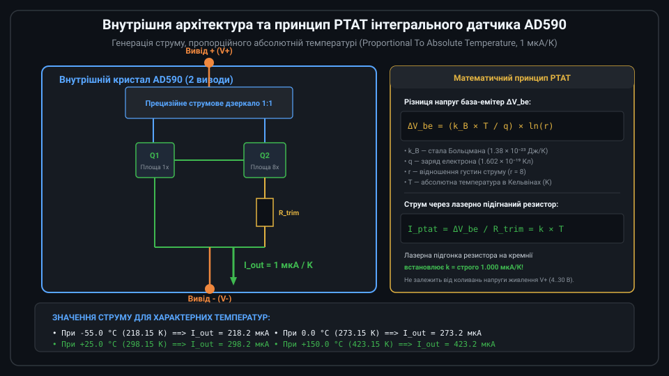
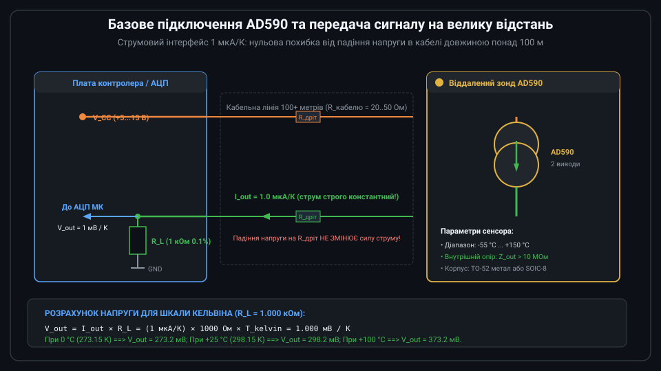
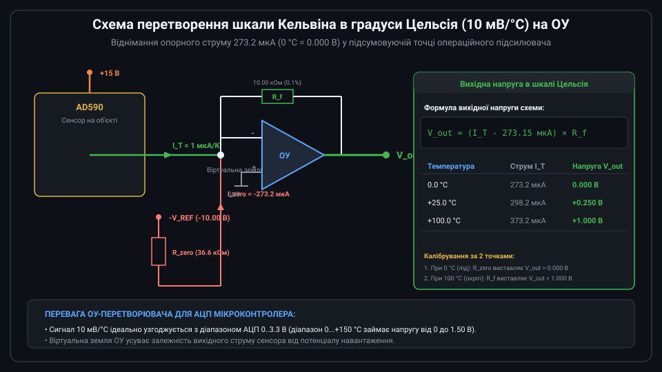

# Поглиблений інженерний аналіз та схемотехніка датчика температури AD590

Інтегральний датчик температури AD590 є еталонним напівпровідниковим сенсором зі струмовим виходом, що понад чотири десятиліття застосовується в аерокосмічній техніці, системах геофізичного зондування та промисловій автоматиці. Проектування прецизійних вимірювальних трактів на його основі вимагає детального аналізу роботи транзисторної комірки PTAT, розрахунку балансу самопрогріву, вибору класів точності та схем калібрування зсуву.



---

## 1. Напівпровідникова фізика та схемотехніка комірки PTAT

В основі формування струму PTAT лежить експоненційна залежність колекторного струму біполярного транзистора від напруги база-емітер V_be в активному режимі:

```text
I_c = I_s × exp( V_be / V_t )
```

де I_s — струм насичення, пропорційний площі емітерного переходу A_e, V_t = (k_B × T) / q — температурний потенціал (при 25 °C V_t ≈ 25.69 мВ).

У схемі AD590 пара узгоджених біполярних транзисторів Q1 та Q2 живиться від верхнього точного струмового дзеркала Вілсона, яке з високою точністю примушує колекторні струми бути рівними: `I_c1 = I_c2 = I_0`.
Площа емітера транзистора Q2 у 8 разів більша за площу транзистора Q1: `A_e2 = 8 × A_e1` (відношення площ r = 8).

Виразивши напруги база-емітер через колекторні струми та взявши їх різницю, отримують:
```text
V_be1 = V_t × ln( I_0 / I_s1 )
V_be2 = V_t × ln( I_0 / I_s2 ) = V_t × ln( I_0 / (r × I_s1) )

Delta_V_be = V_be1 - V_be2 = V_t × ln(r) = (k_B × T / q) × ln(8)
```

Температурний нахил різниці напруг становить:
```text
d(Delta_V_be) / dT = (k_B / q) × ln(8) = (86.17 мкВ/К) × 2.0794 ≈ 179.2 мкВ/К
```

Ця напруга виділяється на послідовно включеному тонкоплівковому резисторі R_trim в емітері Q2. Відповідно, струм кожної гілки:
`I_branch = Delta_V_be / R_trim`.
Сумарний струм датчика через обидві паралельні гілки становить:
```text
I_total = 2 × I_branch = [ 2 × (k_B × ln(8) / q) / R_trim ] × T
```
Лазерна підгонка опору R_trim на етапі виробництва кремнієвої пластини встановлює номінал:
`R_trim = 2 × 179.2 мкВ / 1.000 мкА ≈ 358.4 Ом`.
В результаті сумарний вихідний струм стає строго рівним **1.000 мкА/К**.

---

## 2. Метрологічні грейди (класи точності) та нелінійність AD590

Сенсори AD590 класифікуються виробником за літерами грейдів, які визначають допустиму похибку калібрування, температурний дрейф та нелінійність:

| Грейд сенсора | Діапазон температур | Калібрувальна похибка при 25 °C | Нелінійність у діапазоні | Корпус |
| :--- | :--- | :--- | :--- | :--- |
| **AD590J** | 0 °C ... +70 °C | ±5.0 °C (±5.0 мкА) | ±1.5 °C | TO-52 / SOIC-8 |
| **AD590K** | 0 °C ... +70 °C | ±2.5 °C (±2.5 мкА) | ±1.0 °C | TO-52 / SOIC-8 |
| **AD590L** | 0 °C ... +70 °C | ±1.0 °C (±1.0 мкА) | ±0.5 °C | TO-52 метал |
| **AD590M** | -55 °C ... +150 °C | ±0.5 °C (±0.5 мкА) | ±0.3 °C | TO-52 метал (MIL-STD) |

Завдяки тому, що температурна залежність кристала визначається фундаментальними фізичними константами k_B та q, нелінійність AD590 є надзвичайно низькою (менше ±0.3 °C для грейду M). Похибка зміщення нуля легко усувається одноточковим або двоточковим програмним або апаратним калібруванням.



---

## 3. Аналіз теплового балансу та похибка самопрогріву

Електрична потужність, яка розсіюється на кристалі AD590, перетворюється на тепло:

```text
P_diss = V_supply × I_out(T)
```

де V_supply — напруга між клемами V+ та V-.
Температурний перегрів кристала відносно вимірюваного середовища описується тепловим опором перехід-середовище theta_ja:

```text
Delta_T_self = P_diss × theta_ja
```

Для металевого корпусу TO-52 тепловий опір у нерухомому повітрі становить приблизно `theta_ja ≈ 480 °C/Вт`.
* При живленні від V_supply = 15 В та температурі 25 °C (I_out = 298 мкА):
  `P_diss = 15 В × 298.2 мкА ≈ 4.47 мВт`.
  Похибка самопрогріву: `Delta_T_self = 4.47 мВт × 0.48 °C/мВт ≈ +2.15 °C`!
* При зниженні напруги живлення до мінімально допустимих V_supply = 5.0 В:
  `P_diss = 5 В × 298.2 мкА ≈ 1.49 мВт`.
  Похибка самопрогріву: `Delta_T_self = 1.49 мВт × 0.48 °C/мВт ≈ +0.72 °C`.

### Інженерні методи боротьби з самопрогрівом:
1. Використання мінімально необхідної напруги живлення (4.5...5.0 В).
2. Забезпечення щільного теплового контакту металевого корпусу TO-52 з масивним радіатором або гільзою за допомогою теплопровідної пасти (при зануренні в масло або метал theta_ja падає до 40...60 °C/Вт, зменшуючи перегрів до менше 0.05 °C).
3. Імпульсна подача живлення (Strobe Mode): датчик вмикається ключем лише на 1–2 мс перед вибіркою АЦП.

---

## 4. Схемотехніка компенсації та калібрування на ОУ

Для отримання прецизійного сигналу 10 мВ/°C схема на базі прецизійного ОУ містить два регулювальні елементи:



```text
V_out = [ I_T - (V_ref / R_zero) ] × R_f
```

### Процедура калібрування за двома реперними точками:
1. **Калібрування нуля (Offset Trim при 0.0 °C)**:
   Датчик занурюють у суміш льоду з водою (0.0 °C = 273.15 K). Підстроювальним потенціометром резистора R_zero виставляють струм віднімання так, щоб вихідна напруга V_out стала строго рівною 0.000 В (з точністю до ±0.1 мВ).
2. **Калібрування нахилу шкали (Gain / Span Trim при 100.0 °C)**:
   Датчик поміщають у пару киплячої води при відомому атмосферному тиску (100.0 °C). Підстроювальним резистором зворотного зв'язку R_f регулюють коефіцієнт передачі так, щоб вихідна напруга склала строго 1.000 В.

Після виконання цієї процедури навіть базовий недорогий грейд AD590J забезпечує точність кращу за ±0.2 °C у всьому робочому діапазоні 0...+100 °C.

---

## 5. Драйвер мікроконтролера для зчитування AD590 мовою C

Наведений драйвер оцифровує напругу на навантажувальному резисторі R_L за допомогою АЦП, виконує осереднення, програмну компенсацію похибки самопрогріву та переводить відлік у градуси Цельсія і Кельвіна.

```c
#include <stdint.h>
#include <stdbool.h>

// Конфігурація каналу вимірювання AD590
typedef struct {
    float r_load_ohms;           // Опір навантаження (типово 1000.0f Ом 0.1%)
    float v_ref_adc_volts;       // Опорна напруга АЦП (напр. 3.300f В)
    uint32_t adc_max_ticks;      // Розрядність АЦП (4095 для 12-біт, 65535 для 16-біт)
    float v_sensor_supply_volts; // Напруга живлення сенсора V+ (напр. 5.0f В)
    float thermal_resistance_c_w;// Тепловий опір монтажу (напр. 250.0f °C/Вт)
    // Калібрувальні поправки
    float offset_trim_kelvin;    // Програмна поправка зміщення нуля
    float gain_trim_factor;      // Програмний коефіцієнт чутливості (типово 1.000f)
} ad590_config_t;

// Результати вимірювання
typedef struct {
    float temp_kelvin;           // Температура за шкалою Кельвіна
    float temp_celsius;          // Температура за шкалою Цельсія
    float current_ua;            // Виміряний струм сенсора в мкА
} ad590_result_t;

// Функція оцифрування та розрахунку
bool ad590_process_reading(const ad590_config_t *cfg, 
                           uint32_t adc_raw_accumulated, 
                           uint16_t oversampling_count, 
                           ad590_result_t *out) 
{
    if (oversampling_count == 0 || cfg->r_load_ohms <= 0.0f) {
        return false;
    }

    // 1. Усереднений код АЦП
    float adc_avg = (float)adc_raw_accumulated / (float)oversampling_count;

    // 2. Напруга на навантажувальному резисторі R_load (у Вольтах)
    float v_measured = (adc_avg / (float)cfg->adc_max_ticks) * cfg->v_ref_adc_volts;

    // 3. Розрахунок струму сенсора I_out = V_measured / R_load (у мкА)
    float current_ua = (v_measured / cfg->r_load_ohms) * 1e6f;
    out->current_ua = current_ua;

    // Перевірка на обрив або КЗ (діапазон AD590 від 218 мкА [-55°C] до 423 мкА [+150°C])
    if (current_ua < 150.0f || current_ua > 500.0f) {
        return false; // Сенсор несправний або обрив кабелю
    }

    // 4. Попередня температура в Кельвінах (масштаб 1 мкА = 1 K)
    // Враховуємо калібрувальні коефіцієнти: T = (I_ua * Gain) + Offset
    float t_raw_kelvin = (current_ua * cfg->gain_trim_factor) + cfg->offset_trim_kelvin;

    // 5. Розрахунок та віднімання похибки джоулевого самопрогріву
    // P_diss = V_drop * I_out = (V_supply - V_load) * I_out
    float v_drop_sensor = cfg->v_sensor_supply_volts - v_measured;
    if (v_drop_sensor < 4.0f) {
        // Якщо напруга менше 4 В, AD590 виходить із лінійного режиму струмового джерела
        return false;
    }
    float p_diss_watts = v_drop_sensor * (current_ua * 1e-6f);
    float delta_t_self_heat = p_diss_watts * cfg->thermal_resistance_c_w;

    // Справжня температура вимірюваного середовища
    out->temp_kelvin = t_raw_kelvin - delta_t_self_heat;
    out->temp_celsius = out->temp_kelvin - 273.15f;

    return true;
}
```

Така програмна архітектура в поєднанні зі струмовою лінією передачі забезпечує промислову точність та стабільність вимірювання на віддалених об'єктах.
