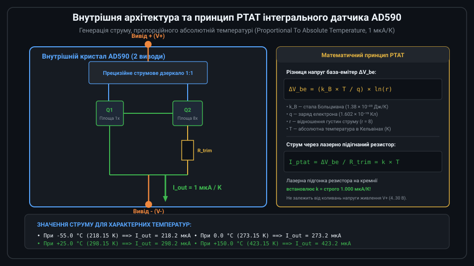
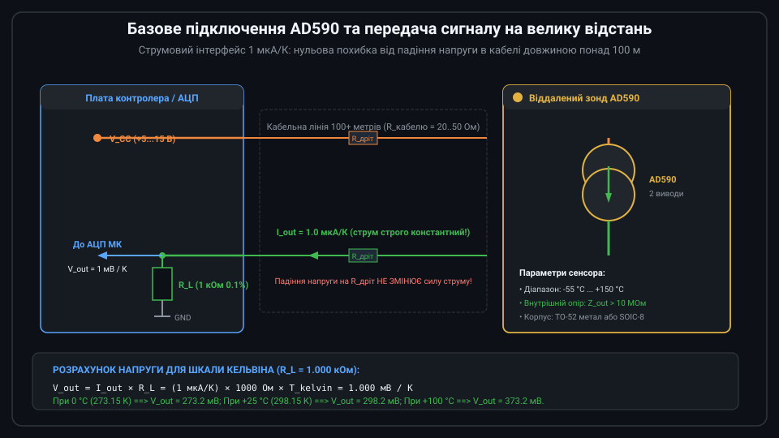
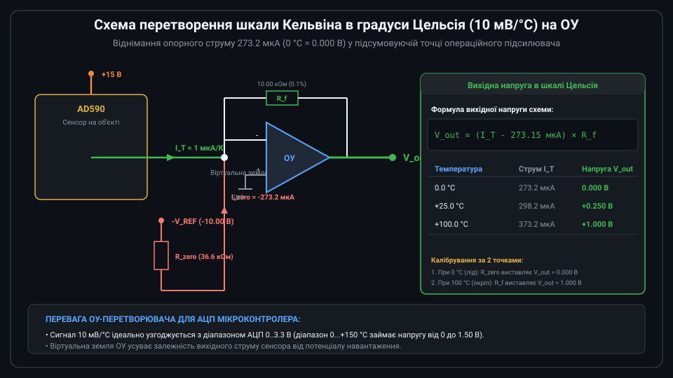
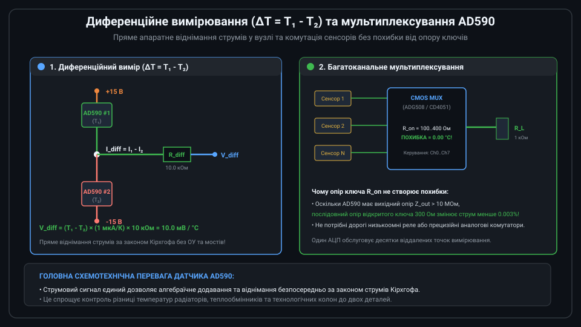
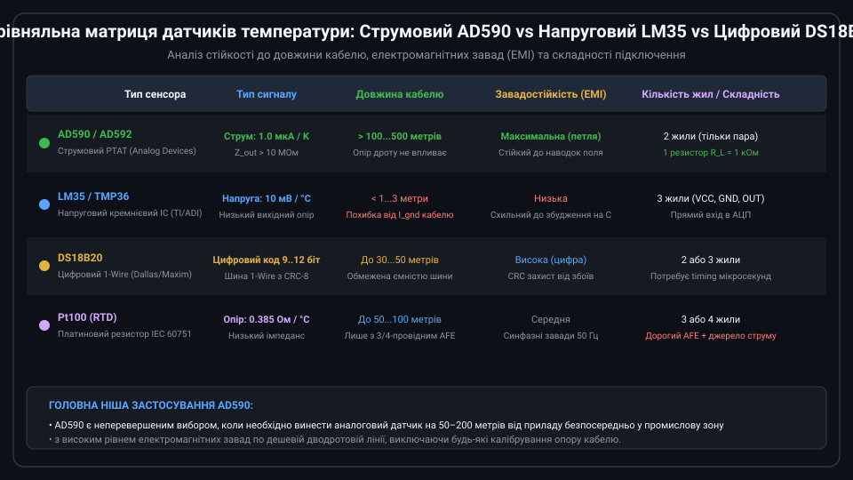

# Аналоговий токовий давач температури AD590

Інтегральна мікросхема AD590 компанії Analog Devices — це прецизійний дводротовий напівпровідниковий перетворювач температури у вихідний струм. Датчик функціонує як високоомний генератор струму, сила якого строго пропорційна абсолютній термодинамічній температурі в Кельвінах (PTAT: Proportional To Absolute Temperature) з каліброваним масштабним коефіцієнтом **1 мкА / K**. Завдяки струмовому виходу датчик ідеально пристосований для дистанційного вимірювання температури через довгі кабельні лінії без втрати точності від падіння напруги.



---

## 1. Фізичний принцип дії та внутрішня структура PTAT

В основі роботи AD590 лежить фундаментальна залежність різниці напруг база-емітер (Delta V_be) узгодженої пари біполярних транзисторів від абсолютної температури. Внутрішня схема чіпа містить два транзистори Q1 та Q2, які працюють при фіксованому відношенні густин емітерних струмів r (у кристалі AD590 співвідношення площ емітерів вибрано r = 8):

```text
Delta_V_be = V_be1 - V_be2 = (k_B × T / q) × ln(r)
```

де k_B — стала Больцмана, q — елементарний заряд електрона, T — температура в Кельвінах.

Ця різниця напруг прикладається до внутрішнього тонкоплівкового резистора R_trim. Струм, що протікає крізь резистор, дорівнює:
```text
I_ptat = Delta_V_be / R_trim = [ (k_B × ln(r)) / (q × R_trim) ] × T
```

Під час виробництва на заводі тонкоплівковий резистор підганяється лазерним променем (laser trimming) доти, доки коефіцієнт пропорційності не стане строго рівним 1.000 мкА/К. Завдяки високому вихідному диференційному опору (понад 10 МОм) вихідний струм залишається стабільним у широкому діапазоні напруги живлення від +4 В до +30 В (зміна струму становить менше 0.1 мкА/В).

---

## 2. Базове підключення та вимірювання в абсолютній шкалі Кельвіна

Найпростіша схема включення AD590 складається лише з джерела постійної напруги, датчика та одного навантажувального прецизійного резистора R_L:



Струм, що витікає з виводу V- датчика, пропускається крізь резистор R_L = 1.000 кОм (з допуском 0.1%), підключений до землі (GND). За законом Ома напруга на цьому резисторі становить:

```text
V_out = I_out × R_L = (1 мкА / K) × 1000 Ом = 1.000 мВ / K
```

Характерні рівні вихідного сигналу:
* При температурі танення льоду 0.0 °C (273.15 K): `I_out = 273.2 мкА`, `V_out = 273.2 мВ`;
* При кімнатній температурі +25.0 °C (298.15 K): `I_out = 298.2 мкА`, `V_out = 298.2 мВ`;
* При температурі кипіння води +100.0 °C (373.15 K): `I_out = 373.2 мкА`, `V_out = 373.2 мВ`.

Головна перевага цієї схеми — абсолютна нечутливість до опору сполучного дроту. Навіть якщо довгий кабель має опір жил 50 Ом, на ньому виникне падіння напруги лише близько 15 мВ, що при живленні +12 В ніяк не вплине на силу вихідного струму.

---

## 3. Схема перетворення в шкалу Цельсія (10 мВ/°C)

Для зручності оцифрування стандартними АЦП часто вимагається вихідна напруга, прямо пропорційна градусам Цельсія (0 В при 0 °C):



Для цього використовують схему трансімпедансного підсилювача на прецизійному операційному підсилювачі (OP07 або OPA277):
1. Датчик AD590 підключається до інвертуючого входу ОУ, який завдяки негативному зворотному зв'язку утримується при нульовому потенціалі (віртуальна земля).
2. До цього ж вузла через підстроювальний резистор R_zero підключається від'ємне опорне джерело -V_ref (-10 В). Номінал резистора R_zero налаштовується так, щоб він відводив струм точно 273.2 мкА.
3. Різницевий струм `I_net = I_T - 273.2 мкА` протікає крізь резистор зворотного зв'язку R_f = 10.00 кОм.

Вихідна напруга схеми становить:
```text
V_out = I_net × R_f = (1 мкА / °C) × 10 кОм = 10.0 мВ / °C
```

При 0 °C напруга на виході дорівнює точно 0.000 В, при +25 °C — +0.250 В, а при +100 °C — +1.000 В.

---

## 4. Диференційні схеми та багатоканальне мультиплексування

Струмова природа вихідного сигналу AD590 відкриває унікальні схемотехнічні можливості, недоступні для звичайних напругових датчиків (таких як LM35):



* **Пряме диференційне вимірювання (Delta T = T1 - T2)**:
  Два датчики AD590 включаються зустрічно в один вузол (один живиться від +15 В, другий від -15 В). У центральній точці за першим законом Кірхгофа струми віднімаються фізично: `I_diff = I1 - I2`. Пропустивши цей струм через один резистор 10 кОм, отримують вихідну напругу `V_diff = 10 мВ / °C × (T1 - T2)` без використання жодного операційного підсилювача!
* **Багатоканальне мультиплексування**:
  Десятки віддалених датчиків AD590 можна комутувати на один спільний навантажувальний резистор за допомогою звичайного недорогого аналогового мультиплексора (CD4051 або ADG508). Опір відкритого каналу мультиплексора (100–300 Ом) повністю нівелюється гігантським вихідним опором сенсора (>10 МОм), забезпечуючи абсолютну похибку комутації менше 0.01 °C.

---

## 5. Порівняння з іншими типами сенсорів та рекомендації

При виборі датчика температури для промислових та вбудованих застосувань слід зіставляти ключові технічні характеристики:



Критерії вибору AD590:
1. **Дистанційні вимірювання на відстані від 20 до 500 метрів**: AD590 не має конкурентів у класі аналогових датчиків завдяки повній нечутливості до опору сполучних ліній.
2. **Важкі електромагнітні умови**: Низькоімпедансна струмова петля значно стійкіша до наведених синфазних електромагнітних завад від частотних приводів і реле, ніж напругові лінії LM35.
3. **Мінімальна кількість провідників**: Потрібно лише 2 жили кабелю замість 3 (для LM35/DS18B20) або 4 (для прецизійного Pt100).
4. **Обмеження**: Робочий температурний діапазон обмежений кремнієм (-55 °C ... +150 °C), що не дозволяє використовувати його у печах (де необхідні термопари або Pt100).
