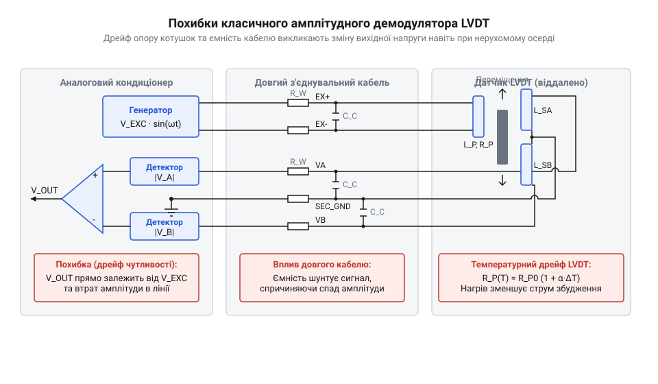
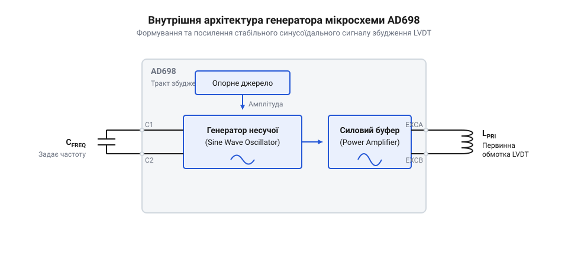
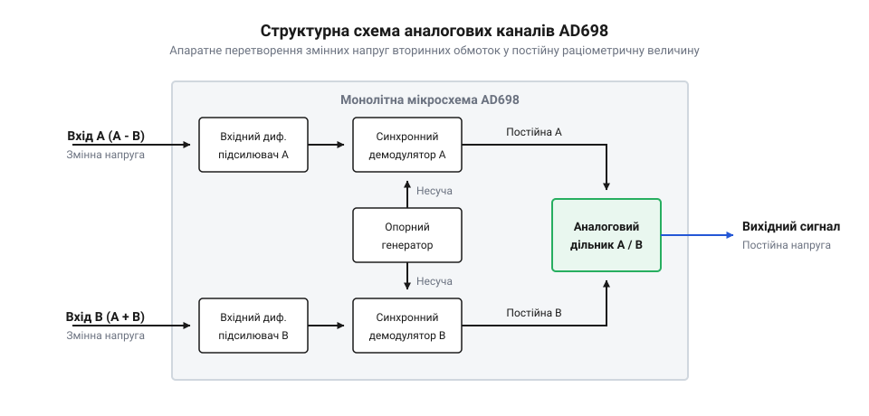
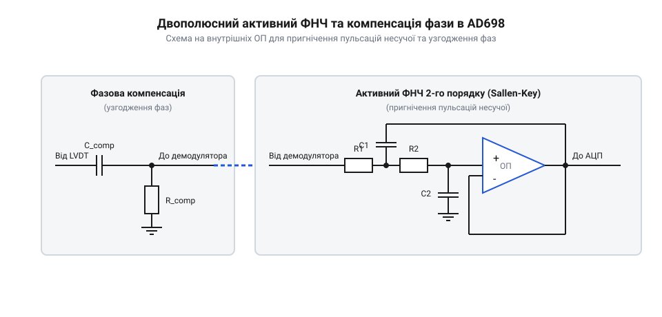
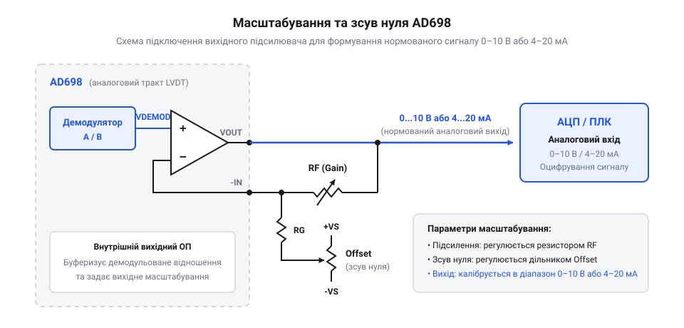

# Спеціалізовані мікросхеми кондиціонування сигналу LVDT

<preknowlist>
- [Лінійні змінні диференціальні трансформатори LVDT](root:cat-hw-sensors/lvdt-linear-variable-differential-transformers) — принципи конструкції, індуктивний зв'язок між первинною та двома вторинними обмотками і залежність амплітуди й фази від переміщення осердя
- [Обертові змінні диференціальні трансформатори RVDT](root:cat-hw-sensors/rvdt-rotary-variable-differential-transformers) — специфіку обертових трансформаторних давачів кута та особливості формоутворення синусоїдальних сигналів вторинних котушок
- [Синхронне детектування та фазочутлива демодуляція давачів положення](root:cat-hw-sensors/synchronous-demodulation-for-inductive-transducers) — математичні та схемотехнічні засади синхронного множення вихідного сигналу на фазовий опорний сигнал несучої частоти
- [Аналоговий фронтенд підготовки сигналів LVDT](root:cat-hw-sensors/lvdt-analog-front-end) — загальні вимоги до узгодження рівня вихідних напруг, нормування сигналів та захисту аналогово-цифрових перетворювачів від високочастотних завад
</preknowlist>

## Нестабільність збудження та збої вимірювання LVDT

У високоточних промислових системах вимірювання мікропереміщень, таких як зворотний зв'язок гідроциліндрів прокатного стану, позиціонування клапанів турбін або виконавчих механізмів авіаційного керування, основним первинним перетворювачем є лінійний змінний диференціальний трансформатор — [трансформаторів LVDT](root:cat-hw-sensors/lvdt-linear-variable-differential-transformers) (від англ. Linear Variable Differential Transformer). Конструктивно LVDT складається з однієї первинної обмотки, двох симетричних вторинних обмоток та рухомого феромагнітного осердя. Для роботи датчика первинну обмотку необхідно живити змінною синусоїдальною напругою збудження `V_exc(t) = V_p · sin(ω_c · t)`. Механічне зміщення осердя змінює магнітний зв'язок між обмотками, модулюючи амплітуду змінних напруг `V_S1` та `V_S2`, що наводяться у вторинних котушках.

У класичній математичній моделі вихідний диференціальний сигнал вторинних обмоток `V_diff = V_S1 - V_S2` прямо пропорційний механічному переміщенню осердя `x` та амплітуді напруги збудження `V_p`:

```
V_diff(t) = k · V_p · x · sin(ω_c · t + θ)
```

де `k` — конструктивний коефіцієнт чутливості датчика, `V_p` — амплітудне значення напруги збудження, `ω_c` — кругова несуча частота генератора, `θ` — кут фазового зсуву між струмом первинного збудження та вихідною напругою. У ідеальному лабораторному середовищі за суворого термостатування та стабільного живлення виміряна амплітуда `V_diff` дозволяє однозначно обчислити положення осердя.

Однак у реальних умовах промислового цеху амплітуда `V_p` джерел живлення та дискретних задаючих генераторів плаває через мережеві завади та температурний дрейф компонентів. Падіння амплітуди `V_p` лише на 2% спричиняє прямо пропорційну хибку вимірювання переміщення `x` на ті ж 2%, створюючи хибне враження механічного зсуву вузла, який насправді лишається нерухомим.

Більш підступним джерелом похибки є температурна нестабільність самих котушок датчика. Мідний дріт, яким вимотано обмотки LVDT, має позитивний температурний коефіцієнт опору `α ≈ +0.393% / °C`. При нагріванні датчика від робочого обладнання на 30 °C (наприклад, від 20 °C до 50 °C) активний опір первинної котушки `R_p` зростає на 11.8% за формулою:

```
R_p(T) = R_0 · (1 + α · ΔT)
= R_0 · (1 + 0.00393 · 30)      [підстановка температурного коефіцієнта міді]
= 1.1179 · R_0                  [зростання опору на 11.79%]
```

Оскільки повний електричний опір первинного кола дорівнює `Z_p = R_p + j · ω_c · L_p`, зростання `R_p` зменшує амплітуду первинного струму `I_p = V_p / Z_p`. Згідно із законом електромагнітної індукції, це пропорційно зменшує амплітуду магнітного потоку `Φ = μ · N_p · I_p / l_m` у магнітопроводі, що призводить до падіння індукованих напруг вторинних обмоток `V_S1` та `V_S2`. В результаті масштабуючий коефіцієнт вимірювального тракту "пливе" разом із температурою навколишнього середовища.

Негативний вплив посилюють з'єднувальні кабелі між датчиком та шафою автоматики, довжина яких може досягати десятків або сотень метрів. Паразитні ємність `C_cable` та опір `R_cable` довгої лінії разом із індуктивністю котушок утворюють розподілений ФНЧ. При добових коливаннях температури вздовж кабельної траси параметри `C_cable` та `R_cable` змінюються, що створює непередбачуване додаткове згасання сигналу та додатковий кут фазового зсуву `θ_cable`.

Спроби оцифрувати вихідний сигнал за допомогою простих випрямляльних мостків на діодах призводять до повного збою вимірювань. Пряме падіння напруги на діодах `V_f ≈ 0.6 В` має високий температурний коефіцієнт (`-2 мВ / °C`), а нелінійність вольт-амперної характеристики поблизу нуля знищує чутливість до мікропереміщень. Крім того, випрямляч втрачає інформацію про фазу сигналу, через що неможливо розрізнити зміщення осердя вліво чи вправо від нульової позиції. Навіть при застосуванні окремого аналогового блоку [синхронної фазочутливої демодуляції](root:cat-hw-sensors/synchronous-demodulation-for-inductive-transducers), вихідна постійна напруга становить:

```
V_dc = (2 / π) · V_s · cos(θ)
```

Якщо фазовий зсув `θ` дрейфує через температурну зміну індуктивності та ємності кабелю, множник `cos(θ)` змінюється, створюючи зміщення нуля та дрейф підсилення в [аналогового фронтенду LVDT](root:cat-hw-sensors/lvdt-analog-front-end).

Для вирішення цієї проблеми застосовують раціометричне (від латинського ratio — відношення та грецького metron — міра) обчислення відношення сигналів. У 4-провідних датчиках LVDT або [перетворювачів RVDT](root:cat-hw-sensors/rvdt-rotary-variable-differential-transformers) формують два аналогові канали: Канал A вимірює різницевий сигнал вторинних обмоток `V_A = V_S1 - V_S2`, а Канал B вимірює їхню суму `V_B = V_S1 + V_S2` (або опорний сигнал первинного збудження).

```
V_A = k_1 · V_p · (x / L) · sin(ω_c · t)
V_B = k_2 · V_p · sin(ω_c · t)
```

При виконанні аналогового ділення `(A - B) / (A + B)` вихідне відношення приймає вигляд:

```
V_ratio = (V_S1 - V_S2) / (V_S1 + V_S2)
= (k · V_p · (1 + x/L) - k · V_p · (1 - x/L)) / (k · V_p · (1 + x/L) + k · V_p · (1 - x/L))    [підстановка напруг вторинних обмоток]
= (2 · k · V_p · (x/L)) / (2 · k · V_p)                                                      [спрощення чисельника й знаменника]
= x / L                                                                                      [скорочення коефіцієнтів та збудження]
```

Оскільки амплітуда збудження `V_p` та несуча синусоїда присутні як у чисельнику, так і у знаменнику, вони повністю скорочуються під час ділення. Якщо струм первинної обмотки зменшиться на 10% через нагрівання котушки або згасання у кабелі, обидві напруги `V_A` та `V_B` впадуть рівно на 10%, залишивши відношення `V_ratio` абсолютно незмінним. Детальний математичний апарат та моделювання фільтрації наведено у [моделі раціометричного обчислення](root:cat-hw-sensors/ad698-signal-conditioner/math-ad698-ratiometric-math.md).

Історично схемотехніка кондиціонування сигналів індуктивних датчиків пройшла шлях від дискретних транзисторних детекторів та діодно-фазових мостків до спеціалізованих інтегральних мікросхем. У дискретних вимірювальних трактах досягнення термостабільності вимагало прецизійного добору пасивних компонентів, термокомпенсованих джерел струму та складної ручної підстройки фазових ланцюгів. Революційним кроком у 1990-х роках стало створення компанією Analog Devices монолітної мікросхеми @@en|AD698@@, яка вперше об'єднала синусоїдальний генератор збудження з силовим буфером, два незалежні аналогові канали обробки з синхронними демодуляторами та внутрішній блок раціометричного ділення на єдиному кремнієвому кристалі. Перехід від вимірювання абсолютних амплітуд напруги до аналогового розрахунку відношення сигналів дозволив повністю компенсувати температурний дрейф опору котушок [трансформаторів LVDT](root:cat-hw-sensors/lvdt-linear-variable-differential-transformers) та нестабільність генератора, поставивши новий стандарт прецизійної промислової автоматики.


*Виникнення вимірювальних похибок у класичному тракті LVDT внаслідок температурного дрейфу амплітуди збудження, зростання опору котушок та фазових спотворень у кабельних лініях.*

## Архітектура AD698 та генератор несучої

Монолітний кондиціонер @@en|AD698@@ (від англ. @@en|LVDT signal conditioner@@) є завершеною прецизійною аналоговою системою кондиціонування сигналів індуктивних датчиків положення. Внутрішня апаратна структура мікросхеми об'єднує на одному кремнієвому кристалі всі функціональні вузли, необхідні для живлення датчика та формування пропорційної постійної напруги для АЦП:

1. Переналаштовуваний синусоїдальний генератор несучої частоти (@@en|carrier oscillator@@) (від латинського oscillare — розгойдуватися). 2. Силовий вихідний буфер збудження з можливістю віддачі струму до 30 мА rms при напрузі до 24 В rms. 3. Два незалежні аналогові канали обробки (Канал A та Канал B) із диференціальними вхідними підсилювачами та фазочутливими синхронними демодуляторами (@@en|synchronous demodulators@@) (від латинського de — вилучення та modulator — той, що розміряє). 4. Два двополюсні активні фільтри нижніх частот (@@en|low-pass filters@@) для пригнічення пульсацій несучої частоти. 5. Внутрішній блок аналогового раціометричного ділення сигналів `(A - B) / (A + B)` або `A / B`. 6. Вихідний масштабуючий операційний підсилювач (@@en|op-amp@@) із можливістю регулювання підсилення (@@en|gain@@) та зсуву нуля (@@en|zero offset adjustment@@).

Застосування чистої синусоїдальної напруги збудження є принциповою вимогою при роботі з датчиками LVDT та [перетворювачів RVDT](root:cat-hw-sensors/rvdt-rotary-variable-differential-transformers). Живлення датчика прямокутними або трикутними імпульсами створює високі гармонійні складові, які викликають паразиний ємнісний струм між обмотками, провокують втрати на вихрові струми у феромагнітному осерді та створюють високочастотні електромагнітні завади. Синусоїдальний сигнал із низьким коефіцієнтом нелінійних спотворень (@@en|THD@@) забезпечує плавну зміну магнітного потоку та виключає квадратурну похибку під час синхронного детектування.

Частота несучої генератора `f_exc` програмується підключенням одного зовнішнього керамічного або плівкового конденсатора `C_OSC` між виводами OSC REF та OSC FILT. Математична залежність частоти від ємності описується формулою:

```
f_exc = 35 Hz / C_OSC_uF
```

Розрахунок номіналу задаючого конденсатора проводиться за кроками:

**Розрахунок частоти генератора несучої:**
```
f_exc = 35 Hz / C_OSC
= 35 / 0.0035            [підстановка ємності C_OSC = 0.0035 мкФ]
= 10000 Hz               [обчислення несучої частоти 10 кГц]
```

Для поширених датчиків LVDT із робочими частотами 2.5 кГц, 5 кГц або 10 кГц значення ємності `C_OSC` обирають відповідно 0.014 мкФ, 0.007 мкФ або 0.0035 мкФ.

Амплітудне значення напруги збудження `V_exc` на виході силового буфера програмується зовнішнім резистором `R_SET`, який підключається між виводом AMP OUT та внутрішньою точкою зворотного зв'язку. Схема автоматичного регулювання посилення стабілізує амплітуду відносно внутрішнього прецизійного опорного джерела 1.2 В rms:

```
V_exc_rms = 1.2 V · (R1 / 10 kΩ)
```

**Розрахунок амплітуди напруги збудження:**
```
V_exc_rms = 1.2 V · (R1 / 10 kΩ)
= 1.2 · (29.4 kΩ / 10 kΩ)      [підстановка R_SET = 29.4 кОм]
= 1.2 · 2.94                   [ділення опорів]
= 3.528 V rms                  [отримання середньоквадратичної напруги]
```

Внутрішній підсилювач потужності спроможний видавати вихідний струм до 30 мА rms, що дозволяє підключати первинні обмотки LVDT з індуктивним опором від 100 Ом напряму без використання зовнішніх драйверів. Схема авторегулювання утримує коефіціент нелінійних спотворень `@@en|THD@@` синусоїди нижче 0.3%, запобігаючи виникненню фазових викривлень.

Оскільки генератор несучої та синхронні демодулятори виконані на одному напівпровідниковому кристалі, опорна фаза для демодуляції жорстко прив'язана до частоти збудження. Фізичне призначення виводів та геометрія корпусів DIP-24 та SOIC-28 описані у [інтерфейсі мікросхеми AD698](root:cat-hw-sensors/ad698-signal-conditioner/api-ad698-hardware-interface.md). Повний приклад проєктування друкованої плати модуля зчитування LVDT подано у [модулі кондиціонування LVDT](root:cat-hw-sensors/ad698-signal-conditioner/proj-ad698-lvdt-interface-board.md).


*Функціональна архітектура AD698 та схемотехніка синусоїдального генератора несучої частоти із пасивними елементами налаштування частоти C_OSC та амплітуди R_SET.*

## Подвійне синхронне детектування та аналоговий дільник

У класичних схемах підключення індуктивних датчиків положення вихідний аналоговий сигнал формується як амплітудно-модульована змінна напруга вторинних обмоток. Головний недолік побудови вимірювальних трактів прямим амплітудним детектуванням полягає у виключній чутливості вихідної напруги до будь-яких коливань амплітуди синусоїдального збудження первинної котушки. Якщо напруга задаючого генератора опускається або зростає через нестабільність джерела живлення, вихідний виміряний рівень змінюється навіть за нерухомого осердя датчика. Крім того, температурний коефіцієнт опору мідного дроту обмоток утворює значний дрейф: при підвищенні температури на 50 °C активний опір котушок зростає приблизно на 20%, що змінює струм збудження та падіння напруги на вихідних обмотках. Ситуація додатково ускладнюється при використанні довгих з'єднувальних кабелів у промислових умовах, де опір і паразитна ємність лінії зв'язку динамічно змінюються від температури навколишнього середовища. Для подолання цих обмежень у спеціалізованій монолітній мікросхемі @@en|AD698@@ застосовано подвійне синхронне детектування з наступним внутрішнім аналоговим діленням.

Внутрішня схемотехніка мікросхеми @@en|AD698@@ базується на двох повністю автономних, вимірювально узгоджених аналогових каналах обробки — Каналі A та Каналі B. Кожен канал починається з прецизійного вхідного диференціального підсилювача з високим вхідним імпедансом та високим коефіцієнтом пригнічення синфазного сигналу (англ. @@en|Common Mode Rejection Ratio@@, @@en|CMRR@@). Диференціальна конфігурація входів дозволяє знімати аналогові сигнали безпосередньо з виводів вторинних обмоток датчика, пригнічуючи синфазні завади й наведені імпульсні перехідні процеси, які виникають у промислових кабельних трасах.

Канал A виділяє та підсилює інформаційну різницю напруг вторинних обмоток `V_A - V_B`. Коли осердя [трансформаторів LVDT](root:cat-hw-sensors/lvdt-linear-variable-differential-transformers) або ротор [обертових перетворювачів RVDT](root:cat-hw-sensors/rvdt-rotary-variable-differential-transformers) перебуває у нейтральному положенні (електричний нуль), амплітуди напруг на обох вторинних обмотках однакові (`V_A = V_B`), і різнецевий сигнал дорівнює нулю. При зміщенні осердя в один чи інший бік амплітуда `V_A - V_B` зростає пропорційно величині переміщення, а фаза зміщується на 180 градусів при зміні напрямку зміщення відносно нуля.

Канал B слугує для формування опорного сигналу, пропорційного сумі напруг вторинних обмоток `V_A + V_B` або безпосередньо напрузі первинного збудження `V_pri`. Завдяки симетрії конструкції диференціального трансформатора сума амплітуд вторинних напруг `V_A + V_B` залишається практично незмінною при будь-якому переміщенні осердя у межах робочого діапазону. Проте ця сумарна величина миттєво відстежує всі амплітудні коливання синусоїдального генератора несучої (@@en|carrier oscillator@@), температурний дрейф опору обмоток та падіння напруги в кабельних лініях.

Після первинного диференціального підсилення аналогові сигнали обох каналів подаються на фазочутливі синхронні демодулятори (@@en|synchronous demodulators@@). Механізм синхронного детектування полягає у множенні вхідного змінного сигналу несучої частоти на внутрішній опорний прямокутний меандр, згенерований та синхронізований із вихідним синусоїдальним збудженням. Внутрішні електронні ключі демодуляторів здійснюють повноперіодне випрямлення: у позитивному напівперіоді несучої сигнал проходить без інверсії, а у негативному — інвертується на протилежний знак. Завдяки цьому змінний синусоїдальний сигнал перетворюється на пульсуючий постійний струм. Оскільки випрямлення відбувається синхронно з частотою несучої, демодулятор повністю ігнорує сторонні некорельовані завади, шуми та парні гармоніки. Детальний математичний апарат фазочутливого випрямлення висвітлює розділ про [демодуляцію індуктивних сенсорів](root:cat-hw-sensors/synchronous-demodulation-for-inductive-transducers).


*Двоканальна обробка сигналів LVDT із диференціальним підсиленням, синхронною демодуляцією та аналоговим раціометричним діленням.*

Випрямлені аналогові напруги з виходів демодуляторів Каналу A та Каналу B потрапляють на входи внутрішнього блока аналогового ділення. Внутрішній дільник мікросхеми @@en|AD698@@ побудований на базі прецизійної логарифмічно-антилогарифмічної транзисторної комірки у колі зворотного зв'язку операційного підсилювача. Блок у реальному часі здійснює апаратне обчислення відношення двох аналогових величин.

Математичний механізм повного скасування амплітудного та температурного дрейфу описується співвідношеннями вихідних демодульованих напруг Каналу A (`V_demod_A`) та Каналу B (`V_demod_B`):

```
V_demod_A = k(T, t) · V_exc · (V_A - V_B)
V_demod_B = k(T, t) · V_exc · (V_A + V_B)

V_div = V_demod_A / V_demod_B
      = (k(T, t) · V_exc · (V_A - V_B)) / (k(T, t) · V_exc · (V_A + V_B))      [підстановка виразів каналів]
      = (V_A - V_B) / (V_A + V_B)                                             [скорочення мультиплікативного дрейфу]
```

де `k(T, t)` — узагальнений коефіцієнт передачі вимірювальної траси, що враховує температурні зміни опору обмоток та дрейф параметрів кабелю, а `V_exc` — миттєве значення амплітуди синусоїдального збудження. Оскільки збудження та температурні впливи однаково діють на обидві вторинні обмотки симетричного датчика, мультиплікативний множник `k(T, t) · V_exc` у чисельнику та знаменнику повністю скорочується.

Вихідне значення `V_div` стає абсолютно інваріантним до нестабільності напруги генератора збудження та коливань температури навколишнього середовища. Якщо кондиціонер конфігурується для роботи з 4-провідними датчиками, Канал B підключається безпосередньо до первинної обмотки `V_pri`, виконуючи ділення `(V_A - V_B) / V_pri`. Вичерпний математичний розрахунок лінійності та похибок перетворення подано у матеріалі про [математичну модель раціометричного перетворення](root:cat-hw-sensors/ad698-signal-conditioner/math-ad698-ratiometric-math.md).

Специфіку фізичного розведення вхідних ліній, режими конфігурації виводів дільника та електричні параметри корпусу мікросхеми містить [апаратний інтерфейс AD698](root:cat-hw-sensors/ad698-signal-conditioner/api-ad698-hardware-interface.md).

## Активна фільтрація та компенсація фазового зсуву

Після синхронної демодуляції аналогові сигнали Каналу A та Каналу B містять корисну постійну складову, пропорційну переміщенню осердя, а також потужні високочастотні пульсації на подвоєній частоті несучої `2 · f_carrier` та її вищих парних гармоніках. Якщо подати ці пульсуючі сигнали безпосередньо на блок аналогового ділення та вихідний масштабуючий підсилювач, високочастотні складові викличуть перевантаження й нелінійні спотворення аналогового дільника, а при подальшому оцифруванні у мікроконтролерному АЦП призведуть до виникнення похибок накладання частот (англ. @@en|aliasing@@). Щоб забезпечити високий рівень співвідношення сигнал/шум, у складі кондиціонера @@en|AD698@@ передбачено внутрішні операційні підсилювачі, призначені для побудови активних фільтрів нижніх частот (@@en|low-pass filters@@).

Для кожного з двох аналогових каналів розраховується автономний двополюсний активний ФНЧ другого порядку. Фільтри будуються на базі внутрішніх операційних підсилювачів @@en|AD698@@ із використанням зовнішнього пасивного RC-обв'язування за топологією Саллена-Кея (англ. @@en|Sallen-Key topology@@) або за топологією багаторазового зворотного зв'язку (англ. @@en|Multiple Feedback@@, @@en|MFB@@).

Вибір частоти зрізу `f_c` активного ФНЧ визначається компромісом між рівнем пригнічення високочастотних пульсацій несучої та динамічною смугою пропускання вимірювальної системи. Для забезпечення надійного пригнічення складової `2 · f_carrier` (щонайменше на 40–50 дБ) частоту зрізу вибирають у розрахунковому діапазоні від `1/10` до `1/100` від частоти задаючого генератора `f_carrier`.

Розрахунок частоти зрізу двополюсного ФНЧ другого порядку здійснюється за виразом:

```
f_c = 1 / (2 · π · √(R1 · R2 · C1 · C2))
```

Під час вибору типу апроксимації характеристик фільтра рекомендується розраховувати коефіцієнти пасивних компонентів під критерій Бесселя (англ. @@en|Bessel filter@@). На відміну від апроксимації Баттерворта (англ. @@en|Butterworth filter@@), яка забезпечує максимально плоску амплітудно-частотну характеристику, фільтр Бесселя має максимально лінійну фазочастотну характеристику та постійну величину групового затримування у смузі пропускання. Це гарантує повну відсутність перерегулювання й викидів на вихідному аналоговому сигналі при стрибкоподібному механічному переміщенні осердя датчика.


*Схема активних фільтрів другого порядку та коригувальних RC-мереж для пригнічення HF-пульсацій і компенсації фазового зсуву.*

Поряд із фільтрацією високочастотних пульсацій критичною умовою забезпечення точності вимірювання є компенсація фазового зсуву (@@en|phase shift@@). У реальних датчиках LVDT та RVDT вихідна напруга вторинних обмоток має фазовий зсув `θ` відносно синусоїдальної напруги первинного збудження. Виникнення фазового зсуву зумовлене сукупністю фізичних чинників:

1. Власною індуктивністю та активним опором первинної котушки датчика. 2. Розподіленою ємністю та індуктивністю з'єднувального кабелю великої довжини. 3. Втратами на вихрові струми та гістерезис у феромагнітному осерді. 4. Зміною активного опору мідної обмотки при коливаннях температури навколишнього середовища.

Коли синхронний демодулятор виконує множення вхідного сигналу на опорний меандр, який зсунутий за фазою відносно вихідного сигналу датчика на кут `θ`, амплітуда отриманої випрямленої постійної напруги зменшується пропорційно `cos(θ)`:

```
V_demod = V_max · cos(θ)
```

Якщо кут `θ` малий (менше 5 градусів), величина `cos(θ)` близька до одиниці і похибка незначна. Однак при зміні температури навколишнього середовища опір обмотки змінюється, що спричиняє температурне плавання кута зсуву `Δθ(T)`. Оскільки похідна `d(cos θ)/dθ = -sin θ`, при наявності початкового фазового зсуву будь-яка температурна девіація фази викличе суттєвий дрейф коефіцієнта підсилення всього вимірювального тракту. При великих кутах зсуву (понад 10–15 градусів) додатково знижується чутливість каналу та погіршується лінійність перетворення.

Для усунення фазових похибок у мікросхемі @@en|AD698@@ застосовують два схемотехнічні методи:

- **Зовнішня фазокомпенсувальна RC-мережа:** між виходом синусоїдального генератора та опорним входом синхронізації демодуляторів вмикається фазозсувний RC-ланцюг. Цей ланцюг забезпечує випередження або затримування опорного прямокутного меандру на кут `θ`, точно рівний фазовому зсуву вторинної напруги датчика, що зводить різницю фаз до нуля (`cos(0°) = 1`). - **Автоматичне скасування фазової похибки в раціометричному режимі:** якщо Канал B обробляє сумарну напругу вторинних обмоток `V_A + V_B`, обидва сигнали (і різнецевий `V_A - V_B`, і сумарний `V_A + V_B`) отримують абсолютно одинаковий фазовий зсув `θ` відносно первинного збудження. При синхронному детектуванні обидва канали зазнають одинакового зменшення амплітуди на множник `cos(θ)`. Під час подальшого аналогового ділення в блоці дільника множник `cos(θ)` у чисельнику й знаменнику скорочується:

```
V_div = ((V_A - V_B) · cos(θ)) / ((V_A + V_B) · cos(θ))
      = (V_A - V_B) / (V_A + V_B)                               [автоматичне скасування фазового зсуву]
```

Таким чином, раціометричний режим обчислення (A - B) / (A + B) автоматично компенсує помірні фазові зсуви без встановлення додаткових пасивних фазообертачів.

Практичні рекомендації щодо розрахунку номіналів пасивних компонентів ФНЧ, вибору типів конденсаторів з низьким ТКЄ та розведення друкованої плати містить [проєктування вимірювального модуля](root:cat-hw-sensors/ad698-signal-conditioner/proj-ad698-lvdt-interface-board.md). Вимоги до трасування аналогової землі, екранування вимірювальних трас та захисту вхідних каскадів детально висвітлює розділ про вимоги до [аналогового фронтенду LVDT](root:cat-hw-sensors/lvdt-analog-front-end).

## Масштабування вихідної напруги та зсув нуля

Вхідний вимірювальний тракт на базі синхронних демодуляторів та внутрішнього дільника мікросхеми @@en|AD698@@ формує аналоговий сигнал, амплітуда якого безпосередньо пропорційна відносному переміщенню осердя [трансформаторів LVDT](root:cat-hw-sensors/lvdt-linear-variable-differential-transformers). Однак вихідний струм дільника становить лише мікроамперні значення і не відповідає стандартним вхідним рівням більшості промислових аналогово-цифрових перетворювачів та контролерів автоматизації. Без додавання спеціалізованого ступеня узгодження вимірювальний сигнал залишається вразливим до наведених завад і не дозволяє використовувати повну розрядність АЦП. Для перетворення цього первинного раціометричного сигналу в уніфікований напруговий діапазон 0–10 В, ±5 В або струмовий сигнал 4–20 мА до складу @@en|AD698@@ інтегровано вихідний операційний підсилювач (англ. *operational amplifier*, від латинського *operari* — працювати та *amplificare* — розширювати; @@en|operational amplifier@@) з вільними виводами інвертуючого входу, неінвертуючого входу та виходу.

Внутрішня схемотехніка вихідного підсилювача побудована так, щоб користувач міг гнучко задавати коефіцієнт підсилення (англ. *gain*, від давньоанглійського *gagn* — прибуток, вигода; @@en|gain@@) та здійснювати зсув нуля (англ. *zero offset adjustment*, від давньоанглійського *of* — від та *settan* — ставити; @@en|zero offset adjustment@@) за допомогою зовнішньої резистивної обв'язки. Після завершення [демодуляції індуктивних сенсорів](root:cat-hw-sensors/synchronous-demodulation-for-inductive-transducers) внутрішній дільник нагнітає у підсумовуючу точку інвертуючого входу струм `I_DIV`, який визначається відношенням сигналів вторинних обмоток `(A - B) / (A + B)` або `A / B`. Підключення зовнішніх пасивних компонентів дає змогу сформувати чітку лінійну залежність вихідної напруги `V_OUT` від положення осердя давача.


*Схема підключення вихідного масштабуючого операційного підсилювача AD698 із резистивним дільником регулювання підсилення Gain та зсуву нуля Offset.*

Аналітичний розрахунок вихідної напруги операційного підсилювача ґрунтується на першому законі Кірхгофа для вузла інвертуючого входу. Сума струму від внутрішнього дільника `I_DIV`, струму зсуву `I_OFFSET` від джерела опорної напруги `V_REF` та струму зворотного зв'язку `I_FB` дорівнює нулю. Це дозволяє вивести базове рівняння передавальної функції масштабуючого каскаду:

```text
I_DIV + I_OFFSET + I_FB = 0
I_DIV + (V_REF / R_OFFSET) + ((V_REF_MID - V_OUT) / R_GAIN) = 0
V_OUT = V_REF_MID + (I_DIV × R_GAIN) + (V_REF × R_GAIN / R_OFFSET)
```

де `R_GAIN` — опір резистора у колі зворотного зв'язку між виходом та інвертуючим входом, `R_OFFSET` — опір резистора задання зміщення нуля, підключений до опорної напруги `V_REF` (наприклад, внутрішнього джерела +2.5 В або зовнішнього прецизійного іонізатора напруги), а `V_REF_MID` — потенціал неінвертуючого входу підсилювача.

При налаштуванні двополярного виходу ±5 В для симетричного датчика переміщення (де нульове переміщення осердя відповідає `I_DIV = 0 мкА`) струм зсуву `I_OFFSET` обирається рівним нулю, а опір `R_GAIN` розраховується так, щоб максимальний струм дільника `I_DIV_FS` створював на виході напругу `+5.0 В`. У разі однополярного живлення та потреби формоутворення діапазону 0–10 В, для нейтрального положення осердя `dx = 0` вихідну напругу зсувають до рівня `+5.0 В`, за рахунок чого крайній від'ємний хід осердя формує `0.0 В`, а крайній додатний — `+10.0 В`.

**Розрахунок обв'язки AD698 для виходу 0–10 В при ході осердя ±2.5 мм:**

```text
[1. Вхідні дані давача та кондиціонера]
Робочий хід осердя dx = ±2.5 мм
Повний вихідний струм дільника I_DIV_FS = ±100 мкА (при dx = ±2.5 мм)
Діапазон вихідної напруги V_OUT = 0.0 В ... 10.0 В
Опорна напруга зсуву V_REF = +2.5 В
Потенціал неінвертуючого входу V_REF_MID = +5.0 В

[2. Розрахунок резистора підсилення R_GAIN]
Необхідний розмах вихідної напруги V_SPAN = 10.0 В - 0.0 В = 10.0 В
Розмах вхідного струму I_SPAN = +100 мкА - (-100 мкА) = 200 мкА = 0.0002 А
R_GAIN = V_SPAN / I_SPAN
       = 10.0 В / 0.0002 А
       = 50 000 Ом = 50 кОм

[3. Розрахунок резистора зсуву нуля R_OFFSET]
При dx = 0 мм струм I_DIV = 0 мкА, вихід має дорівнювати V_OUT = 5.0 В
Оскільки V_REF_MID = 5.0 В, додатковий струм зсуву не потрібен:
R_OFFSET = ∞ (відкрите коло)

При використанні неінвертуючого входу, підключеного до 0 В (AGND), зміщення розраховується так:
R_OFFSET = V_REF × R_GAIN / V_OUT_OFFSET
         = 2.5 В × 50 кОм / 5.0 В
         = 25 кОм
```

Для забезпечення точності вимірювання мікропереміщень у цьому каскаді застосовують лише металоплівкові резистори з допуском не гірше `0.1%` та температурним коефіцієнтом опору ТКО не більше `±10 ppm/°C`. Використання стандартних вуглецевих резисторів неприпустиме через високий рівень теплового шуму та температурний дрейф опору, що знівелює раціометричну компенсацію датчика.

Для передачі аналогового сигналу на значні відстані (понад 10–50 метрів) у промислових умовах напруговий вихід масштабуючого підсилювача перетворюється у нормований струмовий сигнал 4–20 мА (англ. *current loop*; @@en|current loop@@). Струмовий передавач (англ. *current transmitter*; @@en|current transmitter@@) стійкий до падіння напруги на вимірювальних кабелях та лінійних завад від силового обладнання. У такій схемі струм `4 мА` відповідає крайньому від'ємному положенню осердя LVDT (`dx = -x_max`), струм `12 мА` — нейтральному положенню (`dx = 0`), а струм `20 мА` — крайньому додатному положенню (`dx = +x_max`). Нижній поріг у `4 мА` слугує апаратним детектором обриву лінії: якщо струм у петлі падає до `0 мА`, система фіксує механічне пошкодження з'єднувального кабелю.

Подальша обробка оцифрованого сигналу в мікроконтролері вимагає зворотного математичного перетворення відліків АЦП у фізичну величину переміщення в міліметрах з урахуванням калібрувальних коефіцієнтів:

:::tabs
@tab C
:::code ad698-signal-conditioner-d/c/lvdt-calculate-displacement-mm.c
@tab C++
:::code ad698-signal-conditioner-d/cpp/lvdtsignalprocessor.cpp
:::

Детальний аналітичний вивід математичних формул та алгоритм розрахунку активних фільтрів наведено у [математичній моделі AD698](root:cat-hw-sensors/ad698-signal-conditioner/math-ad698-ratiometric-math.md). Фізичне призначення цокольовки та граничні електричні параметри виходів висвітлено у [апаратному інтерфейсі AD698](root:cat-hw-sensors/ad698-signal-conditioner/api-ad698-hardware-interface.md), що слугує інженерним довідником при спряженні з вимогами [аналогового фронтенду LVDT](root:cat-hw-sensors/lvdt-analog-front-end).

## Топологія друкованої плати та мінімізація завад

Проєктування прецизійного вимірювального модуля для індуктивних датчиків переміщення вимагає суворого дотримання правил топології друкованої плати (англ. *printed circuit board*; @@en|printed circuit board@@). Навіть точний математичний розрахунок пасивної обв'язки мікросхеми @@en|AD698@@ не забезпечить високої роздільної здатності (до часток мікрометра), якщо аналогові сигнали спотворюватимуться паразитною наводкою від силових кіл чи цифрових шин. Основні джерела похибок у промислових умовах виникають через паразитні контури заземлення (англ. *ground loop*, від давньоанглійського *grund* — земля, та середньоанглійського *loupe* — петля; @@en|ground loop@@), імпульсні завади перемикання живлення та електромагнітні наводки на вимірювальні кабелі.

Фундаментальним принципом побудови завадостійкої плати є розділення аналогового заземлення (AGND) та цифрового заземлення (DGND). Аналогове заземлення слугує опорним потенціалом для чутливих вхідних підсилювачів, синхронних демодуляторів та вихідного ОП. Якщо через спільне заземлення протікатимуть імпульсні струми перемикання цифрових логічних елементів або АЦП, на паразитному опорі друкованих доріжок виникне падіння напруги в кілька мілівольт, що повністю спотворить мікровольтний вихідний сигнал вторинних обмоток [трансформаторів LVDT](root:cat-hw-sensors/lvdt-linear-variable-differential-transformers). Зауважимо, що коли система вимагає прямого цифрового виходу без аналогового тракту, застосовують альтернативні [цифрові інтерфейси SSI](root:cat-hw-sensors/ssi-bissc-digital-interfaces), однак для прецизійної аналогової демодуляції ізоляція заземлення є обов'язковою.

З'єднання аналогової та цифрової площин заземлення повинно здійснюватися виключно в одній точці — за схемою «зірка» (англ. *star ground*; @@en|star ground@@). Цю точку вибирають безпосередньо під корпусом мікросхеми @@en|AD698@@ або біля аналогового виводу заземлення АЦП. Для фізичного розділення площин на внутрішніх шарах друкованої плати залишають зазор завширшки не менше 1–2 мм, а точка з'єднання реалізується у вигляді вузького містка або феритової намистини (англ. *ferrite bead*), яка блокує високочастотні струми.

Для стабілізації внутрішніх вузлів генератора та демодуляторів кожна шина живлення `+V_S` та `-V_S` мікросхеми @@en|AD698@@ має містити паралельну пару блокувальних конденсаторів (англ. *decoupling capacitor*; @@en|decoupling capacitor@@). Пара складається з керамічного конденсатора ємністю `0.1 мкФ` з низьким еквівалентним послідовним опором (ESR) та танталового або електролітичного конденсатора ємністю `10 мкФ`. Керамічний конденсатор розміщують на мінімальній відстані (не далі 2 мм) від виводу живлення мікросхеми та підключають до площини AGND короткими й широкими провідниками через перехідні отвори. Це мінімізує індуктивність провідників та запобігає виникненню високочастотних автоколивань внутрішнього генератора несучої.

Трасування сигнальних ліній вхідних первинних та вторинних обмоток LVDT і [обертових перетворювачів RVDT](root:cat-hw-sensors/rvdt-rotary-variable-differential-transformers) виконується у вигляді симетричних диференціальних пар. Сигнальні провідники каналів `A` та `B` мають розводитися паралельно, володіти однаковою довжиною та мінімальною площею міжпровідникової петлі для взаємної компенсації наведених синфазних завад.

Підключення виносного датчика LVDT до плати кондиціонера здійснюється екранованим кабелем із витими парами. Обмотки збудження та вихідні обмотки розміщують у окремих екранованих жилах. Металевий екран кабелю (англ. *electrostatic shielding*; @@en|electrostatic shielding@@) підключається до аналогової землі AGND лише з одного боку — на стороні модуля кондиціонування. Підключення екрана з обох боків суворо заборонено, оскільки це створює замкнений паразитний контур заземлення, через який протікатимуть зрівнювальні струми промислової частоти 50 Гц, викликаючи фазовий дрейф та похибку амплітуди.

Аналоговий тракт @@en|AD698@@ чутливий до градієнтів температури на поверхні друкованої плати. Несиметричне розміщення пасивних компонентів задання коефіцієнта підсилення та активних фільтрів відносно джерел тепла (стабілізаторів живлення, потужних транзисторів чи обчислювальних процесорів) створює паразитичні термо-ЕРС у місцях спаювання мідних доріжок із виводами елементів. Щоб мінімізувати температурні викривлення:
1. Компоненти аналогових каналів `Channel A` та `Channel B` розміщують дзеркально й симетрично відносно корпусу @@en|AD698@@. 2. Гарячі силові елементи виносять на протилежний край друкованої плати та відділяють теплоізолюючими прорізами у текстоліті. 3. Використовують суцільні внутрішні шари аналогового заземлення для рівномірного розподілу тепла по платі.

Підсумкова збірка прецизійного аналогового тракту забезпечує узгодження високої лінійності кондиціонера @@en|AD698@@ із вимогами [аналогового фронтенду LVDT](root:cat-hw-sensors/lvdt-analog-front-end). На вході АЦП встановлюють антиаліасинговий RC-фільтр з частотою зрізу, що в 2–5 разів перевищує верхню частоту зрізу внутрішніх активних ФНЧ AD698. Це запобігає проникненню високочастотних комутаційних шумів вхідного каскаду АЦП у вимірювальний тракт.

Практичну методику проєктування принципових схем, розводки друкованих плат та компонування вимірювальних модулів висвітлено у [проєктуванні модуля LVDT](root:cat-hw-sensors/ad698-signal-conditioner/proj-ad698-lvdt-interface-board.md), що містить готові топологічні рішення для промислових датчиків переміщення.