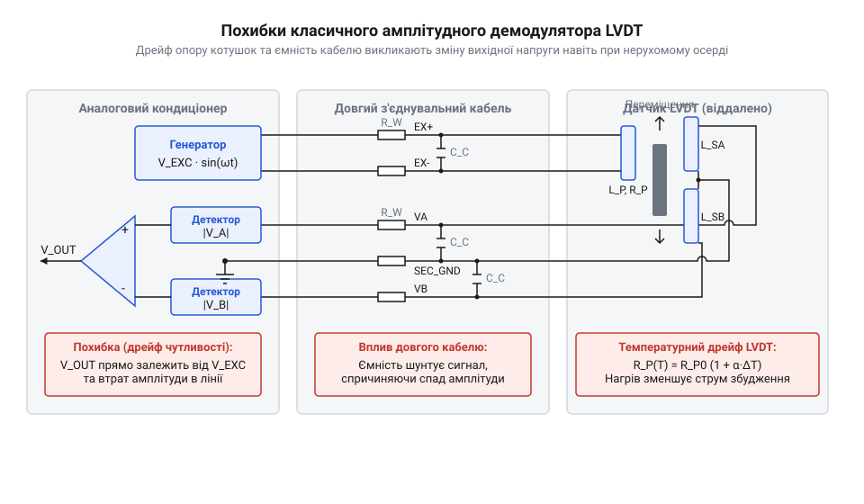
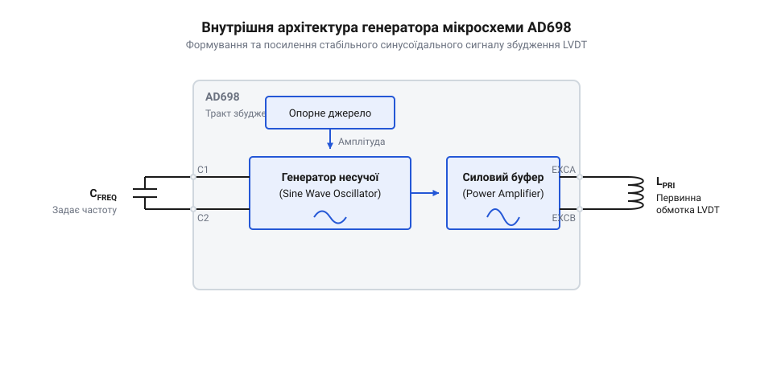
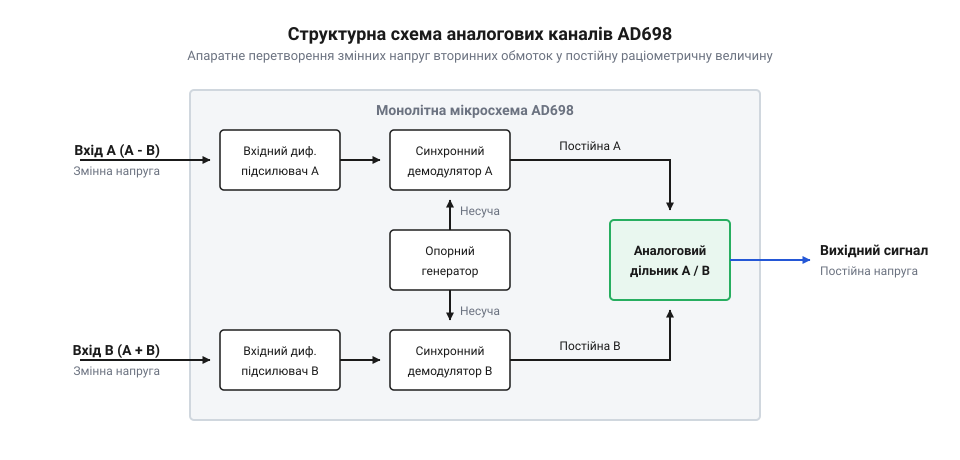

# Спеціалізовані мікросхеми кондиціонування сигналу LVDT

<preknowlist>
- [Лінійні змінні диференціальні трансформатори LVDT](root:cat-hw-sensors/lvdt-linear-variable-differential-transformers) — принципи конструкції, індуктивний зв'язок та залежність амплітуди від переміщення осердя
- [Синхронне детектування та фазочутлива демодуляція давачів положення](root:cat-hw-sensors/synchronous-demodulation-for-inductive-transducers) — схемотехнічні засади синхронного множення вихідного сигналу на фазовий опорний сигнал несучої
</preknowlist>

## Проблема нестабільності класичного випрямлення LVDT

Для вимірювання точного положення індуктивними давачами потрібне стабільне збудження та безпомилкове зчитування сигналу. Коли осердя [лінійного змінного диференціального трансформатора](root:cat-hw-sensors/lvdt-linear-variable-differential-transformers) зміщується, амплітуда вихідної напруги змінюється пропорційно до цього зміщення. Найпростіший спосіб отримати значення амплітуди — використати діодний випрямляч. Проте діоди мають власний спад напруги, який сильно залежить від температури. Будь-яке коливання температури довкілля призводить до зміни вихідної напруги випрямляча, навіть якщо механічне положення осердя залишається незмінним.

Крім того, амплітуда сигналу вторинних обмоток безпосередньо залежить від амплітуди напруги збудження первинної обмотки. Якщо джерело живлення має пульсації або його напруга «пливе» з часом, вихідний сигнал давача також зміниться. Опір мідних обмоток трансформатора зростає з нагріванням, що додатково послаблює сигнал. Усі ці завади імітують для системи вимірювання справжнє механічне зміщення осердя, створюючи невідворотну вимірювальну похибку.

*Вплив нестабільності збудження та температури на класичне випрямлення.*

Ця проблема вимагає принципово іншого підходу до обробки сигналів, який би не залежав від абсолютних значень напруг і компенсував би вплив температури. Для цього створюють спеціалізовані мікросхеми @@en|кондиціонування@@, що працюють за раціометричним (від @@la|ratio@@ — відношення) принципом.

## Архітектура AD698 та генератор несучої

Щоб гарантувати точність, система вимірювання повинна самостійно формувати еталонний сигнал збудження та синхронно обробляти відповідь. Мікросхема AD698 містить усі необхідні для цього блоки в одному корпусі. Її архітектура охоплює генератор синусоїдальної несучої (@@en|carrier oscillator@@), два канали підсилення та @@en|демодуляції@@, а також вихідний підсилювач-масштабатор.

*Структурна схема AD698 із вбудованим генератором синусоїди.*

Вбудований генератор формує стабільну синусоїдальну напругу низьких спотворень, яка живить первинну обмотку давача. Частота та амплітуда цього сигналу задаються зовнішніми конденсаторами й резисторами. Висока чистота синусоїди важлива для того, щоб уникнути виникнення гармонік, які можуть спричинити додаткові похибки в трансформаторі. Генератор забезпечує надійну опорну частоту, відносно якої відбувається вся подальша обробка.

## Синхронна демодуляція та раціометричне ділення

Після того як давач перетворив положення на амплітудно-модульований сигнал, його потрібно розшифрувати. Для цього AD698 використовує двоканальне [синхронне детектування](root:cat-hw-sensors/synchronous-demodulation-for-inductive-transducers). Перший канал підключений до вторинних обмоток давача і вимірює їхній вихідний сигнал. Другий канал підключений паралельно до первинної обмотки і постійно вимірює реальну напругу збудження, яка надходить на давач.

*Двоканальна демодуляція та блок ділення сигналів.*

Обидва сигнали проходять через синхронні демодулятори, перетворюючись на постійні напруги, пропорційні їхнім амплітудам. Ключовим етапом є апаратне @@en|раціометричне@@ обчислення: мікросхема ділить напругу вторинної обмотки на напругу первинної. Оскільки температурний дрейф опору обмоток або падіння напруги в кабелі послаблюють обидва сигнали пропорційно, при діленні ці фактори повністю скасовуються. Результатом стає чисте відношення, яке залежить лише від магнітного зв'язку, тобто від реального механічного положення осердя.

## Активна фільтрація та фазовий зсув

Після синхронної @@en|демодуляції@@ утворені постійні напруги містять пульсації на подвоєній частоті несучої. Щоб виділити чистий корисний сигнал, ці пульсації необхідно відфільтрувати. Мікросхема використовує активні фільтри низьких частот, параметри яких задаються зовнішніми компонентами, дозволяючи налаштувати компроміс між швидкістю реакції системи та рівнем шумів.

Ще однією проблемою в промислових умовах є фазовий зсув. При використанні довгих кабелів виникає затримка сигналу між первинною та вторинною обмотками. Класичний фазочутливий демодулятор, який спирається лише на фазу генератора, у таких умовах втрачає амплітуду корисного сигналу. Однак завдяки тому, що AD698 вимірює напругу безпосередньо на первинній обмотці за допомогою окремого каналу, @@en|раціометричний@@ режим автоматично компенсує цей фазовий зсув без необхідності додаткових ручних налаштувань.