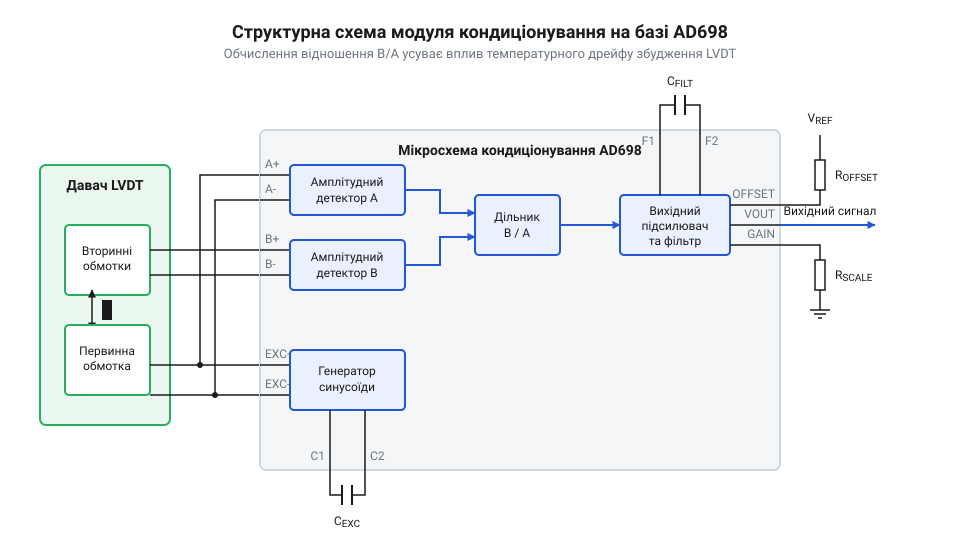
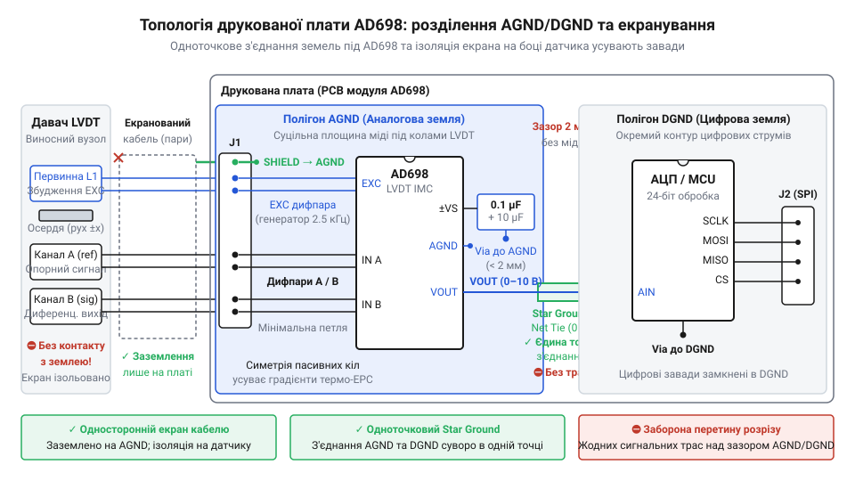

# Проєктування прецизійного аналогового модуля кондиціонування LVDT на базі AD698

<preknowlist>
- [Аналоговий фронтенд підготовки сигналів LVDT](root:cat-hw-sensors/lvdt-analog-front-end) — Принципи роботи аналогових фронтендів для LVDT, загальні вимоги до збудження та демодуляції.
- [Синхронне детектування та фазочутлива демодуляція давачів положення](root:cat-hw-sensors/synchronous-demodulation-for-inductive-transducers) — Математична та фізична суть синхронного детектування, яке використовується всередині AD698.
- [Лінійні змінні диференціальні трансформатори LVDT](root:cat-hw-sensors/lvdt-linear-variable-differential-transformers) — Будова та принцип дії самого датчика LVDT, параметри його обмоток.
</preknowlist>

## Завдання і структурна схема модуля

Звичайне підключення [лінійного змінного диференціального трансформатора (LVDT)](root:cat-hw-sensors/lvdt-linear-variable-differential-transformers) напряму до вимірювальних систем вимагає одночасно генерувати стабільний синусоїдальний сигнал збудження, зчитувати змінну напругу з вторинних обмоток та обчислювати їх відношення з урахуванням фази. Якщо збудження змінює амплітуду або фазу під впливом температури, результат прямого вимірювання стає неточним. Мікросхема AD698 розв'язує цю проблему, реалізуючи повний цикл кондиціонування: вона сама живить первинну обмотку і демодулює сигнали вторинних, видаючи на виході постійну напругу, пропорційну зміщенню осердя.

Архітектура AD698 побудована навколо методу ратіометричного вимірювання. Вона порівнює амплітуду сигналу з вторинної обмотки безпосередньо з амплітудою збудження первинної, тому будь-які дрейфи генератора взаємно компенсуються. 


*Структурна схема модуля кондиціонування з підключеним LVDT. Видно, як генератор живить первинну обмотку, а сигнали з неї та вторинної обмотки надходять на окремі канали демодуляції для обчислення їх відношення.*

Усередині мікросхеми працює генератор синусоїди, частоту і розмах якого ми задаємо зовнішніми компонентами. Сигнал збудження подається на датчик. Напруга з первинної обмотки повертається на перший канал мікросхеми як опорна (референсна), а напруга з вторинної обмотки — на другий канал як вимірювана. Обидва сигнали проходять через [вбудовані синхронні демодулятори](root:cat-hw-sensors/synchronous-demodulation-for-inductive-transducers), де очищаються від шумів і перетворюються на постійні напруги: вимірювану `V_A` з вторинної обмотки та опорну `V_B` з первинної. Нарешті, внутрішній аналоговий дільник обчислює відношення вимірюваної напруги до опорної. Цю операцію реалізовано не на класичних комірках Гілберта чи логарифмічних підсилювачах, які страждають від сильного температурного дрейфу й нелінійності `p-n`-переходів, а за допомогою перемножувача зі змінним коефіцієнтом заповнення (@@en|duty cycle multiplier@@). Внутрішній генератор і компаратор перетворюють відношення напруг на часовий інтервал: амплітуда пилкоподібного сигналу задається опорною напругою `V_B` у знаменнику, а поріг спрацьовування компаратора — вимірюваною напругою `V_A` у чисельнику. У результаті на виході формуються прямокутні імпульси, коефіцієнт заповнення (шпаруватість) яких строго дорівнює відношенню `V_A / V_B` (при `V_A = V_B` він становить 100%). Цей імпульсний сигнал комутує внутрішнє стабільне джерело опорного струму `I_ref` номіналом 500 мкА, і після згладжування інтегрувальним фільтром середній струм стає пропорційним відношенню напруг `I_ref · (V_A / V_B)`. Перехід у часову область забезпечує високу лінійність у широкому діапазоні температур, проте платою за це є потреба у згладжуванні імпульсних пульсацій: вихідний фільтр обмежує смугу пропускання та уповільнює реакцію тракту на різкі механічні переміщення осердя. Механізм ділення працює таким чином, що внутрішня схема порівнює вимірювану напругу з рівнем опорної за допомогою пікового детектора та схеми зворотного зв'язку, яка динамічно змінює масштабний коефіцієнт. Якщо опорна напруга змінюється через коливання температури або напруги живлення, подібна зміна синхронно масштабує обидва канали, завдяки чому кінцевий результат залишається стабільним. Проте у випадку різкого зникнення опорного сигналу або обриву дротів первинної обмотки знаменник прямує до нуля, через що дільник втрачає стійкість, виходить на насичення і видає максимальну або хибну напругу на виході. Оскільки обидва сигнали походять від одного генератора, будь-які дрейфи його амплітуди пропорційно змінюють чисельник і знаменник, тому обчислене відношення залежить виключно від положення осердя. Цей механізм вимагає достатнього рівня опорного сигналу: якщо амплітуда первинної обмотки просідає (знаменник `V_B` прямує до нуля), коефіцієнт підсилення кола ділення прямує до нескінченності, через що власні похибки, зміщення компаратора та шуми стрімко посилюються, дільник заходить у насичення і спотворює вимір. Після ділення вихідний каскад масштабує результат у стандартний діапазон, наприклад 0–10 В, готовий для АЦП.

## Розрахунок частотозадавальних кіл

Щоб генератор AD698 видавав правильний сигнал збудження, його потрібно налаштувати під конкретний датчик. Кожен LVDT має оптимальну частоту збудження, на якій його чутливість максимальна, а фазовий зсув мінімальний. Зазвичай це від 1 до 10 кГц. 

Частота генератора `f_{exc}` в AD698 визначається лише одним зовнішнім конденсатором `C_{exc}`, який підключається між виводом частоти та аналоговою землею. Формула для розрахунку така:

```
C_{exc}
= 35 мкФ · Гц / f_{exc}      [формула з документації AD698]
= 35 мкФ · Гц / 2500 Гц     [підстановка частоти 2.5 кГц]
= 14 нФ                     [результат]
```

Значення конденсатора безпосередньо встановлює частоту, тому вибір високостабільного компонента, наприклад кераміки NP0 або плівкового конденсатора, є критичним для усунення температурного дрейфу генератора.

Окрім частоти, ми маємо задати амплітуду збудження. Розмах напруги встановлюється резистором `R_{exc}`, який керує струмом внутрішнього джерела опорної напруги. Якщо амплітуда буде замалою, співвідношення сигнал/шум погіршиться, а якщо завеликою — може виникнути спотворення сигналу через насичення магнітопровода. Підібравши `C_{exc}` та `R_{exc}`, ми забезпечуємо датчик LVDT надійним і стабільним живленням.

## Фільтрація і демодуляція

Після того як сигнали з обмоток пройшли через вхідні підсилювачі, вони потрапляють у синхронні демодулятори. Демодулятор множить змінний сигнал на опорний, перетворюючи його на пульсуючу напругу, яка містить постійну складову (корисний сигнал) і високочастотні пульсації на подвоєній частоті збудження. Щоб отримати чисту напругу, що відповідає положенню, пульсації необхідно відфільтрувати.

В AD698 для цього передбачені зовнішні конденсатори фільтра нижніх частот (ФНЧ) — по одному для опорного і вимірювального каналів (`C_{f1}` та `C_{f2}`). Ці конденсатори підключаються до відповідних виводів мікросхеми й разом із внутрішніми елементами утворюють однополюсні RC-кола першого порядку. Усередині мікросхеми вихідні вузли синхронних демодуляторів підключені до інтегрованих резисторів з еквівалентним опором `R_{int}`, розрахунковий номінал яких становить 1591.55 Ом (у технічній документації наводиться значення 1.59 кОм або в паспортних таблицях заокруглено 1.6 кОм). Інтеграція цих резисторів безпосередньо в кремнієвий кристал усуває потребу в зайвих зовнішніх компонентах на платі та гарантує однаковий внутрішній імпеданс для обох трактів. Проте такий фіксований опір обмежує гнучкість розробника: значення `R_{int}` неможливо змінити ззовні, тому єдиним параметром для налаштування смуги пропускання залишається ємність зовнішнього конденсатора `C_f` (де для збереження симетрії каналів обирають `C_{f1} = C_{f2} = C_f`). Частота зрізу фільтра `f_c` за рівнем -3 дБ визначається внутрішнім опором `R_{int}`, ємністю `C_f` та сталою часу `τ = R_{int} · C_f`, і обчислюється за співвідношенням:

```
f_c
= 1 / (2 · π · R_{int} · C_f)      [формула частоти зрізу однополюсного RC-кола]
= 1 / (2 · π · 1591.55 · C_f)     [підстановка еквівалентного внутрішнього опору 1.59 кОм]
≈ 10⁻⁴ / C_f                      [обчислення константи знаменника: 2 · π · 1591.55 ≈ 10⁴]
```

З отриманого виразу видно фізичну природу інженерної константи `10⁻⁴ Ф · Гц`, наведеної в технічній документації виробника: вона виникає безпосередньо з фіксованого номіналу внутрішніх резисторів `R_{int} ≈ 1.59 кОм`, оскільки добуток `2 · π · R_{int}` наближено дорівнює `10⁴`. На практиці інтегральні дифузійні резистори мають технологічний розкид опору до ±15–20% та помітний температурний коефіцієнт, через що смуга пропускання окремого каналу може зміщуватися відносно номінальної. Проте завдяки тому, що резистори обох трактів сформовані на одному напівпровідниковому кристалі поруч, їхній дрейф є синхронним, і якщо встановити однакові високостабільні конденсатори `C_{f1} = C_{f2}` (плівкові або кераміку NP0), спричинені розкидом зміни амплітуди й фази повністю компенсуються внутрішнім аналоговим дільником.

Ємність конденсаторів визначає смугу пропускання модуля. Більша ємність краще згладжує пульсації, роблячи вихідний сигнал тихим і стабільним, але при цьому уповільнює реакцію системи. Якщо механізм рухається швидко, занадто великий конденсатор призведе до затримки вимірювання, і система не встигатиме фіксувати реальне положення. Менша ємність дозволяє відстежувати швидкі рухи, але залишає більше шумів на виході. 

Оптимальний вибір полягає в тому, щоб частота зрізу фільтра була принаймні в 10 разів нижчою за частоту збудження, але достатньо високою для фіксації найшвидших змін положення. 


*Приклад топології друкованої плати з акцентом на розділення AGND і DGND та екранування виводів датчика. Аналогова земля об'єднує всі конденсатори фільтрів для уникнення цифрових наведень.*

Правильне розміщення цих конденсаторів на платі відіграє вирішальну роль: вони повинні стояти якомога ближче до виводів мікросхеми, а їхні земляні контакти мають з'єднуватися з чистою аналоговою землею єдиною точкою, окремо від шумних цифрових кіл.

## Масштабування і зсув рівня

Сигнал після синхронного детектора та фільтра нижніх частот мікросхеми AD698 є диференційним або несиметричним (залежно від конфігурації) і пропорційним положенню осердя датчика. Проте для передачі цього сигналу на промисловий контролер чи систему збору даних його необхідно привести до стандартних діапазонів, таких як напруга від 0 до 10 В або струмова петля 4–20 мА. За це відповідає вихідний каскад масштабування та зсуву рівня.

Основою для налаштування коефіцієнта підсилення і зміщення нуля в AD698 є вбудований операційний підсилювач та зовнішня резистивна матриця. Мікросхема видає напругу зміщення, яку можна додати до відфільтрованого сигналу через резистор суматора. Розрахунок резисторів починається з визначення необхідного діапазону вихідної напруги `V_out` при заданому максимальному переміщенні осердя.

Для несиметричного виходу напруга обчислюється за формулою:

```
V_out
= V_sig · R_gain / R_in + V_offset · R_gain / R_offset
```

Тут `V_sig` — це напруга після демодулятора, пропорційна позиції, `R_in` — вхідний резистор, `R_gain` — резистор у колі зворотного зв'язку, що визначає підсилення, а `R_offset` задає вплив опорної напруги `V_offset` для зсуву нуля. Якщо осердя перебуває в механічному нулі, `V_sig` дорівнює нулю, і вихідна напруга задається лише відношенням `R_gain / R_offset`. Це дозволяє встановити, наприклад, 5 В для нульового положення в діапазоні 0–10 В, щоб вимірювати рух в обидва боки.

Щоб перетворити цю напругу на струм 4–20 мА, потрібен зовнішній каскад напруга-струм, часто на базі додаткового операційного підсилювача та транзистора (або спеціалізованого перетворювача типу XTR115). Напруга 0–10 В подається на вхід такого перетворювача, де 0 В відповідає 4 мА (сигнал несправності або крайнього положення), а 10 В — 20 мА. Важливо використовувати прецизійні резистори з низьким температурним дрейфом (не гірше 25 ppm/°C) і допуском 0.1 %, інакше похибка зміщення змінюватиметься з температурою, зводячи нанівець високу точність AD698.

## Трасування і розділення земель

Висока чутливість AD698 вимагає ретельного підходу до топології друкованої плати, оскільки мікросхема обробляє слабкі аналогові сигнали поруч із потужним сигналом збудження. Будь-які перехресні завади або струми по колах землі можуть призвести до спотворення вимірювань і появи шумів на виході. 

Ключовим принципом тут є фізичне та електричне розділення аналогової землі (AGND) і цифрової або силової землі (DGND). Усі чутливі аналогові кола: резистори масштабування, конденсатори фільтрів та входи сигналів від датчика — повинні підключатися до суцільного полігона AGND. Ланцюги живлення, вихідні буфери та кола збудження (які генерують відносно великі струми) мають свій шлях повернення через DGND. Обидві землі з'єднуються в одній єдиній точці на платі, найчастіше безпосередньо під самою мікросхемою або біля вхідного роз'єму живлення. Таке топологічне рішення («зірка») гарантує, що поворотні струми потужних каскадів не створюватимуть падіння напруги на загальному опорі землі для чутливих входів.

Сигнали від LVDT повинні підводитися до плати екранованим кабелем. Екран найкраще підключати до аналогової землі плати лише з одного боку — з боку інтерфейсу, щоб запобігти виникненню земляних петель (струмів, що протікають через екран між двома пристроями з різними потенціалами землі). На самій платі вхідні сигнальні лінії варто проводити симетричними диференційними парами, розміщуючи їх поруч, щоб зовнішні наведення діяли на них однаково і придушувалися диференційним входом мікросхеми.

Не менш важливим є правильне розміщення блокувальних конденсаторів. Кожен вивід живлення мікросхеми має бути зашунтований керамічним конденсатором (зазвичай 0.1 мкФ) якомога ближче до самого виводу. Шлях від конденсатора до виводу живлення і до полігона землі повинен бути мінімальної довжини, щоб індуктивність доріжок не заважала фільтрації високочастотних завад від генератора збудження.