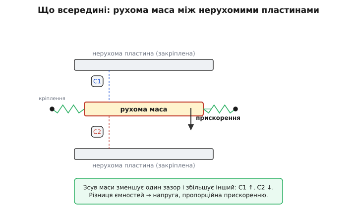
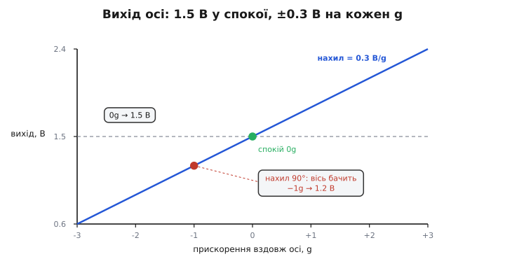
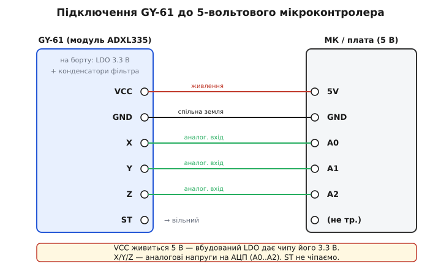

# GY-61 ADXL335 — 3-осьовий акселерометр

## Що насправді міряє акселерометр

Персональний гаджет чи робот визначить власний нахил у просторі без орієнтирів на зовнішні маяки завдяки вимірюванню внутрішніх сил. Аналоговий @@en|акселерометр@@ (від лат. *acceleratio* — прискорення та грец. *metreo* — вимірюю) @@en|ADXL335@@ фіксує не швидкість чи зміщення, а @@en|власне прискорення@@ — силу реакції опори, яка протидіє гравітації. Якщо прилад нерухомо лежить на столі, датчик показує прискорення `1g` напрямлене вгору, бо стіл тисне на його корпус. У стані вільного падіння опора зникає, і вихідний сигнал стає рівним нулю, як у більш складних [багатоосьових інерційних модулях](root:cat-hw-sensors/mpu6050).


*Проекція вектора сили опори на осі X, Y та Z залежить від кута нахилу датчика.*

Розклад постійного вектора `1g` на трьох ортогональних осях `X`, `Y` та `Z` дозволяє обчислити статичний кут нахилу модуля відносно горизонталі.

## Диференційна ємнісна MEMS-структура всередині

Всередині чипа @@en|ADXL335@@ розміщена @@en|MEMS@@ (від англ. *Micro-Electro-Mechanical Systems* — мікроелектромеханічні системи) структура: рухома кремнієва маса, підвішена на мікроскопічних пружинах між нерухомими електродами. Під дією прискорення маса зміщується за інерцією, змінюючи відстані до фіксованих зубців. Це утворює диференційний конденсатор, де ємність однієї пари обкладок зростає, а іншої — зменшується.

Вимірювальна схема чипа визначає саме різницю цих ємностей. Такий підхід повністю компенсує зміну температури й зовнішні завади, адже дрейф однаково впливає на обидва плечі. У результаті механічний зсув маси в частки нанометра перетворюється на стабільну аналогову напругу.

## Лінійний вихід і ратіометричність живлення

Аналогові виходи осей видають напругу, яка лінійно пропорційна прискоренню. За відсутності прискорення напруга спокою дорівнює половині напруги живлення `VCC / 2`, що дає змогу вимірювати рух в обох протилежних напрямках.


*Вихідна напруга лінійно змінюється відносно половини живлення при зміні напрямку прискорення.*

Важливою властивістю є @@en|ратіометричність@@ (від лат. *ratio* — відношення): напруга спокою та чутливість змінюються строго пропорційно до живлення `VCC`. Якщо живити чип та опорну напругу @@en|АЦП@@ (аналогово-цифровий перетворювач) від однієї шини, коливання живлення скасовуються.

Щоб перерахувати зчитаний код АЦП `A` у прискорення `a` в одиницях `g`, від зчитаного значення віднімають код спокою `A_0` і ділять на чутливість `S`:

```
a = (A - A_0) / S     [різниця кодів відносно спокою ділиться на чутливість]
```

Отримане значення `a` відповідає прискоренню вздовж обраної осі.

## Модуль GY-61 та підключення АЦП

Готовий модуль @@en|GY-61@@ містить чип @@en|ADXL335@@ та вбудований @@en|LDO@@ (від англ. *Low Dropout* — низький спад напруги) стабілізатор на 3.3 В, який дозволяє безпечно живити плату від шини 5 В. На відміну від [цифрових давачів прискорення](root:cat-hw-sensors/adxl345), сигнал з осей `X`, `Y`, `Z` знімається безпосередньо у вигляді напруги.


*Підключення ліній живлення та аналогових виходів модуля до мікроконтролера.*

Вивід @@en|самоперевірка@@ `ST` слугує для тестового зміщення маси й у робочому режимі залишається вільним. При підключенні до мікроконтролера важливо узгодити опорну напругу @@en|АЦП@@ з напругою живлення давача, щоб зберегти ратіометричну точність.

## Налаштування смуги пропускання та шуму

Вихідний аналоговий сигнал містить високочастотний шум, створений тепловим рухом носіїв та механічними вібраціями. Внутрішній вихідний опір осей 32 кОм разом із зовнішніми конденсаторами на платі @@en|GY-61@@ утворює аналоговий нижньочастотний @@en|RC-фільтр@@.

Ємність цих конденсаторів визначає смугу пропускання. Для вимірювання повільного статичного нахилу ємність збільшують, згладжуючи шум, а для відстеження швидких вібрацій чи ударів ємність зменшують для підвищення швидкодії.
