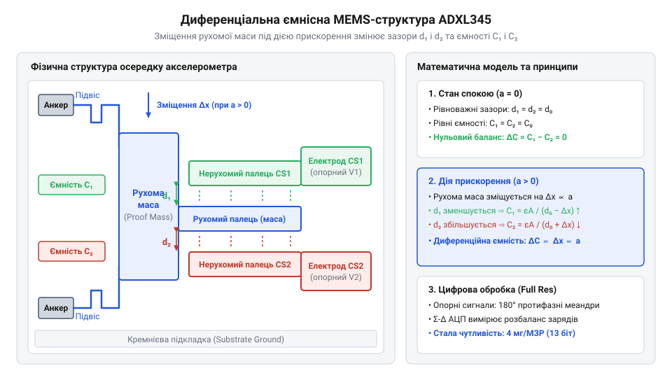
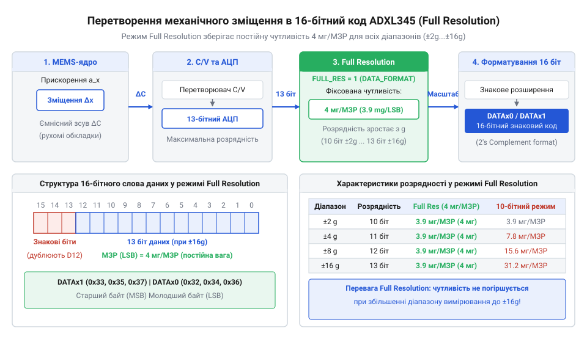
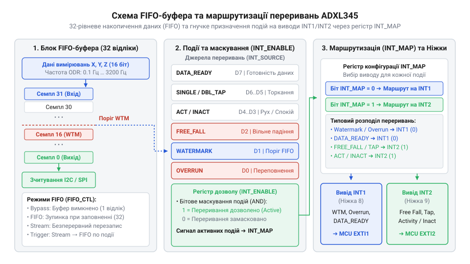
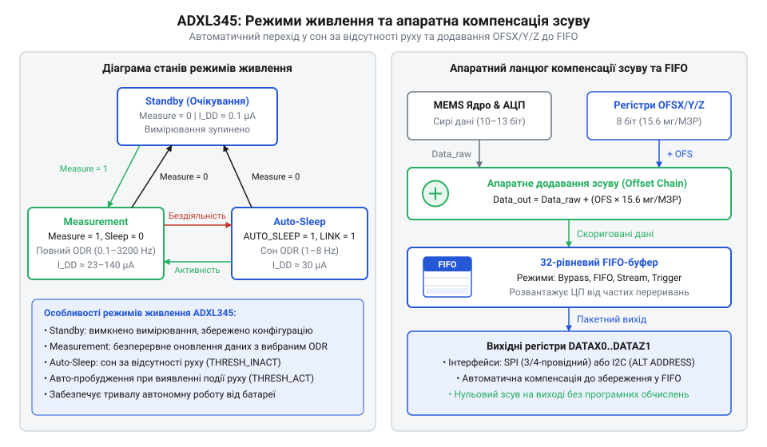

# ADXL345 — 3-осьовий цифровий акселерометр

<preknowlist>
- [GY-61 ADXL335 — 3-осьовий акселерометр](root:cat-hw-sensors/adxl335) — Принцип вимірювання лінійних прискорень аналоговим акселерометром та базова фізика MEMS.
</preknowlist>

## Проблема вимірювання динамічних навантажень в автономних пристроях

Автономний пристрій із батарейним живленням — наприклад, трекер для відстеження вантажів чи портативний реєстратор спортивних навантажень — мусить безперервно стежити за тим, що відбувається з об'єктом у просторі. Пристрою потрібно миттєво фіксувати короткочасні падіння, удари, струси або вібрації. Якщо побудувати такий вузол на базі застарілих аналогових сенсорів руху, мікроконтролер змушений цілодобово виконувати високочастотне опитування внутрішнього @@en|аналогово-цифрового перетворювача@@ (АЦП, англійською @@en|ADC@@ — @@en|Analog-to-Digital Converter@@). АЦП має безперервно квантувати сигнали трьох аналогових осей, щоб не пропустити коротку пікову подібність удару тривалістю в кілька мілісекунд.

Такий підхід неминуче призводить до швидкого виснаження елементів живлення. Головний процесор пристрою не має змоги перейти у режим глибокого сну, оскільки зупинка опитування АЦП означає повну втрату інформації про динамічні події. Крім того, аналогові лінії зв'язку між сенсором та мікроконтролером вловлюють електромагнітні перешкоди від імпульсних джерел живлення та бездротових модулів. Вони вимагають додавання зовнішніх фільтрів нижніх частот і постійного обчислювального ресурсу ЦП для програмного відфільтровування шумів та калібрування зсуву нуля. Для порівняння, приборкання аналогових сигналів у [простіших триосьових модулях](root:cat-hw-sensors/adxl335) вимагає суттєвих програмних витрат на первинну перпендикулярну обробку даних.

Розв'язанням цієї проблеми є перенесення задач первинного аналогового фільтрування, оцифрування та виявлення порогових подій безпосередньо на кристал сенсора. Сучасний цифровий @@en|акселерометр@@ (від латинського *acceleratio* — прискорення та грецького *metron* — вимірювання) інтегрує в одному корпусі як мікромеханічний давач, так і спеціалізовану схему обробки сигналів. Це дозволяє пристрою самостійно аналізувати амплітуду й тривалість прискорень, накопичувати відліки у внутрішній @@en|буфер FIFO@@ (англійською @@en|First-In, First-Out@@ — першим прийшов, першим вийшов) та генерувати апаратне @@en|переривання@@ (англійською @@en|interrupt@@) для пробудження ЦП лише тоді, коли сталася реальна подія. Історія переходу від перших одноосьових давачів описує [розвиток поверхневої мікрообробки](root:cat-hw-sensors/adxl345/hist-mems-capacitive-accelerometers.md) кремнію компанією Analog Devices, що зробив можливим створення наднизькоспоживаючих цифрових систем.

Передача виміряних величин до головного контролера відбувається без втрати точності завдяки інтеграції стандартних цифрових шин — двопровідного інтерфейсу @@en|I2C@@ (англійською @@en|Inter-Integrated Circuit@@) та високошвидкісного @@en|SPI@@ (англійською @@en|Serial Peripheral Interface@@). Вибір активного протоколу здійснюється схемотехнічно: високий логічний рівень на виводі вибору мікросхеми @@en|CS@@ (англійською @@en|Chip Select@@) вмикає режим @@en|I2C@@, а опускання його в логічний нуль переводить сенсор у режим шини @@en|SPI@@, яка вимагає чіткого узгодження часових діаграм тактування. Для стабільного обміну даними через @@en|SPI@@ периферія мікроконтролера має працювати в режимі з налаштуваннями полярності тактового сигналу @@en|CPOL@@ (англійською @@en|Clock Polarity@@) та фази @@en|CPHA@@ (англійською @@en|Clock Phase@@), що відповідають значенням `CPOL = 1` і `CPHA = 1` (третій режим шини, де тактова лінія @@en|SCLK@@ у стані спокою перебуває у високому логічному рівні) або `CPOL = 0` і `CPHA = 0` (нульовий режим з низьким логічним рівнем спокою). В обох допустимих конфігураціях зчитування даних акселерометром відбувається строго за наростаючим фронтом імпульсу @@en|SCLK@@, а виставлення бітів на лінію — за спадаючим; найменше порушення цих фазових співвідношень призводить до зсуву бітової сітки та зчитування спотворених вибірок. Кожна @@en|SPI@@-транзакція починається з передачі командного байта (англійською @@en|command byte@@), чия структура чітко регламентована: найстарший біт 7 (біт @@en|R/W@@ — від англійського @@en|Read/Write@@) задає напрямок обміну (`1` для зчитування, `0` для запису), біт 6 (біт множинного доступу @@en|MB@@ — від англійського @@en|Multiple Byte@@) визначає режим доступу (`1` вмикає автоінкремент адреси для послідовного зчитування чи запису декількох регістрів поспіль, `0` задає одиночний байт), а молодші шість бітів (від 5 до 0) містять 6-бітну адресу регістра `A5…A0` у діапазоні від `0x00` до `0x3F`. У транзакціях шиною @@en|I2C@@ структура командних фреймів відрізняється: спершу передається 7-бітний адресовий байт пристрою із доданим бітом напрямку @@en|R/W@@ у наймолодшому розряді, після чого окремим байтом надсилається адреса цільового регістра `A5…A0`, а пакетне зчитування виконується шляхом неперервного тактування без потреби у встановленні окремого біта @@en|MB@@. Для уникнення конфліктів адрес на спільній шині @@en|I2C@@ розробник може гнучко задавати 7-бітний ідентифікатор пристрою за допомогою лінії альтернативної адреси @@en|ALT ADDRESS@@ (англійською @@en|Alternate Address@@): підтяжка цього виводу до напруги живлення @@en|VDD_I/O@@ встановлює адресу `0x1D`, тоді як приєднання до землі дає `0x53`. У разі використання шини @@en|SPI@@ за замовчуванням діє 4-провідна схема з окремими лініями прийому @@en|SDI@@ та передачі @@en|SDO@@, проте за обмеженої кількості виводів мікроконтролера запис одиниці в біт @@en|SPI@@ регістра @@en|DATA_FORMAT@@ (адреса `0x31`) перемикає давач у 3-провідний режим із єдиною двоспрямованою лінією даних.

## Внутрішня мікромеханічна будова та ємнісна диференціальна система MEMS

В основі роботи @@en|ADXL345@@ лежить технологія @@en|MEMS@@ (англійською @@en|Micro-Electro-Mechanical Systems@@, від грецького *mikros* — малий, *elektron* — янтар, *mechane* — машина та *systema* — з'єднане ціле). Сенсорне ядро виготовлене з єдиного монокристала кремнію шляхом селективного травлення. У центрі структури знаходиться рухома @@en|інерційна маса@@ (англійською @@en|proof mass@@), підвішена над підкладкою на гнучких пружинах із пружного @@en|полікремнію@@ (англійською @@en|polysilicon@@). Від цієї маси у різні боки відходять рухомі кремнієві пальці, які входять у проміжки між фіксованими нерухомими електродами, закріпленими на підкладці. Таким чином утворюється тривимірна диференціальна система конденсаторів для кожної з трьох осей вимірювання `X`, `Y` та `Z`.


*Схема кремнієвого мікромеханічного ядра: зовнішнє прискорення зміщує рухому масу з електродами, змінюючи зазори d₁ та d₂ відносно нерухомих пальців і створюючи вимірювану диференціальну ємність.*

Коли пристрій зазнає прискорення або змінює орієнтацію у гравітаційному полі Землі, на інерційну масу `m` діє механічна сила. Під дією цієї сили маса відхиляється від положення рівноваги вздовж осей чутливості, стискаючи або розтягуючи полікремнієві підвіси з коефіцієнтом жорсткості `k`. Обчислимо механічне зміщення `Δx` інерційної маси `m` під дією зовнішнього прискорення `a`:

```
F_in = m · a             [другий закон Ньютона]
F_el = k · Δx            [закон Гука для пружного підвісу]
Δx = (m · a) / k         [рівновага сил F_in = F_el]
```

Отримане зміщення `Δx` прямо пропорційне прикладеному прискоренню `a`. Воно змінює геометрію зазорів між рухомими та нерухомими електродами диференціального конденсатора.

За відсутності прискорення зазори з обох боків рухомого пальця є однаковими й дорівнюють `d₀`, а ємності обох плечей конденсатора є рівними. Під дією прискорення зазор з одного боку зменшується до `d₁ = d₀ - Δx`, а з протилежного — збільшується до `d₂ = d₀ + Δx`. На основі геометрії плоских конденсаторів із площею перекриття електродів `A` та діелектричною проникністю середовища `ε` розрахуємо зміну ємностей та підсумкову @@en|диференціальну ємність@@ (від латинського *differentia* — різниця та *capacitas* — місткість) `ΔC`:

```
C₁ = (ε · A) / (d₀ - Δx)           [ємність першого зазору]
C₂ = (ε · A) / (d₀ + Δx)           [ємність другого зазору]
ΔC = C₁ - C₂                       [різниця ємностей диференціальної пари]
= (2 · ε · A · Δx) / (d₀² - Δx²)  [зведення виразів до спільного знаменника]
```

Оскільки механічне зміщення `Δx` набагато менше за початковий зазор `d₀` (`Δx ≪ d₀`), квадратичним членом `Δx²` у знаменнику можна знехтувати:

```
ΔC ≈ (2 · ε · A / d₀²) · Δx        [лінеаризація для малих зміщень]
```

Цей вираз виявляє фундаментальний принцип: зміна диференціальної ємності `ΔC` лінійно залежить від зміщення `Δx`, а отже, і від вимірюваного прискорення `a`. Внутрішня електронна схема @@en|ADXL345@@ подає на нерухомі електроди протифазні прямокутні напруги високої частоти та знімає із рухомої маси заряд, пропорційний `ΔC`, який потім підсилюється та передається на демодулятор. Загальні фізичні закони, що пояснюють [ємнісне вимірювання мікрозміщень](root:cat-hw-sensors/mems-capacitive-sensing-principles), діють аналогічно і в багатьох інших кремнієвих датчиках.

Перш ніж внутрішня електронна схема перетворить механічний зсув на вимірюваний електричний сигнал, сам підвіс @@en|інерційної маси@@ на кремнієвих пружинах функціонує як механічна коливальна система другого порядку. Вона володіє власною @@en|резонансною частотою@@ (від латинського *resonare* — лунати, відгукуватися) `f₀ = (1 / (2 · π)) · √(k / m)`, яка для окремих осей ADXL345 лежить у діапазоні кількох кілогерц (близько 1.2–2.4 кГц), що значно перевищує робочу смугу частот вихідних даних. Щоб запобігти неконтрольованому резонансному розгону та тривалим затухаючим коливанням маси під дією зовнішніх вібрацій чи різких механічних ударів, у герметичній мікрокамері кристала реалізовано @@en|механічне демпфування@@ (від німецького *dämpfen* — глушити, гасити) газовим середовищем. Переміщення рухомих електродів супроводжується витисканням повітряного шару у мікроскопічних зазорах (ефект @@en|squeeze-film damping@@), що створює в'язкий опір руху, розсіює кінетичну енергію маси та перетворює механічний підвіс на природний аналоговий @@en|механічний фільтр низьких частот@@. Сформована та стабілізована цим демпфуванням різниця ємностей `ΔC`, що становить частки фемтофарад, вимірюється внутрішньою схемою, оскільки пряме вимірювання на постійному струмі є неможливим через низькочастотні шуми, паразитичні ємності підкладки та температурний дрейф. Щоб вилучити корисний сигнал із шумів, генератор несучої частоти створює високочастотні протифазні прямокутні імпульси з частотою близько 1.2 МГц і подає їх на нерухомі обкладки сенсора. Механічний зсув інерційної маси амплітудно модулює електричний заряд на центральному вимірювальному вузлі, після чого @@en|синхронний демодулятор@@ (від грецького *synchronos* — одночасний та латинського *modulus* — міра) перемножує отриманий сигнал із клоком того самого генератора. Завдяки синхронності випрямлення зміна електричного заряду перетворюється на аналогову напругу, а будь-які завади чи зсуви, що не збігаються за фазою з несучою частотою, ефективно пригнічуються. Для розділення вимірювальних каналів трьох осей X, Y та Z без взаємного ємнісного перехресного наведення використовується @@en|часове мультиплексування@@ (від латинського *multiplex* — складений з багатьох частин): генератор послідовно комутує імпульси збудження між структурами окремих осей у різні фазові інтервали, а демодульована напруга кожного каналу фіксується на власному блоці вибірки та утримання перед оцифруванням. Після цього вбудований @@en|АЦП@@ оцифровує сигнал. Точна [математична модель ємнісного перетворення](root:cat-hw-sensors/adxl345/math-adxl345-capacitive-sensing-and-data-conversion.md) описує зв'язок між механічним зсувом і вихідним цифровим кодом. Згенерований 16-бітний @@en|доповняльний код@@ передається у регістри вихідних даних, завершуючи цикл перетворення механічного руху на цифрові величини.

## Режим високої роздільності Full Resolution та механіка масштабування

При зміні шкали вимірювання в класичних цифрових давачах виникає вимушений компроміс між охопленням діапазону та точністю. Якщо давач має фіксовану 10-бітну сітку перетворення, то в мінімальному діапазоні ±2g вся шкала становить 4g, а на кожен @@en|молодший значущий розряд@@ (МЗР, від @@en|LSB@@, @@en|Least Significant Bit@@: @@en|least@@ — найменший, @@en|significant@@ — значущий, @@en|bit@@ — біт) припадає близько 4 мг. Проте при перемиканні на максимальний діапазон ±16g повний розмах досягає 32g, і той самий 10-бітний код змушений ділити цей діапазон на 1024 рівні. У результаті ціна одного розряду зростає до 31.2 мг/МЗР, що призводить до втрати дрібних деталей вібрацій чи слабких нахилів пристрою.

Для усунення цього обмеження в @@en|ADXL345@@ реалізовано @@en|режим високої роздільності@@ (від @@en|Full Resolution mode@@: @@en|full@@ — повний, @@en|resolution@@ — роздільна здатність, @@en|mode@@ — режим). При його активації бітом `FULL_RES` у @@en|регістрі конфігурації@@ (від @@en|configuration register@@: @@en|configure@@ — налаштовувати, @@en|register@@ — список, запис) `DATA_FORMAT` розрядність внутрішнього аналогово-цифрового перетворення автоматично розширюється разом із розширенням діапазону. Пристрій додає нові розряди у @@en|старший значущий розряд@@ (СЗР, від @@en|MSB@@, @@en|Most Significant Bit@@: @@en|most@@ — найбільший, @@en|significant@@ — значущий, @@en|bit@@ — біт) так, щоб зберігати постійну чутливість 4 мг/МЗР (або точніше 3.9 мг/МЗР) незалежно від обраної межі вимірювання. У діапазоні ±2g давач працює як 10-бітний, у ±4g — як 11-бітний, у ±8g — як 12-бітний, а в діапазоні ±16g розрядність досягає 13 біт.


*Схема масштабування та вирівнювання даних: режим Full Resolution додає розряди при збільшенні діапазону, гарантуючи незмінний коефіцієнт масштабування 4 мг/МЗР.*

Вихідні дані вимірювань для кожної з трьох осей записуються у пару 8-бітних регістрів (наприклад, `DATAX0` та `DATAX1`) у вигляді 16-бітного знакового значення у @@en|доповняльному коді@@ (від @@en|two's complement@@: @@en|two@@ — два, @@en|complement@@ — доповнення). За замовчуванням при біті `JUSTIFY = 0` дані вирівнюються по правому краю зі збереженням знака. @@en|знаковий розряд@@ (від @@en|sign bit@@: @@en|sign@@ — знак, @@en|bit@@ — біт) з розряду MSB поточного діапазону дублюється у всі вищі біти аж до 15-го розряду. Завдяки цьому в мовах програмування вибірка з двох регістрів безпосередньо інтерпретується як стандартне 16-бітне ціле число зі знаком. Специфікація фреймів та адреси регістрів даних наведені в [карті регістрів пристрою](root:cat-hw-sensors/adxl345/api-adxl345-register-map.md).

Розрахуємо фізичне прискорення `a_g` у одиницях `g` та прискорення `a_ms2` у `м/с²` на основі сирого 16-бітного коду `DATA_raw`, постійного коефіцієнта чутливості `K_scale` та прискорення вільного падіння `g₀`:

```
a_g = DATA_raw · K_scale           [значення прискорення в одиницях g]
= DATA_raw · 0.0039 g/МЗР          [підстановка коефіцієнта чутливості 3.9 мг/МЗР]
a_ms2 = a_g · g₀                   [переведення в системи СІ]
= a_g · 9.80665 м/с²               [підстановка стандартного прискорення вільного падіння]
```

Тут `DATA_raw` є 16-бітним значенням у правому вирівнюванні, а `K_scale = 0.0039` відповідає постійній чутливості 3.9 мг на один МЗР. Більш детальний [математичний розрахунок прискорення](root:cat-hw-sensors/adxl345/math-adxl345-conversion-and-angles.md) охоплює тригонометричні перетворення для визначення кутів нахилу в просторі та алгоритми компенсації зсуву нуля.

Покажемо обчислення фізичного прискорення на практичному прикладі зчитування регістрів акселерометра:

:::tabs
@tab C (ESP-IDF)
:::code adxl345-d/c/esp-idf/convert-raw-to-acceleration.c
@tab C++ (Arduino)
:::code adxl345-d/cpp/arduino/acceleration.cpp
:::

Вихідні вимірювання по кожній з трьох осей записуються у парні 8-бітні регістри `DATAX0`...`DATAZ1` (адреси `0x32`...`0x37`) у формі 16-бітного знакового доповняльного коду (англійською @@en|two's complement@@). Внутрішнє упакування цього коду та режим оцифрування визначаються конфігураційним регістром `DATA_FORMAT` (адреса `0x31`). Його молодші біти `RANGE` (D1:D0) вибирають граничний динамічний діапазон вимірювань: значення `00` відповідає ±2g, `01` — ±4g, `10` — ±8g, а `11` — ±16g. Біт `FULL_RES` (D3) задає масштабну поведінку АЦП: значення `0` фіксує 10-бітну роздільність із розширенням ваги @@uk|МЗР@@ у ширших діапазонах, а `1` вмикає режим високої роздільності з постійною чутливістю 3.9 мг/@@uk|МЗР@@ та автоматичним зростанням розрядності сітки до 13 біт. Спосіб розташування отриманих розрядів у 16-бітному слові керується бітом `JUSTIFY` (D2). У правовирівняному форматі (`JUSTIFY = 0`) значущі біти займають молодші позиції сітки, а знаковий біт (D12 у 13-бітному режимі) автоматично розмножується апаратурою сенсора до 15-го розряду — виконується знакове розширення (англійською @@en|sign extension@@). Математичний зміст цієї операції полягає у збереженні знакового значення від'ємного числа при переході від 13-бітної сітки до 16-бітного контейнера `int16_t`. У доповняльному коді старший значущий біт 13-бітного числа D12 має від'ємне вагове значення −2¹² = −4096. Якщо виміряне прискорення від'ємне (D12 = 1), заповнення старших розрядів D15...D13 одиницями додає до суми розрядів ваговий внесок −2¹⁵ + 2¹⁴ + 2¹³ = −32768 + 16384 + 8192 = −8192, що у сумі з +2¹² (+4096) тотожно дає початкову від'ємну вагу −2¹² (−4096). Якщо ж число додатне (D12 = 0), старші біти D15...D13 заповнюються нулями, не змінюючи підсумкової суми. Завдяки тому, що @@en|ADXL345@@ виконує знакове розширення апаратно ще до запису в регістри `DATAX0`...`DATAZ1`, зчитане 16-бітне слово при об'єднанні двох байтів безпосередньо відповідає дійсному знаковому цілому числу `int16_t` без потреби додаткових бітових масок чи зсувів у програмі мікроконтролера. У лівовирівняному форматі (`JUSTIFY = 1`) дані зсуваються до старшого знакового біта, а вільні молодші розряди заповнюються нулями. Для гарантії цілісності виміряних значень зчитування послідовних регістрів `DATAX0`...`DATAZ1` вимагає дотримання правил пакетного зчитування (англійською @@en|burst read@@ — від *burst* — спалах або вибухова порція даних). Поодиноке зчитування кожної з шести комірок окремими транзакціями ламає узгодженість вибірок: якщо апаратне ядро оновлює вихідні байти безпосередньо посеред зчитування старшої й молодшої частин або між осями, підсумкове число збирається з двох різних моментів часу та створює хибні пікові сплески прискорення. Неперервна пакетна передача змушує сенсор зафіксувати стан внутрішнього вихідного буфера на весь час транзакції, зберігаючи атомарність вибірки по всіх трьох осях. Під час обміну через шину @@en|SPI@@ для активації автоматичного інкременту адреси в командному байті обов'язково встановлюється біт багатобайтового доступу `MB` (біт 6) разом із бітом читання `R/W` (біт 7), тоді як у протоколі @@en|I2C@@ автоінкремент адреси відбувається автоматично при послідовній передачі байтів без проміжних умов зупинки шини. Детальна [карта регістрів пристрою](root:cat-hw-sensors/adxl345/api-adxl345-hardware-pinout-and-register-map.md) містить повний розподіл конфігураційних бітів для вибору режиму вирівнювання та динамічного діапазону.

## Апаратні функції розвантаження CPU: FIFO-буфер та детектори подій

Постійна передача даних від акселерометра до центрального процесора на кожному такті вибірки змушує мікроконтролер працювати в режимі неперервної обробки. Якщо частота вихідних даних становить 100 Гц, процесор мусить прокидатися кожні 10 мілісекунд лише для того, щоб зчитати шість байтів координат. Це унеможливлює тривале перебування мікроконтролера у режимах глибокого енергозбереження.

Для подолання цієї проблеми @@en|ADXL345@@ містить вбудований 32-рівневий @@en|буфер FIFO@@. Вбудована пам'ять здатна накопичувати до 32 триосьових кадрів даних (по 6 байтів на кадр), дозволяючи процесору прокидатися набагато рідше. Поведінка буфера задається в регістрі `FIFO_CTL` у чотирьох режимах:
1. `Bypass` (обхід): буфер вимкнено, нові дані одразу потрапляють у вихідні регістри.
2. `FIFO`: буфер накопичує відліки до заповнення 32 кадрів, після чого зупиняє запис нових даних до моменту їх зчитування ЦП.
3. `Stream` (потік): буфер працює як @@en|кільцевий буфер@@ (від @@en|circular buffer@@: @@en|circular@@ — круговий, @@en|buffer@@ — буфер), де нові відліки безперервно витісняють найстаріші застарілі дані при досягненні ліміту у 32 кадри.
4. `Trigger` (тригер): буфер зберігає передісторію подій у режимі `Stream`, а при виникненні переривання фіксує накопичені кадри та дозаписує задану кількість відліків після події, зупиняючи подальше оновлення.


*Структура розвантаження процесора: FIFO-буфер накопичує вибірки за порогом водяного знака, а апаратний селектор спрямовує сигнали подій на незалежні виводи INT1 або INT2.*

Паралельно з FIFO в мікросхемі функціонують апаратні детектори подій, які аналізують сигнал у реальному часі без залучення ЦП. Апаратний @@en|детектор вільного падіння@@ (від @@en|free-fall detector@@: @@en|free@@ — вільний, @@en|fall@@ — падіння, @@en|detect@@ — виявляти) порівнює векторне прискорення по всіх трьох осях із порогом `THRESH_FF` протягом часу `TIME_FF`. Якщо прискорювач перебуває у стані падіння (сумарне прискорення близьке до 0g), давач сигналізує про подію. Аналогічно працюють @@en|детектор торкання@@ (від @@en|tap detector@@: @@en|tap@@ — легкий удар, @@en|detect@@ — виявляти) для поодиноких і подвійних імпульсних ударів, а також детектори руху та спокою.

Усі події маскуються в регістрі `INT_ENABLE` та розподіляються через регістр `INT_MAP` на один із двох фізичних виводів переривань: `INT1` або `INT2`. Наприклад, поріг заповнення FIFO — @@en|водяний знак@@ (від @@en|watermark@@: @@en|water@@ — вода, @@en|mark@@ — позначка) — можна спрямувати на `INT1` для пакетированого зчитування даних, а виявлення падіння — на `INT2` як надзвичайно пріоритетне апаратне пробудження. Електричні схеми обв'язки та узгодження рівнів для виводів переривань розкрито у [довіднику апаратного інтерфейсу](root:cat-hw-sensors/adxl345/api-adxl345-hardware-interface.md). Обробка буферизованих відліків у сучасних операційних системах спирається на тригери [підсистеми Industrial I/O](root:cat-hw-sensors/iio-subsystem-linux-kernel), які безпосередньо зчитують кадри FIFO через SPI або I2C.

Налаштування буфера та обробка переривань реалізуються в драйверах для мікроконтролерів. Нижче наведено приклад конфігурування FIFO в режим `Stream` із встановленням порогового переривання:

:::tabs
@tab C (ESP-IDF / STM32)
:::code adxl345-d/c/esp-idf/adxl345-configure-fifo-stream.c
@tab C++ (Arduino)
:::code adxl345-d/cpp/arduino/adxl345fifomanager.cpp
:::

Повна реалізація низькоспоживаючого драйвера з опитуванням буфера пакетним зчитуванням та обробкою переривань наведена у [проєкті C-драйвера](root:cat-hw-sensors/adxl345/proj-adxl345-fifo-interrupt-driver.md).

Автономне виявлення характерних рухів виконується блок-детекторами подій. Детектор вільного падіння (англійською @@en|Free-Fall@@ — від *free* — вільний, *fall* — падіння) відстежує спад загального вектора прискорення нижче порогу `THRESH_FF` на час понад `TIME_FF`. Порогове прискорення `THRESH_FF` задається з масштабним коефіцієнтом 62.5 мг/МЗР, а тривалість стану падіння в регістрах `TIME_FF` кодується з дискретністю 5 мс/МЗР. Детектор торкання аналізує короткочасні сплески прискорення для виявлення поодиноких імпульсів (англійською @@en|Single Tap@@ — від *single* — поодинокий, *tap* — дотик) та подвійних ударів (англійською @@en|Double Tap@@ — від *double* — подвійний, *tap* — дотик). Для фіксації дотику прискорення має перевищити поріг `THRESH_TAP` і впасти нижче нього за час, не більший за `DUR`. Поріг амплітуди `THRESH_TAP` обчислюється з масштабом 62.5 мг/МЗР, а тривалість імпульсу в `DUR` вимірюється з кроком 625 мкс/МЗР. Триваліші сплески регістр `DUR` відсікає як звичайну вібрацію або тривалий рух пристрою. Після першого вдалого дотику таймер відкриває вікно затримки `LATENT`. Упродовж цього інтервалу, що задається з масштабом 1.25 мс/МЗР, детектор ігнорує механічні відскоки та згасаючі коливання корпусу. Після завершення `LATENT` відкривається часове вікно `WINDOW` із такою ж дискретністю 1.25 мс/МЗР. У межах цього вікна має відбутися другий такий самий імпульс. Повторний дотик усередині `WINDOW` формує подію подвійного удару, а його відсутність завершує обробку поодинокого торкання. Детектор руху та спокою порівнює прискорення з порогом `THRESH_ACT` з аналогічним коефіцієнтом 62.5 мг/МЗР у двох режимах зв'язку. При DC-зв'язку (англійською @@en|DC Coupling@@ — від *direct current* — постійний струм) детектор порівнює з порогом абсолютний вектор прискорення. Оскільки гравітаційне прискорення діє постійно, будь-який нахил корпусу змінює проєкції осей і може викликати хибне спрацьовавання детектора у статичному стані. Для усунення впливу нахилу застосовують AC-зв'язок (англійською @@en|AC Coupling@@ — від *alternating current* — змінний струм). Цей режим віднімає початковий статичний зсув і вимірює лише динамічну зміну прискорення. Описані [кінематичні алгоритми обробки](root:cat-hw-sensors/adxl345/math-adxl345-kinematics-tap-and-tilt-thresholds.md) висвітлюють математичні залежності між налаштуваннями цих регістрів та розрахунком порогів подій.

## Енергозбереження, режими живлення та компенсація нульового зсуву

У портативних пристроях із батарейним живленням безперервне вимірювання прискорення з високою частотою швидко виснажує джерело енергії. На відміну від [аналогових акселерометрів](root:cat-hw-sensors/adxl335), які вимагають постійної роботи мікроконтролерного АЦП, цифровий акселерометр ADXL345 пропонує гнучке апаратне керування живленням. Водночас механічні напруження при розварюванні кристала та монтажу на друковану плату створюють системну похибку — зсув нуля (від @@en|zero-g offset@@: @@en|zero-g@@ — нульове прискорення, @@en|off@@ — геть, @@en|set@@ — ставити).

### Режими живлення та автоматичний сон

Керування основними станами сенсора здійснюється через регістр @@en|POWER_CTL@@ (адреса `0x2D`). Пристрій підтримує три основних режими:
- **Standby** (режим очікування, від @@en|standby mode@@: @@en|stand@@ — стояти, @@en|by@@ — поруч): вимикає внутрішній генератор та вимірювальний тракт, зменшуючи струм споживання до 0.1 мкА. Усі регістри зберігають свої значення, а шина зв'язку залишається активною. Зміна конфігураційних регістрів має виконуватися саме в цьому режимі.
- **Measurement** (режим вимірювання, від @@en|measurement mode@@: @@en|measure@@ — вимірювати): активує аналогові кола та АЦП. Струм споживання становить близько 140 мкА при частоті вихідних даних (від @@en|ODR@@, @@en|Output Data Rate@@: @@en|out@@ — назовні, @@en|data@@ — дані, @@en|rate@@ — темп) 100 Гц. Регістр @@en|BW_RATE@@ (адреса `0x2C`) дозволяє змінювати @@en|ODR@@ від 0.10 Гц до 3200 Гц, що автоматично задає смугу пропускання (від @@en|bandwidth@@: @@en|band@@ — смуга, @@en|width@@ — ширина) цифрового фільтра нижніх частот (від @@en|low-pass filter@@: @@en|low@@ — низький, @@en|pass@@ — проходити, @@en|filter@@ — фільтр) на рівні `ODR / 2`. Зменшення частоти звужує смугу й відсікає високочастотні завади, зменшуючи підсумковий шум, але збільшує затримку відгуку. Встановлення біта `LOW_POWER` у регістрі @@en|BW_RATE@@ додатково зменшує струм споживання на частотах 12.5–400 Гц (наприклад, до 90 мкА при 100 Гц) за рахунок імпульсного тактування аналогового тракту, проте це підвищує спектральну щільність шуму (від @@en|noise spectral density@@: @@en|noise@@ — шум, @@en|spectrum@@ — спектр, @@en|density@@ — щільність) і погіршує роздільну здатність вимірювання.
- **Sleep** (режим сну, від @@en|sleep mode@@: @@en|sleep@@ — спати): знижує частоту оновлення даних до 1, 2, 4 або 8 Гц (біти `Wakeup` регістра @@en|POWER_CTL@@), що зменшує споживання струму до 23 мкА.

Для мінімізації участі центрального процесора ADXL345 підтримує механізм автосну (від @@en|auto-sleep@@: @@en|auto@@ — сам, @@en|sleep@@ — спати). Коли біти `AUTO_SLEEP` та `Link` у регістрі @@en|POWER_CTL@@ встановлені в `1`, сенсор пов'язує моніторинг активності та спокою. За відсутності руху протягом часу `TIME_INACT` пристрій самостійно переходить у режим @@en|Sleep mode@@. Щойно внутрішній детектор виявляє рух, який перевищує поріг `THRESH_ACT`, акселерометр негайно повертається в режим @@en|Measurement mode@@ із робочою частотою @@en|ODR@@.


*Діаграма станів керування живленням Standby, Measurement i Auto-Sleep та ланцюжок цифрової корекції zero-g offset.*

### Апаратна компенсація нульового зсуву

Навіть у нерухомому стані вихідні дані акселерометра можуть відхилятися від ідеальних значень 0 g за осями X і Y та +1 g за віссю Z. Замість витрачання тактів мікроконтролера на віднімання похибок у кожному циклі читання, у [програмному інтерфейсі драйвера](root:cat-hw-sensors/adxl345/api-adxl345-software-driver-interface.md) використовують апаратні регістри компенсації @@en|OFSX@@ (`0x1E`), @@en|OFSY@@ (`0x1F`) та @@en|OFSZ@@ (`0x20`).

Кожен із регістрів @@en|OFS@@ містить 8-бітне знакове число у доповняльному коді (від @@en|two's complement@@: @@en|two@@ — два, @@en|complement@@ — доповнення). Ці значення автоматично додаються до виміряного сигналу перед записом у регістри даних `0x32`–`0x37` та @@en|FIFO@@-буфер.

Важливо враховувати різницю роздільності: вихідні дані в режимі @@en|Full Resolution@@ мають чутливість близько 3.9 мг/МЗР, тоді як регістри компенсації мають фіксований масштабний коефіцієнт (від @@en|scale factor@@: @@en|scale@@ — масштаб, @@en|factor@@ — чинник) **15.6 мг/МЗР** (@@en|mg/LSB@@). Отже, 1 МЗР регістра @@en|OFS@@ компенсує 4 МЗР вихідних даних.

Обчислення значення компенсації виконується за схемою:

```
OFSX = - round( X_measured_LSB / 4 )
OFSY = - round( Y_measured_LSB / 4 )
OFSZ = - round( (Z_measured_LSB - Z_target_1g_LSB) / 4 )
```

Наприклад, якщо при горизонтальному положенні плати вісь X показує +16 МЗР (приблизно +62.4 мг):

```
OFSX = - round( 16 / 4 )       [ділення похибки МЗР на коефіцієнт 4]
     = -4                      [запис знакового значення в регістр 0x1E]
```

Для алгоритмів обробки даних такий підхід гарантує чисті вихідні дані без додаткового навантаження на обчислювальне ядро, як це реалізовано в [низькоенергетичному драйвері STM32](root:cat-hw-sensors/adxl345/proj-adxl345-stm32-fifo-interrupt-driver.md).

:::tabs
@tab C (ESP-IDF / STM32)
:::code adxl345-d/c/esp-idf/adxl345-configure-power-saving.c
@tab C++ (Arduino)
:::code adxl345-d/cpp/arduino/adxl345powermanager.cpp
:::
