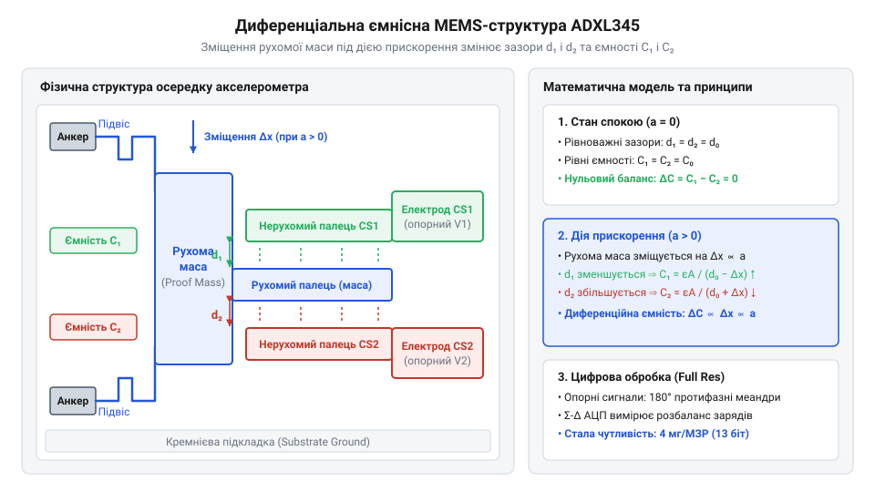
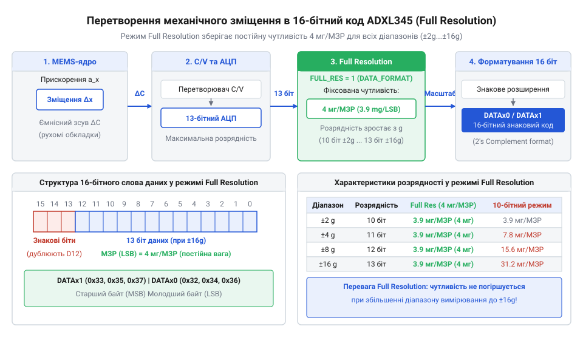
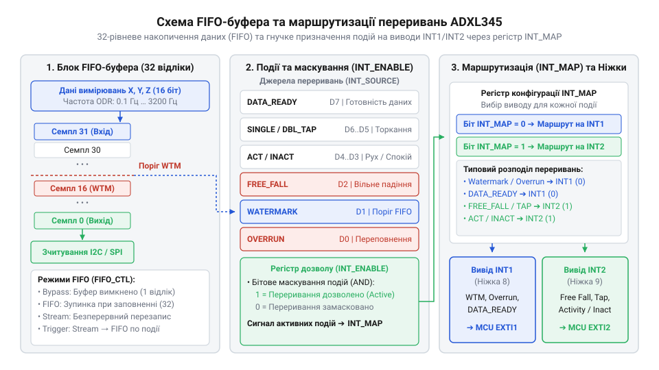
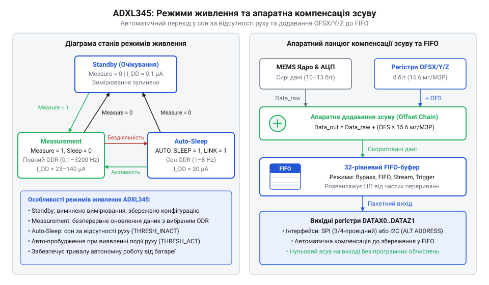

# ADXL345 — 3-осьовий цифровий акселерометр

<preknowlist>
- [GY-61 ADXL335 — 3-осьовий акселерометр](root:cat-hw-sensors/adxl335) — Принцип вимірювання лінійних прискорень аналоговим акселерометром та базова фізика MEMS
</preknowlist>

## Проблема постійного опитування аналогових акселерометрів

Безперервна робота батарейного пристрою вимагає тривалого перебування мікроконтролера в режимі глибокого сну. У разі використання схем із [аналоговим сенсором ADXL335](root:cat-hw-sensors/adxl335) процесор змушений постійно не спати, щоб опитувати аналогово-цифрові канали та обробляти напруги трьох осей. До довгих планарних провідників навалюються електромагнітні завади, які вимагають додаткових обчислювальних витрат на фільтрування. Цифровий акселерометр @@en|ADXL345@@ розв'язує цю проблему: оцифрування, первинне усереднення та перевірка порогових подій відбуваються всередині корпусу давача. Мікроконтролер залишається знеструмленим і прокидається лише за апаратним сигналом, що кардинально знижує загальне енергоспоживання системи.

## Диференціальна ємнісна MEMS-структура та оцифрування

Серцем чипа є кремнієве @@en|MEMS@@ (англ. *micro-electromechanical systems* — мікроелектромеханічні системи) ядро, де рухома маса підвішена на полікремнієвих пружинах. Зовнішнє прискорення зміщує рухомі пальці відносно нерухомих, змінюючи зазори диференціальних конденсаторів по осях `X`, `Y` та `Z`.


*Диференціальна ємнісна структура MEMS-ядра та шлях оцифрування сигналу в ADXL345.*

Внутрішня схема подає високочастотне прямокутне збудження, а синхронний демодулятор із часовим мультиплексуванням виділяє корисну різницю ємностей і відсікає зовнішні завади. Вбудований АЦП перетворює цей сигнал на 16-бітний доповняльний код, який записується у вихідні регістри даних.

## Цифрові інтерфейси та режим Full Resolution

Обмін даними відбувається через інтерфейси @@en|I2C@@ (англ. *inter-integrated circuit* — міжінтегральна схема) або @@en|SPI@@ (англ. *serial peripheral interface* — послідовний периферійний інтерфейс). Вибір адреси чи режиму задається лінією `ALT ADDRESS`. Особливістю @@en|ADXL345@@ є режим @@en|Full Resolution@@: при розширенні діапазону від `±2g` до `±16g` АЦП автоматично збільшує розрядність до 13 біт, зберігаючи чутливість незмінною — `3.9 мг/МЗР`.


*Збереження постійної чутливості 3.9 мг/МЗР у режимі Full Resolution на всіх діапазонах.*

Пакетне зчитування вибірок забезпечує атомарність отримання даних осей `X`, `Y`, `Z` без ризику неузгодженості байтів. Знаковий доповняльний код зчитується з вихідних регістрів і масштабується у фізичні величини.

**Обчислення фізичного прискорення для вибірки 256 МЗР у режимі Full Resolution**
```
a_g = 256 × 0.0039 g
    = 0.9984 g           [множення на чутливість 3.9 мг/МЗР]
a_ms2 = 0.9984 × 9.80665
      = 9.791 м/с²        [переведення в одиниці SI через прискорення вільного падіння]
```

## Буферизація FIFO та апаратні переривання

Вбудований 32-рівневий @@en|FIFO@@ (англ. *first in, first out* — першим зайшов, першим вийшов) буфер накопичує кадри вибірок у чотирьох режимах (Bypass, FIFO, Stream, Trigger), дозволяючи процесору зчитувати дані пачками замість обробки кожного відліку.


*Режими роботи FIFO-буфера та формування сигналів переривань на виводах INT1 і INT2.*

Апаратні детектори фіксують вільне падіння, поодинокий чи подвійний доторк, а також рух і спокій. Налаштування часових вікон `DUR`, `LATENT` та `WINDOW` відсікають механічний брязкіт. Сформовані події маскуються й маршрутизуються на фізичні виводи переривань @@en|INT1@@ та @@en|INT2@@ для пробудження мікроконтролера.

## Режими живлення та компенсація нульового зсуву

Сенсор підтримує режими @@en|Standby@@, @@en|Measurement@@ та @@en|Sleep@@. Зниження частоти вихідних даних ODR зменшує споживання струму, але підвищує рівень шуму. Механізм @@en|Auto-Sleep@@ автоматично переводить пристрій у режим сну за відсутності руху та повертає в робочий стан при активності.


*Переходи між режимами живлення та внутрішнє віднімання зсуву нуля в регістрах OFSX-OFSZ.*

Технологічний зсув нуля @@en|zero-g offset@@ усувається апаратно: значення компенсації з розрядністю `15.6 мг/МЗР` записуються в регістри `OFSX`, `OFSY`, `OFSZ` і додаються внутрішньо перед формуванням вихідних даних.
