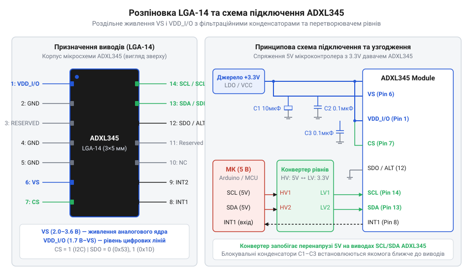
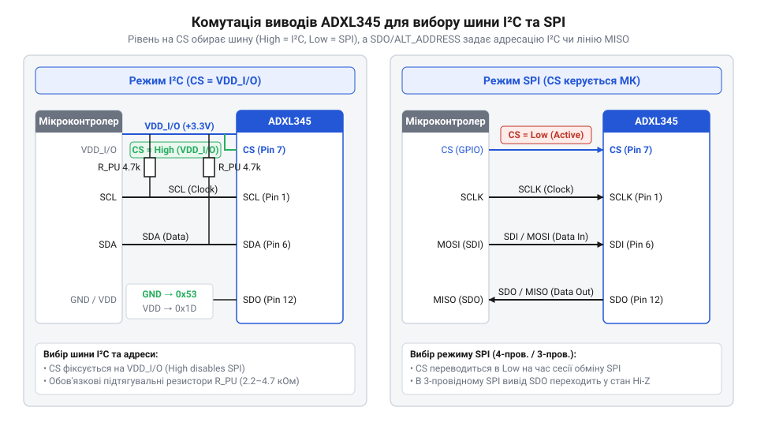

# Апаратний інтерфейс ADXL345: виводи, схемотехніка та вибір I2C/SPI

## Проблеми спряження акселерометра з мікроконтролером

Напрям та інтенсивність руху роботизованої системи чи безпілотного апарата визначаються вимірюванням лінійних прискорень. Цифровий @@en|акселерометр@@ (від лат. *acceleratio* — прискорення та грец. *metreo* — вимірюю) @@en|ADXL345@@ розрахований на високу точність вимірювання, однак прямолінійне підключення цієї мікросхеми до поширених 5-вольтових мікроконтролерів призводить до миттєвого виходу з ладу або хаотичних збоїв обміну даними.

Основна причина електричних пошкоджень полягає у фізичних обмеженнях напівпровідникового кристала. Мікросхема @@en|ADXL345@@ виготовляється за технологією тонкоплівкового @@en|CMOS@@ (від англ. *Complementary Metal-Oxide-Semiconductor* — комплементарний метал-оксид-напівпровідник) процесу з максимально допустимою напругою живлення та сигнальних ліній `3.6 В`. Коли вивід класичного 5-вольтового контролера видає високий логічний рівень напругою близько `5 В`, на захисні @@en|ESD@@-діоди (від англ. *Electrostatic Discharge* — захист від електростатичного розряду) виводів давача подається перенапруга. Струм витоку через захисні діоди спричиняє паразитне живлення ядра, перегрів кристала та засувковий ефект, що повністю руйнує структури вихідних каскадів.

Другою проблемою є завади та нестабільність живлення. Вимірювальне аналогове ядро @@en|MEMS@@ (від англ. *Micro-Electro-Mechanical Systems* — мікроелектромеханічні системи) містить вихідні підсилювачі та перетворювачі ємності у цифровий код, чутливі до пульсацій на шині живлення. Сплески напруги під час роботи цифрових периферійних вузлів викликають зміщення нульової точки та шумові завади в результатах вимірювання. На відміну від [аналогових акселерометрів](root:cat-hw-sensors/adxl335), де коливання живлення компенсуються ратіометричною зміною опорної напруги АЦП, цифровий датчик вимагає жорсткої стабілізації живлення безпосередньо біля виводів корпусу.

Третя небезпека виникає через плаваючі стани ліній зв'язку, відомі як @@en|High-Z@@ (від англ. *High-Impedance* — стан високого імпедансу). Якщо шина передачі даних не має чітко визначеного електричного потенціалу в моменти спокою, зовнішні електромагнітні наводки створюють помилкові тактові імпульси та довільні фронти напруги. Це призводить до блокування інтерфейсу або хибного розпізнавання команд, як це буває у [складних інерційних модулях](root:cat-hw-sensors/mpu6050). Щоб уникнути цих проблем, інженер повинен розділити кола живлення аналогової та цифрової частин мікросхеми та застосувати вузли узгодження логічних рівнів.

## Призначення виводів та роздільне живлення

Для надійного функціонування мікросхеми @@en|ADXL345@@ у компактному 14-вивідному корпусі @@en|LGA-14@@ (від англ. *Land Grid Array* — матриця пласких контактних майданчиків) розробники передбачили виділені лінії живлення та керування.

*Схема подачі живлення на виводи VS та VDD_I/O з фільтруючими конденсаторами й узгодженням логіки для 5 В контролера.*

Центральним розв'язком безпеки є розділення шини живлення на два незалежних входи: `VS` (вивід 6) та `VDD_I/O` (вивід 1). Вивід `VS` постачає напругу від `2.0 В` до `3.6 В` на внутрішнє аналогове ядро @@en|MEMS@@, внутрішні джерела опорної напруги та перетворювач. Вивід `VDD_I/O` живить цифрові буфери шин вводу-виводу. Його напруга може перебувати у межах від `1.7 В` до значення `VS`. Це дозволяє пряме підключення акселерометра @@en|ADXL345@@ до низьковольтних мікроконтролерів із логікою `1.8 В` чи `2.5 В` без додаткових перетворювачів. Проте таке розділення вимагає суворого дотримання послідовності подачі живлення (@@en|Power Supply Sequencing@@). Для коректного спрацьовування внутрішнього вузла @@en|POR@@ (від англ. *Power-On Reset* — скидання після подачі живлення) напругу `VS` необхідно подавати одночасно з `VDD_I/O` або раніше за неї, забезпечуючи умову `VDD_I/O` ≤ `VS`. Якщо `VDD_I/O` подати раніше за `VS`, через захисні діоди цифрових буферів протікатиме паразитний струм у знеструмлене аналогове ядро. Це завадить схемі @@en|POR@@ зафіксувати початковий стан і призведе до блокування регістрів у некоректно ініціалізованому стані. Додатково обидві напруги мають наростати монотонно, а під час вимкнення — повністю спадати до нуля, щоб схема @@en|POR@@ могла надійно спрацювати при повторному ввімкненні.

Для придушення високочастотних завад та стрибків струму під час роботи аналогово-цифрового перетворювача паралельно виводам живлення підключають керамічні блокувальні конденсатори з низьким @@en|ESR@@ (від англ. *Equivalent Series Resistance* — еквівалентний послідовний опір). Безпосередньо біля виводу `VS` установлюють керамічний конденсатор ємністю `0.1 мкФ` та додатковий конденсатор `10 мкФ` для згладжування низькочастотних пульсацій. На лінію `VDD_I/O` також додають керамічний конденсатор `0.1 мкФ`. Їх монтують на мінімальній відстані до виводів корпусу та заземлюють через виводи `GND` (виводи 2, 4, 5).

При спряженні з 5-вольтовими мікроконтролерами (де рівень високої логічної напруги перевищує `3.6 В`) застосування двонаправлених конвертерів логічних рівнів є обов'язковим. Схема на польових @@en|MOSFET@@-транзисторах (від англ. *Metal-Oxide-Semiconductor Field-Effect Transistor* — польовий транзистор) або спеціалізованих мікросхемах узгодження передає сигнальні рівні між шинами `5 В` та `VDD_I/O` (`3.3 В`), повністю захищаючи виводи `SCL/SCLK`, `SDA/SDI/SDIO`, `SDO/ALT ADDRESS` та `CS` від перенапруги.

## Конфігурування шин обміну I2C та SPI

Мікросхема @@en|ADXL345@@ підтримує два основних цифрових інтерфейси обміну даними: @@en|I2C@@ (від англ. *Inter-Integrated Circuit* — міжмікросхемна шина) та @@en|SPI@@ (від англ. *Serial Peripheral Interface* — послідовний периферійний інтерфейс). Вибір активного протоколу виконується апаратно за допомогою лінії вибору чипа `CS` (вивід 7).

*Комутація ліній CS та ALT ADDRESS для вибору між шиною I2C з адресами 0x53/0x1D та 3-/4-провідним SPI.*

Якщо лінія `CS` підключена до високого логічного рівня `VDD_I/O`, мікросхема переходить у режим шини @@en|I2C@@. У цьому режимі вивід `SCL/SCLK` (вивід 14) працює як тактова лінія `SCL`, а вивід `SDA/SDI/SDIO` (вивід 13) — як двонаправлена лінія даних `SDA`. Оскільки вихідні каскади лінії `SDA` виконані за схемою @@en|Open-Drain@@ (від англ. *Open-Drain* — відкритий сток), лінії `SDA` та `SCL` вимагають зовнішніх підтягувальних резисторів @@en|Pull-Up@@ до шини `VDD_I/O`. Номінал резисторів обирають у межах від `2.2 кОм` до `4.7 кОм` залежно від ємності провідників шини та швидкості тактування (`100 кГц` або `400 кГц`).

Для конфігурування базової @@en|I2C@@-адреси пристрою слугує вивід `SDO/ALT ADDRESS` (вивід 12):
- Якщо вивід `ALT ADDRESS` підключено до шини `GND` (логічний 0), 7-бітова адреса @@en|ADXL345@@ дорівнює `0x53`.
- Якщо вивід `ALT ADDRESS` підключено до шини `VDD_I/O` (логічна 1), 7-бітова адреса змінюється на `0x1D`.

Це дозволяє одночасно підключати два акселерометри @@en|ADXL345@@ до однієї шини @@en|I2C@@ без апаратних конфліктів адресації.

При підключенні лінії `CS` до цифрового виводу мікроконтролера та подачі низького логічного рівня (0 В) мікросхема @@en|ADXL345@@ перемикається у режим @@en|SPI@@. Для коректного узгодження часових діаграм контролер повинен налаштувати полярність тактового сигналу `CPOL=1` (від англ. *Clock Polarity* — тактовий сигнал у пасивному стані залишається на високому рівні) та фазу `CPHA=1` (від англ. *Clock Phase* — зчитування даних відбувається по зростаючому фронту імпульсу). У класичному 4-провідному режимі лінії виконують такі функції: `SCLK` приймає тактовий сигнал, `SDI` приймає вхідні дані від контролера, `SDO` видає вихідні дані, а `CS` управляє вибіркою пристрою. Якщо виводів мікроконтролера недостатньо, у внутрішньому регістрі `DATA_FORMAT` (адреса `0x31`) можна увімкнути 3-провідний режим @@en|SPI@@. Процедура перемикання вимагає початкового запису в регістр `DATA_FORMAT` у 4-провідному режимі з встановленням біта `SPI` (біт 6) у значення `1`. При цьому подальша передача та прийом даних об'єднуються на лінії `SDIO` (вивід 13), а вивід `SDO` переходить у стан @@en|High-Z@@.

Висячий стан виводу `CS` неприпустимий: він спричиняє спонтанне перемикання між @@en|I2C@@ та @@en|SPI@@, повністю блокуючи обмін даними.

## Апаратні переривання та принципова схема

Постійний програмний опит датчика (полінг) перевантажує процесорне ядро мікроконтролера. Для оперативного сповіщення про події руху акселерометр @@en|ADXL345@@ оснащений двома незалежними апаратними лініями переривань `INT1` (вивід 8) та `INT2` (вивід 9).

Внутрішня логіка мікросхеми дозволяє гнучко маршрутизувати вісім типів системних подій (готовність даних `Data Ready`, виявлення одиночного чи подвійного удару `Single/Double Tap`, вільне падіння `Free-Fall`, наявність або відсутність руху `Activity/Inactivity`) на будь-який із двох виводів переривань. Вихідні каскади ліній `INT1` та `INT2` за замовчуванням працюють у двотактному режимі @@en|Push-Pull@@ (від англ. *Push-Pull* — двотактний вихідний каскад) з активним високим рівнем `VDD_I/O`. Через регістри конфігурації виходи можна перемикати в активний низький рівень або режим відкритий сток @@en|Open-Drain@@, що дозволяє об'єднувати лінії переривань від кількох датчиків за схемою «Монтажне АБО».

Повна принципова схема підключення @@en|ADXL345@@ об'єднує всі вивчені вузли:
1. Живлення: роздільна подача `VS = 3.3 В` та `VDD_I/O = 3.3 В` із встановленням керамічних конденсаторів `0.1 мкФ` та `10 мкФ` у безпосередній близькості до корпусу.
2. Шина обміну (режим @@en|I2C@@): фіксація `CS` на `VDD_I/O`, вибір адреси `0x53` через заземлення `ALT ADDRESS`, встановлення підтягувальних резисторів `4.7 кОм` на лінії `SDA` та `SCL`.
3. Сигнали подій: підключення ліній `INT1` та `INT2` до входів зовнішніх переривань @@en|GPIO@@ мікроконтролера.

При проектуванні друкованої плати для @@en|ADXL345@@ необхідно дотримуватися правил мінімізації завад:
- Розміщувати блокувальні конденсатори на відстані не більше `2 мм` від виводів `VS` та `VDD_I/O`.
- Забезпечити суцільний шар заземлення під корпусом @@en|LGA-14@@ для екранування аналогового ядра.
- Прокладати швидкісні тактові провідники `SCLK` подалі від чутливих механічних елементів MEMS-структури.

На відміну від [триосьових магнітометрів](root:cat-hw-sensors/hmc5883l), які чутливі до феромагнітних мас, @@en|ADXL345@@ вимагає першочергової уваги саме до механічної жорсткості монтажу плати та чистоти напруги живлення.
