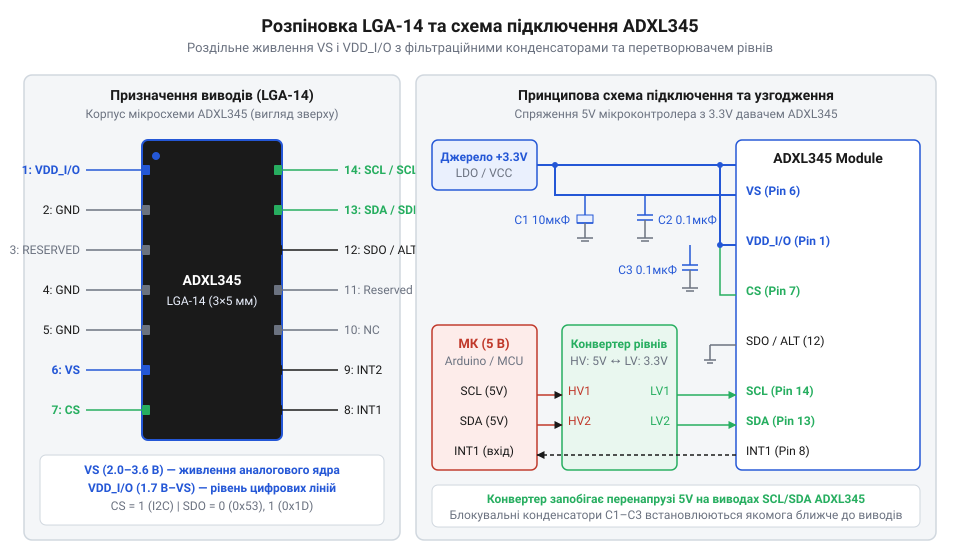
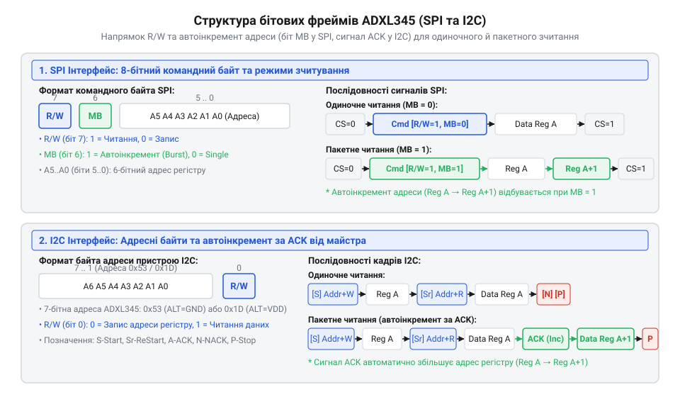

# Апаратний інтерфейс, схемотехніка підключення та карта регістрів ADXL345

## Апаратні пастки підключення акселерометра ADXL345

Спроба прямого підключення цифрового @@en|акселерометра@@ (англ. *accelerometer*, від лат. *accelero* — прискорювати + грец. *metron* — вимірювати) @@en|ADXL345@@ до мікроконтролера без урахування електричних параметрів ліній живлення нерідко призводить до апаратних збоїв чи фізичного пошкодження датчика. На відміну від простих аналогових рішень, де використовується єдине джерело, як-от [3-осьовий аналоговий сенсор ADXL335](root:cat-hw-sensors/adxl335), мікросхема @@en|ADXL345@@ має дві роздільні лінії живлення: @@en|Vs@@ та @@en|VDD_I/O@@.

Вивід @@en|Vs@@ живить аналогове ядро кремнієвого сенсора (робоча напруга від 2.0 В до 3.6 В, типово 2.5 В або 3.3 В), а вивід @@en|VDD_I/O@@ відповідає за електричні рівні цифрового @@en|інтерфейсу@@ (англ. *interface*, від лат. *inter* — між + *facies* — обличчя, поверхня) вводу-виводу (від 1.7 В до значення @@en|Vs@@). Така роздільна схемотехніка ізолює чутливі вимірювальні кола від високочастотних імпульсних завад, що виникають під час перемикання цифрових ліній, і дозволяє підключати сенсор до низьковольтних процесорів без додаткових перетворювачів.

Головна апаратна пастка полягає в спробі подати логічні сигнали з рівнем 5 В безпосередньо на виводи @@en|VDD_I/O@@, @@en|SDA@@ чи @@en|SCL@@. Максимально припустима напруга на цифрових входах @@en|ADXL345@@ обмежена величиною `VDD_I/O + 0.3 В`. Подача 5 В викликає пробій захисних діодів і паразитне замикання, що знищує мікросхему. Для безпечного узгодження з 5-вольтовими мікроконтролерами необхідний двонапрямний @@en|перетворювач рівнів@@ (англ. *level shifter*) або живлення всієї системи від 3.3 В.

Крім того, внутрішні підтягувальні резистори у @@en|ADXL345@@ відсутні. Тому для роботи по шині @@en|I2C@@ лінії @@en|SDA@@ і @@en|SCL@@ вимагають зовнішніх @@en|підтягувальних резисторів@@ опором від 2.2 кОм до 10 кОм, підключених саме до шини @@en|VDD_I/O@@. Для приглушення завад біля виводів @@en|Vs@@ та @@en|VDD_I/O@@ обов'язково встановлюють керамічний @@en|конденсатор@@ ємністю 0.1 мкФ паралельно з танталовим конденсатором 1 мкФ на спільну землю @@en|GND@@.

## Призначення виводів та конфігурація шин

Фізична інтеграція @@en|ADXL345@@ здійснюється через 14-вивідний корпус @@en|LGA-14@@. Кожен вивід має чітке призначення, яке залежить від обраного протоколу зв'язку.


*Фізична конфігурація виводів ADXL345 визначає активний протокол зв'язку, шинну адресу I2C та спосіб підключення джерел живлення.*

Вибір активної шини між @@en|I2C@@ та @@en|SPI@@ виконується станом сигналу на виводі @@en|CS@@ (Chip Select, вивід 7). Якщо вивід @@en|CS@@ підтягнутий до високого рівня @@en|VDD_I/O@@, мікросхема працює по шині @@en|I2C@@. Якщо ж на вивід @@en|CS@@ подається низький логічний рівень від мікроконтролера, вмикається @@en|інтерфейс@@ @@en|SPI@@.

У режимі @@en|I2C@@ вивід 14 слугує тактовою лінією @@en|SCL@@, а вивід 13 — лінією даних @@en|SDA@@. Вивід 12 (@@en|ALT ADDRESS@@ / @@en|SDO@@) конфігурує молодший біт 7-бітової адреси пристрою. Якщо вивід 12 підключено до @@en|GND@@, адреса на шині дорівнює `0x53` (базовий запис `0xA6`, читання `0xA7`). При підключенні виводу 12 до @@en|VDD_I/O@@ адреса змінюється на `0x1D` (запис `0x3A`, читання `0x3B`), що дає змогу використовувати два акселерометри на одній шині @@en|I2C@@.

У режимі 4-провідного @@en|SPI@@ вивід @@en|CS@@ керується контролером, вивід 14 слугує тактовою лінією @@en|SCLK@@, вивід 13 — вхідною лінією даних @@en|SDI@@ (MOSI), а вивід 12 — вихідною лінією @@en|SDO@@ (MISO). За потреби зменшення кількості провідників сенсор переводять у 3-провідний режим @@en|SPI@@, де вивід 13 (@@en|SDIO@@) працює як напівдуплексна двонапрямна лінія, а вивід 12 залишається вільним. На відміну від таких рішень, як [комбінований модуль MPU-6050](root:cat-hw-sensors/mpu6050), така гнучкість спрощує розведення плати.

## Карта регістрів і базове живлення

Програмне керування @@en|ADXL345@@ здійснюється через внутрішні @@en|регістри@@ (англ. *register*, від лат. *regestum* — внесений запис), що мають 6-бітові адреси в діапазоні від `0x00` до `0x39`.

Для перевірки зв'язку з мікросхемою спочатку зчитують регістр ідентифікатора @@en|DEVID@@ (адреса `0x00`). Він доступний лише для читання і завжди повертає фіксоване байтове значення `0xE5` (229 у десятковій формі). Отримання значень `0x00` або `0xFF` вказує на відсутність фізичного контакту або помилку адресації.

Налаштування режимів живлення відбувається через регістр @@en|POWER_CTL@@ (адреса `0x2D`). Після скидання сенсор перебуває в режимі очікування (Standby), де струм споживання становить одиниці мікроампер, але вимірювання прискорень зупинено (біт `Measure` дорівнює `0`). Щоб перевести акселерометр у робочий стан, у біт `Measure` (біт 3) записують `1`.

```
   [POWER_CTL значення 0x08]
   7        6        5        4          3         2       1      0
+--------+--------+----+------------+---------+-------+--------------+
| 0      | 0      | 0  | AUTO_SLEEP | Measure | Sleep | Wakeup(1:0)  |
+--------+--------+----+------------+---------+-------+--------------+
```

Регістр @@en|POWER_CTL@@ також містить біт `Sleep` (біт 2) для переходу в режим зниженого споживання та біт `AUTO_SLEEP` (біт 4), який автоматично присипляє сенсор при відсутності руху. Вибір частоти вибірки даних (ODR) здійснюється в регістрі @@en|BW_RATE@@ (адреса `0x2C`). Біти `Rate` (біти 3:0) задають частоту від 0.10 Гц до 3200 Гц (за замовчуванням 100 Гц, значення `0x0A`). Увімкнення біта `LOW_POWER` (біт 4) в регістрі @@en|BW_RATE@@ знижує струм споживання на частотах до 400 Гц ціною незначного зростання шуму.

## Форматування даних та вимірювальні діапазони

Первинні вимірювання прискорення по трьох осях зберігаються у шести 8-бітових регістрах: @@en|DATAX0@@ (`0x32`), @@en|DATAX1@@ (`0x33`), @@en|DATAY0@@ (`0x34`), @@en|DATAY1@@ (`0x35`), @@en|DATAZ0@@ (`0x36`) та @@en|DATAZ1@@ (`0x37`). Кожна вісь представлена 16-бітовим числом у форматі @@en|двійкового доповнення@@ (англ. *two's complement*) з молодшим байтом на початку.

Формат даних та межі вимірювання задаються регістром @@en|DATA_FORMAT@@ (адреса `0x31`).

```
   [DATA_FORMAT значення 0x08 (FULL_RES=1, Range=±2g)]
   7        6       5          4        3        2       1      0
+-------+-------+------------+----+----------+---------+------------+
| SELF_T| SPI   | INT_INVERT | 0  | FULL_RES | JUSTIFY | Range(1:0) |
+-------+-------+------------+----+----------+---------+------------+
```

Біти `Range` (біти 1:0) обирають динамічний діапазон: `00` (±2g), `01` (±4g), `10` (±8g) або `11` (±16g).

Ключову роль відіграє біт @@en|FULL_RES@@ (біт 3). Якщо біт @@en|FULL_RES@@ дорівнює `0`, пристрій працює з фіксованою 10-бітовою роздільною здатністю для всіх діапазонів, а ціна молодшого розряду (LSB) змінюється від 3.9 мг/LSB (для ±2g) до 31.2 мг/LSB (для ±16g).

При встановленні біта @@en|FULL_RES@@ у `1` вмикається режим високої роздільної здатності. У ньому роздільна здатність масштабується від 10 біт (при ±2g) до 13 біт (при ±16g), забезпечуючи сталу ціну розряду 3.9 мг/LSB (0.0039 g/LSB) незалежно від обраного діапазону.

Перерахунок цифрового значення `raw_x` у прискорення `a_x` в одиницях `g` виконується за формулою:

```
a_x = raw_x × 0.0039
```

Завдяки постійній масштабувальній константі режим @@en|FULL_RES@@ спрощує програмні розрахунки при зміні вимірювальних меж.

## Апаратні переривання та буферизація FIFO

Для звільнення мікроконтролера від постійного опитування @@en|ADXL345@@ містить модуль апаратних @@en|переривань@@ (англ. *interrupt*, від лат. *interrumpere* — розривати) та вбудований кільцевий @@en|буфер@@ (англ. *buffer*, від англ. *buff* — пом'якшувати удар) типу @@en|FIFO@@ на 32 вибірки.

Сигнали сповіщення виводяться на фізичні ніжки @@en|INT1@@ та @@en|INT2@@. За логіку їх формування відповідають три регістри: @@en|INT_ENABLE@@ (`0x2E`), @@en|INT_MAP@@ (`0x2F`) та @@en|INT_SOURCE@@ (`0x30`). Регістр @@en|INT_ENABLE@@ дозволяє обробку подій готовності даних (`DATA_READY`), досягнення порогу буфера (`Watermark`), вільного падіння (`FREE_FALL`) або поштовху (`SINGLE_TAP`). Регістр @@en|INT_MAP@@ комутує ці події: значення `0` спрямовує сигнал на вивід @@en|INT1@@, а `1` — на вивід @@en|INT2@@. Зчитування регістру @@en|INT_SOURCE@@ визначає конкретну причину переривання та скидає відповідні прапорці.

Вбудована пам'ять @@en|FIFO@@ керується регістром @@en|FIFO_CTL@@ (`0x38`) і підтримує чотири режими:

1. `Bypass` (`00`): буфер вимкнено, дані відразу надходять у регістри осей.
2. `FIFO` (`01`): накопичує до 32 вибірок осей X, Y, Z і припиняє запис.
3. `Stream` (`10`): безперервно перезаписує найстаріші дані новими.
4. `Trigger` (`11`): утримує дані до настання події та дозаповнює буфер після неї.

Регістр @@en|FIFO_STATUS@@ (`0x39`) показує поточну кількість збережених вибірок. Застосування переривання `Watermark` дозволяє зчитувати дані блоками по 10–20 вибірок за один сеанс, що є значно ефективнішим, ніж у складніших пристроях, таких як [багатоосьовий модуль MPU-9250](root:cat-hw-sensors/mpu9250).

## Транзакції шини та багатобайтове зчитування

Обмін даними по шинах @@en|I2C@@ та @@en|SPI@@ підпорядковується чітким правилам формування часових діаграм. У протоколі @@en|SPI@@ перший байт будь-якої @@en|транзакції@@ (англ. *transaction*, від лат. *transactio* — здійснення, договореність) складається з біта читання/запису `R/W` (біт 7), біта багатобайтового доступу @@en|MB@@ (Multi-Byte, біт 6) та 6-бітової адреси регістру (біти 5:0).


*Часова діаграма ілюструє роль біта MB у формуванні безперервної транзакції пакетного зчитування регістрів прискорення.*

Використання біта @@en|MB@@ є критично важливим для зчитування даних прискорення. Якщо виконувати окремі однобайтові транзакції для кожного з регістрів від @@en|DATAX0@@ (`0x32`) до @@en|DATAZ1@@ (`0x37`), виникає ризик @@en|стану гонитви@@ (англ. *race condition*). Якщо оновлення даних у сенсорі відбудеться посеред процесу зчитування (наприклад, між X1 та Y0), дані осі X належатимуть до вибірки `N`, а осей Y і Z — до вибірки `N+1`, що викривить підсумковий вектор прискорення.

Встановлення біта @@en|MB@@ у `1` (байт адреси `0xC0` у @@en|SPI@@ або послідовне читання в @@en|I2C@@) вмикає автоінкремент адреси. При цьому @@en|ADXL345@@ фіксує всі шість байт поточної вибірки в буфері в момент першого звернення.

Завдяки цьому під час пакетного читання мікроконтролер гарантовано отримує узгоджені значення осей X, Y та Z з одного часового зрізу за один сеанс зв'язку.
