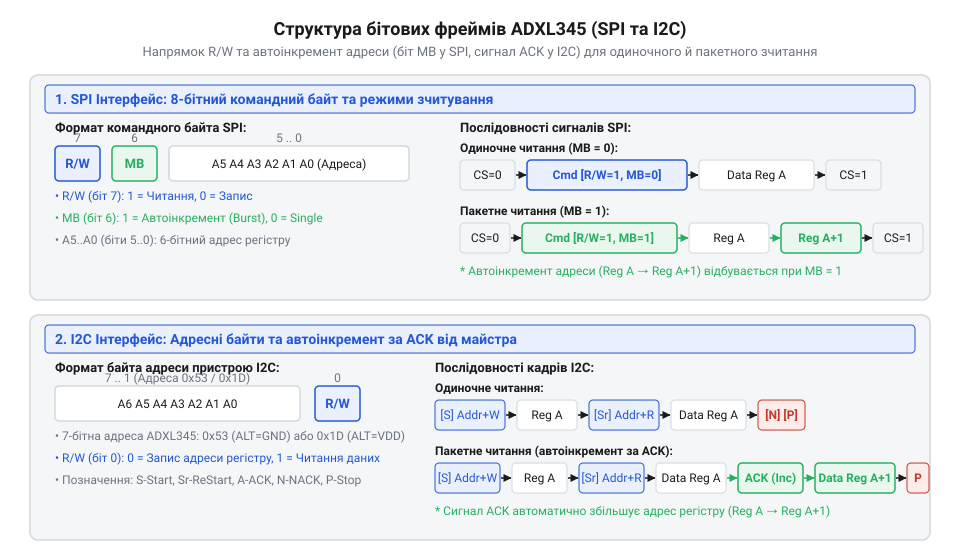
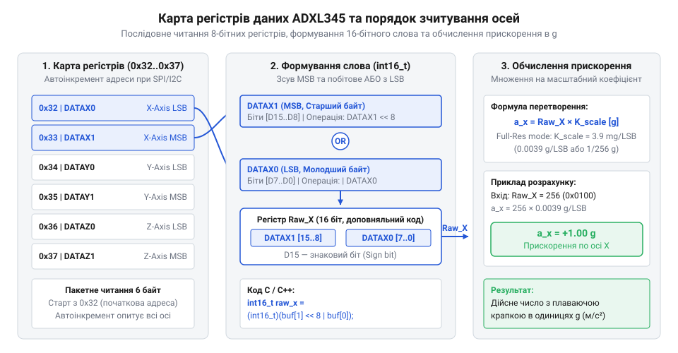

# Карта регістрів та протокол обміну даними ADXL345

<preknowlist>
- [GY-61 ADXL335 — 3-осьовий акселерометр](root:cat-hw-sensors/adxl335) — базові принципи вимірювання 3-осьового прискорення та перетворення чутливості
</preknowlist>

## Спроба зчитування без конфігурації регістрів

Після подачі живлення цифровий акселерометр не видає оновлень вимірювальних даних, а спроба одразу прочитати значення осей повертає лише нулі. Таку поведінку обумовлено тим, що після увімкнення мікросхема потрапляє в режим @@en|standby@@ (з англ. *stand by* — перебувати напоготові). У цьому стані аналогова частина сенсора знеструмлена для економії енергії, а внутрішні регістри містять початкові скинуті значення. На відміну від аналогових датчиків, як-от [акселерометр GY-61 ADXL335](root:cat-hw-sensors/adxl335), цифровий сенсор вимагає явного керування внутрішнім станом через адресовну пам'ять.

Увесь функціонал пристрою розподілено по 8-бітних регістрах керування, конфігурації та даних. Будь-яка взаємодія з мікросхемою зводиться до передачі адреси потрібної комірки та подальшого запису або зчитування байта. Першим кроком після подачі живлення є перевірка наявності пристрою на шині та фізичного зв'язку з ним.

Для верифікації зв'язку призначено регістр ідентифікації @@en|DEVID@@ (з англ. *device identifier* — ідентифікатор пристрою) за адресою `0x00`. Ця комірка доступна лише для читання і завжди містить незмінний зашитий код `0xE5`. Якщо під час звернення за адресою `0x00` отримується значення `0xE5`, фізичне підключення шини та адресація є коректними, і мікросхема готова до ініціалізації.

## Протоколи обміну та формування фреймів

Отримання доступу до регістрів вимагає дотримання чіткого формату командних команд, адже зміщення адреси чи збій синхронізації призводять до зчитування викривлених даних. Давач ADXL345 підтримує дві фізичні шини обміну: @@en|I2C@@ та @@en|SPI@@. Кожен сеанс зв'язку починається з формування фрейму адресації, який визначає напрямок передачі та режим доступу.

*Формат командних фреймів шин I2C та SPI для поповерхового та пакетного зчитування.*

У протоколі @@en|SPI@@ командний байт містить три функціональні зони. Старший біт 7 відповідає за напрямок @@en|R/W@@ (`0` — запис, `1` — читання). Біт 6 керує автоінкрементом адреси @@en|MB@@ (з англ. *multiple byte* — декілька байтів): значення `0` задає поповерховий доступ до одного регістру, а значення `1` вмикає режим @@en|burst read@@ (з англ. *burst read* — пакетне зчитування серією). Решта шість бітів (від 5 до 0) містять 6-бітну адресу регістру. Передача здійснюється при низькому рівні на лінії @@en|CS@@ (з англ. *chip select* — вибір мікросхеми).

На шині @@en|I2C@@ адресація пристрою визначається станом виводу @@en|ALT ADDRESS@@. Якщо вивід підключено до землі, 7-бітна адреса веденого пристрою дорівнює `0x53`, а при підключенні до лінії живлення — `0x1D`. Після передачі адреси пристрою та адреси регістру подальше зчитування кількох байтів поспіль автоматично інкрементує внутрішній вказівник адреси. Це гарантує цілісність даних при опитуванні кількох осей поспіль, оскільки всі байти зчитуються з одного й того самого відліку вимірювання. I2C@@ адресація пристрою визначається | Детальнішу схемотехніку обв'язки, підключення виводів живлення та підтяжку шин розкрито у матеріалі про [принципову схему та підключення ADXL345](root:cat-hw-sensors/adxl345/api-adxl345-hardware-interface.md).

## Конфігурація режимів та вимірювального діапазону

Після налаштування зв'язку датчик залишається неактивним, доки конфігураційні регістри не зададуть темп оновлення та роздільну здатність вимірювань. Керування цими параметрами зосереджено в трьох регістрах: @@en|BW_RATE@@ (`0x2C`), @@en|POWER_CTL@@ (`0x2D`) та @@en|DATA_FORMAT@@ (`0x31`).

Регістр @@en|BW_RATE@@ вибирає частоту оновлення даних (@@en|ODR@@, з англ. *output data rate* — частота вихідних даних). Молодші чотири біти задають частоту дискретизації від 0.10 Гц до 3200 Гц. Значення за замовчуванням `0x0A` відповідає частоті 100 Гц. Встановлення біта @@en|LOW_POWER@@ зменшує струм споживання на низьких частотах за рахунок незначного зростання рівня шумів.

Переведення акселерометра в активний стан виконується через регістр @@en|POWER_CTL@@. Запис одиниці в біт 3 @@en|Measure@@ вмикає внутрішній аналогово-цифровий перетворювач та вимірювальне ядро, виводячи пристрій із режиму @@en|standby@@.

Налаштування вимірювального діапазону та формату чисел виконується в регістрі @@en|DATA_FORMAT@@. Біти 1..0 задають граничне прискорення: `00` для ±2g, `01` для ±4g, `10` для ±8g та `11` для ±16g. Біт 3 @@en|FULL_RES@@ визначає масштабування роздільної здатності. При `FULL_RES` = `0` роздільна здатність обмежена 10 бітами для всіх діапазонів, тому ціна молодшого розряду @@en|LSB@@ (з англ. *least significant bit* — найменший значущий біт) зростає зі збільшенням діапазону. Запис `1` у біт `FULL_RES` вмикає повнорозрядний режим, у якому роздільна здатність зростає до 13 біт на діапазоні ±16g, забезпечуючи постійний масштабний коефіцієнт 3.9 мг/LSB незалежно від вибраної межі вимірювань.

## Зчитування та масштабування вихідних даних

Вмикання вимірювального режиму наповнює шість послідовних регістрів даних від `0x32` до `0x37` актуальними значеннями прискорення. Опитування цих регістрів по одному поповерховими читаннями створює ризик розриву даних, коли значення осі X зчитується з одного вимірювального такту, а оси Y та Z — з наступного.

*Порядок розташування та об'єднання байтів вихідних регістрів даних осей X, Y та Z.*

Щоб запобігти розсинхронізації, застосовують режим @@en|burst read@@, зчитуючи шість байтів поспіль починаючи з адреси `DATAX0` (`0x32`). Результати вимірювання кожної осі розподілено між двома регістрами: молодшим байтом @@en|LSB@@ (`DATAX0`, `DATAY0`, `DATAZ0`) та старшим байтом @@en|MSB@@ (з англ. *most significant byte* — найвищий значущий байт; `DATAX1`, `DATAY1`, `DATAZ1`).

Для відновлення первинного числа молодший і старший байти об'єднуються зсувом старшого байта на 8 бітів ліворуч та побітовим додаванням молодшого байта. Отримане 16-бітне значення інтерпретується як число зі знаком у доповняльному коді.

Обчислення значення фізичного прискорення `a_g` в одиницях g із відновленого 16-бітного цілого числа `raw_16bit` виконується за пропорційною залежністю:

a_g = raw_16bit × 0.0039    [множення сирого значення на масштабний коефіцієнт 3.9 мг/LSB]

При увімкненому повнорозрядному режимі `FULL_RES` кожен крок @@en|LSB@@ завжди дорівнює 3.9 мг (або 0.0039 g), що переводить сирі цілочисельні відліки регістрів у фізичне прискорення.

## Апаратний буфер FIFO та переривання

Постійне опитування регістрів даних мікроконтролером даремно витрачає процесорний час та енергію живлення, а при високих завантаженнях системи призводить до втрати окремих вимірювань. Для розвантаження центрального процесора ADXL345 містить апаратний 32-рівневий буфер @@en|FIFO@@ (з англ. *first in, first out* — першим зайшов, першим вийшов), керування яким здійснюється через регістр @@en|FIFO_CTL@@ (`0x38`).

Буфер підтримує чотири режими роботи. У режимі @@en|Bypass@@ (з англ. *bypass* — обхід) буферизація вимкнена, і дані надходять напряму у вихідні регістри. Режим @@en|FIFO@@ накопичує до 32 відліків і зупиняє запис, чекаючи вичитування. Режим @@en|Stream@@ безперервно оновлює буфер, залишаючи останні 32 вимірювання і витісняючи найстаріші. Режим @@en|Trigger@@ утримує дані до та після настання заданої події. Рівень заповнення буфера контролюється бітами @@en|Samples@@ у регістрах `FIFO_CTL` та @@en|FIFO_STATUS@@ (`0x39`).

Окрім накопичення даних, мікросхема здатна самостійно фіксувати фізичні події без участі процесора. Пороги спрацювання задаються в регістрах @@en|THRESH_TAP@@ (`0x1D`) для покісних ударів та @@en|THRESH_FF@@ (`0x28`) для вільного падіння.

Генерація апаратних сигналів налаштовується в регістрах @@en|INT_ENABLE@@ (`0x2E`) та @@en|INT_MAP@@ (`0x2F`). Біти `INT_MAP` дозволяють спрямувати будь-яке переривання (готовність даних, заповнення буфера, удар або вільне падіння) на один із двох фізичних виводів: @@en|INT1@@ або @@en|INT2@@. Це дозволяє мікроконтролеру перебувати у режимі глибокого сну та прокидатися лише за сигналом переривання.

## Компенсація зсуву та аварійні стани

Навіть після коректного налаштування датчик може показувати відмінні від нуля значення у стані спокою через механічні напруження при паянні корпусу та виготовленні кристала. Окрім того, імпульсні перешкоди на шині здатні збити синхронізацію фреймів обміну, заблокувавши подальшу передачу.

Для апаратного усунення статичної похибки нуля ADXL345 містить регістри калібрування @@en|OFSX@@ (`0x1E`), @@en|OFSY@@ (`0x1F`) та @@en|OFSZ@@ (`0x20`). Вони приймають 8-бітні числа зі знаком, де ціна кожного кроку @@en|LSB@@ дорівнює 15.6 мг (0.0156 g). Значення з цих регістрів автоматично додаються до виміряного прискорення перед записом у регістри даних. Для проведення калібрування нуля пристрій розміщують горизонтально у стані спокою, обчислюють середнє відхилення кожної осі від очікуваного значення та записують зворотно пропорційну поправку в регістри `OFSX`..`OFSZ`.

Аварійні стани шини потребують окремих механізмів відновлення. У протоколі @@en|SPI@@ розсинхронізація усувається короткочасним підняттям лінії @@en|CS@@ у високий рівень, що скидає внутрішній автомат станів інтерфейсу давача.

На шині @@en|I2C@@ при несподіваному скиданні мікроконтролера під час читання давач може залишити лінію даних @@en|SDA@@ (з англ. *serial data* — послідовні дані) у низькому стані, блокуючи шину. Відновлення виконується примусовим формуванням до 9 тактових імпульсів на лінії @@en|SCL@@ (з англ. *serial clock* — послідовний тактовий сигнал) з боку майстра до звільнення лінії `SDA`, після чого генерується стандартна умова @@en|STOP@@.
