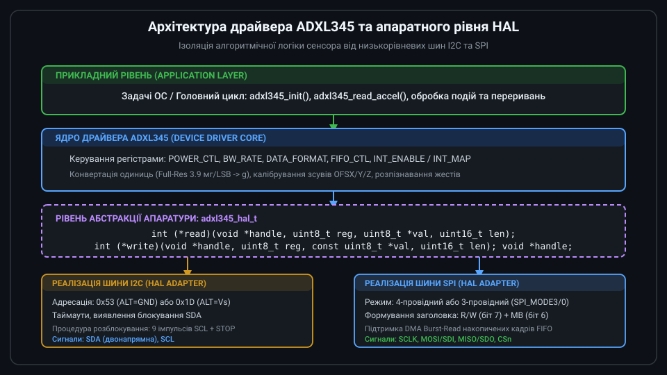
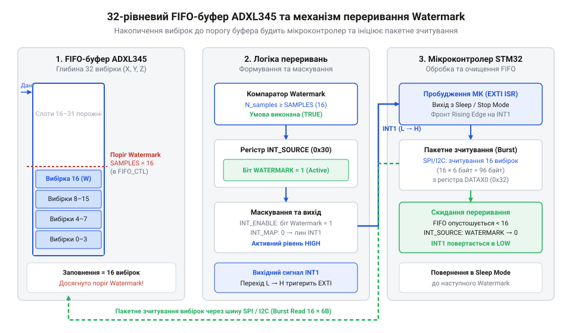

# Програмний інтерфейс драйвера та бітові маски керування ADXL345

<preknowlist>
- [GY-61 ADXL335 — 3-осьовий акселерометр](root:cat-hw-sensors/adxl335) — базові принципи вимірювання 3-осьового прискорення та перетворення векторних величин у фізичні одиниці g
</preknowlist>

## Ізоляція драйвера від апаратури шини

Прямий виклик функцій зчитування периферійних системних бібліотек мікроконтролера з основного коду програми створює жорстку апаратну залежність. Якщо застосунок викликає низькорівневі методи зв'язку безпосередньо, перехід на інше сімейство мікроконтролерів або навіть зміна шинного інтерфейсу вимагає повного переписання високорівневої логіки. Крім того, апаратні збої, такі як замикання ліній шини @@en|I2C@@ (від англ. @@en|Inter-Integrated Circuit@@, міжмікросхемна шина) чи @@en|SPI@@ (від англ. @@en|Serial Peripheral Interface@@, послідовний периферійний інтерфейс), викликають нескінченні затримки й повністю блокують виконання циклу програми.

На відміну від систем із простим аналоговим виходом, як-от [аналоговий акселерометр ADXL335](root:cat-hw-sensors/adxl335), цифровий сенсор ADXL345 вимагає обміну командами та даними через регістри. Для усунення залежності від конкретної апаратури створюють рівень апаратних абстракцій @@en|HAL@@ (від англ. @@en|Hardware Abstraction Layer@@, рівень абстракції апаратури). Архітектура @@en|HAL@@ будується на структурі з указувачами на функції зчитування та запису регістрів.


*Рівень абстракції шини ізолює логіку драйвера від конкретної апаратної реалізації I2C або SPI.*

Така ізоляція дозволяє розробнику передати драйверу власні функції зв'язку, де передбачені обробники помилок, перевірка прапорів готовності шини та @@en|Timeout@@ (таймаут затримки).

:::tabs
```c
typedef int (*adxl345_bus_read_fn)(void *handle, uint8_t reg, uint8_t *val, uint16_t len);
typedef int (*adxl345_bus_write_fn)(void *handle, uint8_t reg, const uint8_t *val, uint16_t len);

typedef struct {
    adxl345_bus_read_fn  read;
    adxl345_bus_write_fn write;
    void                *handle;
} adxl345_hal_t;
```
```cpp
using adxl345_bus_read_fn  = int (*)(void *handle, uint8_t reg, uint8_t *val, uint16_t len);
using adxl345_bus_write_fn = int (*)(void *handle, uint8_t reg, const uint8_t *val, uint16_t len);

struct Adxl345Hal {
    adxl345_bus_read_fn  read;
    adxl345_bus_write_fn write;
    void                *handle;
};
```
:::

Указувач `handle` дає змогу зберігати контекст конкретної шини або її номера, що робить можливим підключення кількох сенсорів до різних шин без зміни коду драйвера.

## Дескриптор драйвера та ініціалізація пристрою

Контекст роботи з акселерометром зберігається в єдиній структурі — дескрипторі драйвера (англ. @@en|Driver Context@@). Дескриптор містить інтерфейс @@en|HAL@@, стан конфігурації сенсора та локальні прапорці помилок. 

Ініціалізація починається з перевірки апаратної присутності сенсора на шині @@en|I2C@@ або @@en|SPI@@. Для цього виконується зчитування ідентифікаційного @@en|Register@@ (регістра) `DEVID` (від англ. @@en|Device Identification@@, ідентифікатор пристрою), який розміщений за адресою `0x00`. Фіксоване значення цього регістра для ADXL345 завжди дорівнює `0xE5` (229 у десятковій системі). Якщо під час читання повернуто інше значення або шина виявила помилку зв'язку, процес ініціалізації негайно зупиняється з поверненням відповідного коду помилки.

:::tabs
:::code api-adxl345-software-driver-interface/c/adxl345-init.c
:::code api-adxl345-software-driver-interface/cpp/adxl345status.cpp
:::

Успішна зчитка `DEVID` підтверджує фізичну цілісність лінії зв'язку й правильність адресації пристрою, створюючи базу для налаштування його функціональних регістрів. Проте сам акселерометр не має окремого регістра чи апаратного біта для @@en|Software Reset@@ (від англ. @@en|Software Reset@@, програмного скидання), тому після @@en|Warm Reboot@@ (від англ. @@en|Warm Reboot@@, гарячого перезавантаження) мікроконтролера чи повторного запуску живлений сенсор зберігає попередню конфігурацію. Якщо пристрій раніше генерував переривання чи накопичував вибірки, залишковий стан спричиняє спонтанні спрацьовування сигнальних ліній і збій подальшого обміну. Щоб гарантувати передбачуваність, ініціалізація обов'язково включає процедуру початкового обнулення конфігураційних регістрів перед безпосереднім вибором режимів роботи. Запис `0x00` у `POWER_CTL` переводить пристрій у режим @@en|Standby@@ (від англ. @@en|Standby@@, режим очікування) й зупиняє вимірювання, а скидання регістрів `INT_ENABLE` та `FIFO_CTL` відключає вихідні переривання й вимикає буферизацію, приводячи сенсор до контрольованого вихідного стану. Докладний довідник усіх регістрів, апаратних виводів та електричних параметрів сенсора наведено в матеріалі про [карту регістрів та апаратні виводи ADXL345](root:cat-hw-sensors/adxl345-registers).

## Режими живлення та частота вибірок

Управління станами енергоспоживання здійснюється через @@en|Register@@ `POWER_CTL` (`0x2D`), а швидкість оновлення даних — через @@en|Register@@ `BW_RATE` (`0x2C`). Для запобігання випадковому скиданню інших конфігураційних бітів модифікація цих регістрів виконується виключно через процедуру @@en|Read-Modify-Write@@ (зчитування-модифікація-запис).

Біт `Measure` (біт 3 регістра `POWER_CTL`) перемикає акселерометр із режиму @@en|Standby@@ (режим очікування із мінімальним споживанням) у режим @@en|Measurement@@ (активний режим вимірювання). За замовчуванням після подачі живлення пристрій перебуває в @@en|Standby@@, тому зчитування даних неможливе до встановлення біта `Measure` в 1.

Режим @@en|Auto-Sleep@@ (автоматичний перехід у сон) активується бітом 4 регістра `POWER_CTL` разом із бітом `LINK` (біт 5). Це змушує акселерометр знижувати частоту вибірок при відсутності активності, заощаджуючи заряд акумулятора. Біт `LINK` пов'язує виявлення активності й спокою у послідовний цикл. Пристрій переходить у сон лише після утримання прискорення нижчим за поріг `THRESH_INACT` протягом часу з регістра `TIME_INACT`. Для повернення до робочої частоти вибірок рівень прискорення має перевищити поріг `THRESH_ACT`. Поріг `THRESH_ACT` обов'язково обирають вищим за `THRESH_INACT`. За однакових або зворотних значень фоновий шум спричинить постійні хибні пробудження та безперервне перемикання режимів.

Частота вихідних даних @@en|ODR@@ (від англ. @@en|Output Data Rate@@, частота вихідних даних) задається чотирма молодшими бітами `[3:0]` регістра `BW_RATE`. Початкова частота становить 100 Гц (код `0x0A`). Зміна частоти на 400 Гц (код `0x0C`) здійснюється маскуванням потрібних розрядів.

:::tabs
```c
#define ADXL345_REG_BW_RATE   0x2C
#define ADXL345_REG_POWER_CTL 0x2D

#define ADXL345_BW_400HZ      0x0C
#define ADXL345_POWER_MEASURE (1 << 3)

adxl345_err_t adxl345_set_odr(adxl345_dev_t *dev, uint8_t rate_code) {
    uint8_t val = 0;
    if (dev->hal.read(dev->hal.handle, ADXL345_REG_BW_RATE, &val, 1) != 0) return ADXL345_ERR_BUS;
    val = (val & 0xF0) | (rate_code & 0x0F);
    if (dev->hal.write(dev->hal.handle, ADXL345_REG_BW_RATE, &val, 1) != 0) return ADXL345_ERR_BUS;
    return ADXL345_OK;
}
```
```cpp
Adxl345Status set_odr(Adxl345Dev &dev, uint8_t rate_code) {
    uint8_t val = 0;
    if (dev.hal.read(dev.hal.handle, 0x2C, &val, 1) != 0) return Adxl345Status::ErrBus;
    val = (val & 0xF0) | (rate_code & 0x0F);
    if (dev.hal.write(dev.hal.handle, 0x2C, &val, 1) != 0) return Adxl345Status::ErrBus;
    return Adxl345Status::Ok;
}
```
:::

Маскування зберігає значення біта `LOW_POWER` (біт 4 в `BW_RATE`), який використовується для збільшення шуму або додаткового зниження струму на низьких частотах @@en|ODR@@.

## Формат даних та керування FIFO

Форматування вихідних даних налаштовується в регістрі `DATA_FORMAT` (`0x31`). Біти `RANGE` `[1:0]` вибирають діапазон вимірювань: ±2g (`00`), ±4g (`01`), ±8g (`10`) або ±16g (`11`). Встановлення біта `FULL_RES` (біт 3) перемикає пристрій у режим повної роздільної здатності @@en|Full-Res@@. У режимі @@en|Full-Res@@ масштабувальний коефіцієнт залишається постійним на рівні 3.9 мг/@@en|LSB@@ незалежно від вибраного діапазону, а роздільна здатність автоматично зростає до 13 біт при діапазоні ±16g.

Апаратний буфер @@en|FIFO@@ (від англ. @@en|First In, First Out@@, першим прийшов — першим вийшов) вміщує до 32 вибірок по трьох осях. Режим роботи буфера задається бітами `FIFO_MODE` `[7:6]` у регістрі `FIFO_CTL` (`0x38`):
- @@en|Bypass@@ (`00`): буфер вимкнено, зчитуються лише поточні дані;
- @@en|FIFO@@ (`01`): буфер накопичує до 32 вибірок і зупиняє запис до зчитування;
- @@en|Stream@@ (`10`): буфер постійно оновлюється, перезаписуючи найстаріші дані новими вибірками;
- @@en|Trigger@@ (`11`): буфер зберігає вибірки до події переривання та зупиняється через задану кількість вибірок після неї.


*Буфер FIFO накопичує векторні вибірки до рівня Watermark, викликаючи апаратне переривання для мікроконтролера.*

Кількість вибірок для генерації порогу заповнення регулюється бітами `Samples` `[4:0]` регістра `FIFO_CTL`, що задає рівень порогу @@en|Watermark@@. Кожна вибірка містить шість послідовних байтів для трьох осей вимірювання. Зчитування неповного блоку байтів залишає внутрішній вказівник буфера @@en|FIFO@@ у проміжному стані. Це порушує фазове вирівнювання осей при наступних зверненнях і залишає прапор @@en|Watermark@@ активним. Для відновлення синхронізації та очищення накопичених вибірок при зміні режимів біти `FIFO_MODE` `[7:6]` регістра `FIFO_CTL` перемикають у режим @@en|Bypass@@ (`00`). Перехід у режим @@en|Bypass@@ миттєво скидає внутрішній лічильник і вказівники буфера. Після повторного ввімкнення робочого режиму дані зчитують пакетними транзакціями @@en|Burst Read@@ кратно шести байтам для запобігання переповненню @@en|Overrun@@.

## Маршрутизація та обробка переривань

Система генерації подій ADXL345 керується трьома регістрами: `INT_ENABLE` (`0x2E`), `INT_MAP` (`0x2F`) та `INT_SOURCE` (`0x30`). Для усунення постійного опитування процесором (англ. @@en|Polling@@) події маршрутизуються на фізичні ніжки `INT1` та `INT2`.

Регістр `INT_ENABLE` активує маску подій: біт `DATA_READY` (біт 7), порог заповнення буфера @@en|Watermark@@ (біт 1) та переповнення @@en|Overrun@@ (біт 0). Регістр `INT_MAP` визначає фізичний вивід: значення `0` у відповідному біті спрямовує переривання на ніжку `INT1`, а `1` — на ніжку `INT2`.

Обробка у процедурі обробки переривань @@en|ISR@@ (від англ. @@en|Interrupt Service Routine@@, процедура обробки переривання) вимагає зчитування регістра `INT_SOURCE` для визначення причини події. Зчитування `INT_SOURCE` скидає більшість прапорів, але прапори `DATA_READY` та @@en|Watermark@@ скидаються лише після вичитування даних із регістрів вимірювання або буфера @@en|FIFO@@.

:::tabs
```c
#define ADXL345_REG_INT_ENABLE 0x2E
#define ADXL345_REG_INT_MAP    0x2F
#define ADXL345_REG_INT_SOURCE 0x30

#define ADXL345_INT_DATA_READY (1 << 7)
#define ADXL345_INT_WATERMARK  (1 << 1)

adxl345_err_t adxl345_config_interrupts(adxl345_dev_t *dev, uint8_t enable_mask, uint8_t map_mask) {
    if (dev->hal.write(dev->hal.handle, ADXL345_REG_INT_MAP, &map_mask, 1) != 0) return ADXL345_ERR_BUS;
    if (dev->hal.write(dev->hal.handle, ADXL345_REG_INT_ENABLE, &enable_mask, 1) != 0) return ADXL345_ERR_BUS;
    return ADXL345_OK;
}
```
```cpp
Adxl345Status config_interrupts(Adxl345Dev &dev, uint8_t enable_mask, uint8_t map_mask) {
    if (dev.hal.write(dev.hal.handle, 0x2F, &map_mask, 1) != 0) return Adxl345Status::ErrBus;
    if (dev.hal.write(dev.hal.handle, 0x2E, &enable_mask, 1) != 0) return Adxl345Status::ErrBus;
    return Adxl345Status::Ok;
}
```
:::

Маршрутизація переривань дозволяє переводити мікроконтролер у режим глибокого сну між появами нових блоків даних, [як це реалізовано в комбінованих IMU модулях](root:cat-hw-sensors/mpu6050).

## Зчитування даних та обробка помилок

Отримання координат прискорення виконується пакетним зчитуванням (англ. @@en|Burst Read@@) шести послідовних регістрів даних від `DATAX0` (`0x32`) до `DATAZ1` (`0x37`). Пакетний режим є критично важливим: вичитування всіх шести байтів за одну транзакцію шини забезпечує атомарність осей X, Y та Z з одного моменту часу, запобігаючи викривленню вектора прискорення.

Отримані байти об'єднуються у 16-бітові числа зі знаком у доповняльному коді. Для перетворення сирих одиниць @@en|LSB@@ (від англ. @@en|Least Significant Bit@@, найменший значущий розряд) у фізичні величини g результат множиться на масштабувальний коефіцієнт @@en|Scale Factor@@. У режимі @@en|Full-Res@@ цей коефіцієнт дорівнює 0.0039 g/@@en|LSB@@.

:::tabs
:::code api-adxl345-software-driver-interface/c/adxl345-read-accel.c
:::code api-adxl345-software-driver-interface/cpp/adxl345data.cpp
:::

Для усунення систематичної похибки вимірювань використовують калібрувальні регістри `OFSX` (`0x1E`), `OFSY` (`0x1F`) та `OFSZ` (`0x20`) (від англ. @@en|Offset@@, зсув). Записані у них 8-бітові значення зі знаком мають крок 15.6 mg/@@en|LSB@@ і автоматично додаються апаратурою сенсора до виміряних даних перед їх записом у регістри виходу. Це звільняє центральний процесор від постійного програмного віднімання зміщення під час кожного зчитування. У разі збою шини чи виникнення @@en|Timeout@@ під час передачі даних драйвер повертає статус `ADXL345_ERR_BUS`. Найбільш критична відмова виникає при перериванні транзакції, коли ведений пристрій утримує лінію @@en|SDA@@ (від англ. @@en|Serial Data@@, послідовні дані) у низькому стані й блокує шину. Для відновлення зв'язку верхній рівень ПЗ переводить вивід @@en|SCL@@ (від англ. @@en|Serial Clock@@, послідовний тактовий сигнал) у режим @@en|GPIO@@ (від англ. @@en|General-Purpose Input/Output@@, цифровий вхід/вихід загального призначення), генерує до дев'яти тактових імпульсів до звільнення лінії @@en|SDA@@, формує примусовий стан @@en|STOP@@ та перезапускає периферійний контролер @@en|I2C@@. Така процедура скидає завислий автомат станів сенсора, як це робиться для [відновлення шини HMC5883L](root:cat-hw-sensors/hmc5883l), і повертає шину до робочої готовності.
