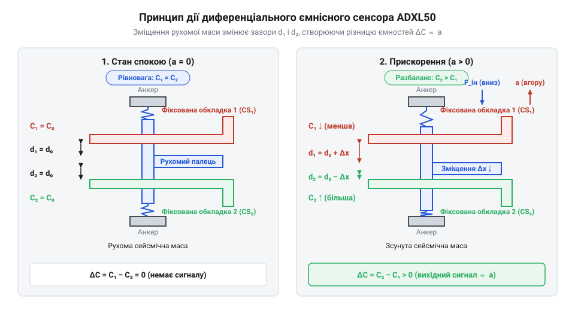
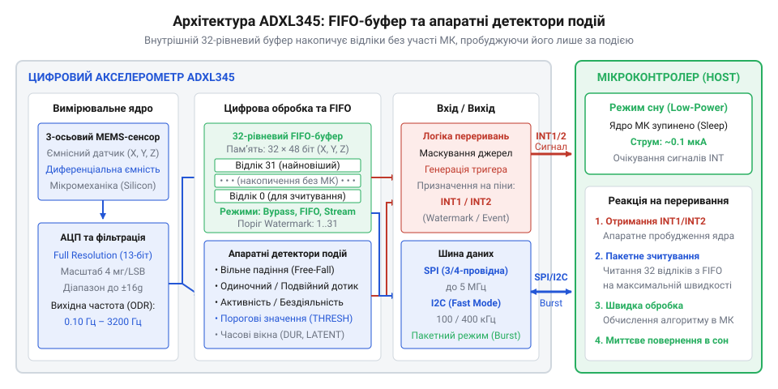

# Еволюція ємнісних MEMS-акселерометрів: від ADXL50 до цифрового ADXL345

<preknowlist>
- [GY-61 ADXL335 — 3-осьовий акселерометр](root:cat-hw-sensors/adxl335) — принципи аналогового вимірювання прискорення за трьома осями та обмеження аналогового виходу
</preknowlist>

## Криза інерційних сенсорів в автопромі

Наприкінці 1980-х років автомобільна промисловість зіткнулася з жорсткою вимогою безпеки: масове впровадження подушок безпеки вимагало миттєвого й безпомилкового виявлення аварійного удару. На той час для фіксації сильного сповільнення застосовували @@en|п'єзоелектричний сенсор@@ (від грец. *piezo* — тиснути та *electron* — бурштин) або громіздкі електромеханічні вимикачі з підпружиненими кульками. У механічних вимикачах інерційна кулька під дією сповільнення стискала пружину для замикання контактів, проте вібрація двигуна викликала брязкіт контактів і хибні спрацьовування. У п'єзоелектричних сенсорах деформація кристала генерувала електричний заряд лише під час динамічних коливань: за сталого прискорення заряд миттєво стікав через опір ізоляції, унеможливлюючи фіксацію постійного сповільнення, а вібрації створювали в кристалі завадові сплески напруги. Ці пристрої були дорогими, мали значні габарити й високу чутливість до хибних спрацьовувань від вібрації двигуна. Крім того, аналоговий сигнал від дискретного давача вимагав складного узгодження для передачі в електронний блок керування — @@en|ECU@@ (від англ. *Electronic Control Unit* — електронний блок керування).

Автовиробникам потрібен був масовий @@en|акселерометр@@ (від лат. *acceleratio* — прискорення та грец. *metreo* — вимірюю) вартістю у кілька доларів замість десятків, який можна було б монтувати безпосередньо на друковану плату. Технологічна криза виникла через те, що традиційна точна механіка досягла межі мініатюризації та здешевлення. Щоб вийти з цього глухого кута, інженери мусили відмовитися від складання окремих пружин та знайшли спосіб виготовляти механічні вимірювальні елементи разом із електронними схемами обробки сигналу на єдиній кремнієвій підкладці. Це дало поштовх розвитку технології, відомої як @@en|MEMS@@ (від англ. *Micro-Electro-Mechanical Systems* — мікроелектромеханічні системи).

## Прорив ADXL50 та поверхова мікрообробка

У 1991 році компанія @@en|Analog Devices@@ здійснила революцію в мікроелектроніці, випустивши перший комерційний ємнісний акселерометр @@en|ADXL50@@. Замість обробки монолітного кремнію на всю глибину кристала розробники застосували метод, який отримав назву @@en|поверхова мікрообробка@@ (англ. *surface micromachining*). На поверхню кремнієвої пластини послідовно наносили жертовні шари оксиду та структурні шари полікристалічного кремнію. Після хімічного травлення оксиду утворилася рухома кремнієва маса — інерційне тіло, підвішене на мікроскопічних кремнієвих пружинах над підкладкою.

*Кремнієва рухома маса підвішена між нерухомими пальцями, утворюючи диференційний конденсатор для вимірювальної схеми.*

Рухома маса має вигляд гребінки, пальці якої входять у проміжки між нерухомими пальцями, закріпленими на підкладці. Така конструкція утворює @@en|диференціальну ємність@@ (від лат. *differentia* — різниця). При виникненні прискорення інерційна маса зміщується: відстань між однією парою пальців зменшується, а між іншою — зростає. Пряме вимірювання статичної зміни ємності у частках пікофарада неможливе через паразитний витік заряду та низькочастотні шуми. Тому вимірювальна схема чипа подає на нерухомі пальці протифазні високочастотні опорні сигнали. У стані спокою ці сигнали на рухомому центральному електроді взаємно компенсуються до нуля. Прискорення порушує ємнісний баланс, і на центральному електроді з'являється змінна напруга: її амплітуда пропорційна зміщенню маси, а фаза вказує напрямок руху. Цей сигнал надходить на вбудований @@en|синхронний демодулятор@@ (від грец. *synchronos* — одночасний та лат. *de-* — зняття, *modulatio* — розмірене коливання), який працює в такт із генератором опорного сигналу. Демодулятор випрямляє високочастотні коливання й виділяє повільну обвідну сигналу, відсікаючи паразитні завади. Фільтр низьких частот усуває залишки носійної частоти, після чого операційний підсилювач перетворює результат у вихідну аналогову напругу.

Головною перевагою чипа @@en|ADXL50@@ стала @@en|монолітна інтеграція@@ (від грец. *monos* — один та *lithos* — камінь): вимірювальна механічна структура та аналоговий підсилювач із демодулятором розташовувалися на одному кристалі кремнію поруч один з одним. Це усунуло паразитичну ємність з'єднувальних провідників і забезпечило високу завадостійкість, необхідну для надійного розгортання подушок безпеки.

## Від аналогових осей до цифрового ADXL345

Перші @@en|MEMS@@ акселерометри були одноосьовими й видавали аналогову напругу, пропорційну прискоренню. Згодом з'явилися багатоосьові аналогові сенсори, як-от [3-осьовий аналоговий акселерометр](root:cat-hw-sensors/adxl335) @@en|ADXL335@@, проте аналогове підключення створювало серйозні обмеження. Вихідний сигнал напруги був вразливим до електричних наведень, а хост-мікроконтролер мусив постійно витрачати ресурси й енергію на опитування зовнішніх каналів @@en|АЦП@@ (від англ. *Analog-to-Digital Converter* — аналогово-цифровий перетворювач).

У 2008 році компанія @@en|Analog Devices@@ представила 3-осьовий акселерометр @@en|ADXL345@@, який ознаменував перехід від вимірювальних елементів до інтелектуальних цифрових модулів. Усередині одного корпусу поєднано 3-осьову @@en|MEMS@@-структуру, 13-бітний @@en|АЦП@@ та цифрові інтерфейси @@en|SPI@@ (від англ. *Serial Peripheral Interface* — послідовний периферійний інтерфейс) і @@en|I2C@@ (від англ. *Inter-Integrated Circuit* — міжінтегральна схема). Конструктивно вимірювальний елемент містить три окремі мікромеханічні секції на спільній кремнієвій підкладці. Для осей X та Y застосовано плоскі диференціальні гребінчасті структури із пальцями, що зсуваються в площині кристала. Для осі Z використано підвішену масу, яка відхиляється перпендикулярно до поверхні й змінює вертикальний зазор відносно нижніх електродів. Прискорювальне зусилля зміщує рухомі елементи й змінює диференціальну ємність відповідної секції. Внутрішня схема подає високочастотне збудження, виділяє пропорційний зміні ємності електричний заряд і перетворює його на аналогову напругу. Інтегрований сигма-дельта @@en|АЦП@@ оцифровує цю напругу в 13-бітний двійковий цифровий код. Ця 13-бітна роздільна здатність забезпечує постійний масштаб 4 мг на молодший значущий розряд у всьому діапазоні вимірювання до `±16 g`, надсилаючи готові дані в шину @@en|SPI@@ або @@en|I2C@@.

*Вбудований FIFO-буфер накопичує вимірювання та видає сигнал переривання для пробудження мікроконтролера зі сну.*

Вирішальною інновацією чипа @@en|ADXL345@@ для портативної електроніки стало впровадження апаратного @@en|FIFO-буфера@@ (від англ. *First In, First Out* — першим зайшов, першим вийшов) на 32 відліки та цифрових детекторів вільного падіння й дотику. Завдяки цьому центральний мікроконтролер може перебувати в режимі глибокого сну, поки сенсор автономно накопичує дані. При настанні події чи заповненні буфера @@en|ADXL345@@ генерує апаратне @@en|переривання@@ (англ. *interrupt*), будячи процесор лише за потреби. Це принципово знизило енергоспоживання мобільних пристроїв порівняно з системами на основі [багатоосьових IMU-модулів](root:cat-hw-sensors/mpu6050) без апаратної буферизації.

Навколо еволюції інерційних сенсорів існує поширений міф, ніби MEMS-акселерометри розроблялися початково для смартфонів. Насправді саме жорсткі вимоги автопрому створили ринок і профінансували технологію за півтора десятиліття до появи масових мобільних гаджетів. Інший міф стверджує, що цифрові акселерометри виникли без етапу аналогової мікромеханіки. Насправді @@en|ADXL345@@ спирається на той самий принцип диференціальної ємності поверхової мікрообробки, випробуваний у чипі @@en|ADXL50@@, додавши до нього апаратні функції цифрової обробки.

## Апаратний FIFO-буфер і автономне спостереження

У портативних автономних пристроях головним обмеженням є ємність акумулятора. Якщо для відстеження руху мікроконтролер змушений безперервно опитувати сенсор через @@en|SPI@@ чи @@en|I2C@@, його процесорне ядро постійно перебуває в активному стані й споживає основну частину енергії. Спроба знизити частоту опитування призводить до втрати швидких динамічних подій — таких як раптовий удар чи початок вільного падіння пристрою.

Розв'язанням цієї проблеми стало перенесення первинної обробки сигналів руху безпосередньо у кристал @@en|ADXL345@@. Вбудований апаратний @@en|FIFO-буфер@@ на 32 відліки накопичує значення прискорення за всіма трьома осями незалежно від головного процесора. Залежно від конфігурації буфер функціонує в одному з трьох апаратних режимів: у базовому @@en|режимі FIFO@@ запис зупиняється після заповнення 32 комірок до зчитування; у @@en|режимі Stream@@ (від англ. *stream* — потік) він працює як кільцевий, де нові вимірювання безперервно витісняють найстаріші; а в @@en|режимі Trigger@@ (від англ. *trigger* — спусковий гачок) буфер постійно оновлюється до моменту апаратної події, зберігаючи зріз руху до й після удару. Одночасно цифрова логіка сенсора порівнює поточні значення з налаштованими @@en|пороговими регістрами@@ (від лат. *registrum* — внесений список) для виявлення специфічних подій: поштовху, подвійного клацання або стану вільного падіння. Таке зіставлення відбувається безпосередньо на виході АЦП за кожен такт вимірювання, що звільняє процесор від аналізу сирих даних, проте обмежує аналіз фіксованою глибиною буфера — при запізненні зчитування в @@en|режимі FIFO@@ нові відліки втрачаються, а в @@en|режимі Stream@@ переписуються.

Поки @@en|ADXL345@@ вимірює прискорення та заповнює буфер, мікроконтролер перебуває у режимі глибокого сну із мінімальним струмом споживання. Коли кількість збережених вимірювань досягає заданого порогу або відбуваються виявлені апаратні події, сенсор змінює логічний рівень на виході @@en|переривання@@. Отримавши цей сигнал, мікроконтролер миттєво прокидається, зчитує весь накопичений блок даних однією пакетною трансакцією та повертається в сон. Такий механізм автономного спостереження дозволяє зменшити середнє енергоспоживання системи в сотні разів порівняно з пристроями на основі [аналогових акселерометрів](root:cat-hw-sensors/adxl335).

## Міфи розробки та справжні витоки MEMS

Історія мікроелектромеханічних систем часто обростає спрощеними уявленнями, які викривлюють справжні причинно-наслідкові зв'язки технологічного прогресу. Найпоширенішим є міф про те, що @@en|MEMS@@ @@en|акселерометри@@ були розроблені для смартфонів та орієнтації їхніх екранів. У дійсності мобільна індустрія масово впровадила інерційні давачі лише наприкінці 2000-х років, тоді як перший комерційний чип @@en|ADXL50@@ з'явився ще у 1991 році. Справжнім рушієм і фінансовим джерелом цієї технології стали жорсткі вимоги автопрому щодо надійності систем подушок безпеки. Саме автомобільний ринок здатний був оплатити тривалі дослідження та витримати високу початкову собівартість виробництва.

Інша поширена омана стверджє, що цифрові сенсори з'явилися як принципово нова технологія, яка відразу витіснила застарілу мікромеханіку. Проте аналіз архітектури @@en|ADXL345@@ доводить протилежне: його вимірювальне ядро використовує ту саму поверхову мікрообробку кремнію та диференціальні ємнісні гребінки, випробувані компанією @@en|Analog Devices@@ за два десятиліття до цього. Цифрова революція відбулася завдяки інтеграції на тому самому кристалі аналогово-цифрового перетворювача (@@en|АЦП@@) та контролера обробки подій, а не через зміну фізичного принципу вимірювання.

Розуміння цих еволюційних етапів показує, що складні апаратні технології спочатку проходять тривале відпрацювання у промислових чи автомобільних сферах із високими вимогами до надійності. Лише після досягнення високого відсотка виходу придатних кристалів та зниження собівартості технологія стає доступною для масових споживчих пристроїв та [багатофункціональних інерційних модулів](root:cat-hw-sensors/mpu6050).
