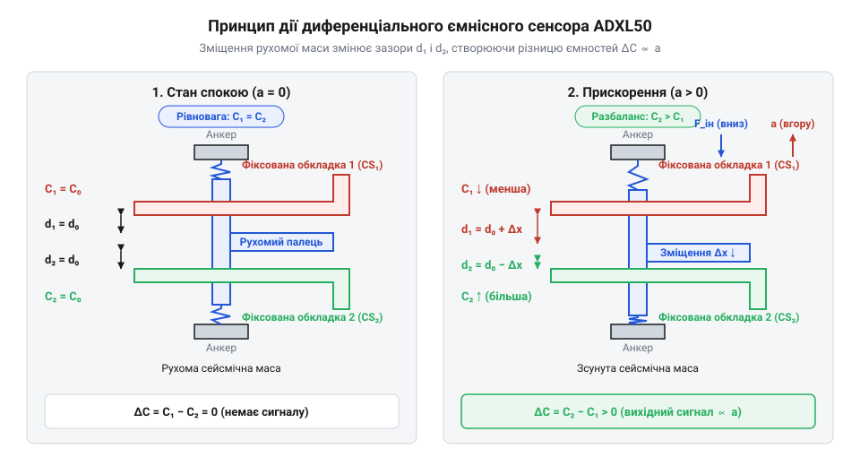
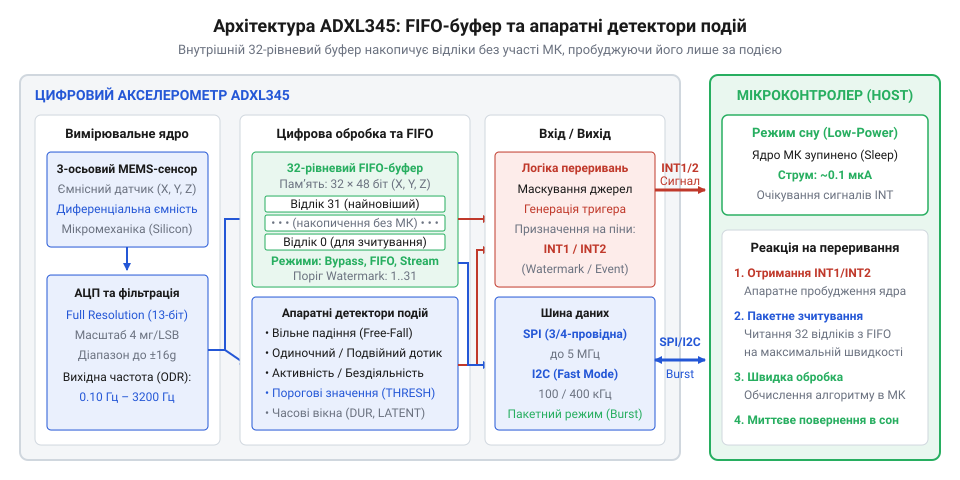

# Еволюція ємнісних MEMS-акселерометрів: від ADXL50 до цифрового ADXL345

<preknowlist>
- [GY-61 ADXL335 — 3-осьовий акселерометр](root:cat-hw-sensors/adxl335) — принципи виведення аналогового сигналу напруги по трьох осях та фільтрація шуму зовнішніми конденсаторами
- [GY-521 / MPU-6050 — 6-осьовий IMU (акселерометр+гіроскоп)](root:cat-hw-sensors/mpu6050) — принципи організації цифрового інтерфейсу I2C, регістрової карти та читання даних прискорення в цифрових інерційних модулях
</preknowlist>

## Обмеження дискретних датчиків у системах безпеки

У 1980-х роках автомобільна промисловість зіткнулася з гострою технічною суперечністю під час впровадження повітряних подушок безпеки (@@en|airbag safety systems@@). Для надійного спрацьовування системи під час аварії потрібні були датчики сповільнення, але на той час існували лише дискретні механічні та п'єзоелектричні пристрої. Найпоширенішими були кульково-трубчасті механічні перемикачі (@@en|ball-in-tube sensor@@), де сталева кулька утримувалася магнітом і при сильному ударі замикала контакти, або дискретні п'єзоелектричні сенсори (від грец. @@el|πιέζω@@ — тиснути; @@en|piezoelectric sensor@@).

Ці конструкції мали критичні недоліки. Кожен дискретний датчик збирався вручну з окремих металевих та пластикових деталей, через що вартість одного блоку сенсорів сягала від 50 до 100 @@en|USD@@ у цінах 1980-х років. Це робило подушки безпеки елітною опцією лише для дорогих автомобілів. П'єзоелектричний сенсор (@@en|piezoelectric sensor@@) генерує електричний заряд лише під час деформації кристала при динамічних змінах навантаження. Через неминуче витікання цього заряду крізь внутрішній опір п'єзоелемента та вимірювальних кіл такий пристрій принципово непридатний для вимірювання статичного прискорення на частоті 0 Гц — він не здатний фіксувати постійну силу тяжіння чи тривале стале сповільнення. Механічні контакти з роками окислювалися й могли заклинити, а головне — їх було неможливо перевірити в процесі експлуатації. Автомобільний електронний блок управління не мав жодного способу дізнатися, чи спрацює механічна кулька при аварії, оскільки апаратний самоконтроль (@@en|self-test@@) у дискретній механіці фізично неможливий без імітації реального удару.

Автомобільні виробники вимагали монолітного, масового та дешевого пристрою вартістю до 5 @@en|USD@@, який можна було б монтувати на друковану плату стандартним автоматом складання й автоматично діагностувати під час кожного запуску двигуна. Ця потреба сформувала чіткий технічний виклик: перенести вимірювальний механічний елемент разом із діагностичною електронною схемою безпосередньо на кремнієву пластину.

## Монолітний ADXL50 і міфи MEMS

У 1991 році компанія @@en|Analog Devices@@ випустила перший у світі масовий монолітний акселерометр @@en|ADXL50@@, виготовлений за технологією поверхневої мікромеханічної обробки (@@en|surface micromachining@@, [поверхневої мікромеханічної обробки](root:hw-sensing/surface-micromachining)). На поверхню кремнієвої підкладки наносили жертовний шар оксиду кремнію, поверх якого формували конструкцію з полікристалічного кремнію. Після витравлювання оксиду плавиковою кислотою над підкладкою утворювалася рухома кремнієва балка із підвішеними пальцями. Рухомі пальці розміщувалися між фіксованими обкладками, утворюючи диференціальний ємнісний сенсор (від лат. @@la|capacitas@@ — місткість; @@en|differential capacitive sensor@@). Під дією прискорення балка зміщувалася, змінюючи ємності двох плечей диференціального конденсатора.

*Диференціальна ємнісна структура ADXL50, де зміщення центральної балки під дією прискорення змінює ємність відносно фіксованих пальців.*

Поява @@en|ADXL50@@ породила поширений міф, ніби @@en|Analog Devices@@ винайшли сам принцип ємнісного вимірювання чи концепцію мікроелектромеханічних систем (від @@en|Micro-Electro-Mechanical Systems@@, @@en|MEMS@@). Насправді фізичний принцип ємнісного вимірювання відомий ще з XIX століття, а перший мікромеханічний кремнієвий транзистор винайшов @@en|Harvey Nathanson@@ у лабораторії @@en|Westinghouse@@ ще 1965 року. Базові принципи обробки кремнію як механічного матеріалу детально описав @@en|Kurt Petersen@@ у своїй фундаментальній праці 1982 року.

Справжнім революційним досягненням @@en|Analog Devices@@ була монолітна інтеграція. До @@en|ADXL50@@ мікромеханічний елемент і електронну схему обробки підключали окремими кристалами або дротами, що призводило до величезних паразитних ємностей з'єднувальних ліній. Розробники @@en|Analog Devices@@ поєднали полікремнієві ємнісні пальці та аналогову схему обробки сигналу (генератор опорної частоти, демодулятор, підсилювач і схему електростатичного самоконтролю @@en|self-test@@) на єдиній кремнієвій пластині за допомогою суміщеного технологічного процесу @@en|BiCMOS@@ (від @@en|Bipolar Complementary Metal-Oxide-Semiconductor@@). Під час активації @@en|self-test@@ внутрішня схема подає калібровану напругу на фіксовані обкладки конденсатора. Створюване електростатичне поле (від грец. @@el|ἤлектрон@@ — бурштин та @@el|στατικός@@ — нерухомий; @@en|electrostatic field@@) притягує рухому полікремнієву балку й механічно відхиляє її на задану відстань без зовнішнього руху пристрою. Це зміщення змінює диференціальну ємність пальців і змушує вимірювальну схему зсувати вихідну напругу на фіксовану величину, імітуючи реальне прискорення. Якщо балка заклинила або вимірювальний тракт пошкоджено, вихідна напруга не зміниться, що дозволяє апаратно виявити несправність датчика. У штатному ж режимі мікросхема видає аналогову напругу, пропорційну прискоренню.

## Перехід до шин і цифрової периферії

Перші аналогові сенсори, подібні до пізніших 3-осьових [аналогових акселерометрів ADXL335](root:cat-hw-sensors/adxl335), виводили сигнал у вигляді безперервної напруги. Це вимагало від центрального мікроконтролера постійного використання аналого-цифрового перетворювача (від @@en|Analog-to-Digital Converter@@, @@en|АЦП@@) та регулярного переривання обчислювача для опитування каналів. З появою 3-осьового акселерометра @@en|ADXL345@@ відбувся перехід до цифрової периферії: на кристал сенсора додали вбудований 13-бітний @@en|АЦП@@ та послідовні шини даних @@en|I2C@@ (від @@en|Inter-Integrated Circuit@@) і @@en|SPI@@ (від @@en|Serial Peripheral Interface@@).

*Архітектура ADXL345 з інтегрованим FIFO-буфером та апаратними детекторами подій, що знімає навантаження з мікроконтролера.*

Серед розробників побутує спрощене уявлення, ніби цифровий акселерометр — це лише аналогове вимірювальне ядро з припаяним поруч зовнішнім @@en|АЦП@@. Утім, додавання цифрового блоку перетворило сенсор на автономну обчислювальну систему. @@en|ADXL345@@ отримав регістровую карту, власні генератори тактування та апаратні монітори подій. Сенсор здатний самостійно виявляти вільне падіння (@@en|freefall detection@@), поодинокі та подвійні удари (@@en|tap detection@@), а також стан активності чи спокою без залучення зовнішнього процесора. В основі цих детекторів лежать вбудовані логічні автомати та цифрові компаратори (від латинського @@la|comparare@@ — зіставляти; @@en|comparator@@), які безперервно порівнюють поточне прискорення з програмованими пороговими умовами. Під час вільного падіння зовнішнє гравітаційне прискорення в системі відліку приладу зникає, тому детектор вільного падіння перевіряє, чи впали виміряні значення за всіма трьома осями нижче заданої межі (зазвичай 300–600 мг) і чи залишаються вони там безперервно протягом усього часового вікна (100–350 мс), що запобігає хибним спрацьовуванням від короткочасних вібрацій. Алгоритм виявлення ударів оцінює амплітуду й тривалість сплеску: поодинокий удар фіксується, коли прискорення перевищує високий поріг і повертається назад у межах заданої часової тривалості, а для подвійного удару (@@en|double tap detection@@) логіка витримує затримку гасіння механічних коливань корпуса після першого імпульсу перед відкриттям вікна для другого сплеску. Виконання цих обчислень безпосередньо на кристалі сенсора позбавляє мікроконтролер потреби постійно опитувати @@en|АЦП@@ та виконувати векторні розрахунки в програмі. Водночас жорстка порогова логіка має граничні випадки: швидке обертання пристрою під час падіння створює відцентрове прискорення, яке утримує підсумковий вектор вище порогу й маскує падіння, а інтенсивна вібрація обладнання здатна спровокувати хибні спрацьовування детекторів удару.

Ключовим елементом нової архітектури став вбудований 32-рівневий буфер тимчасового збереження даних @@en|FIFO@@ (від @@en|First In, First Out@@, «першим зайшов — першим вийшов»; @@en|FIFO buffer@@). Замість постійного пробудження мікроконтролера для зчитування кожного виміру з частотою 100 Гц, сенсор накопичує до 32 відліків прискорення у власній пам'яті. Потім @@en|ADXL345@@ генерує переривання на фізичному виводі, і мікроконтролер зчитує весь пакунок даних за один швидкий сеанс зв'язку по шині @@en|SPI@@ або @@en|I2C@@. Це дозволяє центральному процесору 99% часу перебувати в режимі глибокого сну (@@en|sleep mode@@), що зменшує енергоспоживання автономного пристрою в десятки разів і стало стандартом для сучасних інерційних модулів, таких як [модулів MPU-6050](root:cat-hw-sensors/mpu6050).

## Архітектура ADXL345 та економія енергії

У цифровому сенсорі @@en|ADXL345@@ ключовою особливістю вимірювального ядра став режим високої роздільної здатності (від @@en|full@@ — повний, @@en|resolution@@ — роздільність; @@en|Full Resolution@@). У звичайних цифрових акселерометрах розрядність аналого-цифрового перетворювача є фіксованою: при розширенні діапазону вимірювання від ±2g до ±16g вага молодшого значущого біта (від @@en|Least Significant Bit@@ — найменший значущий біт; @@en|LSB@@) зростає, що призводить до втрати точності на великих прискореннях. Режим @@en|Full Resolution@@ збільшує розрядність даних до 13 біт пропорційно розширенню діапазону. Завдяки цьому масштабувальний коефіцієнт залишається постійним — близько 4 мг/LSB для всіх діапазонів, що зберігає високу чутливість сенсора як при мікрозсувах, так і під час сильних ударів.

Головний енергетичний виграш у реальних пристроях забезпечує поєднання апаратних детекторів подій та вбудованого 32-рівневого буфера @@en|FIFO@@. Замість того щоб постійно опитувати сенсор із заданою частотою вихідних даних (від @@en|output@@ — вихід, @@en|data@@ — дані, @@en|rate@@ — темп; @@en|Output Data Rate@@, @@en|ODR@@), мікроконтролер переходить у режим глибокого сну (@@en|sleep mode@@). @@en|ADXL345@@ самостійно накопичує відліки прискорення в пам'яті або відстежує вихід за порогові значення. При настанні події — вільного падіння чи удару — сенсор змінює логічний рівень на фізичному виводі переривання (від лат. @@la|interruptus@@ — перерваний; @@en|interrupt pin@@). Збуджений цим сигналом мікроконтролер зчитує весь накопичений блок даних за одну швидку сесію по шині @@en|SPI@@ або @@en|I2C@@ і знову засинає, знижуючи середнє споживання струму всієї системи з міліамперного рівня до кількох мікроампер.

Оскільки послідовні шини @@en|I2C@@ та @@en|SPI@@ передають дані побайтово, 13-бітний результат вимірювання прискорення в режимі @@en|Full Resolution@@ неможливо прочитати за один 8-бітний такт. Через це дані кожної осі розподіляються між двома послідовними 8-бітними реєстрами — молодшим байтом @@en|DATAX0@@ та старшим байтом @@en|DATAX1@@. Усередині цього 16-бітного контейнера дані зберігаються у форматі з доповняльним кодом (від @@en|two's complement@@ — доповнення до двійки; @@en|two's complement format@@) для показу від'ємних і додатних величин. За замовчуванням сенсор вирівнює дані за правим краєм (від @@en|right@@ — правий, @@en|justified@@ — вирівняний; @@en|right-justified@@), розміщуючи 13 біт виміру в молодших розрядах від 0-го до 12-го. При цьому 12-й біт є знаковим (від @@en|Most Significant Bit@@ — найстарший значущий біт; @@en|MSB@@). Старші біти 13, 14 та 15 у регістрі @@en|DATAX1@@ автоматично заповнюються копією знакового біта завдяки розширенню знака (від @@en|sign@@ — знак, @@en|extension@@ — розширення; @@en|sign extension@@). Така бітова структура дозволяє мікроконтролеру об'єднати байти виразом `(DATAX1 << 8) | DATAX0` і відразу отримати правильне знакове 16-бітне ціле число без додаткових маніпуляцій з бітами.

## Системний вибір та компроміси акселерометрів

Вибір між аналоговими та цифровими MEMS-акселерометрами обумовлений жорсткими архітектурними компромісами. Прості 3-осьові [аналогові акселерометри ADXL335](root:cat-hw-sensors/adxl335) виводять безперервний сигнал напруги із нульовою затримкою. Вони не потребують цифрового тактування чи налаштування регістрів, а смуга пропускання аналогового сигналу легко задається підбором зовнішніх конденсаторів. Проте такі сенсори вразливі до наведень на довгих лініях зв'язку і вимагають від обчислювача наявності трьох вільних каналів перетворювача напруги та постійної активності для зчитування даних.

Цифрові інерційні модулі, такі як @@en|ADXL345@@ або 6-осьові [модулі MPU-6050](root:cat-hw-sensors/mpu6050), усувають аналогові перешкоди за рахунок оцифрування сигналу безпосередньо біля вимірювального ядра. Вони дозволяють об'єднувати десятки датчиків на спільній послідовній шині, гнучко налаштовувати частоту @@en|ODR@@ та передавати обробку подій апаратному буферу. Ці переваги компенсуються квантувальним шумом, затримками шинного обміну та більшою складністю первинного програмування. Для автономних трекерів із батарейним живленням чи багатодатчикових систем вирішальним є цифровий інтерфейс із буферизацією, тоді як для високочастотних аналогових контурів прямого керування або найпростіших сигнальних схем досі оптимальним залишається аналоговий вихід.
