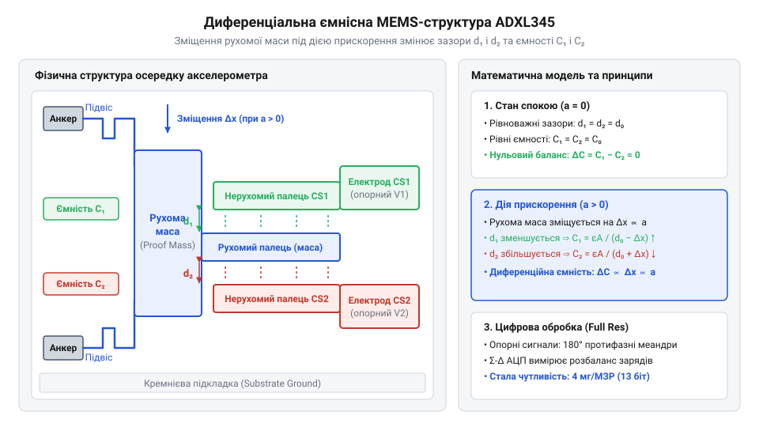

# Фізико-математична модель ємнісного перетворення MEMS та обчислення прискорення

<preknowlist>
- [GY-61 ADXL335 — 3-осьовий акселерометр](root:cat-hw-sensors/adxl335) — принципи вимірювання прискорення MEMS-структурою та аналогове представлення сигналу
</preknowlist>

## Похибки прямих вимірювань цифрового акселерометра

Пряме зчитування двійкових кодів із регістра `DATAX` цифрового давача `@@en|ADXL345@@` без подальшої математичної обробки дає хибне уявлення про справжнє прискорення об'єкта. Якщо некалібрований сенсор перебуває в стані спокою, його вихідний код показує не нульове значення, а деяке відхилення, зумовлене технологічним розкидом виготовлення та механічним напруженням корпусу після монтажу. Спроба використовувати такі «сирі» дані безпосередньо в алгоритмах орієнтації чи навігації призводить до катастрофічного накопичення помилки.

У системах інерційної навігації виміряне прискорення інтегрується по часу для обчислення швидкості, після чого повторне інтегрування визначає поточну координату. Постійна похибка зсуву нульового рівня (англ. @@en|zero-g offset@@) призводить до лінійного зростання похибки швидкості та квадратичного зростання похибки позиції.

Позначимо час через `t`, постійний зсув нульового рівня прискорення через `b₀`, похибку обчисленої швидкості через `Δv`, а похибку визначення координати через `Δr`.

    Δv = b₀ · t                     [лінійне накопичення похибки швидкості]
    Δr = 0.5 · b₀ · t²              [квадратичне накопичення похибки координати]

Блок рівнянь показує, що навіть невелике статичне зміщення вихідного коду спричиняє розраховане прискорення похибки, яке збільшує відхилення координати пропорційно квадрату часу. Наприклад, якщо зсув нульового рівня становить `40 мг` (що дорівнює приблизно `0.392 м/с²`), то за `10` секунд дрейф координати становитиме `19.6` метрів, а за хвилю перевищить `700` метрів. На відміну від [аналогового акселерометра ADXL335](root:cat-hw-sensors/adxl335), де сигнал знімається безпосередньо у вигляді напруги, цифровий акселерометр (від лат. @@la|acceleratio@@ — прискорення та грец. @@el|μετρέω@@ — вимірювати) `@@en|ADXL345@@` вимагає побудови чіткої математичної моделі перетворення від механічного ядра до цифрового коду для компенсації системних похибок у [складних інерційних модулях MPU-6050](root:cat-hw-sensors/mpu6050).

## Механічне зміщення кремнієвого підвісу MEMS

Серцем вимірювального тракту є мікроелектромеханічна система (від грец. @@el|μικρός@@ — малий, @@el|ἤλεκτρον@@ — янтар та @@el|μηχανική@@ — мистецтво побудови машин), або `@@en|MEMS@@`, у якій прискорення перетворюється на механічне переміщення. Всередині кремнієвого кристала сформовано рухому масу (інерційна маса, англ. @@en|proof mass@@), яка утримується пружними мікробалками підвісу. Коли на корпус пристрою діє зовнішнє прискорення, інерційна маса прагне зберегти стан спокою, спричиняючи деформацію мікробалок.

Рівновага структури визначається рівністю сили інерції та пружної сили реакції підвісу. Позначимо масу рухомої частини через `m`, прикладене прискорення через `a`, виникаючу силу інерції через `F_in`, жорсткість мікробалок підвісу через `k`, геометричне зміщення маси через `Δx`, а пружну силу підвісу через `F_sp`.

    F_in = m · a                    [закон інерції Ньютона]
    F_sp = k · Δx                   [закон Гука для пружної деформації]
    m · a = k · Δx                  [умова механічної рівноваги]
    Δx = (m ÷ k) · a                [залежність геометричного зсуву від прискорення]

Отриманий вираз підтверджує, що лінійне зміщення `Δx` кремнієвих пальців рухомої маси прямо пропорційне прикладеному прискоренню `a`. Відношення `m ÷ k` задає механічну чутливість підвісу `@@en|MEMS-ядра@@`. Чим більша маса та чим гнучкіші мікробалки, тим більшим є геометричний зсув при одному й тому ж рівні прискорення.

## Диференціальне ємнісне перетворення та оцифрування

Механічний зсув `Δx` перетворюється на електричний сигнал за допомогою диференціальної ємнісної комірки. Рухома маса містить кремнієві пальці, що розміщені між двома нерухомими електродами, утворюючи два конденсатори зі спільним центральним виводом.

*Будова диференціального ємнісного перетворювача, де відхилення рухомого центрального пальця змінює відстані до нерухомих обкладок і формує різницю ємностей.*

Позначимо початковий зазор між електродами в стані спокою через `d₀`, діелектричну проникність середовища через `ε`, електричну сталу через `ε₀`, площу перекриття пальців через `A`, початкову ємність кожної пари через `C₀`, ємність верхнього зазору через `C₁`, ємність нижнього зазору через `C₂`, а різницю ємностей через `ΔC`.

При відхиленні рухомого пальця на відстань `Δx` один зазор зменшується до `d₀ - Δx`, а інший збільшується до `d₀ + Δx`.

    C₁ = C₀ ÷ (1 - Δx ÷ d₀)                                 [ємність верхнього зазору]
    C₂ = C₀ ÷ (1 + Δx ÷ d₀)                                 [ємність нижнього зазору]
    ΔC = C₁ - C₂                                            [різниця ємностей диференціальної пари]
    ΔC = C₀ ÷ (1 - Δx ÷ d₀) - C₀ ÷ (1 + Δx ÷ d₀)            [підстановка складових ємностей]
    ΔC = 2 · C₀ · (Δx ÷ d₀) ÷ (1 - (Δx ÷ d₀)²)              [алгебраїчне зведення до спільного знаменника]
    ΔC ≈ 2 · C₀ · (Δx ÷ d₀)                                 [лінійне наближення для малих зміщень]

Оскільки геометричне зміщення `Δx` набагато менше за початковий зазор `d₀` (`Δx << d₀`), квадратичним членом `(Δx ÷ d₀)²` можна знехтувати. Підставивши значення `Δx = (m ÷ k) · a` із механічної моделі, отримуємо підсумкову залежність:

    ΔC ≈ 2 · C₀ · (m ÷ (k · d₀)) · a                        [зв'язок різниці ємностей із прискоренням]

Отримане рівняння доводить строго лінійний зв'язок між прискоренням `a` та зміною диференціальної ємності `ΔC`. Внутрішній підсилювач заряду інтегрує різницю ємностей при поданні протифазних опитувальних імпульсів, перетворюючи її на напругу. Аналогово-цифровий перетворювач (англ. @@en|ADC@@) оцифровує цю напругу у 16-бітний доповняльний код (англ. @@en|two's complement@@), який записується в регістри даних `@@en|DATAX0@@` та `@@en|DATAX1@@` акселерометра `@@en|ADXL345@@`. Математичний механізм формування та декодування знакових двійкових кодів розкрито у матеріалі про [представлення від'ємних чисел у доповняльному коді](root:math-number-theory/twos-complement-algebra).

## Масштабування сирих кодів у фізичне прискорення

Зчитані з двох 8-бітних регістрів (наприклад, `@@en|DATAX0@@` та `@@en|DATAX1@@`) байти об'єднуються у 16-бітне знакове ціле число. Режим роботи вимірювального тракту задається в регістрі `@@en|DATA_FORMAT@@` (адреса `0x31`). Акселерометр `@@en|ADXL345@@` підтримує два основних режими оцифрування: режим високої роздільності (англ. @@en|Full Resolution@@) та режим фіксованої 10-бітної роздільності.

У режимі `@@en|Full Resolution@@` (біт `FULL_RES = 1`) чутливість приладу залишається сталою і дорівнює `4 мг/МЗР` (мілі-g на молодший значущий розряд, англ. @@en|LSB@@) незалежно від обраного діапазону вимірювань. При збільшенні діапазону від `±2g` до `±16g` розрядність даних автоматично зростає від 10 до 13 біт.

Позначимо сирий 16-бітний код у доповняльному коді через `N`, масштабний коефіцієнт чутливості через `K_s`, прискорення в одиницях `g` через `a_g`, стандартне прискорення вільного падіння через `g₀ = 9.80665 м/с²`, а підсумкове прискорення у `м/с²` через `a_ms2`.

    a_g = N · K_s                      [прискорення у g]
    a_ms2 = a_g · g₀                   [переведення у м/с²]
    a_ms2 = N · 0.004 · 9.80665        [підстановка коефіцієнта Full Resolution]
    a_ms2 = N · 0.0392266              [значення прискорення у м/с² на 1 МЗР]

У режимі фіксованої 10-бітної роздільності (біт `FULL_RES = 0`) весь динамічний діапазон вимірювання розбивається на `2¹⁰ = 1024` дискретних рівнів. Тому масштабний коефіцієнт `K_s` змінюється залежно від обраної межі вимірювань:
- Для діапазону `±2g` (ширина `4g`): `K_s = 4 ÷ 1024 = 0.00390625 g/LSB` (приблизно `3.9 мг/МЗР`);
- Для діапазону `±4g` (ширина `8g`): `K_s = 8 ÷ 1024 = 0.0078125 g/LSB` (приблизно `7.8 мг/МЗР`);
- Для діапазону `±8g` (ширина `16g`): `K_s = 16 ÷ 1024 = 0.015625 g/LSB` (приблизно `15.6 мг/МЗР`);
- Для діапазону `±16g` (ширина `32g`): `K_s = 32 ÷ 1024 = 0.03125 g/LSB` (приблизно `31.2 мг/МЗР`).

**Обчислення прискорення для сирого коду N = +250 у режимі Full Resolution:**

    a_g = 250 · 0.004 = 1.0 g                     [перерахунок коду в одиниці g]
    a_ms2 = 1.0 · 9.80665 = 9.80665 м/с²          [переведення в одиниці м/с²]

Отже, код `+250` відповідає стандартному прискоренню вільного падіння `1.0 g`.

**Обчислення прискорення для сирого коду N = -128 у режимі 10-бітної роздільності при діапазоні ±8g:**

    K_s = 16 ÷ 1024 = 0.015625 g/LSB              [масштабний коефіцієнт для діапазону ±8g]
    a_g = -128 · 0.015625 = -2.0 g                [перерахунок від'ємного коду в g]
    a_ms2 = -2.0 · 9.80665 = -19.6133 м/с²        [переведення від'ємного значення в м/с²]

У результаті від'ємний код `-128` при фіксованій 10-бітній роздільності точно відповідає прискоренню `-2.0 g`.

## Компенсація системного зсуву через регістри зміщення

Після монтажу приладу на друковану плату залишковий зсув нульового рівня може перевищувати допуски вимірювального тракту. Для апаратного усунення цього зсуву акселерометр `@@en|ADXL345@@` містить 8-бітні регістри зміщення `@@en|OFSX@@` (адреса `0x1E`), `@@en|OFSY@@` (`0x1F`) та `@@en|OFSZ@@` (`0x20`).

Роздільність регістрів зміщення становить `15.6 мг/МЗР` (або `0.0156 g/LSB`), що відрізняється від роздільності регістрів даних у режимі `@@en|Full Resolution@@` (`4 мг/МЗР`). Внутрішня логіка приладу автоматично віднімає записане в регістр `@@en|OFSX@@` значення від зчитаного сигналу перед його приміщенням у вихідні регістри `@@en|DATAX@@`.

Для калібрування сенсор розміщують горизонтально на нерухомій поверхні. У цьому стані очікувані значення прискорення для осей X та Y дорівнюють `0 g`, а для осі Z — `+1 g` (при орієнтації чутливим елементом угору).

Позначимо виміряне статичне прискорення через `a_meas`, очікуване ідеальне значення через `a_target`, похибку прискорення через `Δa`, роздільність компенсаційного регістру через `K_ofs = 0.0156 g/LSB`, а розрахований 8-бітний код калібрування у доповняльному коді через `OFS_code`.

    Δa = a_meas - a_target                         [визначення абсолютного зсуву]
    OFS_code = - round( Δa ÷ K_ofs )               [формула компенсаційного коду]
    OFS_code = - round( Δa ÷ 0.0156 )              [підстановка роздільності 15.6 мг/МЗР]

Знак мінус у формулі зумовлений тим, що апаратна схема `@@en|ADXL345@@` віднімає вміст компенсаційного регістру від поточного вимірювання.

**Обчислення компенсаційного коду для осі X при виявленому зсуві zero-g:**

Нехай при розміщенні на площині середній сирий код осі X у режимі `@@en|Full Resolution@@` становить `N_x = +15` (при очікуваному `0 g`).

    a_meas = 15 · 0.004 = 0.060 g                  [переведення середнього коду в одиниці g]
    Δa = 0.060 - 0.0 = 0.060 g                     [обчислення відхилення від нуля]
    OFS_code = - round( 0.060 ÷ 0.0156 )           [розрахунок дробового значення]
    OFS_code = - round( 3.84615 ) = -4             [округлення до найближчого цілого коду]

Отримане значення `-4` у вигляді 8-бітного числа в доповняльному коді (`0xFC`) записується в регістр `@@en|OFSX@@`. Після цього внутрішня схема зміщує рівень нуля на `4 · 15.6 мг = 62.4 мг`, компенсуючи вихідну похибку `60 мг` практично до повного нуля.
