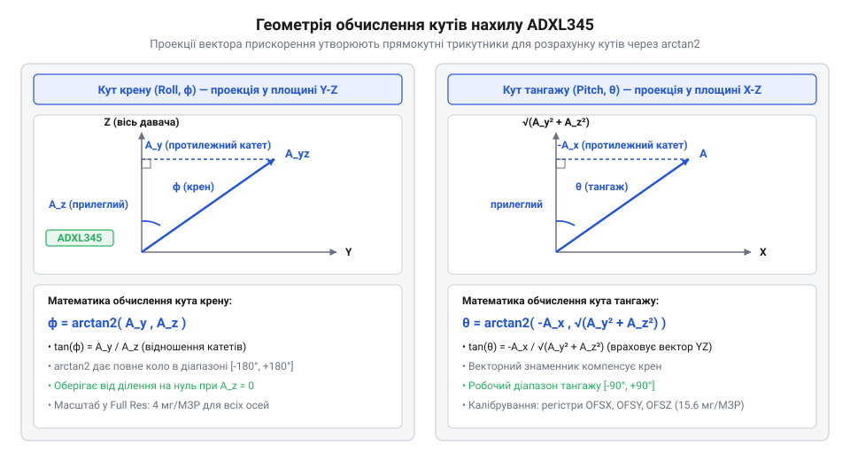

# Розрахунок прискорення, кутів нахилу та компенсації зсуву ADXL345

<preknowlist>
- [GY-61 ADXL335 — 3-осьовий акселерометр](root:cat-hw-sensors/adxl335) — фізичний принцип вимірювання проекцій прискорення та сили тяжіння триосьовим MEMS-сенсором.
</preknowlist>

## Чому сирі дані викривляють кути

Зчитування сирих двійкових значень із регістрів `@@en|DATAX0@@`–`@@en|DATAZ1@@` акселерометра `@@en|ADXL345@@` (від лат. *acceleratio* — прискорення) не дає безпосередньої інформації про кути нахилу об'єкта. Результат вимірювання за кожною віссю є 16-бітним значенням, тому сенсор розділяє його між двома 8-бітними регістрами: молодшим байтом `@@en|DATAX0@@` та старшим байтом `@@en|DATAX1@@`. Для отримання єдиного 16-бітного коду `N_u` мікроконтролер зчитує обидва байти, зсуває старший байт `@@en|DATAX1@@` вліво на 8 бітів за допомогою бітового зсуву та об'єднує його з молодшим байтом `@@en|DATAX0@@` за допомогою побітового АБО. У стані спокою на горизонтальній поверхні сенсор має показувати нульове прискорення вздовж горизонтальних осей, однак у розрахованому коді замість нуля часто виявляється число на кшталт `+35`. Без фізичного декодування це число є лише абстрактним цілим кодом у дискретних одиницях молодшого значущого розряду (`@@en|МЗР@@`, від англ. *least significant bit*).

Викривлення розрахованих кутів викликане двома основними чинниками:
1. Відсутність фізичного масштабу. Сирий код залежить від обраного діапазону та роздільності давача. Спроба підставити неокреслене ціле число в тригонометричну формулу спотворює результати.
2. Системний зсув нульового рівня. Через механічні напруження в структурі `@@en|MEMS@@` (від англ. *microelectromechanical systems* — мікроелектромеханічні системи) реальний пристрій має похибку нульового значення.

Якщо обчислювати кути нахилу робота безпосередньо із сирих вихідних кодів, навіть невеликий зсув у 30 `@@en|МЗР@@` призводить до хибного кута у кілька градусів, через що пристрій втрачає горизонтальну орієнтацію. Крім того, якщо при зчитуванні 16-бітного доповняльного коду пропустити розширення знаку, від'ємні прискорення перетворяться на величезні додатні числа. Порівняно з цим простий аналоговий акселерометр з [давача ADXL335](root:cat-hw-sensors/adxl335) видає напругу, але цифровий сенсор потребує чіткого математичного перетворення коду у фізичне прискорення та подальшого калібрування.

## Перетворення 16-бітного коду у прискорення

Дані про прискорення по кожній осі `@@en|ADXL345@@` зберігаються у двох 8-бітних регістрах у формі 16-бітного доповняльного коду. Зчитування двох байтів у беззнакове 16-бітне число `N_u` потребує математичного відновлення знаку для отримання знакового коду `N_s`.

Для чисел із встановленим старшим бітом (`N_u ≥ 32768`) знаковий код обчислюється відніманням розрядної сітки:

Ми відновлюємо знаковий цілочисельний код `N_s` із беззнакового значення `N_u`:
```
N_s = N_u - 65536        [перетворення доповняльного коду у знакове число]
```
Де `N_u` — беззнакове 16-бітне число з регістрів даних, а `N_s` — decoded знаковий код у `@@en|МЗР@@`.

У режимі `@@en|Full Resolution@@` чутливість `@@en|ADXL345@@` залишається постійною і становить `S_g = 0.004 g/МЗР` (4 мг/`@@en|МЗР@@`) незалежно від обраного граничного діапазону.

Ми обчислюємо проекцію прискорення `a_g` у безрозмірних одиницах `g` з отриманого знакового коду `N_s`:
```
a_g = N_s × S_g
    = N_s × 0.004 g/МЗР  [множення коду на масштабувальний коефіцієнт]
```
Де `a_g` — прискорення у кратностях сили тяжіння `g`, `N_s` — знаковий код у `@@en|МЗР@@`, а `S_g` — чутливість давача.

Для переведення прискорення у стандартні фізичні одиниці системи SI використовують стандартне прискорення вільного падіння `g₀ = 9.80665 м/с²`.

Ми розраховуємо лінійне прискорення `a_ms` у метрах за секунду в квадраті з величини `a_g`:
```
a_ms = a_g × g₀
     = a_g × 9.80665 м/с² [перехід до фізичних одиниць SI]
```
Де `a_ms` — прискорення у м/с², а `g₀` — константа прискорення вільного падіння.

Розглянемо обчислення на конкретному прикладі, коли зчеплені регістри дають код `N_u = 256` `@@en|МЗР@@`. Оскільки значення менше за 32768, знаковий код `N_s = +256`.

Ми виконуємо послідовне перетворення коду `N_s = 256` `@@en|МЗР@@` у фізичні величини:
```
a_g = 256 МЗР × 0.004 g/МЗР
    = 1.024 g            [прискорення в одиницях g]
```
```
a_ms = 1.024 g × 9.80665 м/с²
     = 10.042 м/с²       [фізичне прискорення в м/с²]
```
Отримане значення `10.042 м/с²` відповідає фізичній проекції прискорення на обрану вісь сенсора.

Зазначена чутливість `S_g = 0.004 g/МЗР` є фіксованою лише у режимі `@@en|Full Resolution@@`. Якщо ж сенсор `@@en|ADXL345@@` працює у стандартному 10-бітному режимі (коли біт `@@en|FULL_RES@@` у регістрі `@@en|DATA_FORMAT@@` дорівнює 0), розрядність вихідного коду залишається сталою — 10 біт — незалежно від обраного діапазону `±2 g`, `±4 g`, `±8 g` чи `±16 g`. Оскільки 1024 рівні розрядної сітки мають покрити весь вимірювальний інтервал від `-R` до `+R`, чутливість обчислюється як:
```
S_g = (2 × R) ÷ 1024        [обчислення чутливості у 10-бітному режимі]
```
Де `R` — граничне значення обраного діапазону. Для діапазону `±2 g` чутливість становить `S_g = 4 g ÷ 1024 ≈ 0.0039 g/МЗР` (близько 4 мг/`@@en|МЗР@@`), але для діапазону `±16 g` крок квантування зростає увісім разів — до `S_g = 32 g ÷ 1024 ≈ 0.0312 g/МЗР` (31.2 мг/`@@en|МЗР@@`), що суттєво погіршує роздільну здатність при вимірюванні малих прискорень. Натомість режим `@@en|Full Resolution@@` пропорційно розширює сітку даних від 10 біт (на `±2 g`) до 13 біт (на `±16 g`), що зберігає стале значення `S_g = 0.004 g/МЗР` і захищає точність від зміни граничного діапазону.

## Обчислення кутів крену та тангажу

У статичному стані, коли пристрій не зазнає зовнішніх прискорень, акселерометр вимірює лише проекції вектора реакції сили тяжіння Землі. Просторова орієнтація описується двома кутами: кутом @@nl|крену@@ (англ. `@@en|roll@@`, `ϕ`, від нід. *krengen* — нахиляти судно на бік) навколо поздовжньої осі X та кутом @@fr|тангажу@@ (англ. `@@en|pitch@@`, `θ`, від франц. *tangage* — гойдання) навколо поперечної осі Y.


*Схема просторової орієнтації давача з проекціями сили тяжіння та кутами крену й тангажу.*

Використання стандартної тригонометричної функції арктангенса `arctan(y / x)` є помилковим, оскільки ділення двох координат втрачає знаки і не дозволяє розрізнити протилежні квадранти, а при нахилі до вертикалі викликає ділення на нуль. Функція двох аргументів `@@en|arctan2(y, x)@@` (від англ. *arc tangent*) приймає чисельник і знаменник окремо, визначає точний квадрант у повному діапазоні від -180° до +180° та стійка до нульових знаменників.

Кут @@nl|крену@@ `ϕ` визначається за проекціями прискорення на осі Y та Z.

Ми обчислюємо кут крену `ϕ` у радіанах за виміряними проекціями `a_y` та `a_z`:
```
ϕ = arctan2(a_y, a_z)    [розрахунок кута крену]
```
Де `a_y` та `a_z` — проекції прискорення, а `ϕ` — кут @@nl|крену@@ у радіанах.

Для забезпечення математичної стійкості при нахилах біля 90° застосовують тривимірну формулу з урахуванням компоненти `a_x`:
```
ϕ = arctan2(a_y, √(a_x² + a_z²)) [стійке обчислення кута крену]
```

Кут @@fr|тангажу@@ `θ` відповідає нахилу вздовж осі X. При нахилі вперед вектор сили тяжіння створює від'ємну проекцію на вісь X.

Ми розраховуємо кут тангажу `θ` у радіанах з урахуванням проекцій по трьох осях:
```
θ = arctan2(-a_x, √(a_y² + a_z²)) [розрахунок кута тангажу]
```
Де `a_x`, `a_y`, `a_z` — проекції прискорення по осях, а `θ` — кут @@fr|тангажу@@ у радіанах.

Переведення розрахованих кутів із радіан у градуси виконується множенням на коефіцієнт `180 ÷ π`.

Ми переводимо кут `α_rad` із радіан у градуси `α_deg`:
```
α_deg = α_rad × (180 ÷ π) [перетворення радіан у градуси]
```
Де `α_rad` — кут у радіанах, а `α_deg` — кут у градусах.

Визначити кут рискання (`@@en|yaw@@`, ψ) за вектором сили тяжіння неможливо, оскільки обертання навколо вертикалі не змінює проекцій прискорення. Для вимірювання рискання додають [цифровий компас HMC5883L](root:cat-hw-sensors/hmc5883l) або аналогічний [компас QMC5883L](root:cat-hw-sensors/qmc5883l). Під час руху лінійні прискорення викривляють показання акселерометра, тому для динамічної орієнтації дані об'єднують із [гіроскопом MPU-6050](root:cat-hw-sensors/mpu6050) або [модулем MPU-9250](root:cat-hw-sensors/mpu9250) через [комплексуючий комплементарний фільтр](root:com-signal/complementary-filter) чи математичний [фільтр Калмана](root:com-signal/kalman-filter).

## Математична модель та калібрування зсуву

Математична модель вимірювань `@@en|ADXL345@@` враховує реальне фізичне прискорення `N_true` та системну похибку нульового зсуву `N_err`, викликану апаратними відхиленнями давача.

Ми виражаємо виміряний сирий код `N_meas` через істинний код та похибку зсуву:
```
N_meas = N_true + N_err  [модель сирого вимірювання зі зсувом]
```
Де `N_meas` — зчитаний код у `@@en|МЗР@@`, `N_true` — істинний код прискорення, а `N_err` — похибка нульового зсуву.

Для вимірювання похибки сенсор розміщують у спокої на суворо горизонтальній поверхні віссю Z вгору. У цьому положенні істинні значення становлять `N_true_x = 0`, `N_true_y = 0`, а по осі Z діє сила тяжіння `+1.0 g`, що відповідає `N_true_z = 256` `@@en|МЗР@@` у режимі `@@en|Full Resolution@@`.

Ми розраховуємо похибки зсуву `N_err` для кожної осі за усередненими вимірюваннями у статиці `N_avg`:
```
N_err_x = N_avg_x - 0    [похибка зсуву по осі X]
N_err_y = N_avg_y - 0    [похибка зсуву по осі Y]
N_err_z = N_avg_z - 256  [похибка зсуву по осі Z]
```
Де `N_avg` — усереднені сирі коди вимірювань у спокої.

Давач `@@en|ADXL345@@` має внутрішні 8-бітні регістри зсуву `@@en|OFSX@@` (адреса `0x1E`), `@@en|OFSY@@` (`0x1F`) та `@@en|OFSZ@@` (`0x20`). Важливо врахувати різницю чутливостей: регістри вихідних даних у режимі `@@en|Full Resolution@@` мають роздільність `4 мг/МЗР`, тоді як регістри апаратного зсуву мають роздільність `15.6 мг/МЗР`.

Оскільки `15.6 мг ÷ 4 мг ≈ 3.9` (точніше `15.625 ÷ 3.90625 = 4`), один розряд регістра зсуву компенсує 4 розряди регістрів вихідних даних. Для компенсації похибки обчислене значення зсуву береться із протилежним знаком і ділиться на 4.

Ми розраховуємо цілочисельне значення `OFS` для запису в апаратний регістр зсуву:
```
OFS = - (N_err ÷ 4)      [масштабування похибки до роздільності регістрів OFS]
```
Де `OFS` — 8-бітне знаковий число для регістра компенсації, а `N_err` — похибка у вихідних `@@en|МЗР@@`.

Розглянемо приклад, коли виміряні усереднені коди горизонтального давача становлять `N_avg_x = +16` `@@en|МЗР@@`, `N_avg_y = -8` `@@en|МЗР@@`, `N_avg_z = +272` `@@en|МЗР@@`.

Ми розраховуємо значення для регістрів `@@en|OFSX@@`, `@@en|OFSY@@`, `@@en|OFSZ@@`:
```
OFSX = - (16 ÷ 4)
     = -4 МЗР            [корекція регістра OFSX]
```
```
OFSY = - (-8 ÷ 4)
     = +2 МЗР            [корекція регістра OFSY]
```
```
OFSZ = - ((272 - 256) ÷ 4)
     = -4 МЗР            [корекція регістра OFSZ]
```
Запис чисел `-4` (код `0xFC`), `+2` (`0x02`) та `-4` (`0xFC`) у регістри `@@en|OFSX@@`, `@@en|OFSY@@`, `@@en|OFSZ@@` забезпечує апаратну компенсацію нульового зсуву безпосередньо всередині давача. Апаратна корекція віднімає похибку до збереження даних у буфер, зберігаючи динамічний діапазон і вивільняючи ресурси мікроконтролера.
