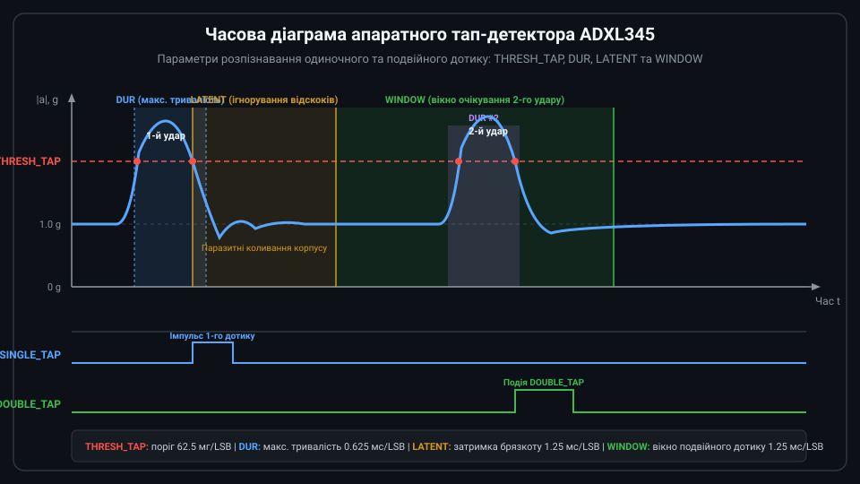

# Математичне моделювання порогів подій, тап-детектору та кутів орієнтації

<preknowlist>
- [GY-61 ADXL335 — 3-осьовий акселерометр](root:cat-hw-sensors/adxl335) — Базові принципи вимірювання лінійних прискорень 3-осьовим акселерометром та векторний розклад сили земного тяжіння.
</preknowlist>

## Невизначеність орієнтації та подій у цифровому коді

Спроба визначити кут нахилу платформи чи зафіксувати удар шляхом прямого порівняння дискретного коду однієї осі з пороговим значенням миттєво зазнає поразки при повороті корпусу в просторі. Цифровий триосьовий акселерометр @@en|ADXL345@@ вимірює проєкції вектора сумарного прискорення на власні ортогональні осі `X`, `Y` та `Z`. У статичному стані єдиним джерелом прискорення є вектор земного тяжіння величиною `1g` (близько 9.81 м/с²). Коли пристрій лежить горизонтально, уся сила тяжіння припадає на вісь `Z`, і її код дорівнює `1g`, а коди осей `X` та `Y` близькі до нуля. Проте варто повернути корпус на довільний кут, як вектор `1g` перерозподіляється між усіма трьома осями згідно з законами векторної тригонометрії.

Просте порогове правило на кшталт `Z_RAW < THRESHOLD` не здатне відрізнити вільне падіння @@en|free fall@@ (англ. *free fall*, від франк. *fri* — вільний та герм. *fallan* — падати), під час якого прискорення зникає на всіх трьох осях одночасно (`X ≈ 0`, `Y ≈ 0`, `Z ≈ 0`), від звичайного нахилу корпусу на 90°, де вісь `Z` також стає нульовою, але вісь `X` або `Y` фіксує повні `1g`. Для усунення залежності виявлення падіння від кута нахилу обчислюють скалярний модуль сумарного вектора прискорення `A_TOTAL`, який є математичним інваріантом @@en|invariant@@ (англ. *invariant*, від лат. *in-* — не та *varians* — змінюваний) щодо будь-яких просторових поворотів [3-осьового акселерометра](root:cat-hw-sensors/adxl335). Сумарне прискорення розраховують через тригонометричну суму квадратів ортогональних компонент:

        A_TOTAL = √(A_X² + A_Y² + A_Z²)      [обчислення модуля вектора за теоремою Піфагора]

У цьому виразі `A_TOTAL` позначає довжину сумарного вектора прискорення, а `A_X`, `A_Y` та `A_Z` — виміряні проєкції лінійного прискорення на відповідні осі. У статичному стані пристрій перебуває під дією лише земного тяжіння, тому модуль вектора завжди дорівнює `A_TOTAL ≈ 1g` незалежно від кута нахилу. Під час вільного падіння об'єкт втрачає опору, прискорення на всіх осях наближається до нуля, і модуль падає нижче заданого порогу `A_TOTAL < THRESH_FF`. Проте прямий розрахунок квадратного кореня на мікроконтролері вимагає значних обчислювальних ресурсів, а поодинокі амплітудні шумівки чи вібрація мотора можуть короткочасно скидати модуль вектора. Аналогічно, короткий механічний удар створює високочастотний сплеск амплітуди, який без аналізу часової тривалості легко переплутати з швидким поворотом або вібрацією мотора. Для надійного визначення кутів орієнтації та розпізнавання подій необхідно відмовитися від ізольованого аналізу окремих осей і перейти до математичного моделювання тривимірного вектора прискорення та апаратних часових вікон. Математичну модель виявлення стану вільного падіння за сумарним вектором та конфігурацією регістрів THRESH_FF й TIME_FF розкрито у матеріалі про [апаратне виявлення вільного падіння в ADXL345](root:cat-hw-sensors/adxl345-free-fall-detection).

## Тригонометрія обчислення кутів тангажу й крену

Для визначення статичного кутового положення об'єкта обчислюють проєкції вектора гравітації `a = [a_x, a_y, a_z]ᵀ` на осі зв'язаної системи координат. Кут подовжнього нахилу вперед-назад називають тангажем @@en|pitch@@ (англ. *pitch*, від сер.-англ. *picchen* — устромляти; позначають грецькою літерою θ), а нахил ліворуч-праворуч — креном @@en|roll@@ (англ. *roll*, від лат. *rotula* — котитися; позначають літерою φ). При нахилі корпусу вектор земного тяжіння `g` величиною `1g` утворює з осями давача прямокутні трикутники. Його проєкція на вісь `X` дорівнює `a_x = g · sin(θ)`, а на перпендикулярну площину `YZ` припадає катет довжиною `g · cos(θ)`. У самій площині `YZ` цей складник розкладається на проєкції `a_y = -g · cos(θ) · sin(φ)` та `a_z = -g · cos(θ) · cos(φ)`, які формують прямокутний трикутник із гіпотенузою `√(a_y² + a_z²) = g · cos(θ)`. Ділення `a_x` на `√(a_y² + a_z²)` визначає тангенс кута тангажу `tan(θ)`, а ділення `a_y` на `a_z` — тангенс крену `tan(φ)`, які для уникнення невизначеності знаку при переході через квадранти обчислюють функцією арктангенсу двох аргументів @@en|atan2@@. Проте чутливий елемент акселерометра фіксує сумарний вектор `a_meas = g + a_dyn`, у якому лінійний рух чи вібрація додають динамічне прискорення `a_dyn`. Оскільки давач не розрізняє гравітаційну та інерційну сили, складова `a_dyn` викривляє кутовий напрямок вектора й змінює його модуль `|a_meas| ≠ 1g`, тому чисті кути `θ` і `φ` отримують лише за умови `a_dyn = 0` у стані спокою або після відокремлення динамічної складової.

Для обчислення кута тангажу `θ` визначають відношення проєкції прискорення вздовж осі `X` до довжини проєкції вектора на площину `YZ`. Значення `θ` розраховують за формулою:

```
θ = atan2(a_x, √(a_y² + a_z²))
```

Кут крену `φ` визначають як кут відхилення вектора гравітації в площині `YZ` за допомогою відношення компонентів `a_y` та `a_z`:

```
φ = atan2(a_y, a_z)
```

**Обчислення кутів нахилу за виміряними прискореннями**
Припустимо, акселерометр @@en|ADXL345@@ зняв значення прискорень `a_x = 0.5g`, `a_y = 0.0g`, `a_z = 0.866g`. Розрахуємо кут тангажу `θ` у радіанах та градусах:

```
√(a_y² + a_z²) = √(0.0² + 0.866²) = 0.866g    [довжина вектора в площині YZ]
θ_rad = atan2(0.5, 0.866) ≈ 0.5236 rad         [обчислення арктангенсу]
θ_deg = 0.5236 × (180 / π) = 30.0°             [переведення в градуси]
```

Отже, корпус пристрою нахилений угору на кут 30 градусів.

Математична модель тригонометричного обчислення має два суттєвих обмеження. Перше — динамічна похибка: будь-який лінійний рух створює додаткове прискорення `a_dyn`, яке додається до вектора `g` і викривляє розрахований кут. Друге — сингулярність @@en|gimbal lock@@ (англ. *gimbal lock*, від англ. *gimbal* — підвіс та *lock* — блокування) при вертикальному стані (`θ = ±90°`), коли осі `Y` та `Z` стають нульовими, унаслідок чого кут крену `φ` втрачає математичний зміст. Крім того, триосьовий акселерометр фундаментально не здатний виміряти кут верчення (yaw) навколо вертикальної осі `Z`, оскільки поворот навколо вектора тяжіння не змінює його проєкцій; для визначення повного курсу в просторі його комбінують із [цифровим магнетометром](root:cat-hw-sensors/hmc5883l) або з [шестиосьовим модулем IMU](root:cat-hw-sensors/mpu6050).

## Математична модель апаратного тап-детектора

Динамічні події торкання @@en|single tap@@ є короткочасними механічними імпульсами, під час яких компоненти прискорення стрибкоподібно перевищують статичний рівень гравітації. На відміну від [аналогових акселерометрів](root:cat-hw-sensors/adxl335), чип @@en|ADXL345@@ містить вбудований апаратний детектор, який порівнює виміряний вектор прискорення з амплітудним порогом `THRESH_TAP` та часовим вікном `DUR`.

Імпульс визнається поодиноким торканням @@en|single tap@@ лише тоді, коли амплітуда прискорення перевищує поріг `THRESH_TAP`, а тривалість перебування над порогом `t_pulse` є суворо меншою за максимальне часове вікно `t_dur`. Якщо прискорення залишається високим довше за `t_dur`, алгоритм кваліфікує подію як тривалу вібрацію чи навмисне переміщення і скасовує фіксацію дотику.


*Часова діаграма апаратного розпізнавання поодинокого та подвійного торкання ADXL345.*

Фізичні величини порогу прискорення `a_thresh` та тривалості `t_dur` перераховують у коди регістрів `THRESH_TAP` (адреса `0x1D`) та `DUR` (адреса `0x21`). Дискретний крок порогу прискорення становить `Δa = 62.5 мг/LSB` (`0.0625g/LSB`), а часовий крок вікна тривалості — `Δt_dur = 625 мкс/LSB` (`0.625 мс/LSB`). Коди обчислюють за формулами:

```
N_THRESH_TAP = round(a_thresh / 0.0625g)
N_DUR = round(t_dur / 0.625ms)
```

При заданому порогу `a_thresh = 3.0g` та максимальній тривалості удару `t_dur = 20.0 мс` значення регістрів становлять `N_THRESH_TAP = round(3.0 / 0.0625) = 48` (`0x30`) та `N_DUR = round(20.0 / 0.625) = 32` (`0x20`).

## Часові вікна розпізнавання подвійного торкання

Після завершення першого механічного удару в корпусі пристрою виникають згасаючі акустичні та механічні коливання. Якщо обробляти вихідні дані без затримки, ці повторні відскоки спричинять хибне повторне спрацьовування. Для надійного розпізнавання подвійного торкання @@en|double tap@@ в @@en|ADXL345@@ реалізовано послідовну двокомпонентну часову модель, що складається з латентного інтервалу `LATENT` та вікна очікування `WINDOW`.

Латентне вікно `LATENT` задає часовий інтервал `t_latent`, який розпочинається одразу після завершення першого дотику (коли прискорення спадає нижче `THRESH_TAP`). Упродовж `t_latent` детектор повністю ігнорує будь-які повторні перевищення порогу `THRESH_TAP`, що пригнічує перехідні коливання. Після закінчення `t_latent` відкривається вікно очікування `WINDOW` тривалістю `t_window`. Якщо другий повноцінний імпульс (який задовольняє вимогам `THRESH_TAP` та `DUR`) виникає в межах `t_window`, детектор генерує переривання подвійного торкання @@en|double tap@@. Якщо вікно `t_window` вичерпується без повторного удару, подія скидається.

Дискретизація регістрів `LATENT` (адреса `0x22`) та `WINDOW` (адреса `0x23`) виконується з часовим квантом `Δt_win = 1.25 мс/LSB`.

**Розрахунок регістрів подвійного торкання**
Необхідно налаштувати придушення відскоків на `t_latent = 20.0 мс` та вікно очікування другого дотику `t_window = 80.0 мс`. Розрахуємо коди регістрів:

```
N_LATENT = round(20.0 / 1.25) = 16       [код регістру LATENT, 0x10]
N_WINDOW = round(80.0 / 1.25) = 64       [код регістру WINDOW, 0x40]
```

Значення `0x10` та `0x40` забезпечують чітку часову фільтрацію серійних дотиків без хибних повторних імпульсів.

## Дискретизація та перерахунок кодів регістрів

Підсумкова конфігурація апаратного ядра @@en|ADXL345@@ вимагає узгодження масштабних коефіцієнтів чутливості вимірювальних та подієвих регістрів. Вхідні дані прискорення зчитуються з регістрів `DATAX0`...`DATAZ1` у формі 16-бітних чисел із доповняльним кодом. Фізичне значення прискорення `a_phys` розраховують через множення сирого коду `N_raw` на коефіцієнт чутливості `S_a`.

У режимі повної роздільності @@en|Full Resolution@@ (біт `FULL_RES` у регістрі `DATA_FORMAT` `0x31`) коефіцієнт чутливості залишається постійним для всіх діапазонів вимірювання (`±2g`, `±4g`, `±8g`, `±16g`) і дорівнює `S_a = 3.9 мг/LSB` (`1 / 256 g/LSB = 0.00390625 g/LSB`). У 10-бітному режимі масштабний коефіцієнт змінюється відповідно до обраного діапазону: `3.9 мг/LSB` для `±2g`, `7.8 мг/LSB` для `±4g`, `15.6 мг/LSB` для `±8g` та `31.2 мг/LSB` для `±16g`.

Апаратні детектори подій використовують власні фіксовані кванти дискретизації, незалежні від налаштування роздільності осей вимірювання. Для порогу вільного падіння @@en|free fall@@ використовується регістр `THRESH_FF` (адреса `0x28`) з кроком `62.5 мг/LSB` та регістр тривалості `TIME_FF` (адреса `0x29`) з кроком `5 мс/LSB`.

Узагальнена розрахункова модель перерахунку фізичних параметрів у байтові коди регістрів має вигляд:

```
N_THRESH_FF = round(a_ff_thresh / 0.0625g)     [крок порогу падіння 62.5 мг]
N_TIME_FF   = round(t_ff_min / 5.0ms)          [крок часу падіння 5 мс]
N_THRESH_TAP= round(a_tap_thresh / 0.0625g)    [крок порогу торкання 62.5 мг]
N_DUR       = round(t_dur / 0.625ms)           [крок тривалості 0.625 мс]
N_LATENT    = round(t_latent / 1.25ms)          [крок затримки 1.25 мс]
N_WINDOW    = round(t_window / 1.25ms)          [крок вікна 1.25 мс]
```

Побудований розрахунковий базис дозволяє однозначно переводити кінематичні вимоги системи у конфігураційні байтові маски сенсора.
