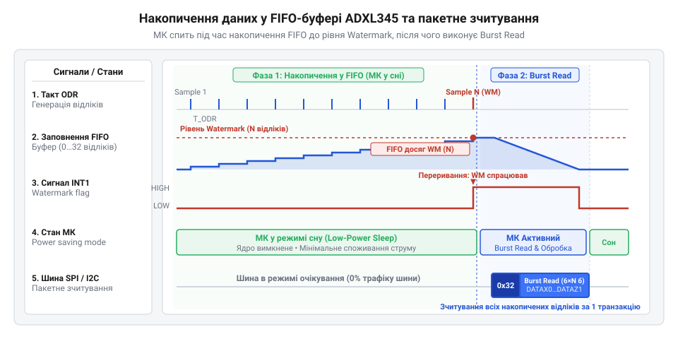
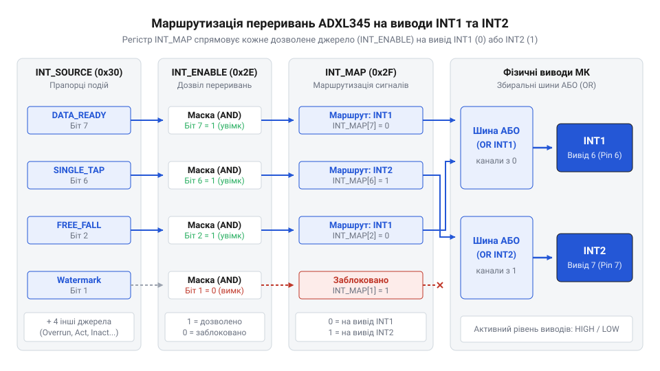

# Розробка низькоспоживаючого драйвера ADXL345 з FIFO та перериваннями

<preknowlist>
- [GY-61 ADXL335 — 3-осьовий акселерометр](root:cat-hw-sensors/adxl335) — базові фізичні принципи вимірювання прискорення по 3 осях та інтерпретацію вектора гравітації
- [GY-521 / MPU-6050 — 6-осьовий IMU (акселерометр+гіроскоп)](root:cat-hw-sensors/mpu6050) — принципи адресації й читання цифрових регістрів через шину I2C/SPI та конфігурування обробників зовнішніх переривань
</preknowlist>

## Енергетичний глухий кут поодиноких зчитувань

Автономні пристрої моніторингу — такі як фітнес-браслети, датчики вібрації чи трекери для тварин — живляться від дискових батарейок або невеликих акумуляторів. У таких системах головним обмежувачем є енергоспоживання мікроконтролера. Коли розробник налаштовує 3-осьовий акселерометр на частоту вихідних даних @@en|Output Data Rate@@ (англ. *output data rate*, «частота вихідних даних») @@en|ODR@@ у 100 Гц, нове вимірювання з'являється кожні 10 мс.

Якщо мікроконтролер @@en|Microcontroller Unit@@ (англ. *microcontroller unit*, «мікроконтролерний блок») @@en|MCU@@ працює в режимі безперервного опитування прапорця готовності даних @@en|polling@@ (англ. *poll*, «опитувати»), його процесорне ядро постійно виконує цикл зчитування статусного регістру @@en|Data Ready@@ через шину @@en|I2C@@ або @@en|SPI@@. При цьому струм споживання @@en|MCU@@ становить 10–15 мА. На відміну від систем з [аналогових 3-осьових акселерометрів](root:cat-hw-sensors/adxl335), де оцифрування виконує АЦП мікроконтролера, цифровий сенсор сам формує відліки. Проте постійне опитування шини позбавляє систему переваг цифрового інтерфейсу, виснажуючи батарею за кілька днів.

Навіть якщо відмовитися від опитування й перевести @@en|MCU@@ у переривання по таймеру кожні 10 мс, ситуація покращується лише частково. Кожне зчитування вимагає виконання шинної транзакції: передачі адреси пристрою, адреси регістра та 6 байтів вимірювань (осі X, Y, Z). Транзакція на частоті шини 400 кГц триває близько 200 мкс. З урахуванням часу пробудження кварцового генератора, збереження контексту та обробки вимірювання, мікроконтролер залишається активним близько 0.3 мс із кожних 10 мс.

Обчислимо частку часу неспання процесора при такому підході:

```
T_period = 1 ÷ 100 Hz
         = 10 ms               [період генерації відліку прискорень]

T_active = 0.3 ms              [сумарний час неспання МК на обробку 1 відліку]

Duty_cycle = (0.3 ms ÷ 10 ms) × 100%
           = 3%                [коефіцієнт неспання процесора]
```

Здавалося б, коефіцієнт неспання 3% є малим. Однак повторний вихід із глибокого сну 100 разів на секунду утримує стабілізатори живлення та системну периферію в активному стані. Середній струм споживання залишається на рівні сотень мікроампер, що унеможливлює річну автономність. Щоб досягти максимальної енергоефективності, необхідно навчитися переводити мікроконтролер у [глибокий режим сну](root:hw-arch/sleep-modes) на тривалий час, довіривши збереження вимірювань апаратному буферу сенсора.

Окрім перевитрати енергії, висока частота пробуджень прямо підриває апаратну стабільність вимірювального тракту. Кожне раптове включення процесорного ядра @@en|MCU@@ створює імпульсний стрибок струму споживання від мікроамперних значень до десятків міліампер. При повторенні 100 разів на секунду ці піки змушують джерело живлення постійно перебувати в режимі перехідного процесу @@en|transient response@@ (англ. *transient response*, «перехідна характеристика»). Регулятор напруги не встигає стабілізувати шину, що спричиняє високочастотні пульсації та збільшує рівень шумів оцифрування. Часте чергування активного стану й сну додатково викликає циклічне самонагрівання кристала мікроконтролера. Регулярні температурні коливання породжують @@en|thermal drift@@ (англ. *thermal drift*, «температурний ухід») опорних джерел напруги та нульового зміщення сенсора, погіршуючи точність отриманих даних.

## Конфігурування режимів живлення та роздільної здатності

Для мінімізації власного споживання акселерометр ADXL345 містить гнучку карту регістрів @@en|Register@@ (англ. *register*, «упорядкований запис»). Після подачі живлення сенсор перебуває в режимі очікування @@en|Standby@@ (англ. *standby*, «режим очікування»), у якому вимірювальний тракт вимкнено, а споживання струму не перевищує 0.1 мкА. У цьому стані виконується первинне налаштування пристрою.

Керування живленням здійснюється через регістр `POWER_CTL` (адреса `0x2D`). Запис біта `MEASURE` (біт 3) переводить акселерометр у режим вимірювання. Частота дискретизації задається у регістрі `BW_RATE` (адреса `0x2C`), де біти `[3:0]` визначають @@en|ODR@@ від 0.10 Гц до 3200 Гц.

Розрядність вихідних даних і вимірювальний діапазон конфігуруються у регістрі `DATA_FORMAT` (адреса `0x31`). Біти `[1:0]` задають розмах вимірювань: ±2g, ±4g, ±8g або ±16g. Одночасно з розмахом важливо встановити біт `FULL_RES` (біт 3) — режим повної роздільної здатності @@en|Full Resolution@@ (англ. *full resolution*, «повна роздільність»).

У звичайному 10-бітному режимі збільшення розмаху зменшує чутливість. Натомість у режимі @@en|Full Resolution@@ розрядність вихідного значення автоматично зростає разом із розмахом (до 13 бітів при ±16g). Це забезпечує постійний масштабний коефіцієнт близько 3.9 мг/МЗР, де @@en|LSB@@ / МЗР — молодший значущий розряд @@en|Least Significant Bit@@ (англ. *least significant bit*, «найменш значущий розряд»).

Зв'язок між розмахом і масштабним коефіцієнтом у режимі повної роздільної здатності визначається виразом:

```
Scale_FullRes = 32 g ÷ 2^13 LSB
              = 32 g ÷ 8192 LSB      [розподіл повного розмаху на кількість дискрет]
              = 0.00390625 g/LSB     [сталий масштабний коефіцієнт 3.9 мг/LSB]
```

Завдяки цьому програмне забезпечення не потребує перерахунку коефіцієнтів при зміні діапазону. Робота з [цифровими регістрами MPU-6050](root:cat-hw-sensors/mpu6050) або ADXL345 вимагає дотримання чіткої послідовності ініціалізації: спочатку налаштовуються параметри в @@en|Standby@@, і лише потім активується біт `MEASURE`.

:::tabs
@tab C
:::code proj-adxl345-fifo-interrupt-driver/c/adxl345.h 48-65
:::code proj-adxl345-fifo-interrupt-driver/c/adxl345.c 44-59
:::

@tab C++
:::code proj-adxl345-fifo-interrupt-driver/cpp/Adxl345.hpp 37-50
:::code proj-adxl345-fifo-interrupt-driver/cpp/Adxl345.cpp 26-41
:::
:::

## Накопичення даних у FIFO та burst-зчитування

Щоб звільнити мікроконтролер від постійної обробки поодиноких відліків, ADXL345 оснащено апаратним буфером @@en|FIFO@@ (англ. *First-In, First-Out*, «першим прийшов — першим пішов») на 32 кадри. Кожен кадр містить 6 байтів — по 2 байти для кожної з трьох осей.

Режим роботи буфера задається бітами `[7:6]` у регістрі `FIFO_CTL` (адреса `0x38`). Найбільш ефективним для моніторингу є потоковий режим @@en|Stream@@ (англ. *stream*, «потік»). У режимі @@en|Stream@@ буфер безперервно накопичує нові вимірювання. Коли всі 32 комірки заповнюються, найновіший відлік витісняє найстаріший, запобігаючи втраті останніх даних.

Поріг сповіщення @@en|Watermark@@ (англ. *watermark*, «позначка рівня води») задається бітами `[4:0]` регістра `FIFO_CTL` у межах від 1 до 31 кадру. Як тільки кількість збережених вибірок досягає значення @@en|Watermark@@, сенсор встановлює прапорець переривання `WATERMARK` у регістрі `INT_SOURCE` (`0x30`). Через регістри `INT_ENABLE` (`0x2E`) та `INT_MAP` (`0x2F`) це переривання маршрутизується на фізичний вивід INT1 або INT2 для пробудження @@en|MCU@@.


*Часова діаграма потокового накопичення даних у буфері FIFO та формування переривання Watermark при досягненні заданого порогу.*


*Логічна схема комутації прапорців подій сенсора на вихідні ніжки переривань.*

Отримавши сигнал переривання, мікроконтролер прокидається й виконує пакетне зчитування @@en|burst read@@ (англ. *burst read*, «пакетне зчитування»). Замість окремих звернень до кожного регістра @@en|MCU@@ зчитує масив байтів послідовно, починаючи з регістра `DATAX0` (`0x32`). При повторному читанні адреса регістра всередині ADXL345 автоматично не інкрементується, а вказує на наступний елемент у черзі @@en|FIFO@@.

Під час зчитування кадрів із регістра `DATAX0` (`0x32`) кількість вибірок у буфері @@en|FIFO@@ зменшується з кожним прочитаним блоком. Апаратний прапорець `WATERMARK` у регістрі `INT_SOURCE` (`0x30`) не потребує ручного скидання записом і не знімається від самого лише читання статусу. Сенсор скидає його автоматично тоді, коли залишок кадрів у буфері стає меншим за встановлений поріг @@en|Watermark@@. Якщо @@en|MCU@@ вивантажить лише частину даних і в буфері залишиться кількість кадрів, що дорівнює або перевищує поріг, прапорець `WATERMARK` утримуватиме лінію переривання активною, спричиняючи повторні пробудження. Якщо обробка затримується й буфер повністю заповнюється, встановлюється прапорець аварійного переповнення @@en|Overrun@@ (англ. *overrun*, «переповнення»). На відміну від порогу заповнення, прапорець @@en|Overrun@@ знімається зчитуванням регістра `INT_SOURCE` (`0x30`) або вивантаженням даних із буфера, показуючи, що частина вимірювань у потоці була втрачена.

:::tabs
@tab C
:::code proj-adxl345-fifo-interrupt-driver/c/adxl345.c 61-76
:::code proj-adxl345-fifo-interrupt-driver/c/adxl345.c 107-121
:::

@tab C++
:::code proj-adxl345-fifo-interrupt-driver/cpp/Adxl345.cpp 44-63
:::code proj-adxl345-fifo-interrupt-driver/cpp/Adxl345.cpp 99-131
:::
:::

Використання порогу @@en|Watermark@@ на 16 вибірок при @@en|ODR@@ 100 Гц зменшує частоту пробуджень мікроконтролера зі 100 до 6.25 разів на секунду. Це знижує середнє споживання енергії процесором майже в 16 разів.

## Детекція апаратних подій та маршрутизація переривань

Якщо мікроконтролер змушений постійно опитувати регістри прискорення через шину, його процесорний модуль перебуває у стані постійного неспання, що миттєво виснажує автономне живлення. На відміну від простіших пристроїв на зразок [аналогового акселерометра ADXL335](root:cat-hw-sensors/adxl335), мікросхема @@en|ADXL345@@ має вбудовану цифрову логіку для самостійного виявлення фізичних подій без залучення процесора. Перш ніж генерувати сигнал пробудження, сенсор опрацьовує дані всередині кристала за допомогою апаратних детекторів.

Детектор @@en|вільного падіння@@ (англ. *free-fall*) аналізує одночасне зменшення прискорення за всіма трьома осями. У стані невагомості модуль вектора гравітації прямує до нуля. Коли виміряне значення падає нижче порогу в регістрі @@en|THRESH_FF@@ (із кроком 62.5 mg/МЗР) і утримується довше за час з регістра @@en|TIME_FF@@ (із кроком 5 ms/МЗР), апаратний блок фіксує падіння. Детектор @@en|дотику@@ (англ. *tap*, від *tap* — легкий удар) відстежує короткі імпульси прискорення, амплітуда яких перевищує поріг @@en|THRESH_TAP@@, а тривалість не виходить за межі @@en|DUR@@. Для подвійного дотику додаються вікна затримки @@en|LATENT@@ та очікування @@en|WINDOW@@.

Апаратні події необхідно комутувати на зовнішні лінії пробудження мікроконтролера. Для цього в @@en|ADXL345@@ передбачено гнучку систему маршрутизації через три спеціалізовані регістри.


*Маршрутизація прапорців подій із регістру INT_SOURCE через маски INT_ENABLE та INT_MAP на виводи INT1 та INT2.*

Порядок комутації сигналів визначається трьома етапами:

1. **Маскування джерел (@@en|INT_ENABLE@@, 0x2E)** — кожен біт регістру дозволяє або забороняє генерування @@en|переривання@@ (англ. *interrupt*, від лат. *interruptus* — перерваний) для відповідної події (@@en|WATERMARK@@, @@en|FREE_FALL@@, @@en|SINGLE_TAP@@, @@en|OVERRUN@@).
2. **Маршрутизація виводів (@@en|INT_MAP@@, 0x2F)** — визначає, на який фізичний вивід буде спрямовано сигнал. Запис нуля в біт направляє подію на лінію @@en|INT1@@, а записи одиниці — на @@en|INT2@@. Це дозволяє, наприклад, відокремити критичне переповнення буфера від планового заповнення.
3. **Обробка статусу (@@en|INT_SOURCE@@, 0x30)** — регістр тільки для читання, який містить поточні прапорці подій. Під час спрацьовування @@en|ISR@@ обробник зчитує цей регістр, щоб з'ясувати причину події та атомарно скинути активний стан сигнальної лінії.

Завдяки такій схемі, подібній до опрацювання сигналів у [цифрових модулях MPU-6050](root:cat-hw-sensors/mpu6050), апаратні виводи @@en|INT1@@ та @@en|INT2@@ дозволяють утримувати мікроконтролер у глибокому сні до моменту настання обраної події.

## Реалізація модульного C-драйвера та обробника переривань

Об'єднання апаратних можливостей сенсора у надійний прошивальний модуль вимагає чіткого дотримання послідовності конфігурування. Драйвер побудовано на основі шару абстракції від апаратури @@en|HAL@@ (англ. *Hardware Abstraction Layer*), що виносить шинні транзакції @@en|I2C@@/@@en|SPI@@ у зовнішні функції-вказівники.

Алгоритм ініціалізації акселерометра включає обов'язкові кроки захисту від невизначених станів:

1. **Перевірка ідентифікатора** — зчитування регістра @@en|DEVID@@ (0x00). Якщо значення відрізняється від 0xE5, ініціалізація переривається з помилкою відсутності пристрою.
2. **Скидання в Standby** — запис нуля в регістр @@en|POWER_CTL@@ (0x2D) переводить сенсор у режим очікування, що є обов'язковою умовою для безпечної зміни конфігурації.
3. **Налаштування ODR та формату** — вибір частоти оновлення в @@en|BW_RATE@@ та активація режиму @@en|Full Resolution@@ у @@en|DATA_FORMAT@@.
4. **Конфігурування FIFO та переривань** — вибір потокового режиму @@en|Stream FIFO@@, встановлення порогу @@en|Watermark@@, маршрутизація ліній у @@en|INT_MAP@@ та дозвіл у @@en|INT_ENABLE@@.
5. **Старт вимірювань** — встановлення біта @@en|MEASURE@@ у @@en|POWER_CTL@@.

:::tabs
:::code proj-adxl345-fifo-interrupt-driver/c/adxl345.h 147-164
:::code proj-adxl345-fifo-interrupt-driver/c/adxl345.c 69-92
:::code proj-adxl345-fifo-interrupt-driver/cpp/Adxl345.hpp 113-163
:::code proj-adxl345-fifo-interrupt-driver/cpp/Adxl345.cpp 10-42
:::

Під час спрацьовування лінії переривання мікроконтролер виконує обробник @@en|ISR@@ (англ. *Interrupt Service Routine*). Щоб не затримувати систему в контексті переривання, обробник лише виставляє прапорець події, а вивантаження даних виноситься у неблокуючий суперцикл @@en|Super-loop@@ або обробляється через механізм зворотних викликів @@en|callback@@ (англ. *callback*).

:::tabs
:::code proj-adxl345-fifo-interrupt-driver/c/main.c 109-147
:::code proj-adxl345-fifo-interrupt-driver/cpp/main.cpp 122-137
:::

Зчитування накопичених кадрів із буфера виконується за один сеанс зв'язку — пакетом @@en|burst read@@ (англ. *burst read* — пакетне зчитування) від регістра @@en|DATAX0@@ (0x32). Одночасне читання 6 послідовних байтів запобігає розриву кадрів між осями. Сирі 16-бітні значення у доповняльному коді перераховуються у фізичні одиниці g множенням на сталий коефіцієнт 0.0039 g/МЗР (3.9 mg/МЗР).

:::tabs
:::code proj-adxl345-fifo-interrupt-driver/c/adxl345.c 102-131
:::code proj-adxl345-fifo-interrupt-driver/cpp/Adxl345.cpp 99-131
:::

Така архітектура дозволяє мікроконтролеру спати до 95% часу, прокидаючись лише для швидкої пакетної вибірки готових даних з FIFO.
