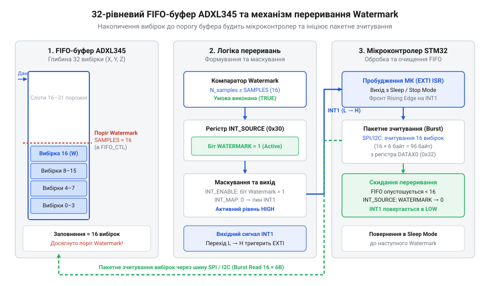
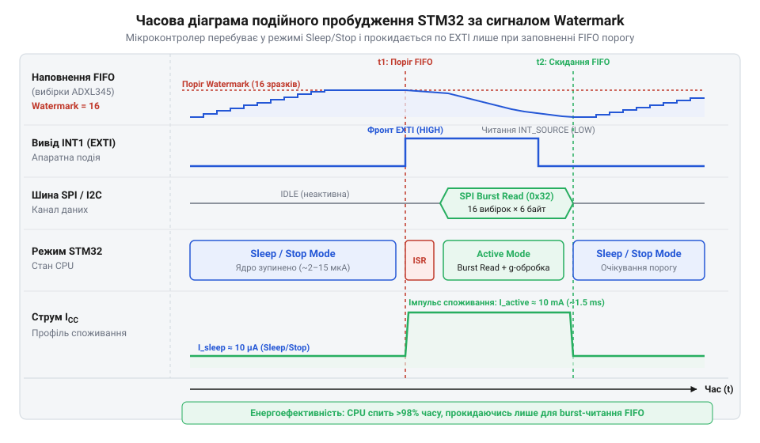

# ADXL345 — 3-осьовий цифровий акселерометр

<preknowlist>
- [Принципи ємнісного вимірювання в MEMS-структурах](root:cat-hw-sensors/mems-capacitive-sensing-principles) — розуміння фізичного принципу зміни ємності рухомих обкладок MEMS-акселерометра під дією прискорення та формування первинного аналогового сигналу.
</preknowlist>

## Проблема постійного опитування акселерометра мікроконтролером

Циклічне опитування — @@en|polling@@ (англ. *poll* — опитування) — регістрів акселерометра в циклі програми марнує ресурси. На відміну від [аналогового акселерометра ADXL335](root:cat-hw-sensors/adxl335), цифровий акселерометр @@en|ADXL345@@ (лат. *acceleratio* — прискорення + грец. *metron* — міра) оцифровує сигнал ємнісних перетворювачів на основі [принципів ємнісного вимірювання](root:cat-hw-sensors/mems-capacitive-sensing-principles) й оновлює дані у регістрах, що створює перевитрати енергії та часові флуктуації.

Енергетична проблема полягає у тривалій роботі мікроконтролера @@en|STM32@@ в активному режимі (до 20 мА). Для частоти вихідних даних @@en|Output Data Rate@@ (@@en|ODR@@) `f_odr = 800` Гц і зчитання по шині @@en|I2C@@ або @@en|SPI@@ `t_trans = 150` мкс обчислимо частку втраченого процесорного часу `Overhead` від періоду вибірки `T_sample`:

T_sample = 1 / f_odr
= 1 / 800 Гц
= 0.00125 с = 1250 мкс [період вибірки акселерометром]

Overhead = (t_trans / T_sample) × 100%
= (150 мкс / 1250 мкс) × 100% [відношення часу обміну до періоду]
= 12% [частка процесорного часу на шинний обмін]

Ці `12%` часу ядро @@en|STM32@@ марно очікує прапорці шини, а частий виклик зчитання унеможливлює перехід у глибокий сон.

Друга проблема — часовий @@en|jitter@@ (англ. *jitter* — тремтіння, флуктуація). Затримка опитування високими пріоритетами створює `@@en|sampling jitter@@`, що спотворює спектральний аналіз, або спричиняє перезапис регістрів `DATAX0`–`DATAZ1` із втратою вибірок.

Блокуюча реалізація зчитання у C-драйвері показує прив'язку процесора до шинного обміну:

:::code proj-adxl345-stm32-fifo-interrupt-driver/c/src/adxl345.c 141-158

Це обґрунтовує перехід до апаратного буферизування та подійно-орієнтованого керування.

## Архітектура FIFO та джерела переривань ADXL345

Для звільнення мікроконтролера від рутинного опитування шини акселерометр @@en|ADXL345@@ оснащено внутрішнім 32-рівневим апаратним буфером @@en|FIFO@@ (англ. *First-In, First-Out* — першим зайшов, першим вийшов). Буфер @@en|FIFO@@ є проміжним накопичувачем (англ. *buffer*), який здатен зберігати до 32 трьох-осьових кадрів вимірювання. Кожен кадр складається з 6 байтів: двох байтів для осі X (`DATAX0`, `DATAX1`), двох для осі Y (`DATAY0`, `DATAY1`) та двох для осі Z (`DATAZ0`, `DATAZ1`), кодованих у доповняльному двійковому коді (16-бітні Signed Integer).

*Функціональна організація 32-рівневого буфера FIFO з відстеженням рівня Watermark для автоматичного сповіщення мікроконтролера.*

Керування буфером здійснюється через регістр `FIFO_CTL` (адреса `0x38`). Два старші біти `FIFO_MODE` [7:6] визначають один із чотирьох режимів роботи:

1. `Bypass` (`0x00`): Буфер @@en|FIFO@@ вимкнений. Виміряні дані потрапляють безпосередньо у регістри `DATAX0`–`DATAZ1`. Режим сумісний зі старими давачами, але вимагає постійного опитування. 2. `FIFO` (`0x40`): Буфер накопичує вибірки до досягнення 32 кадрів, після чого припиняє запис нових даних. Нові вимірювання відкинуться, доки мікроконтролер не зчитає наявні кадри. 3. `Stream` (`0x80`): Кільцевий буфер. Буфер постійно накопичує дані; при досягненні 32 кадрів новий кадр витісняє найстаріший. Це основний режим для безперервного моніторингу руху. 4. `Trigger` (`0xC0`): Буфер працює в режимі накопичення до моменту виникнення зовнішньої події (наприклад, імпульсу дотику або вільного падіння), після чого дописує задану кількість кадрів і зупиняється.

Молодші 5 бітів `SAMPLES` [4:0] регістра `FIFO_CTL` задають поріг @@en|Watermark@@ (англ. *watermark* — водяний знак, у значенні контрольного рівня заповнення) — число кадрів `N_wm` в інтервалі від 1 до 32. Коли кількість накопичених у буфері кадрів досягає рівня `N_wm`, у регістрі джерел переривань `INT_SOURCE` (`0x30`) встановлюється прапорець `WATERMARK` (біт 1).

Для гнучкої інтеграції з мікроконтролерами @@en|ADXL345@@ містить два фізичних виводи апаратних переривань: `INT1` та `INT2`. Маршрутизація подій налаштовується регістром `INT_MAP` (`0x2F`): значення `0` у відповідному біті спрямовує сигнал на вивід `INT1`, а значення `1` — на вивід `INT2`. Дозвіл генерації електричного сигналу регулюється регістром `INT_ENABLE` (`0x2E`).

Якщо мікроконтролер не встигає прочитати дані з буфера @@en|FIFO@@ в режимі `Stream` і новий кадр перезаписує незчитаний, у регістрі `INT_SOURCE` спалахує прапорець `OVERRUN` (біт 0) — це сповіщає систему про виникнення помилки переповнення @@en|overrun@@ (англ. *overrun* — перевищення ємності).

Апаратний прапорець `WATERMARK` скидається автоматично, як тільки кількість кадрів у буфері @@en|FIFO@@ стає меншою за заданий поріг `N_wm` внаслідок пакетного зчитання або при читанні регістра status.

Конфігурування буфера @@en|FIFO@@ та маскування переривань реалізується як у C-драйверах, так і в об'єктно-орієнтованих C++ обгортках:

:::tabs
@tab C
:::code proj-adxl345-stm32-fifo-interrupt-driver/c/adxl345_dma.c 109-116
@tab C++
:::code proj-adxl345-stm32-fifo-interrupt-driver/cpp/Adxl345DmaDriver.cpp 61-75
:::

## Подійно-орієнтоване з'єднання з EXTI STM32

Завдяки налаштуванню буфера @@en|FIFO@@ та виводу `INT1` сенсора @@en|ADXL345@@ з'являється можливість реалізувати повністю подійно-орієнтовану (@@en|event-driven@@) архітектуру керування на мікроконтролері @@en|STM32@@. Фізичний вивід `INT1` підключається до виводу General Purpose I/O (@@en|GPIO@@) мікроконтролера, який призначено джерелом зовнішнього переривання підсистеми @@en|EXTI@@ (англ. *External Interrupt* — зовнішнє переривання).

*Часова діаграма взаємодії сигналу переривання INT1 та циклу енергоспоживання ядра STM32 під час зчитування burst-пакета через SPI DMA.*

Алгоритм функціонування енергоефективної системи будується за наступним циклом:

1. На етапі ініціалізації мікроконтролер налаштовує @@en|ADXL345@@: вибирає частоту вибірок @@en|BW_RATE@@ (наприклад, 100 Гц), встановлює режим `Stream` із порогом @@en|Watermark@@ `N_wm = 16` кадрів у регістрі `FIFO_CTL`, дозволяє переривання `WATERMARK` в `INT_ENABLE` та призначає його на вивід `INT1` через `INT_MAP`. 2. В контролері @@en|STM32@@ лінія @@en|GPIO@@ налаштовується на обробку фронту сигнала (режим `GPIO_MODE_IT_RISING`), а в контролері переривань @@en|NVIC@@ (англ. *Nested Vectored Interrupt Controller*) вмикається відповідний канал @@en|EXTI@@. 3. Головний цикл програми переводить ядро мікроконтролера в режим сну @@en|Sleep Mode@@ за допомогою ассемблерної інструкції `__WFI()` (Wait For Interrupt) або виклику `HAL_PWR_EnterSLEEPMode()`. У цьому стані тактування ядра припиняється, а струм споживання падає до кількох мікроампер. 4. Сенсор @@en|ADXL345@@ автономно проводить вимірювання й заповнює буфер @@en|FIFO@@. При накопиченні 16-го кадру лінія `INT1` переходить у високий логічний рівень. 5. Апаратний сигнал з `INT1` активує лінію @@en|EXTI@@, контролер @@en|NVIC@@ миттєво пробуджує ядро @@en|STM32@@ із режиму сну та передає керування у векторну функцію обробника переривання @@en|ISR@@. 6. В обробнику переривання або підключеному зворотному виклику (@@en|callback@@) замість повільного блокуючого читання ініціюється безблокуюче пакетне зчитання — @@en|burst read@@ (англ. *burst* — пакет, спалах). Контролер прямого доступу до пам'яті @@en|DMA@@ (англ. *Direct Memory Access*) перебирає на себе керування шиною @@en|SPI@@ або @@en|I2C@@ та зчитує весь пакет байтів за одну транзакцію без участі ядра ЦП.

Для пакетного зчитання `DATAX0`–`DATAZ1` по шині @@en|SPI@@ формується заголовок транзакції, де до адреси регістра `0x32` додаються біт читання `ADXL345_SPI_READ` (`0x80`) та біт багаторазового читання `ADXL345_SPI_MB` (`0x40`). Довжина транзакції @@en|DMA@@ обчислюється за формулою:

L_dma = 1 + (N_wm × 6)
= 1 + (16 × 6) [1 байт адреси команди + 16 кадрів по 6 байтів]
= 97 байт

Після завершення обміну @@en|DMA@@ викликає переривання готовності даних (`HAL_SPI_TxRxCpltCallback`), де сирі 16-бітні значення LSBLSBLSB перераховуються у фізичне прискорення в одиницях LSBgLSB або LSBm/s^2LSB. 

Обчислення фізичного прискорення LSBa_gLSB у режимі високої роздільності (@@en|Full-Resolution mode@@):

a_g = raw_lsb × Scale_Factor
= raw_lsb × 0.00390625 g/LSB [масштабний коефіцієнт 3.9 мг/LSB]

Для переведення у систему СІ значення множиться на стандартне прискорення вільного падіння LSBg_0 = 9.80665\text{ м/с}^2LSB:

a_ms2 = a_g × 9.80665
= raw_lsb × 0.00390625 × 9.80665 [прискорення в м/с²]

Така схема з апаратним буфером @@en|FIFO@@, виводом переривання `INT1`, підсистемою @@en|EXTI@@ та безблокуючим @@en|DMA@@ за принципами побудови схожа на високорівневі підсистеми мультизадачних ОС, такі як [підсистема Industrial I/O](root:cat-hw-sensors/iio-subsystem-linux-kernel) ядра Linux. Вона також застосовується у складних інерційних модулях, наприклад [модулях MPU-6050](root:cat-hw-sensors/mpu6050) або суміжних давачах типу [магнетометра HMC5883L](root:cat-hw-sensors/hmc5883l).

Порівняння подійно-орієнтованого головного циклу та обробки переривань у C та C++ драйверах підтверджує мінімальні накладні витрати ядра:

:::tabs
@tab C
:::code proj-adxl345-stm32-fifo-interrupt-driver/c/main.c 83-114
@tab C++
:::code proj-adxl345-stm32-fifo-interrupt-driver/cpp/main.cpp 42-75
:::

## Розробка драйвера та пакетне зчитування

Після налаштування апаратної лінії зовнішніх переривань мікроконтролера ядро STM32 виходить із режиму сну за сигналом від виводу акселерометра. На відміну від простих аналогових модулів, де [принципи ємнісного вимірювання](root:cat-hw-sensors/mems-capacitive-sensing-principles) вимагають безперервної роботи АЦП, цифровий акселерометр ADXL345 самостійно квантує сигнал та накопичує кадри у внутрішньому буфері. Для мінімізації накладних витрат процесорного часу обмін із сенсором здійснюється безблокуючим способом — через прямий доступ до пам’яті (англ. direct memory access, від direct — прямий, memory — пам’ять та access — доступ; далі @@en|DMA@@).

Побудова драйвера починається з безпечної послідовності конфігурування регістрів. Будь-які зміни параметрів роботи акселерометра мають виконуватися у стані, коли внутрішній конвеєр вимірювань зупинено, щоб запобігти зчитуванню некоректних або частково оновлених даних.

Послідовність ініціалізації драйвера охоплює такі кроки:
1. Зчитати регістр ідентифікації `DEVID` (адреса `0x00`). Якщо повернене значення не дорівнює `0xE5`, ініціалізація переривається з кодом помилки. 2. Перевести акселерометр у режим очікування (англ. standby mode, від stand — стояти та by — поруч; далі @@en|Standby mode@@), записавши `0x00` у регістр керування живленням `POWER_CTL` (`0x2D`). 3. Сконфігурувати регістр формату даних `DATA_FORMAT` (`0x31`). Встановлення біта `FULL_RES` (біт 3) вмикає режим повного розрізнення (англ. full-resolution mode, від full — повний та resolution — розрізнення; далі @@en|Full-Resolution mode@@). 4. Задати частоту вихідних даних у регістрі `BW_RATE` (`0x2C`), наприклад `100` Гц або `200` Гц. 5. Налаштувати апаратний буфер у регістрі `FIFO_CTL` (`0x38`), вибравши потоковий режим (англ. stream mode, від stream — потік; далі @@en|Stream mode@@) та встановивши поріг водяного знака (англ. watermark, від water — вода та mark — позначка; далі @@en|Watermark@@), наприклад `16` вибірок. 6. Направити переривання `Watermark` на вивід `INT1` через регістр `INT_MAP` (`0x2F`) і дозволити його маску в `INT_ENABLE` (`0x2E`). 7. Активувати режим вимірювання, встановивши біт `MEASURE` (`0x08`) у регістрі `POWER_CTL`.

Режим @@en|Full-Resolution mode@@ є принциповим для збереження точності вимірювань при розширенні діапазону. У звичайному 10-бітному режимі збільшення граничного значення з `±2` g до `±16` g зменшує чутливість з `256` LSB/g до `32` LSB/g. Натомість у режимі @@en|Full-Resolution mode@@ масштабний коефіцієнт залишається суворо сталим — `3.9` мг/LSB (що відповідає `1/256` g/LSB або `0.00390625` g/LSB), а розрядність результату зростає до 13 бітів при діапазоні `±16` g.

:::tabs
@tab C (HAL DMA)
:::code proj-adxl345-stm32-fifo-interrupt-driver/c/adxl345_dma.c 61-122
@tab C (Модульний API)
:::code proj-adxl345-stm32-fifo-interrupt-driver/c/src/adxl345.c 33-66
@tab C++ (OOP DMA)
:::code proj-adxl345-stm32-fifo-interrupt-driver/cpp/Adxl345DmaDriver.cpp 41-87
@tab C++ (Модульний API)
:::code proj-adxl345-stm32-fifo-interrupt-driver/cpp/src/adxl345_driver.cpp 18-47
:::

Коли кількість накопичених у FIFO вибірок досягає порогу @@en|Watermark@@, акселерометр встановлює високий рівень на лінії `INT1`. Обробник зовнішніх переривань STM32 не повинен виконувати тривалі операції читання шини всередині ISR. Натомість він ініціює асинхронне пакетне зчитання (англ. burst read, від burst — вибух, спалах та read — читання; далі @@en|Burst Read@@) через контролер @@en|DMA@@.

Для реалізації @@en|Burst Read@@ через шину @@en|SPI@@ драйвер формує командний байт, у якому біт 7 встановлено у `1` (операція читання `0x80`), а біт 6 — у `1` (багатобайтовий режим `0x40`). Стартовою адресою є регістр `DATAX0` (`0x32`). Кожен кадр вимірювання складається з 6 послідовних байтів (по два байти на осі X, Y, Z). Загальний обсяг транзакції @@en|DMA@@ для пакета з N кадрів становить `1 + 6 × N` байтів.

Після завершення транзакції @@en|DMA@@ викликається зворотний виклик (англ. callback; далі @@en|Callback@@), який деактивує лінію вибору мікросхеми (англ. chip select; далі `CS`), переводячи її у високий рівень. Зчитання даних або регістру `INT_SOURCE` (`0x30`) автоматично скидає апаратний прапор переривання всередині ADXL345, переводячи лінію `INT1` у пасивний стан.

Отримані з шини сирі 16-бітні значення збережені у доповняльному коді до двох (англ. two's complement) у форматі з молодшим байтом уперед (англ. little-endian). Драйвер об'єднує байтові пари та виконує перетворення у фізичні величини прискорення.

Обчислення прискорення в одиницях g:

a_g = raw_lsb × scale_factor
    = raw_lsb × 0.00390625           [множення LSB на чутливість у Full-Res]
    = 256 × 0.00390625               [підстановка сирого значення Z = 256 LSB]
    = 1.0 g                          [отримання нормалізованого прискорення]

Переведення нормалізованого прискорення в одиниці Міжнародної системи одиниць (СІ) — м/с²:

a_ms2 = a_g × g_0
      = 1.0 × 9.80665                [множення на стандартне прискорення вільного падіння]
      = 9.80665 m/s²                 [отримання прискорення в м/с²]

:::tabs
@tab C (Обробка DMA пакету)
:::code proj-adxl345-stm32-fifo-interrupt-driver/c/adxl345_dma.c 166-203
@tab C (Головний подієвий цикл)
:::code proj-adxl345-stm32-fifo-interrupt-driver/c/src/main.c 101-124
@tab C++ (Parse & Span API)
:::code proj-adxl345-stm32-fifo-interrupt-driver/cpp/Adxl345DmaDriver.cpp 112-137
@tab C++ (Шаблонізований конвертер)
:::code proj-adxl345-stm32-fifo-interrupt-driver/cpp/include/adxl345_driver.hpp 95-128
:::

## Нейтралізація переповнення FIFO та хибних спрацьовань

У реальних вбудованих системах центральний процесор може затримуватися високопріоритетними перериваннями або конкурентними транзакціями на шині. Якщо обробка порогу @@en|Watermark@@ не розпочинається вчасно, апаратний буфер акселерометра заповнюється до своєї граничної ємності у `32` кадри, що викликає стан переповнення буфера (англ. overrun, від over — понад та run — біг; далі @@en|Overrun@@).

У потоковому режимі @@en|Stream mode@@ досягнення межі у `32` вибірки не зупиняє запис: нові вхідні кадри починають витісняти найстаріші дані з буфера. При цьому вказівник запису продовжує зміщуватися, що призводить до розсинхронізації часових позначок кадрів і втрати фазової стабільності вибірок. На відміну від багатоосьових систем, таких як [модуль MPU-6050](root:cat-hw-sensors/mpu6050), де зсув даних у буфері спотворює інтегровані кути орієнтації, в ADXL345 це призводить до джиттеру часових інтервалів між пакетами.

Виявлення та ліквідація стану @@en|Overrun@@ здійснюється шляхом перевірки біта 0 (`ADXL345_INT_OVERRUN`) у регістрі `INT_SOURCE` (`0x30`). Для відновлення коректної роботи буфера ззвичайного зчитування вибірок недостатньо, оскільки вказівники буфера залишаються зсунутими.

Алгоритм очищення та відновлення синхронізації FIFO:
1. Прочитати регістр `INT_SOURCE` і зафіксувати наявність прапорця `OVERRUN`. 2. Тимчасово переключити режим FIFO у регістрі `FIFO_CTL` (`0x38`) на режим скидання `Bypass` (запис `0x00` у біти 7:6). Це миттєво обнуляє вміст буфера та скидає внутрішні вказівники читання і запису. 3. Повторно перевести `FIFO_CTL` у режим `Stream mode` (`0x80`) із відновленням початкового значення порогу @@en|Watermark@@. 4. Очистити локальні програмні буфери та скинути прапори стану автомата драйвера.

Окрім апаратного переповнення буфера, надійність драйвера залежить від захисту від електричних завад на фізичних лініях з'єднання. Довгі провідники між акселерометром та мікроконтролером схильні до наводок, які можуть формувати короткі імпульси на лінії `INT1` і викликати хибні спрацьовування переривань `EXTI` STM32 до реального накопичення вибірок.

Для нейтралізації хибних спрацьовувань застосовується двобар'єрний апаратно-програмний фільтр:
- На апаратному рівні вхідний пін GPIO мікроконтролера підтягується до землі через внутрішній резистор (англ. pull-down; далі @@en|Pull-down@@), якщо активний рівень переривання акселерометра вибрано високим. - На програмному рівні перед запуском транзакції @@en|DMA@@ драйвер виконує перевірку регістру статусу буфера `FIFO_STATUS` (`0x39`). Біти `ENTRIES[5:0]` повертають точну кількість збережених на даний момент кадрів. Якщо `ENTRIES` менше за встановлений поріг @@en|Watermark@@, подія вважається хибною завадою, транзакція шини не запускається, а переривання ігнорується.

Якщо розробка вестиметься в середовищі операційних систем реального часу або при інтеграції в [підсистему IIO Linux](root:cat-hw-sensors/iio-subsystem-linux-kernel), ці перевірки виступають основою для побудови стійких кільцевих буферів.

:::tabs
@tab C (Обробка переривання EXTI та перевірка FIFO)
:::code proj-adxl345-stm32-fifo-interrupt-driver/c/adxl345_dma.c 208-218
@tab C (Перевірка ENTRIES у демо-драйвері)
:::code proj-adxl345-stm32-fifo-interrupt-driver/c/src/main.c 104-110
@tab C++ (Захист транзакції DMA)
:::code proj-adxl345-stm32-fifo-interrupt-driver/cpp/Adxl345DmaDriver.cpp 94-110
@tab C++ (RAII Guard шини)
:::code proj-adxl345-stm32-fifo-interrupt-driver/cpp/include/adxl345_driver.hpp 141-165
:::