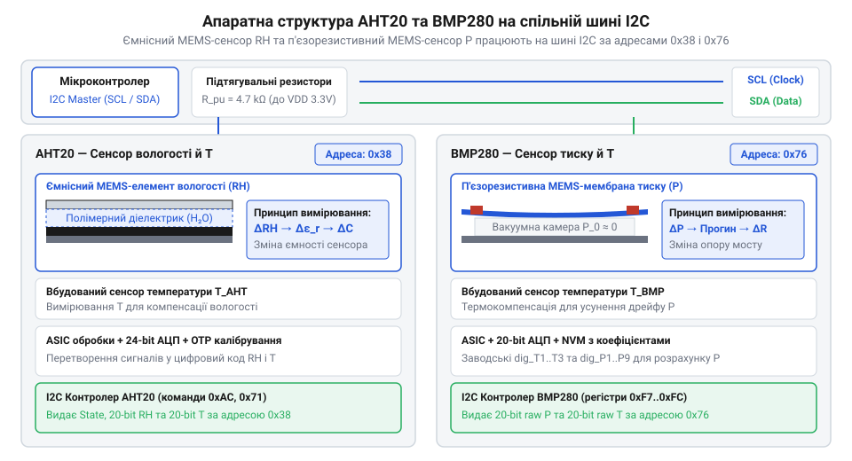
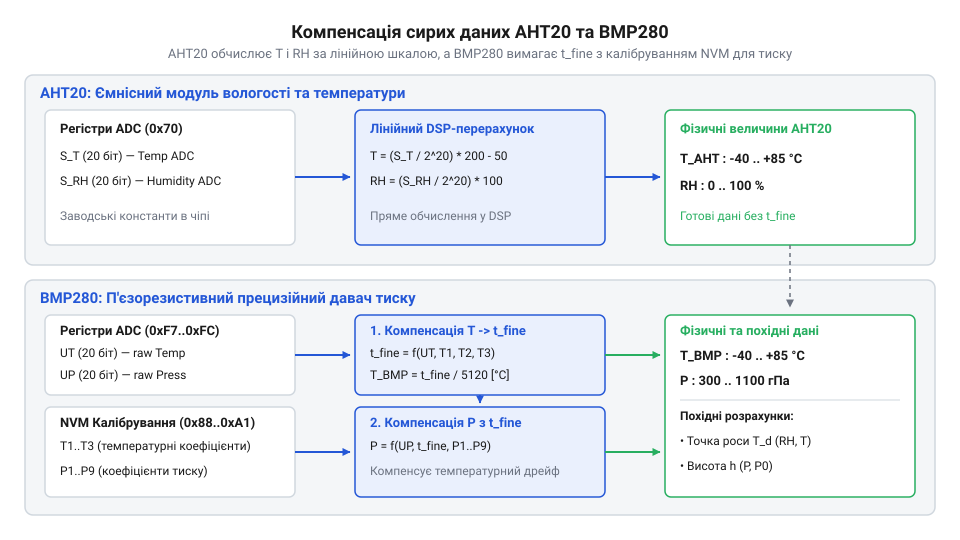
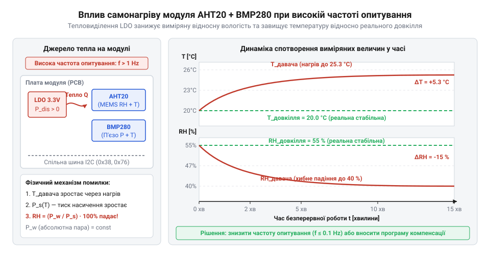
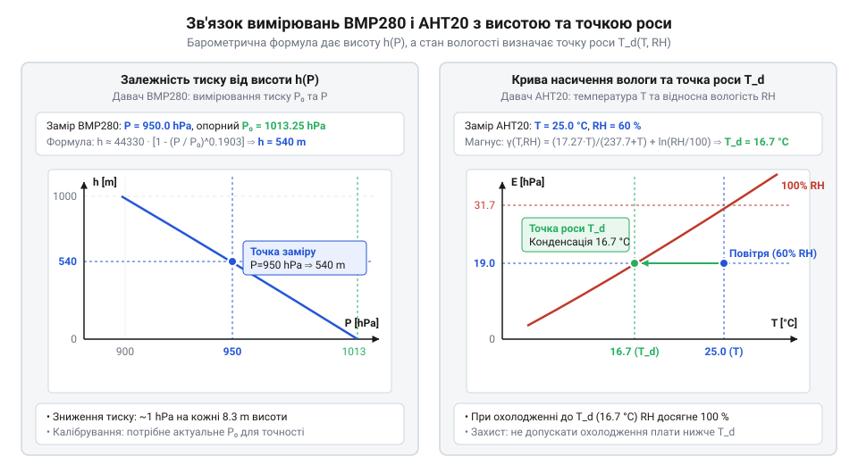

# AHT20 + BMP280 — температура, вологість, тиск

<preknowlist>
- [SHT30 — температура й вологість (I2C)](root:cat-hw-sensors/sht30) — Принципи обміну даними по шині I2C та базові поняття цифрового вимірювання відносної вологості.
- [DHT11 — температура/вологість](root:cat-hw-sensors/dht11) — Основи суміщеного вимірювання температури й вологості та фізичні обмеження простих цифрових сенсорів.
</preknowlist>

## Проблема роздільного вимірювання параметрів мікроклімату

Моніторинг навколишнього середовища в автономних метеостанціях, теплицях чи серверних приміщеннях вимагає одночасного контролю трьох ключових параметрів — температури, відносної вологості повітря та атмосферного тиску. Якщо розробник намагається побудувати таку систему на окремих дискретних сенсорах, він одразу стикається з серйозними інженерними перешкодами. Використання таких компонентів, як [аналоговий термістор](root:cat-hw-sensors/ky-013-thermistor) або аналоговий мікрокаскад @@en|LM35DZ@@, вимагає наявності вільних каналів @@en|ADC@@ (з @@en|Analog-to-Digital Converter@@ — аналого-цифровий перетворювач) і створює чутливість до наведень на лінії. Додавання цифрових вимірювачів на кшталт [термометра DS18B20](root:cat-hw-sensors/ds18b20) вимагає окремої шини @@en|1-Wire@@, а [застосування DHT11](root:cat-hw-sensors/dht11) або більш точного [вологелемента SHT30](root:cat-hw-sensors/sht30) вирішує лише завдання вимірювання вологості й температури, залишаючи тиск поза увагою.

Розміщення трьох окремих давачів на одній друкованій платі @@en|PCB@@ (з @@en|Printed Circuit Board@@ — друкована плата) створює надлишкове громіздке розведення провідників живлення й сигналів. Крім того, виникають проблеми з узгодженням логічних рівнів: один сенсор вимагає живлення 5 В, тоді як інші працюють від 3.3 В. Найбільш критичним недоліком дискретного підходу є неузгодженість температурного відгуку окремих давачів. Через різну геометричну масу й локальне нагрівання сусідніх елементів кожен сенсор вимірює температуру у своїй точці з власною затримкою. Фізично @@en|теплова інерція@@ (від лат. @@la|inertia@@ — бездіяльність) корпусів визначається їхньою масою, питомою теплоємністю та співвідношенням площі поверхні теплообміну до об'єму. Масивний пластиковий або металевий корпус дискретного термометра має велику теплоємність і відносно малу поверхню обдуву, тому його теплова постійна часу становить десятки секунд або й хвилини. Натомість [відкритий сенсорний кристал](root:hw-sensing/mems-pressure-and-humidity-sensing-physics) вимірювача вологості має мікроскопічну масу й вирівнює свою температуру з довкіллям майже миттєво. У разі стрімкого коливання мікроклімату виникає часова розбіжність вимірювання: легкий сенсор вологості реагує негайно, тоді як масивний корпус давача температури видає застаріле значення. Оскільки розрахунок вологості спирається на @@en|тиск насиченої пари@@ (з @@en|saturation vapor pressure@@ — граничний тиск вологи за даної температури), який зростає за експоненціальною залежністю від температури, ця часова розбіжність створює суттєву похибку. Якщо через масу корпуса виміряна температура запізнюється всього на 1 °C від істинної температури сенсора вологості, обчислений тиск насиченої пари викривляється приблизно на 6.5 %. У результаті обчислена відносна вологість відхиляється на 5–6 %, що викривляє також розрахунок точки роси й створює ризик хибного оцінювання конденсації в реальних пристроях.

Еволюція цифрових @@en|MEMS@@ (з @@en|Microelectromechanical Systems@@ — мікроелектромеханічні системи) давачів пройшла шлях від громіздких аналогових сенсорів і механічних барометрів до високоінтегрованих мікросхем. Компанія @@en|Bosch Sensortec@@ послідовно вдосконалювала свої барометричні сенсори від перших моделей @@en|BMP085@@ та @@en|BMP180@@ до прецизійного чипа @@en|BMP280@@ з п'єзорезистивною мембраною. У той самий час компанія @@en|Asair@@ здійснила перехід від дискретних модулів @@en|DHT11@@ і @@en|DHT22@@ до повністю цифрового ємнісного сенсора @@en|AHT20@@. Логічним завершенням цього еволюційного шляху стало об'єднання чипів @@en|AHT20@@ та @@en|BMP280@@ на єдиній мініатюрній платі зі спільною шиною @@en|I2C@@ (з @@en|Inter-Integrated Circuit@@ — міжмікросхемна шина), що створило компактний і надійний індустріальний стандарт для метеорологічних вимірів.

Інтеграція @@en|AHT20@@ та @@en|BMP280@@ на одному модулі усуває громіздкість схеми й розбіжності вимірів, дозволяючи зчитувати всі три параметри по двох провідниках. Щоб зрозуміти, як цей комбінований вузол досягає високої точності, необхідно розглянути мікромеханічну будову кожного з його сенсорних елементів.

## Фізика MEMS-елементів та шинне підключення

В основі модуля @@en|AHT20@@ + @@en|BMP280@@ лежать два принципово різних фізичних механізми перетворення навколишнього середовища в електричний сигнал.

Сенсор @@en|AHT20@@ вимірює відносну вологість повітря за допомогою ємнісного @@en|MEMS@@-елемента. Внутрішня структура являє собою мікроконденсатор, де роль діелектрика виконує тонка гігроскопічна полімерна плівка, розміщена між двома перфорованими електродами. Молекули водяної пари з повітря вільно проникають у пори полімеру, змінюючи його @@en|діелектричну проникність@@ (з @@en|dielectric permittivity@@ — здатність речовини поляризуватися в електричному полі). Оскільки відносна діелектрична проникність води становить близько 80, що значно перевищує показник сухого полімеру (близько 3..4), поглинання вологи викликає пропорційне зростання ємності елемента. Вбудована мікросхема @@en|ASIC@@ перетворює цю ємність на 20-бітний цифровий код.

Давач @@en|BMP280@@ використовує п'єзорезистивний механізм для вимірювання атмосферного тиску. У кремнієвому кристалі витравлено кремнієву мембрану над герметичною вакуумною камерою. Атмосферний тиск тисне на мембрану ззовні, викликаючи її мікроскопічний прогин. На поверхні мембрани сформовано мікрорезистори, які змінюють свій електричний опір під дією механічного напруження завдяки @@en|п'єзорезистивному ефекту@@ (з @@en|piezoresistive effect@@ — зміна питомого опору напівпровідника при деформації). Ці резистори об'єднані в @@en|міст Вітстона@@ (з @@en|Wheatstone bridge@@ — мостова вимірювальна схема). Диференціальна напруга з мосту, пропорційна тиску, посилюється та цифрується 20-бітним низькошумним @@en|ADC@@. Детальніше різновиди мікромеханічних датчиків описує [фізика MEMS сенсорів](root:hw-sensing/mems-pressure-and-humidity-sensing-physics).


*Внутрішня мікромеханічна будова ємнісного вологелемента AHT20, п'єзорезистивної мембрани BMP280 та схема їхнього спільного підключення до ліній SDA й SCL.*

Обидва сенсори розміщені на одній друкованій платі та підключені до паралельних ліній шини @@en|I2C@@: @@en|SDA@@ (з @@en|Serial Data@@ — послідовна лінія даних) та @@en|SCL@@ (з @@en|Serial Clock@@ — послідовна лінія тактування). Конфлікт шини не виникає завдяки відмінним апаратним адресам. Чип @@en|AHT20@@ має фіксовану 7-бітну адресу `0x38`. Сенсор @@en|BMP280@@ має базову адресу `0x76`, якщо його вивід `SDO` з'єднаний із землею `GND`, або `0x77`, якщо цей вивід підтягнутий до живлення `VCC`. Завдяки цьому мікроконтролер опитує обидва пристрої по черзі через [протокол шини I2C](root:com-devices/i2c).

Для забезпечення сумісності з мікроконтролерами з логікою 5 В на платі модуля встановлено @@en|LDO@@ (з @@en|Low Dropout@@ — стабілізатор напруги з малим падінням) на 3.3 В та двонаправлені транзисторні @@en|перетворювачі рівнів@@ (з @@en|level shifter@@ — схема узгодження напруг) на лініях @@en|SDA@@ та @@en|SCL@@. Кожна така схема побудована на N-канальному польовому транзисторі @@en|MOSFET@@ (з @@en|Metal-Oxide-Semiconductor Field-Effect Transistor@@ — транзистор із керуванням струмом через ізольований затвор) і двох резисторах підтяжки. Затвор транзистора під'єднано до лінії живлення 3.3 В, витік з'єднано з лінією чутливих сенсорів, а стік виведено на 5-вольтову сторону керувального контролера. Обидві лінії підтягнуто до шини живлення 3.3 В резисторами опором 4.7 кОм. У стані спокою підтяжки утримують високий рівень з двох боків, напруга між затвором і витоком дорівнює нулю, а канал транзистора закрито. Коли 3.3-вольтовий сенсор тягне лінію до землі (0 В), потенціал витоку падає, напруга затвор-витік зростає і транзистор відкривається, притягуючи 5-вольтовий стік до землі. Якщо ж низький рівень формує 5-вольтовий мікроконтролер, струм спочатку проходить через паразитний @@en|внутрішній діод@@ (з @@en|body diode@@ — p-n перехід між підкладкою та витоком) транзистора. Це знижує потенціал витоку, що змушує транзистор повністю відкритися й пропустити основний струм до землі. Такий механізм зберігає двонаправлені властивості @@en|відкритого стоку@@ (з @@en|open drain@@ — вихідний каскад без активного верхнього ключа) шини @@en|I2C@@, проте паразитна ємність транзистора разом із підтягувальними резисторами створює RC-ланцюжок, який завалює фронти сигналів при високошвидкісному опитуванні. Загальні вимоги до розведення та [фізичних рівнів шини](root:com-devices/i2c) розкрито окремо, а специфіку побудови [чипів серії Bosch](root:cat-hw-sensors/bmp280-bme280-sensor-family) описує відповідний огляд.

Кремнієва мембрана сенсора деформується під дією різниці тисків між її зовнішньою та внутрішньою поверхнями. Якби підмембранна камера була відкритою або заповненою повітрям, пристрій фіксував би лише @@en|відносний тиск@@ (з @@en|relative pressure@@ — різницю тисків між двома об'ємами), реагуючи на локальні коливання в корпусі приладу. Крім того, запечатаний усередині газ розширювався б від нагрівання чипа, створюючи хибний тиск знизу та викривляючи показання при кожній зміні температури. Щоб виміряти саме @@en|абсолютний тиск@@ (з @@en|absolute pressure@@ — тиск, обчислений відносно повного вакууму як нульової точки), під мембраною @@en|BMP280@@ формують герметичний @@en|опорний вакуум@@ (з @@en|reference vacuum@@ — запечатану порожнину з відсутнім тиском газу). Оскільки з внутрішнього боку тиск дорівнює нулю, прогин мембрани викликається виключно зовнішнім навантаженням атмосфери, а самі вимірювання залишаються стабільними та не залежать від теплового розширення повітря під кристалом.

## Ініціалізація та компенсація калібрувальними коефіцієнтами

Первинний цифровий код, отриманий з внутрішнього аналого-цифрового перетворювача (від англ. @@en|ADC@@ — аналого-цифровий перетворювач), не дорівнює готовому значенню температури чи тиску. При виготовленні напівпровідникових кристалів мікроскопічні відхилення товщини п'єзорезистивної мембрани та хімічного складу ємнісного полімеру неминуче створюють технологічний розкид параметрів. Через це однакові фізичні умови викликають у різних екземплярів мікросхем різні вихідні електричні сигнали. Щоб перетворити сирі двійкові числа на точні фізичні величини, виробник проводить заводське калібрування (від фр. @@fr|calibre@@ — вимір, шаблон) кожного чипа й записує індивідуальні еталонні параметри у постійний запам'ятовувальний пристрій (від англ. @@en|ROM@@ — постійна пам'ять).

Алгоритм запуску комбінованого модуля починається з опитування стану обох давачів. Для сенсора @@en|AHT20@@ після подачі живлення потрібна пауза близько 40 мс для завершення внутрішніх перехідних процесів. Після цього контролер зчитує байт стану через шину: третій біт (`0x08`) показує, чи активовано заводську матрицю. Якщо біт дорівнює нулю, сенсор вимагає відправки команди ініціалізації (`0xBE 0x08 0x00`). Натомість для мікросхеми @@en|BMP280@@ ініціалізація починається перевіркою ідентифікаційного регістру `0xD0`, де збережено фіксоване значення `0x58`. Одразу після підтвердження зв'язку центральний процесор зчитує з блоку @@en|ROM@@ (адреси `0x88`–`0x9F`) 24 байти, в яких зафіксовано 12 коефіцієнтів полінома (від грецьк. @@grc|πολύς@@ — численний та @@grc|ὄнома@@ — член, ім'я). @@grc|πολύς@@ — численний та @@grc|ὄνομα@@ — член, ім'я) компенсації: три для температури (`dig_T1`–`dig_T3`) та дев'ять для тиску (`dig_P1`–`dig_P9`).

Математична обробка зчитаних даних вимагає суворого дотримання послідовності обчислень: спочатку розраховується компенсація (від лат. @@la|compensatio@@ — зрівноваження) температури, і лише потім — тиску. П'єзорезистивний міст кристала тиску змінює свій опір не тільки під дією механічного стиснення, а й від термічного розширення кремнію. Тому первинне 20-бітне число тиску `UP` неможливо коректно інтерпретувати без проміжного температурного фактора `t_fine`. Спочатку сирий код температури `UT` разом із коефіцієнтами `dig_T1`–`dig_T3` формує дійсне значення температури та змінну `t_fine`. Фізично змінна `t_fine` виражає точний температурний стан кремнієвого кристала у вигляді числового відхилення від еталонного значення. Арифметично вона об'єднує лінійний і квадратичний доданки температурного розкиду та слугує єдиним масштабованим аргументом для всіх подальших обчислень. Механічна деформація мембрани тиску викликає нелінійну зміну опору п'єзорезисторів, а їхній початковий зсув та чутливість додатково дрейфують через зміну температури. За знайденим `t_fine` дев'ять коефіцієнтів `dig_P1`–`dig_P9` коригують цей нелінійний відгук. Коефіцієнти `dig_P1`–`dig_P3` задають базову чутливість і лінійний масштаб, `dig_P4`–`dig_P6` усувають температурне зміщення нуля та дрейф підсилення, а `dig_P7`–`dig_P9` компенсують квадратичний вигин власне деформаційної кривої п'єзоопору. Поліном другого порядку поєднує ці поправки в компенсаційну поверхню та перетворює сирий код `UP` на точний тиск у Паскалях.

```
T_fine = (((UT / 16384.0) - (dig_T1 / 1024.0)) * dig_T2) + ((((UT / 131072.0) - (dig_T1 / 8192.0)) * ((UT / 131072.0) - (dig_T1 / 8192.0))) * dig_T3)   [обчислення температурного фактора]
```

Поліноміальні формули перерахунку детально подано у [математичній моделі температурної компенсації](root:cat-hw-sensors/aht20-bmp280/math-bmp280-calibration-compensation-formulas.md), яка дозволяє усунути дрейф.


*Послідовність перетворення первинних цифрових відліків у компенсаційні значення температури й тиску.*

У зчитуванні давача @@en|AHT20@@ командний цикл починається надсиланням трибайтового кадру `0xAC 0x33 0x00`, після чого мікроконтролер витримує паузу 80 мс для проведення вимірювання. Зчитуваний з регістру 6-байтовий масив містить 20 біт вологості й 20 біт температури. Перетворення сирого коду вологості `S_RH` та температури `S_T` здійснюється за прямими лінійними пропорціями:

```
RH = (S_RH / 1048576.0) * 100     [обчислення відносної вологості у відсотках]
T = (S_T / 1048576.0) * 200 - 50  [обчислення температури в градусах Цельсія]
```

Системну передачу кадрів регулюють [фізичні й логічні стандарти I2C](root:com-devices/i2c), що описують сеанси зв'язку. Електричне розведення ліній та схему підтяжки містить [специфікація апаратного інтерфейсу модуля](root:cat-hw-sensors/aht20-bmp280/api-aht20-bmp280-hardware-interface.md), а готові функції керування регістрами описує [низькорівневий програмний драйвер зчитування](root:cat-hw-sensors/aht20-bmp280/api-aht20-bmp280-firmware-driver.md).

Числовий коефіцієнт 1048576.0 у формулах перерахунку чипа @@en|AHT20@@ має суто апаратне походження й визначається розрядністю внутрішнього аналого-цифрового перетворювача. Його АЦП має 20-бітну роздільну здатність, тому максимальна кількість дискретних станів 20-бітного регістра становить 2²⁰ = 1048576. Ділення сирого коду S_RH або S_T на 1048576.0 виконує нормалізацію (від лат. @@la|normalis@@ — прямолінійний, за правилом) — перетворює цілочисельний відлік у безрозмірний коефіцієнт від 0 до 1, що виражає відносну частку заповнення всієї шкали. У формулі вологості множник 100 масштабує отриману частку до фізичного інтервалу відносної вологості від 0 % до 100 %. У формулі ж температури множник 200 та від'ємний зсув -50 визначаються робочим діапазоном вимірювального елемента від -50 °C до +150 °C, загальна ширина якого становить 150 - (-50) = 200 °C. Множення на 200 розтягує одиничний інтервал АЦП на повну 200-градусну шкалу, а віднімання 50 зміщує початок відліку нижче нуля. Це поєднує нормалізований код із фізичною шкалою Цельсія так, що код 0 відповідає межі -50 °C, а повне заповнення регістра 1048576 — верхній межі +150 °C, що визначається [фізикою виготовлення MEMS-давачів](root:hw-sensing/mems-pressure-and-humidity-sensing-physics) вологості й температури.

## Похибки самонагріву та узгодження температур

Після налагодження первинного опитування розробники часто помічають парадокс: два давачі на одній платі видають різні значення температури. Мікросхема @@en|BMP280@@ показує на 0.8–1.5 °C вищу температуру, ніж @@en|AHT20@@, а виміряна відносна вологість виявляється суттєво заниженою порівняно з реальним станом повітря. Джерелом цього викривлення є паразитне самонагрівання (від англ. @@en|self-heating@@) електронних компонентів модуля під час роботи.

Головним локальним джерелом тепла виступає лінійний стабілізатор (від лат. @@la|stabilis@@ — стійкий, нерухомий; @@en|LDO@@ — стабілізатор з малим падінням напруги), який понижує вхідну напругу з 5 В до робочих 3.3 В. Енергія різниці напруг розсіюється у вигляді тепла прямо на компактній друкованій платі. Мідні доріжки та шари живлення діють як ефективні теплопроводи, передаючи це тепло безпосередньо до контактних площадок кремнієвих кристалів. Ситуацію погіршує надто часте опитування: якщо мікроконтролер запитує дані в безперервному режимі (від англ. @@en|normal mode@@) сотні разів на секунду, внутрішній аналоговий тракт і струми вимірювальних мостів постійно підігрівають сенсор зсередини.

Тепловий дрейф кристала руйнує точність вимірювання відносної вологості. Відносна вологість визначає відношення поточної маси водяної пари до максимально можливої за цієї ж температури. Оскільки тиск насиченої пари зростає експоненційно з підвищенням температури, локальний розігрів вимірювальної камери @@en|AHT20@@ всього на 1 °C штучно підвищує поріг насичення. При незмінній абсолютній кількості вологи в повітрі обчислений відсоток вологості падає на 3–5 %.


*Паразитне самонагрівання електронних компонентів та викривлення показників відносної вологості.*

Для мінімізації похибки самонагріву застосовують комплекс алгоритмічних заходів. По-перше, сенсор @@en|BMP280@@ переводять із безперервного режиму в режим вимірювання за запитом (від англ. @@en|forced mode@@), при якому мікросхема прокидається лише на час аналогового перетворення й одразу повертається у сплячий стан. Програмно це реалізують через регістр (від лат. @@la|registrum@@ — внесений список) конфігурації `ctrl_meas` за адресою `0xF4`. У цьому регістрі молодші біти `mode[1:0]` відповідають за режим роботи (`00` — режим сну, `01` або `10` — режим за запитом), а старші біти `osrs_t[7:5]` та `osrs_p[4:2]` задають коефіцієнти передискретизації (від англ. @@en|oversampling@@ — надмірна вибірка) температури й тиску. Для ініціалізації вимірювання мікроконтролер записує в `ctrl_meas` байти налаштувань із кодом `01` або `10` у молодших бітах; давач виконує один цикл перетворення, зберігає значення у вихідних регістрах і апаратно скидає біти `mode[1:0]` назад у `00`. Повторний замір вимагає нового запису в `ctrl_meas`, тоді як випадковий запис коду `11` переводить чип у безперервний режим @@en|normal mode@@ із постійним тепловиділенням. Своєю чергою, давач @@en|AHT20@@ має вбудований апаратний автомат станів: після завершення циклу вимірювання тривалістю близько 80 мс він автоматично переходить у режим сну (від англ. @@en|sleep mode@@) і вимикає аналоговий тракт без окремих команд від мікроконтролера. Якщо ж мікроконтролер надсилає пускові команди занадто часто, кристал @@en|AHT20@@ безперервно перебуває в активній фазі перетворення, що спричиняє додатковий розігрів вимірювальної камери струмами внутрішнього контролера. По-друге, зниження частоти опитування всього модуля до одного заміру на 3–5 секунд дає змогу @@en|AHT20@@ перебувати в режимі сну понад 98 % часу, зводячи власне тепловиділення до нехтовно малого мікроватного рівня. Для опису конструктивних особливостей барометричних кристалів корисний [огляд родини сенсорів Bosch](root:cat-hw-sensors/bmp280-bme280-sensor-family), де розібрано внутрішнє компонування, а механічну пружність мембрани описує [фізична модель MEMS давачів](root:hw-sensing/mems-pressure-and-humidity-sensing-physics).

Узгодження температур двох чипів вимагає поділу їхніх функціональних ролей. Температура з кристала @@en|BMP280@@ потрібна виключно для внутрішнього розрахунку тиску й не повинна транслюватися як температура довкілля. Для відображення кімнатної температури та розрахунку точки роси застосовують показання @@en|AHT20@@, оскільки його чутливий елемент краще ізольований від плати вентиляційною проріззю. Порівняно з [окремим термометром DS18B20](root:cat-hw-sensors/ds18b20), правильно опитуваний @@en|AHT20@@ дає мінімальну затримку теплового відгуку.


*Співвідношення кліматичних параметрів для обчислення барометричної висоти та температури конденсації.*

На основі узгоджених показників температури @@en|AHT20@@ та тиску @@en|BMP280@@ обчислюють похідні кліматичні величини: барометричну висоту за гіпсометричною (від грецьк. @@grc|ὕψος@@ — висота та @@grc|μέτρον@@ — вимір, міра) формулою. @@grc|ὕψος@@ — висота та @@grc|μέτρον@@ — міра) формулою та точку роси за напівемпіричною формулою Магнуса. Повний математичний апарат цих перетворень подано у [розрахунку похідних кліматичних параметрів](root:cat-hw-sensors/aht20-bmp280/math-climate-derived-parameters-dewpoint-altitude.md). Практичну схему побудови енергоефективного контролера висвітлює [проєкт автономного кліматичного вузла](root:cat-hw-sensors/aht20-bmp280/proj-aht20-bmp280-climate-monitor-node.md).

## Розрахунок похідних кліматичних параметрів

Отримання точних показників температури, відносної вологості та атмосферного тиску відкриває можливість обчислення складніших метеорологічних та фізичних величин. У практичних приладах первинні дані слугують базою для барометричної (від грецьк. @@grc|βάρος@@ — вага, важкість та @@grc|μέτρον@@ — вимір, міра) висотометрії. (від грецьк. @@grc|βάρος@@ — вага, важкість та @@grc|μέτρον@@ — вимір, міра) висотометрії та прогнозування точки роси (від англ. @@en|dew point@@ — температура утворення роси).

Барометричний метод визначення висоти базується на фізичній властивості атмосфери: з підйомом вгору маса повітряного стовпа зменшується, що спричиняє падіння тиску. У реальному повітрі тиск спадає не за простою експонентою, бо температура знижується разом із підйомом вгору. Модель міжнародної стандартної атмосфери (англ. @@en|International Standard Atmosphere@@, @@en|ISA@@) визначає базову температуру на рівні моря `T0 = 288.15 К` (15 °C) та її лінійне падіння у тропосфері (від грецьк. @@grc|τρόπος@@ — поворот, зміна та @@grc|σφαῖρα@@ — куля) зі швидкістю `L = 0.0065 К/м`. @@grc|τρόπος@@ — поворот, зміна та @@grc|σφαῖρα@@ — куля) зі швидкістю `L = 0.0065 К/м`. Інтегрування рівняння гідростатики разом із законом ідеального газу для такого температурного профілю приводить до підстепеневої залежності. Коефіцієнт `44330` у цій формулі вимірюється в метрах і дорівнює відношенню `T0 / L` (288.15 / 0.0065 ≈ 44330.77 м), яке задає умовну висоту повного охолодження стандартизованого повітря. Показник ступеня `0.1903` є безрозмірною комбінацією `(R · L) / g`, де `R = 287.05 Дж/(кг · К)` — питома газова стала повітря, а `g = 9.80665 м/с²` — прискорення вільного падіння. Якщо відомо поточний тиск `P`, зчитаний із чипа @@en|BMP280@@, та опорний тиск на рівні моря `P0`, абсолютну висоту `h` розраховують за міжнародною гіпсометричною формулою:

```
h = 44330 * (1 - (P / P0) ^ 0.1903)    [обчислення барометричної висоти над рівнем моря]
```

Головною пасткою барометричної висотомерії є мінливість синоптичних умов. Зміна атмосферного тиску через рух циклонних фронтів викликає хибне уявлення про зміну висоти стаціонарної метеостанції. Для компенсації похибки пристрої вимагають періодичного коригування опорного тиску на рівні моря (позначається як @@en|QNH@@), який запитують із найближчого аеродрому або метеорологічного центра. Проте коли завдання зводиться до вимірювання відносної зміни висоти (наприклад, під час підйому безпілотника за даними від [первинних давачів тиску](root:cat-hw-sensors/bmp280-bme280-sensor-family)), знати поточний тиск @@en|QNH@@ не обов'язково. У такому разі алгоритм фіксує статичний тиск у точці старту як базове значення `P_start`. Замінивши в гіпсометричній формулі абсолютний опорний тиск `P0` на це початкове значення `P_start`, для будь-якого поточного тиску `P` розраховують відносну висоту `dh`:

```
dh = 44330 * (1 - (P / P_start) ^ 0.1903)    [обчислення відносної зміни висоти від точки старту]
```

У точці старту, де поточний тиск `P` дорівнює `P_start`, відношення `P / P_start` перетворюється на одиницю, що дає `dh = 0` метрів. Під час підйому тиск падає, і вираз розраховує підйом відносно вихідного рівня без залучення зовнішніх метеоданих. Механізм працює завдяки тому, що за короткий час вимірювального сеансу синоптичний тиск у регіоні вважається постійним. Якщо ж сеанс триває годинами, природне коливання атмосферного тиску поступово зміщує базовий рівень, створюючи похибку висоти навіть у нерухомому стані, що змушує регулярно оновлювати значення `P_start` перед новим запуском.

Другим важливим похідним параметром є точка роси — температура, до якої необхідно охолодити повітря із поточною вологістю, щоб водяна пара досягла межі насичення й почала випадати у вигляді роси чи туману. Розрахунок точки роси `Td` здійснюється за напівемпіричною формулою @@la|Magnus-Tetens@@, яка бере температуру `T` та відносну вологість `RH` з сенсора @@en|AHT20@@:

```
gamma = (17.27 * T) / (237.7 + T) + ln(RH / 100)    [проміжний коефіцієнт насичення]
Td = (237.7 * gamma) / (17.27 - gamma)              [розрахунок температури точки роси]
```

Знання точки роси є критичним для запобігання утворення конденсації (від лат. @@la|condensatio@@ — згущення, ущільнення) усередині електронних приладів. Коли температура корпусу пристрою наближається до `Td`, система вентиляції або обігріву має увімкнутися заздалегідь. Детальний математичний апарат та крайові умови цих перетворень наведено у розділі про [обчислення похідних кліматичних параметрів](root:cat-hw-sensors/aht20-bmp280/math-climate-derived-parameters-dewpoint-altitude.md).

## Захист сенсорів у реальних умовах

Після побудови обчислювального тракту постає завдання забезпечення довговічності й стабільності роботи модуля в реальних умовах експлуатації. Відкриті мікроелектромеханічні структури чипів @@en|AHT20@@ та @@en|BMP280@@ безпосередньо взаємодіють із навколишнім повітрям, що робить їх вразливими до пилу, вологи та хімічних забрудників.

Пряме осадження крапель конденсату на поверхню ємнісного полімеру @@en|AHT20@@ призводить до насичення рідиною пористих електродів та викликає тривале заліпання показників вологості на рівні 100 %. Пил і дрібнодисперсні частки створюють механічне забруднення та посилюють адгезію (від лат. @@la|adhaesio@@ — прилипання) вологи, що поступово зміщує калібрувальну характеристику. У сенсорі @@en|BMP280@@ попадання пилу або рідини у барометричний отвір кристала блокує деформацію п'єзорезистивної мембрани, роблячи вимірювання тиску неможливими.

Основним методом фізичного захисту є застосування захисних паропроникних мембран @@en|PTFE@@ (від англ. @@en|Polytetrafluoroethylene@@ — політетрафторетилен). Ці пористі структури володіють гідрофобними (від грецьк. @@grc|ὕδωρ@@ — вода та @@grc|φόβος@@ — страх) властивостями. @@grc|ὕδωρ@@ — вода та @@grc|φόβος@@ — страх) та олеофобними властивостями: вони вільно пропускають молекули водяної пари та газу, але надійно затримують рідкі краплі води, олії й пилові частки. Ця вибіркова проникність пояснюється співвідношенням розмірів пор мембрани та речовин, що крізь неї проходять. Мікропориста матриця @@en|PTFE@@ має середній діаметр пор у межах від 0.1 до 1.0 мкм. Окремі молекули водяної пари мають діаметр лише близько 0.0004 мкм (0.4 нм), що в сотні й тисячі разів менше за ширину пор, тому гази й пара вільно проходять крізь пористу сітку. Натомість навіть найменші рідкі краплі туману мають розмір від 2 до 100 мкм, тобто в десятки й сотні разів перевищують діаметр пор. У поєднанні з високим поверхневим натягом рідини та низькою поверхневою енергією @@en|PTFE@@ це створює капілярний бар'єр, який заважає рідкій фазі деформуватися й затікати у вузькі пори, тоді як пилові частки затримуються механічно. Водночас такий захисний бар'єр створює помітний дифузійний опір для руху газу. Обмежена сумарна площа пор та їхня звивиста структура уповільнюють масоперенос водяної пари. Молекулам пари потрібен додатковий час для дифузії (від лат. @@la|diffusio@@ — поширення, розтікання) крізь товщу матриці до повного вирівнювання концентрації вологи у замкненому об'ємі сенсорної камери. У результаті виникає динамічна часова затримка, а стала часу відгуку сенсора на стрибкоподібну зміну вологості довкілля зростає з кількох секунд до десятків секунд. У швидкозмінних кліматичних умовах ця затримка спричиняє динамічний гістерезис показань і запізнення реакції автоматичних систем регулювання. Мембрану розміщують безпосередньо над вентиляційними отворами захисного корпусу.

Конструктивне компонування приладу також вимагає дотримання кількох правил. Плату модуля слід розташовувати у нижній частині захисного кожуха вертикально, щоб запобігти збиранню вологи на поверхні чипів. Корпус повинен мати захищені від прямого попадання дощу жалюзійні вентиляційні щілини, а сам модуль має бути теплоізольованим від внутрішніх компонентів пристрою (дисплея, мікроконтролера чи блоку живлення).

Якщо сенсор @@en|AHT20@@ піддався тривалій дії високої вологості й втратив точність через десорбцію (від лат. @@la|desorbere@@ — вивільняти) або сорбцію (від лат. @@la|sorbere@@ — поглинати) сторонніх сполук, застосовують процедуру термічного відновлення (від англ. @@en|baking@@ — випалювання, прогрів). Модуль витримують при температурі 80 °C протягом кількох годин, після чого залишають для регідратації при нормальній вологості на добу. Практичну схему захисту та конструкцію корпусу описано у [проєкті автономного кліматичного вузла](root:cat-hw-sensors/aht20-bmp280/proj-aht20-bmp280-climate-monitor-node.md), а специфіку розведення виводів висвітлює [довідник апаратного інтерфейсу](root:cat-hw-sensors/aht20-bmp280/api-aht20-bmp280-hardware-interface.md).
