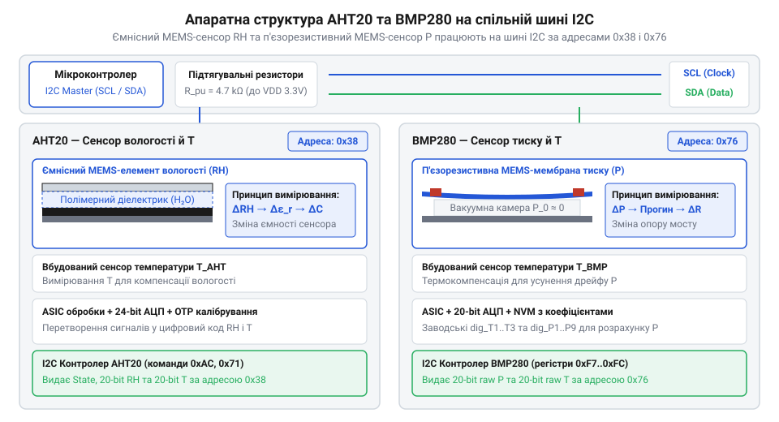
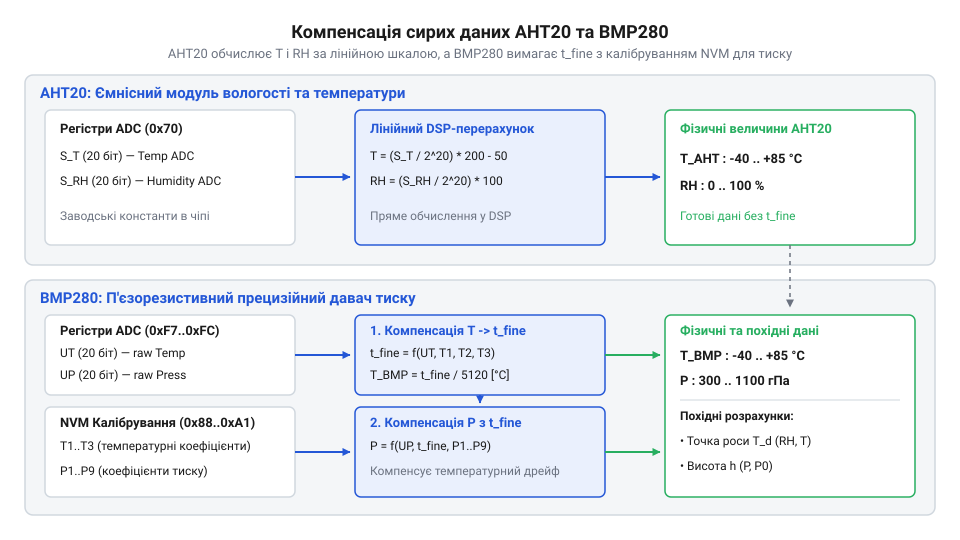
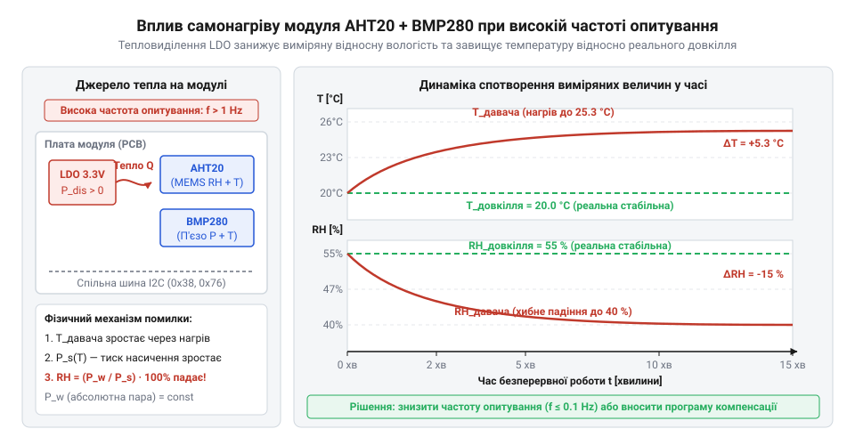
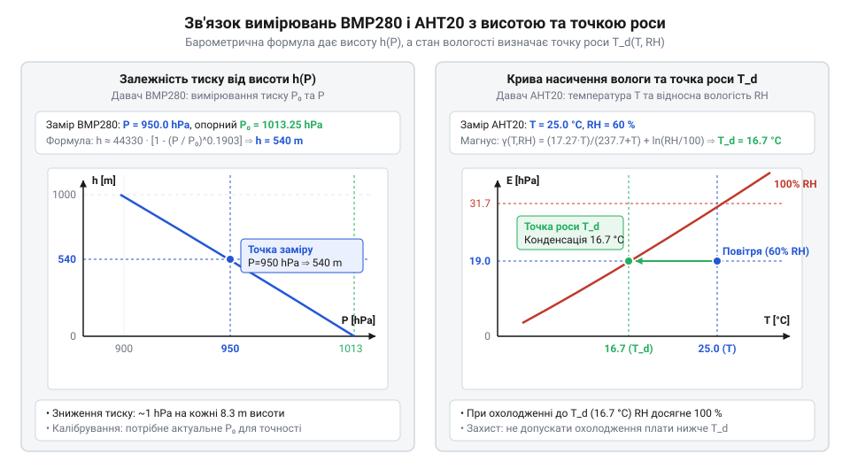

# AHT20 + BMP280 — температура, вологість, тиск

<preknowlist>
- [SHT30 — температура й вологість (I2C)](root:cat-hw-sensors/sht30) — Принципи обміну даними по шині I2C та базові поняття цифрового вимірювання відносної вологості.
- [DHT11 — температура/вологість](root:cat-hw-sensors/dht11) — Основи суміщеного вимірювання температури й вологості та фізичні обмеження простих цифрових сенсорів.
</preknowlist>

## Проблема роздільного вимірювання параметрів мікроклімату

Швидкі коливання довкілля викривають недоліки використання окремих давачів температури та вологості. Різна геометрична маса та матеріали корпусів дискретних сенсорів створюють неоднакову теплову інерцію. У результаті під час різких стрибків температури виміряне значення запазнює: похибка температури всього на 1 °C викривляє розрахований тиск насиченої пари й дає помилку відносної вологості на 5–6 %. На відміну від громіздкого підключення окремих модулів, як-от [давачів DHT11](root:cat-hw-sensors/dht11), комбінований модуль на чипах @@en|AHT20@@ та @@en|BMP280@@ об'єднує вимірювання температури, вологості й тиску на єдиній платі зі спільною шиною @@en|I2C@@.

## Фізика MEMS-елементів та шинне підключення

Усередині модуля працюють два мікромеханічні кристали @@en|MEMS@@ (від @@en|Micro-Electro-Mechanical Systems@@, мікроелектромеханічні системи). Вологоелемент @@en|AHT20@@ використовує диелектричний полімер, ємність якого змінюється від поглинання вологи, а барометр @@en|BMP280@@ містить деформівну п'єзорезистивну мембрану над герметичною камерою з опорним вакуумом.


*Підпис: Фізична будова MEMS-елементів AHT20 і BMP280 та схема узгодження рівнів I2C.*

Для безпечного підключення до 5-вольтових контролерів на лініях @@en|SDA@@ та @@en|SCL@@ встановлено двонапрямні транзисторні перетворювачі рівнів на @@en|MOSFET@@ (від @@en|Metal-Oxide-Semiconductor Field-Effect Transistor@@, польовий транзистор з ізольованим затвором). Чип @@en|AHT20@@ має фіксовану апаратну адресу `0x38`, а @@en|BMP280@@ відповідає на адресу `0x76` (або `0x77`), що дозволяє опитувати обидва сенсори по одній шині @@en|I2C@@.

## Ініціалізація та компенсація калібрувальними коефіцієнтами

Первинні вимірювання чипів формують сирі 20-бітні коди АЦП, які не є готовими фізичними величинами. Через технологічний розкид п'єзорезистивний міст @@en|BMP280@@ має термічний дрейф і нелінійність. Під час зчитування контролер найперше обчислює температурний фактор `t_fine` за допомогою заводських коефіцієнтів із постійної пам'яті @@en|PROM@@ (від @@en|Programmable Read-Only Memory@@, програмований постійний запам'ятовувальний пристрій), після чого скасовує температурний дрейф у коді тиску.


*Підпис: Конвеєр розрахунку компенсації тиску BMP280 та лінійного масштабування AHT20.*

Для чипа @@en|AHT20@@ після подачі команди ініціалізації `0xAC` зчитані відліки `S_RH` та `S_T` масштабуються лінійно:

```
RH = (S_RH ÷ 2²⁰) × 100                  [масштабування відносної вологості в %]
T = (S_T ÷ 2²⁰) × 200 - 50               [масштабування температури в °C]
```

## Похибки самонагріву та узгодження температур

Працюючи на модулі, лінійний стабілізатор @@en|LDO@@ (від @@en|Low Dropout@@, мале падіння напруги) та активні кристали виділяють тепло. При частому опитуванні виникає паразитне самонагрівання плати на 1–2 °C, що локально підвищує температуру й штучно занижує виміряну відносну вологість.


*Підпис: Вплив паразитного самонагріву модуля на показники вологості та його усунення.*

Щоб звести тепловиділення до мінімуму, чип @@en|BMP280@@ переводять у режим за запитом @@en|forced mode@@ (від @@en|forced mode@@, режим за запитом) із паузами між вимірюваннями. Також застосовують правило розподілу ролей: температура @@en|BMP280@@ слугує виключно для компенсації тиску, тоді як для кліматичних розрахунків використовують значення з @@en|AHT20@@, аналогічно до роботи з [давачами вологості SHT30](root:cat-hw-sensors/sht30).

## Розрахунок похідних кліматичних параметрів

Комплексні показники тиску, температури й вологості дають змогу обчислювати похідні параметри довкілля. Для визначення висоти застосовують міжнародну гіпсометричну формулу. Якщо поточний тиск на рівні моря @@en|QNH@@ (від @@en|QNH@@, барометричний тиск на рівні моря) невідомий, обчислюють відносну зміну висоти `Δh` між поточним тиском `P` та початковим тиском старту `P₀`:

```
Δh = 44330 × (1 - (P ÷ P₀)^(1 ÷ 5.255))  [різниця висоти від початкової точки]
```


*Підпис: Залежність похідних параметрів висоти та точки роси від виміряних величин.*

Для оцінювання ризику конденсації обчислюють точку роси за формулою Магнуса на основі температури й вологості з чипа @@en|AHT20@@. Наближення даного значення до температури повітря сигналізує про випадіння роси. Детальніше математичну модель та особливості обчислення висвітлено в матеріалі про [формулу Магнуса для розрахунку точки роси](root:ph-thermodynamics/magnus-dewpoint-formula).

## Захист сенсорів у реальних умовах

Відкриті елементи @@en|MEMS@@ вразливі до пилу, рідин та олій. Для їхнього захисту використовують гідрофобні паропроникні мембрани з @@en|PTFE@@ (від @@en|Polytetrafluoroethylene@@, політетрафлуоретилен). Мікропориста структура захищає кристал, проте створює дифузійний опір водяній парі, що спричиняє динамічну затримку відгуку вимірювань. Модуль монтують вертикально, щоб уникнути накопичення конденсату та висхідного теплового потоку від живлення. У разі тривалого зволоження чипа @@en|AHT20@@ виконують процедуру термічного відновлення — прогрів кристала за температури 80 °C для випаровування зв'язаної води.
