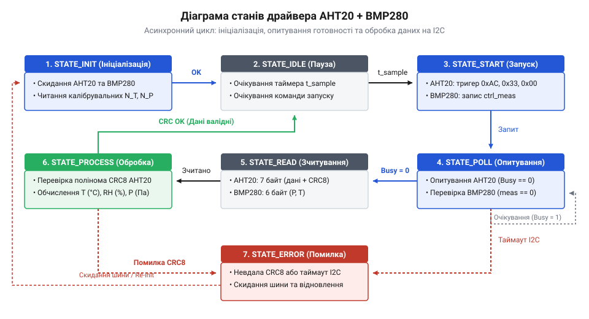
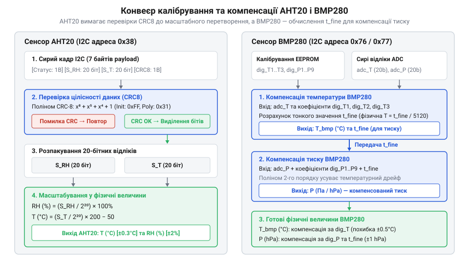

# Програмний інтерфейс драйвера зчитування AHT20 + BMP280

<preknowlist>
- [SHT30 — температура й вологість (I2C)](root:cat-hw-sensors/sht30) — принципи обміну даними з цифровими сенсорами температури й вологості по шині I2C та асинхронний запуск вимірювань
- [GY-21 (Si7021/HTU21D) — температура/вологість](root:cat-hw-sensors/gy-21) — базові поняття затримки перетворення та зчитування сирих регістрів вологості й температури
</preknowlist>

## Збої опитування комбінованого модуля I2C

При одночасному підключенні кількох цифрових чипів до однієї послідовної лінії в розробника прошивки виникає спокуса опитувати їх поспіль в одному синхронному циклі. На комбінованому модулі розташовані дві окремі мікросхеми: сенсор температури та вологості @@en|AHT20@@ та сенсор атмосферного тиску @@en|BMP280@@. Якщо керувати ними через прості блоки читання шини @@en|I2C@@ (англ. *Inter-Integrated Circuit* — міжінтегральна схема), мікроконтролер швидко потрапляє у стан зависання або отримує застарілі та спотворені значення.

Головна причина збоїв полягає у суттєвій різниці апаратного часу перетворення величин. Сенсору @@en|AHT20@@ для формування 20-бітної вибірки вологості потрібно щонайменше 80 мілісекунд, тоді як @@en|BMP280@@ за низьких налаштувань фільтрації завершує вимірювання за 15–45 мілісекунд. Коли програма намагається зчитати дані з @@en|AHT20@@ до завершення внутрішнього циклу, пристрій повертає прапорець зайнятості або затримує лінію @@en|I2C@@. На відміну від одноканальних пристроїв, якими є [модулі серії GY-21](root:cat-hw-sensors/gy-21), спроба блокуючого очікування двох різних сенсорів блокує обчислювальне ядро та призводить до апаратного @@en|таймауту@@ (англ. *timeout* — вичерпання часу) шини.

Для усунення цієї проблеми розробляють @@en|драйвер@@ (англ. *driver* — керуюча програма) на основі шаблону @@fr|фасад@@ (франц. *façade* — передня сторона будівлі). Такий архітектурний підхід об'єднує два незалежні чипи під єдиним програмним інтерфейсом @@en|API@@ (англ. *Application Programming Interface* — інтерфейс прикладного програмування), розділяючи процес опитування на чіткі асинхронні етапи: ініціалізацію, запуск перетворення, перевірку готовності та обчислення результатів. В однопотоковому циклі прошивки фасад керує цими етапами через внутрішній @@en|автомат станів@@ (англ. *state machine* — машина зі станами). Під час кожного виклику драйвер виконує коротку перевірку системних таймерів або прапорців готовності на шині @@en|I2C@@ і миттєво повертає управління головній програмі. Після надсилання команди запуску чипи @@en|AHT20@@ та @@en|BMP280@@ виконують вимірювання апаратно, поки обчислювальне ядро залишається вільним. Така асинхронність вимагає збереження контексту, поточного фазового стану та часових міток у пам'яті драйвера. У разі апаратного збою сенсора або зависання шини автомат ризикує застрягнути в стані очікування готовності. Для запобігання блокуванню кожен етап очікування обмежують неблокуючими @@en|таймаутами@@ з можливістю програмного скидання пристроїв.

## Конфігурація та ініціалізація пристроїв модуля

Перед початком вимірювань @@en|драйвер@@ повинен перевірити фізичну наявність мікросхем на шині @@en|I2C@@ та завантажити у пам'ять їхні заводські параметри. Спільна конфігураційна структура зберігає вказівник на апаратну шину @@en|I2C@@, @@en|I2C@@-адреси сенсорів (за замовчуванням `0x38` для @@en|AHT20@@ та `0x76` або `0x77` для @@en|BMP280@@), а також коефіцієнти передискретизації.

Процедура ініціалізації виконується послідовно:
1. @@en|драйвер@@ надсилає запит на шину @@en|I2C@@ та зчитує ідентифікатор @@en|BMP280@@ з @@en|регістра@@ `0xD0` (значення `0x58`).
2. З @@en|BMP280@@ зчитується таблиця з 24 @@en|байтів@@ заводських калібрувальних коефіцієнтів (`dig_T1`–`dig_T3`, `dig_P1`–`dig_P9`), необхідних для подальшої компенсації.
3. @@en|драйвер@@ перевіряє стан @@en|AHT20@@. Якщо прапорець калібрування в байті стану скинуто, надсилається команда ініціалізації `0xBE`.

Нижче наведено програмний інтерфейс ініціалізації мовами C та C++:

:::tabs
:::code api-aht20-bmp280-firmware-driver/c/snippet-1.c
:::code api-aht20-bmp280-firmware-driver/cpp/combosensorconfig.cpp
:::

Зазначені у конфігурації параметри `bmp280_osrs_t` та `bmp280_osrs_p` визначають компроміс між рівнем шумів у виміряних даних та загальним часом готовності результату. Під час передискретизації (англ. @@en|oversampling@@, від давньоангл. *ofer* — понад, та латинського *discretus* — розділений) внутрішній аналогово-цифровий перетворювач (англ. @@en|ADC@@) @@en|BMP280@@ послідовно зчитує декілька замірних значень і обчислює їхнє середнє арифметичне перед записом у сирі @@en|регістри@@. У режимі мінімальної вибірки `x1` первинна обробка тиску й температури триває близько `5.5 ms`, проте середньоквадратичний шум вимірювання тиску сягає `1.3 Pa`, що утворює похибку розрахунку висоти близько `11 cm`. Вибір максимальної передискретизації `x16` зменшує шум вимірювання тиску до `0.12 Pa` для точного відстеження низькоамплітудних змін висоти у `1–2 cm`, але збільшує тривалість перетворення чипа до `22.5 ms`. Під час ініціалізації @@en|драйвер@@ упаковує ці коефіцієнти у конфігураційний @@en|регістр@@ `ctrl_meas` (`0xF4`), гарантуючи узгодженість між потрібною точністю фізичних величин та необхідним таймаутом очікування на шині @@en|I2C@@.

## Запуск вимірювань і прапорці готовності

Щоб не витрачати такти мікроконтролера на блокуюче очікування, @@en|драйвер@@ реалізує неблокуючий запуск циклу вимірювання. Процес розділено на подачу команди старту та подальше перевіряння @@en|прапорців готовності@@. Як і в окремих [цифрових сенсорах вологості](root:cat-hw-sensors/sht30), асинхронне вимірювання вивільняє процесорний час.

Для запуску вимірювання @@en|AHT20@@ @@en|драйвер@@ відправляє на його @@en|I2C@@-адресу трибайтну команду `0xAC 0x33 0x00`. Для @@en|BMP280@@ у режимі одноразового вимірювання (Forced Mode) виконується запис значення режиму у @@en|регістр@@ `ctrl_meas` (`0xF4`). Після цього мікроконтролер одразу повертає керування в головний цикл програми.

Перевірка стану виконання здійснюється зчитуванням @@en|регістрів@@ стану через шину @@en|I2C@@:
- Для @@en|AHT20@@ зчитується байт стану: старший біт Bit 7 (Busy flag) дорівнює `1`, якщо перетворення триває, і `0`, якщо дані готові.
- Для @@en|BMP280@@ зчитується @@en|регістр@@ `status` (`0xF3`): біт Bit 3 (`measuring`) дорівнює `1` під час аналогово-цифрового перетворення.


*Діаграма станів ілюструє переходи між ініціалізацією, асинхронним запуском перетворення та опитуванням прапорців готовності обох чипів без затримування процесора.*

Опитування прапорців доцільно організовувати в циклі @@en|API@@-функції `combo_sensor_is_ready()`, яка повертає `true` лише після того, як обидва чипи скинуть прапорці зайнятості. Оскільки @@en|BMP280@@ виконує перетворення значно швидше (близько `5–15 мс` залежно від налаштувань передискретизації), ніж @@en|AHT20@@ (якому потрібно до `80 мс`), сенсори завершують вимірювання неодночасно.

Щоб не захаращувати шину @@en|I2C@@ повторними запитами до пристрою, який уже звітував про готовність, @@en|драйвер@@ зберігає проміжні стани в локальних @@en|прапорцях@@. Як тільки @@en|BMP280@@ скидає біт `measuring` у @@en|регістрі@@ стану, @@en|драйвер@@ фіксує його готовність і в наступних ітераціях опитує по шині @@en|I2C@@ лише @@en|AHT20@@. Повторну перевірку @@en|регістрів@@ стану виконують з інтервалом `5–10 мс` — цього достатньо, щоб мінімізувати затримку отримання даних і скорочити кількість транзакцій на шині з кількох тисяч до десятка запитів.

## Зчитування сирих даних та перевірка CRC

Після того як обидва чипи підтвердили готовність даних, @@en|драйвер@@ вилучає сирі @@en|байти@@ з їхніх внутрішніх @@en|буферів@@.

З чипа @@en|AHT20@@ зчитується пакет із 7 @@en|байтів@@: байт стану, 2.5 @@en|байта@@ (20 біт) сирої вологості, 2.5 @@en|байта@@ (20 біт) сирої температури та 1 байт контрольної суми @@en|CRC8@@ (англ. *Cyclic Redundancy Check* — циклічна перевірка надмірності).
Для перевірки цілісності @@en|драйвер@@ обчислює @@en|CRC8@@ для перших 6 @@en|байтів@@ за поліномом `x⁸ + x⁵ + x⁴ + 1` (значення `0x31`, початкова ініціалізація `0xFF`). Якщо обчислене значення відрізняється від 7-го @@en|байта@@ пакета, дані вважаються спотвореними та відкидаються.

З чипа @@en|BMP280@@ зчитується послідовний блок із 6 @@en|байтів@@, починаючи з @@en|регістра@@ `0xF7`: три @@en|байти@@ тиску (`Press_msb`, `Press_lsb`, `Press_xlsb`) та три @@en|байти@@ температури (`Temp_msb`, `Temp_lsb`, `Temp_xlsb`). З них формуються 20-бітні цілочисельні значення `adc_P` та `adc_T`.

Нижче наведено реалізацію перевірки @@en|CRC8@@ та зчитування даних:

:::tabs
:::code api-aht20-bmp280-firmware-driver/c/aht20-calculate-crc8.c
```cpp
// Перевірка CRC8 та вилучення сирих вибірок у C++
class SensorReader {
public:
    static uint8_t calcCRC8(const uint8_t *data, size_t len) {
        uint8_t crc = 0xFF;
        for (size_t i = 0; i < len; ++i) {
            crc ^= data[i];
            for (uint8_t b = 0; b < 8; ++b) {
                crc = (crc & 0x80) ? (crc << 1) ^ 0x31 : (crc << 1);
            }
        }
        return crc;
    }
};
```
:::

## Обчислення фізичних величин за калібровками

Отримані сирі значення є лише цифровими кодами аналогово-цифрових перетворювачів. Перетворення у фізичні величини здійснюється за допомогою розрахункових функцій @@en|API@@.

Для @@en|AHT20@@ 20-бітні значення вологості `S_RH` та температури `S_T` перераховуються безпосередньо у відсотки та градуси Цельсія:

```
RH [%]
= (S_RH / 2²⁰) × 100               [відносна вологість]

T [°C]
= (S_T / 2²⁰) × 200 - 50            [температура AHT20]
```

Для @@en|BMP280@@ застосовуються заводські калібрувальні коефіцієнти. Спочатку обчислюється проміжне значення `t_fine` для температури:

```
var1
= (((adc_T >> 3) - (dig_T1 << 1)) × dig_T2) >> 11     [перший доданок]

var2
= (((((adc_T >> 4) - dig_T1) × ((adc_T >> 4) - dig_T1)) >> 12) × dig_T3) >> 14 [другий доданок]

t_fine
= var1 + var2                                           [проміжне значення]

T [°C]
= ((t_fine × 5 + 128) >> 8) / 100.0                    [температура BMP280]
```

Отримане проміжне значення `t_fine` є обов'язковим для подальшого обчислення атмосферного тиску `P`, оскільки воно компенсує температурний дрейф п'єзорезистивної (від грец. *piezein* — тиснути, та лат. *resistere* — чинити опір) мембрани @@en|BMP280@@. Без цієї компенсації зміна температури навколишнього середовища спотворювала б механічний опір кремнієвої мембрани та сприймалася б давачем як хибне коливання атмосферного тиску. Для відновлення реального значення тиску 20-бітний сирий код `adc_P` обробляють разом із заводськими коефіцієнтами `dig_P1`–`dig_P9` у кілька послідовних кроків:

```
var1
= t_fine - 128000                                       [початковий зсув температури]

var2
= var1 × var1 × dig_P6 + ((var1 × dig_P5) << 17) + (dig_P4 << 35) [корекція зсуву нуля]

var1
= ((var1 × var1 × dig_P3) >> 8) + ((var1 × dig_P2) << 12) + (((1 << 47) + var1) × dig_P1 >> 33) [корекція чутливості]

p
= (((1048576 - adc_P) << 31) - var2) × 3125 / var1     [проміжний тиск]

P [Pa]
= (((p + ((dig_P9 × (p >> 13) × (p >> 13)) >> 25) + ((dig_P8 × p) >> 19)) >> 8) + (dig_P7 << 4)) / 256.0 [остаточний атмосферний тиск]
```

У цій формулі коефіцієнти `dig_P4`–`dig_P6` коригують температурний зсув нуля, `dig_P1`–`dig_P3` визначають масштаб чутливості, а `dig_P7`–`dig_P9` компенсують нелінійність вигину мембрани при високих навантаженнях. Проміжні бітові зсуви `<< 31` та `<< 35` утворюють значення масштабного порядку `2⁶²`, тому цілочисельні обчислення вимагають використання 64-бітного знакового типу `int64_t` для запобігання переповненню. Якщо скоригований коефіцієнт чутливості `var1` дорівнює нулю через пошкодження калібрувальної пам'яті чипа, ділення на нього спричиняє апаратну помилку ділення на нуль, через що драйвер має перевіряти цей дільник перед викликом розрахунку.


*Схема показує послідовну трансформацію сирих 20-бітних даних у значення температури, вологості та тиску з використанням заводських констант.*

## Обробка помилок шини та таймаутів

Апаратні збої на шині @@en|I2C@@, такі як обрив провідників, електромагнітні перешкоди або зависання лінії `SDA` у низькому стані, не повинні призводити до падіння всієї прошивки мікроконтролера. Функції @@en|API@@ @@en|драйвера@@ повертають структуровані коди помилок (наприклад, `AHT20_BMP280_OK`, `ERR_I2C_TIMEOUT`, `ERR_CRC_MISMATCH`, `ERR_BUSY`).

При виникненні @@en|таймауту@@ під час обміну даними @@en|драйвер@@ ініціює процедуру відновлення шини:
1. @@en|драйвер@@ надсилає 9 тактових імпульсів на лінію `SCL` для примусового звільнення лінії `SDA` веденим пристроєм.
2. Надсилається команда програмного скидання (Soft Reset) `0xBA` для @@en|AHT20@@ та запис `0xB6` у @@en|регістр@@ `0xE0` для @@en|BMP280@@.
3. Оновлюється прапорець `is_initialized`, вимагаючи повторного виклику процедури конфігурації.

Нижче наведено приклад обробки помилок у C та C++:

:::tabs
```c
// Перевірка статусу виконання та відновлення шини у C
typedef enum {
    SENSOR_OK = 0,
    ERR_I2C_BUS = -1,
    ERR_TIMEOUT = -2,
    ERR_CRC = -3
} sensor_result_t;

sensor_result_t combo_sensor_read_all(combo_sensor_t *dev, float *temp, float *hum, float *press) {
    if (!dev->is_initialized) return ERR_I2C_BUS;
    // Опитування та зчитування даних...
    return SENSOR_OK;
}
```
```cpp
// Обробка помилок через коди статусу у C++
enum class SensorStatus {
    Ok,
    I2cError,
    Timeout,
    CrcError
};

SensorStatus readData(float &temperature, float &humidity, float &pressure) {
    // Безпечне зчитування з перевіркою таймаутів
    return SensorStatus::Ok;
}
```
:::

Завдяки такій обробці помилок прошивка здатна ізолювати збої конкретного вузла та відновлювати опитування сенсорів у фоновому режимі.
