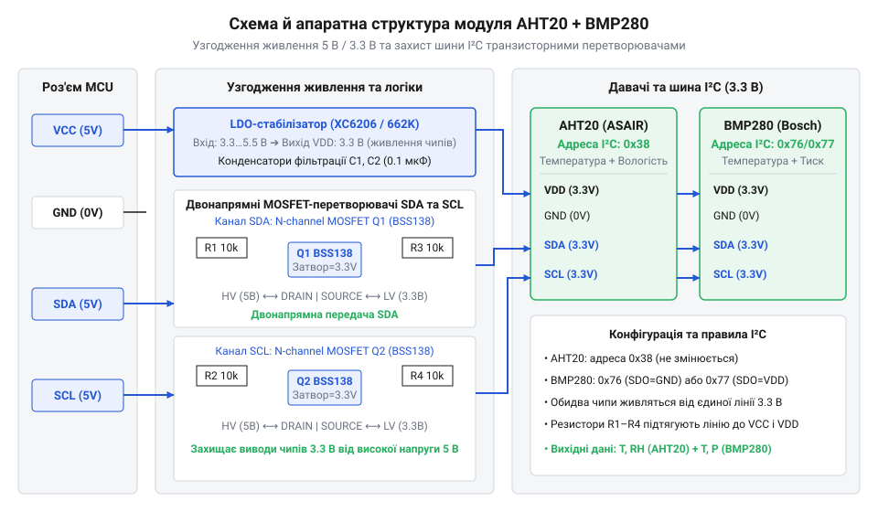
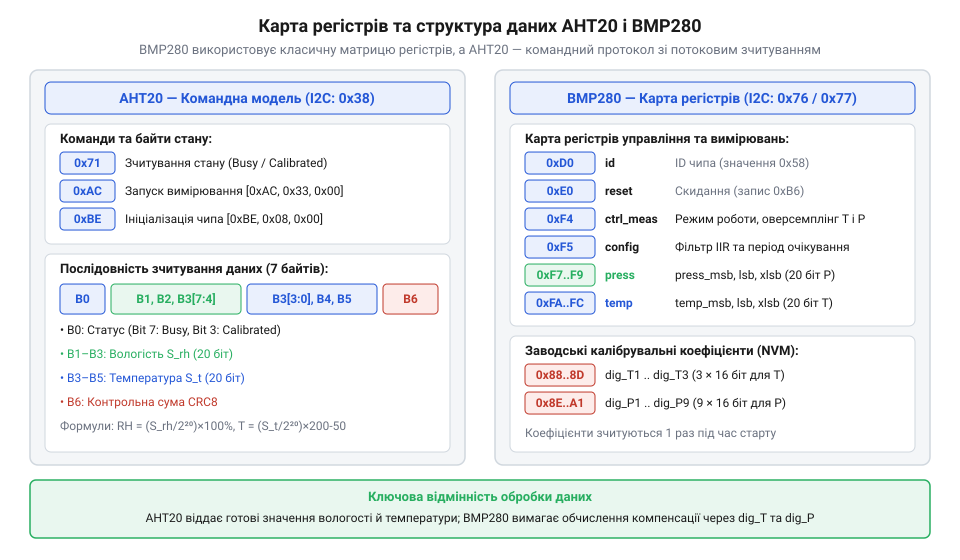

# Апаратний інтерфейс модуля AHT20 + BMP280

<preknowlist>
- [SHT30 — температура й вологість (I2C)](root:cat-hw-sensors/sht30) — принципи побудови вимірювальних цифрових давачів із шинним інтерфейсом I2C та базові поняття вологості й температури
</preknowlist>

## Небезпека прямого підключення 3.3-вольтових чипів

Спроба підключити чутливі 3.3-вольтові чипи @@en|AHT20@@ та @@en|BMP280@@ напряму до 5-вольтового мікроконтролера створює ризик незворотного електричного пошкодження кремнієвого кристала. Мікроконтролери з 5-вольтовою логікою на своїх виводах формують високий рівень напруги близько 5 В, тоді як максимальна допустима напруга для кремнієвих структур @@en|BMP280@@ становить лише 3.6 В.

На вході кожного цифрового виводу 3.3-вольтового чипа розташовані захисні діоди від @@en|ESD@@ (від @@en|Electrostatic Discharge@@, електростатичний розряд), підключені до внутрішньої лінії живлення `VDD`. Якщо на вивід ліній @@en|SDA@@ чи @@en|SCL@@ подати 5 В, верхній захисний діод відкривається, оскільки напруга на виводі перевищує рівень `VDD + 0.3 В`. Через діод починає протікати неконтрольований струм у внутрішню шину 3.3 В чипа. Це викликає ефект паразитного живлення, нагрів напівпровідникового переходу та може спровокувати тиристорний засув @@en|latch-up@@ (від @@en|latch-up@@, зачіплення) — коротке замикання всередині кристала між `VDD` та `GND`, яке миттєво виводить давач з ладу.

Окрім ризику виходу з ладу напівпровідників, виникають збої обміну даними. Шина @@en|I2C@@ (від @@en|Inter-Integrated Circuit@@, міжмікросхемне з'єднання) працює у режимі відкритий стік @@en|open-drain@@ (від @@en|open drain@@, відкритий стік) і вимагає підтягувальних резисторів @@en|pull-up@@ (від @@en|pull up@@, підтяжка). Якщо підтяжка виконана до 5 В, рівень спокою шини становить 5 В, що є неприпустимим для чипів без узгодження рівнів. Порівняно з некритичними [цифровими давачами DS18B20](root:cat-hw-sensors/ds18b20) або [давачами DHT11](root:cat-hw-sensors/dht11), де допустимі інші рівні живлення, суміщений модуль @@en|AHT20@@ + @@en|BMP280@@ вимагає суворого дотримання електричного узгодження за допомогою спеціальної плати обв'язки.

## Схема та двонапрямне узгодження рівнів

Готовий комбінований модуль розв'язує проблему сумісності за допомогою чотирьох зовнішніх виводів: `VCC` (живлення), `GND` (спільний провід), `SDA` (лінія даних) та `SCL` (лінія тактування). Для безпечної роботи від 5 В на платі модуля встановлено лінійний стабілізатор напруги @@en|LDO@@ (від @@en|Low Dropout@@, мале падіння напруги), який знижує вхідну напругу з виводу `VCC` до стабільних 3.3 В для внутрішнього живлення чипів @@en|AHT20@@ та @@en|BMP280@@.

Для двонапрямного узгодження сигнатурних рівнів шини @@en|I2C@@ використано каскади на польових транзисторах @@en|MOSFET@@ (від @@en|Metal-Oxide-Semiconductor Field-Effect Transistor@@, польовий транзистор з ізольованим затвором). Затвор кожного транзистора підключено до внутрішньої лінії 3.3 В, витік — до лінії чипа з підтяжкою до 3.3 В, а стік — до зовнішнього виводу модуля з підтяжкою до зовнішнього `VCC` (5 В або 3.3 В). Детальний розбір схеми, розрахунку елементів та принципу роботи таких вузлів висвітлено у матеріалі про [двонапрямний перетворювач логічних рівнів на MOSFET](root:hw-digital/mosfet-level-shifter).


*Підпис: Принципова схема модуля AHT20 + BMP280 з елементами живлення та двонапрямного узгодження логічних рівнів.*

Коли лінія перебуває у стані спокою, обома сторонами керують резистори підтяжки @@en|pull-up@@, напруга між затвором та витоком транзистора дорівнює 0 В, і транзистор закритий. Коли мікроконтролер або один із давачів притягує лінію до землі (0 В), різниця напруг викликає відкриття транзистора, і протилежна сторона лінії також притягується до 0 В.

Щоб обчислити мінімально припустимий опір підтяжки `R_{p(min)}`, виходять із максимального струму поглинання `I_{OL}` та напруги логічного нуля `V_{OL}`:

```
R_{p(min)} = (V_{CC} - V_{OL}) ÷ I_{OL}
           = (5.0 - 0.4) ÷ 0.003         [підстановка значень для 5 В та 3 мА]
           = 1533.3                      [обчислення мінімального опору в Омах]
```

Вираз показує, що опір підтяжки не може бути меншим за 1.5 кОм, інакше вихідний каскад чипа не зможе притягнути лінію до рівня логічного нуля. Верхня межа опору `R_{p(max)}` обмежена паразитною ємністю шини й вимогами до часу наростання фронту сигналу. Коли транзистор з відкритим стоком @@en|open-drain@@ вимикається, резистор підтяжки заряджає паразитну ємність шини `C_b` від рівня логічного нуля до логічної одиниці. За стандартом шини @@en|I2C@@ час наростання `t_r` визначається як проміжок часу, за який напруга на лінії зростає від 30% (`0.3 V_{CC}`) до 70% (`0.7 V_{CC}`) від напруги живлення `V_{CC}`. При заряджанні @@en|RC@@-кола різниця часу між цими рівнями становить `ln(0.7 ÷ 0.3) × R_p × C_b ≈ 0.8473 × R_p × C_b`. Щоб обчислити максимальний опір підтяжки `R_{p(max)}`, виходять із заданої ємності шини `C_b` та допустимого часу наростання `t_r`:

```
R_{p(max)} = t_r ÷ (ln(0.7 ÷ 0.3) × C_b)
           = t_r ÷ (0.8473 × C_b)        [наближення логарифмічного коефіцієнта заряду RC-кола]
```

З виразу видно, що чим більша паразитна ємність шини або вища частота передачі (що вимагає меншого часу `t_r`), тим меншим має бути опір підтяжки для забезпечення чітких фронтів імпульсів.

**Для стандартного режиму @@en|I2C@@ (100 кГц) з максимальним `t_r = 1000` нс (`1000 × 10⁻⁹` с) та ємністю шини `C_b = 100` пФ (`100 × 10⁻¹²` Ф):**
```
R_{p(max)} = (1000 × 10⁻⁹) ÷ (0.8473 × 100 × 10⁻¹²)
           = 10⁻⁶ ÷ (8.473 × 10⁻¹¹)     [підстановка допустимого часу та ємності]
           = 11802.2                    [обчислення максимального опору в Омах]
```

Висновок: обчислений опір 11.8 кОм є гранично допустимою верхньою межею для ємності 100 пФ; перевищення цього значення затягує фронти імпульсів понад норму і викликає збої зчитування даних. Для стандартних модулів оптимальний опір підтяжки становить від 4.7 кОм до 10 кОм. На відміну від простих схематичних рішень з [аналоговими термісторами KY-013](root:cat-hw-sensors/ky-013-thermistor), активне двонапрямне узгодження повністю захищає шину від перенапруги.

## Розподіл адрес на I2C-шині

Чипи @@en|AHT20@@ та @@en|BMP280@@ розміщені на одній платі й підключені до спільних внутрішніх ліній @@en|SDA@@ та @@en|SCL@@. Протокол @@en|I2C@@ дає змогу адресувати кожен пристрій окремо за допомогою унікальних 7-бітових адрес.

Чип @@en|AHT20@@ має жорстко зафіксовану фабричну адресу `0x38` (у двійковому форматі `0111000`), яка встановлена на рівні внутрішньої логіки та не може бути змінена програмно чи апаратно. Чип @@en|BMP280@@ підтримує дві апаратні адреси залежно від стану виводу вибору адреси @@en|SDO@@:

* Якщо вивід @@en|SDO@@ підтягнуто до `GND` (стандартне розведення більшості модулів), адреса @@en|BMP280@@ дорівнює `0x76` (двійкове `1110110`).
* Якщо вивід @@en|SDO@@ підтягнуто до лінії живлення 3.3 В (через перемичку або контакт на платі), адреса змінюється на `0x77` (двійкове `1110111`).

Оскільки адреси `0x38` та `0x76` (або `0x77`) не перетинаються у 7-бітовому просторі адрес, обидва чипи функціонують на одній шині без колізій. Під час ініціалізації мікроконтролер надсилає стартову умову та байт адреси з бітом читання чи запису. Пристрій, чия адреса збігається з переданою, відповідає сигналом підтвердження @@en|ACK@@ (від @@en|Acknowledge@@, підтвердження), тоді як інший пристрій ігнорує обмін. Подібний розподіл адрес використовується також у комбінаціях з [давачами вологості SHT30](root:cat-hw-sensors/sht30) чи [давачами GY-21](root:cat-hw-sensors/gy-21), що дає змогу будувати розширені вимірювальні мережі.

## Карта регістрів та калібрувальних коефіцієнти

Взаємодія з чипами після адресації відбувається шляхом читання й запису у внутрішні регістри.


*Підпис: Карта внутрішніх регістрів та структура калібрувальних даних чипів AHT20 і BMP280.*

У чипі @@en|BMP280@@ внутрішній простір пам'яті організовано у вигляді байтових регістрів:

* Регістр `0xD0` (`chip_id`) містить фіксований ідентифікатор `0x58`.
* Регістр `0xE0` (`reset`) приймає команду м'якого скидання `0xB6`.
* Регістр `0xF3` (`status`) містить біт `measuring` (іде вимірювання) та `im_update` (копіювання калібрувальних даних).
* Регістр `0xF4` (`ctrl_meas`) задає режим передискретизації @@en|oversampling@@ (від @@en|oversampling@@, передискретизація) температури й тиску та режим живлення (`sleep`, `forced`, `normal`).
* Регістр `0xF5` (`config`) налаштовує час очікування @@en|standby@@ (від @@en|standby@@, режим очікування) та фільтр @@en|IIR@@ (від @@en|Infinite Impulse Response@@, нескінченна імпульсна характеристика).
* Блоки регістрів `0xF7..0xF9` та `0xFA..0xFC` містять 20-бітові сирі значення тиску та температури.
* Регістри `0x88..0x9F` містять 24 байти заводських калібрувальних коефіцієнтів ($dig\_T1..dig\_T3$, $dig\_P1..dig\_P9$), записаних у постійну пам'ять @@en|PROM@@ (від @@en|Programmable Read-Only Memory@@, програмований постійний запам'ятовувальний пристрій).

У чипі @@en|AHT20@@ карта регістрів замінена командною моделлю. Для перевірки стану зчитується байт статусу: біт 7 вказує на зайнятість (`busy`), а біт 3 — на наявність калібрування. Якщо біт 3 дорівнює 0, на чип надсилають команду ініціалізації `0xBE 0x08 0x00`. Вимірювання запускається командою `0xAC 0x33 0x00`, після чого зчитується 7 байтів даних: байт статусу, 20-бітовий код вологості, 20-бітовий код температури та контрольна сума @@en|CRC@@ (від @@en|Cyclic Redundancy Check@@, циклічний надлишковий контроль). Калібрувальні коефіцієнти @@en|AHT20@@ збережені в енергонезалежній пам'яті @@en|NVM@@ (від @@en|Non-Volatile Memory@@, енергонезалежна пам'ять) і застосовуються внутрішнім цифровим контролером автоматично.

## Граничні режими та відновлення зв'язку

Під час експлуатації апаратний інтерфейс може стикатися з нестандартними умовами живлення та збоями на шині.

При просіданні живлення нижче допустимого рівня (стан @@en|brown-out@@) внутрішня логіка давачів може опинитися у невизначеному стані без спрацювання схеми скидання при включенні @@en|POR@@ (від @@en|Power-On Reset@@, скидання при включенні живлення). Це призводить до ігнорування команд або видачі некоректних даних.

За відсутності або обриві підтягувальних резисторів @@en|pull-up@@ фронти сигналів на лініях @@en|SDA@@ та @@en|SCL@@ стають затягнутими через ємність шини. Протокол @@en|I2C@@ втрачає чіткість тактування, що викликає помилки непідтвердження @@en|NACK@@ (від @@en|Not Acknowledge@@, непідтвердження) або пошкодження переданих байтів.

Найскладнішим апаратним збоєм є зависання шини, коли ведений пристрій утримує лінію @@en|SDA@@ у низькому стані (0 В). Це трапляється, якщо мікроконтролер було перезавантажено під час зчитування байта від давача. Давач чекає на наступні тактові імпульси @@en|SCL@@ для завершення передачі біта й не звільняє @@en|SDA@@.

Для відновлення працездатності шини застосовують процедуру розблокування: мікроконтролер переводить вивід @@en|SCL@@ у режим звичайного цифрового виходу та генерує до 9 тактових імпульсів @@en|SCL@@, залишаючи лінію @@en|SDA@@ підтягнутою. Отримавши такти, давач завершує передачу поточного байта, відпускає лінію @@en|SDA@@ у високий стан, після чого контролер формує стопову умову та повертає шину у стандартний режим.

Для програмного відновлення чипів виконують м'яке скидання: для @@en|BMP280@@ це запис значення `0xB6` у регістр `0xE0`, а для @@en|AHT20@@ — відправка команди м'якого скидання `0xBA`, після чого чипам потрібно від 20 мс для повторного завантаження даних із @@en|PROM@@ та @@en|NVM@@.
