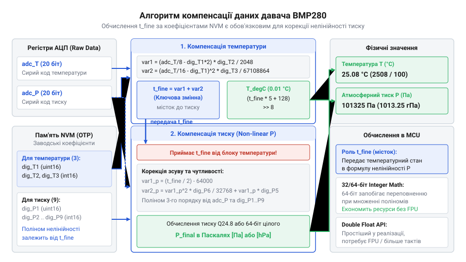

# Математична модель температурної компенсації та перерахунку тиску BMP280

<preknowlist>
- [SHT30 — температура й вологість (I2C)](root:cat-hw-sensors/sht30) — принцип отримання цифрових кодових значень АЦП та зчитування регістрів через I2C
- [GY-21 (Si7021/HTU21D) — температура/вологість](root:cat-hw-sensors/gy-21) — основи застосування математичних коефіцієнтів для первинного перерахунку коду АЦП у температуру
</preknowlist>

## Чому сирим кодам потрібне калібрування

Підключивши давач @@en|BMP280@@ через шину @@en|I2C@@ або @@en|SPI@@, мікроконтролер зчитує з внутрішніх регістрів 20-бітні коди аналого-цифрового перетворювача для тиску та температури. Якщо вивести ці значення напряму, виявиться, що при абсолютно нерухомому барометричному тиску показники тиску стрибають від найменшого подиху тепла.

П'єзорезистивний елемент @@en|MEMS@@ (від англ. @@en|micro-electro-mechanical systems@@ — мікроелектромеханічні системи) змінює свій електричний опір під дією механічної деформації силіцієвої мембрани. Проте кремній має високий температурний коефіцієнт опору: зміна температури навколишнього середовища розширює матеріал і змінює опір п'єзорезисторів дужче, ніж сам атмосферний тиск. На відміну від [давачів температури SHT30](root:cat-hw-sensors/sht30) чи [модулів серії GY-21](root:cat-hw-sensors/gy-21), де вихідний код АЦП перераховується за фіксованою лінійною формулою, кристали @@en|BMP280@@ мають значний індивідуальний розкид параметрів.

Щоб компенсувати технологічні погрешності, виробник під час виготовлення вимірює характеристику кожного чипа й записує індивідуальні калібрувальні коефіцієнти в енергонезалежну пам'ять @@en|NVM@@ (від англ. @@en|non-volatile memory@@ — енергонезалежна пам'ять). Ці параметри розміщено у 24 послідовних 8-бітних регістрах за адресами від `0x88` до `0x9F`. Кожні два сусідні байти формують один із 12 калібрувальних коефіцієнтів у порядку @@en|little-endian@@ (від англ. @@en|little-endian@@ — від молодшого байта до старшого): молодший байт лежить за меншою адресою, а старший — за наступною. У цій таблиці зберігаються три коефіцієнти компенсації температури `dig_T1..T3` та дев'ять коефіцієнтів тиску `dig_P1..P9`. Самі ж первинні вимірювання АЦП видаються у вигляді 20-бітних кодів. Оскільки один регістр шини @@en|I2C@@ або @@en|SPI@@ передає лише 8 біт, давач розподіляє 20-бітне значення між трьома регістрами: старшим `msb` (від англ. @@en|MSB@@ — @@en|most significant byte@@ — старший байт), молодшим `lsb` (від англ. @@en|LSB@@ — @@en|least significant byte@@ — молодший байт) та розширювальним `xlsb` (від англ. @@en|XLSB@@ — @@en|extra least significant byte@@ — додатковий молодший байт). Регістр `msb` містить старші 8 біт, `lsb` — середні 8 біт, а чотири старші біти регістру `xlsb` відповідають наймолодшим 4 бітам виходу АЦП. Прошивка відновлює вихідне 20-бітне число виразом `(msb << 12) | (lsb << 4) | (xlsb >> 4)`. Сирі коди АЦП є лише первинним сировинним матеріалом. Щоб отримати реальні паскалі та градуси Цельсія, прошивка повинна обчислити двоступеневу поліноміальну модель компенсації нелінійності.

## Обчислення t_fine та справжньої температури

Для температурної компенсації в пам'яті @@en|NVM@@ записано три заводські коефіцієнти: беззнаковий `dig_T1` та знакові `dig_T2` і `dig_T3`. Вони описують індивідуальну параболічну характеристику термочутливого елемента.


*Послідовне перетворення сирих кодових значень АЦП за допомогою коефіцієнтів NVM у проміжний параметр t_fine та фінальні фізичні величини.*

Перш ніж рахувати тиск, необхідно вирахувати проміжну змінну @@en|t_fine@@. Вона визначає температурний стан кристала з високою роздільною здатністю (близько 1/5120 °C на одиницю) і виступає тепловим базисом для всіх наступних обчислень.

Перед застосуванням формули позначимо використовувані величини: `adc_T` — 20-бітний сирий код АЦП температури, `dig_T1` — базовий зсув, `dig_T2` — коефіцієнт лінійного нахилу, `dig_T3` — коефіцієнт квадратичного вигину характеристики. Перша змінна `var1` оцінює лінійне відхилення температури від номіналу, а `var2` — квадратичне викривлення.

Для обчислення лінійного компонента `var1` застосовують формулу з прямою компенсацією зсуву:

```
var1 = ((((adc_T >> 3) - (dig_T1 << 1)) × dig_T2) >> 11)     [цілочисельне обчислення лінійної складової]
     = ((adc_T ÷ 16 - dig_T1) × dig_T2) ÷ 1024             [еквівалентна математична форма]
```

Операції `adc_T >> 3` (ділення на 8) та `dig_T1 << 1` (множення на 2) зберігають один додатковий молодший розряд перед відніманням, що запобігає втраті точності при округленні цілих чисел. Підсумковий зсув праворуч на 11 бітів (`>> 11`) ділить добуток на 2048, що з урахуванням подвоєної різниці відповідає діленню на 1024. Заводський коефіцієнт `dig_T2` з пам'яті @@en|NVM@@ нормовано саме так, щоб таке ділення виводило `var1` в одиниці вимірювання @@en|t_fine@@.

Квадратичний компонент `var2` обчислюють із розбиттям на два зсуви:

```
var2 = (((((adc_T >> 4) - dig_T1) × ((adc_T >> 4) - dig_T1)) >> 12) × dig_T3) >> 14     [цілочисельне обчислення квадратичної складової]
     = ((adc_T ÷ 16 - dig_T1)² × dig_T3) ÷ 67108864                                    [еквівалент із сумарним діленням на 2²⁶]
```

Вираз `(adc_T >> 4) - dig_T1` визначає відхилення сирого коду температури від базової точки. Оскільки квадрат цього відхилення утворює велике число, перший зсув на 12 бітів (`>> 12`, ділення на 4096) зменшує його розрядність перед множенням на знаковий коефіцієнт `dig_T3`, запобігаючи переповненню 32-бітного знакового регістра. Другий зсув на 14 бітів (`>> 14`, ділення на 16384) завершує масштабування, що сумарно дає ділення на 2²⁶ (4096 × 16384 = 67 108 864 = 8192²) та узгоджує `var2` за масштабом зі змінною @@en|t_fine@@.

Проміжний температурний параметр @@en|t_fine@@ обчислюється шляхом додавання двох поліноміальних компонентів:

```
t_fine = var1 + var2     [сумування лінійного та квадратичного доданків]
```

Маючи обчислений параметр @@en|t_fine@@, фінальне значення температури `T` у градусах Цельсія дістаємо шляхом масштабування:

```
T = t_fine ÷ 5120     [масштабування у градуси Цельсія]
= (t_fine × 5 + 128) ÷ 256 ÷ 100     [еквівалентний цілочисельний розрахунок]
```

Значення @@en|t_fine@@ зберігається в оперативній пам'яті мікроконтролера і передається в алгоритм компенсації тиску.

## Поліноміальна компенсація нелінійності тиску

Для відновлення справжнього атмосферного тиску використовується дев’ять коефіцієнтів з пам'яті @@en|NVM@@: беззнаковий `dig_P1` та знакові `dig_P2`…`dig_P9`. Вони розбивають складну фізичну нелінійність мембрани @@en|MEMS@@ на окремі математичні складові.

Перша група коефіцієнтів (`dig_P2`…`dig_P6`) виправляє дрейф нуля. При зміні температури мембрана розширюється, змінюючи початковий опір п'єзорезисторів навіть за відсутності тиску. Обчисливши відхилення від контрольної точки `var1_p = (t_fine ÷ 2) - 64000`, алгоритм будує температурне коригування нульового зсуву `var2_p`.

Друга група (`dig_P1`, `dig_P2`, `dig_P3`) корегує чутливість давача. Коефіцієнт `dig_P1` виступає головним масштабуючим множником, а `dig_P2` і `dig_P3` змінюють цей масштаб залежно від @@en|t_fine@@.

Третя група (`dig_P7`, `dig_P8`, `dig_P9`) ураховує квадратичну нелінійність самого деформування силіцієвої мембрани при високому тиску.

Перед розрахунком проміжного тиску `p` із сирого 20-бітного коду `adc_P` алгоритм обчислює температурне відхилення `v_t = (@@en|t_fine@@ ÷ 2) - 64000`, після чого будує температурну корекцію зсуву нуля `var2_p` за допомогою коефіцієнтів `dig_P4`…`dig_P6` та скориговану чутливість `var1_p` за допомогою `dig_P1`…`dig_P3`:

```
var2_p = (v_t² × dig_P6 ÷ 32768 + v_t × dig_P5 × 2) ÷ 4 + dig_P4 × 65536     [температурне коригування зсуву нуля]
```

```
var1_p = (1 + (dig_P3 × v_t² ÷ 524288 + dig_P2 × v_t) ÷ 524288 ÷ 32768) × dig_P1     [скоригований коефіцієнт чутливості]
```

Знаючи скориговані `var1_p` та `var2_p`, проміжне значення тиску `p` обчислюється за виразом:

```
p = (1048576 - adc_P - var2_p ÷ 4096) × 6250 ÷ var1_p     [первинне коригування чутливості й зсуву]
```

У цьому виразі константа `1048576` дорівнює 2²⁰ і відповідає повній шкалі 20-бітного АЦП. Оскільки деформація мембрани @@en|MEMS@@ при зростанні тиску зменшує опір п'єзорезисторів, сирий код `adc_P` є інвертованим: віднімання `1048576 - adc_P` перетворює його на пряме додатне відхилення від верхньої межі розрядності. Множник `6250` виступає базовим масштабувальним коефіцієнтом для перерахунку відносного коду у фізичні паскалі: він походить від нормування атмосферного тиску 100 000 Па ÷ 16 = 6250, що дозволяє зберегти дробову точність у цілочисельних обчисленнях без виходу за межі розрядності. Згодом у фінальній корекції нелінійності використовується знаменник `2147483648`, який є числом 2³¹ (або 0x80000000). Для атмосферного тиску близько 100 000 Па квадрат `p²` досягає величини порядку 10¹⁰, тому ділення на 2³¹ приводить квадратичну поправку коефіцієнта `dig_P9` назад до сітки 1/16 Паскаля, сумісної з рештою членів полінома.

```
p = (1048576 - adc_P - var2_p ÷ 4096) × 6250 ÷ var1_p     [первинне коригування чутливості й зсуву]
```

Отриманий тиск `p` далі коригується поліномом другого степеня для усунення залишків нелінійності:

```
P = p + (var1_final + var2_final + dig_P7) ÷ 16     [фінальний атмосферний тиск у паскалях]
```

де `var1_final = dig_P9 × p² ÷ 2147483648`, а `var2_final = p × dig_P8 ÷ 32768`.

У результаті обчислень прошивка отримує тиск `P` у паскалях (Па), очищений від температурного дрейфу та механічних деформацій кристала.

## Цілочисельні та плаваючі алгоритми прошивки

Практична реалізація формул у прошивках мікроконтролерів вимагає компромісу між точністю, швидкістю та розміром бінарного коду.

Використання 32-бітної цілочисельної арифметики має високий ризик переповнення регістрів. Під час проміжних зсувів бітів (наприклад, `p << 31`) значення виходять за межі діапазону знакового 32-бітного цілого числа (`int32_t`), що призводить до викривлення знака або від'ємних показників тиску.

Для мікроконтролерів без апаратного модуля @@en|FPU@@ (від англ. @@en|floating-point unit@@ — блок обчислень із плаваючою крапкою) оптимальним рішенням є 64-бітна цілочисельна арифметика (`int64_t`). Зсуви бітів та множення розширюються до 64 бітів, усуваючи загрозу переповнення. Компілятор реалізує ці операції кількома інструкціями процесора без залучення важких бібліотек плаваючої арифметики.

На платформах із наявним @@en|FPU@@ зручніше використовувати розрахунки з плаваючою крапкою (`double` або `float`). Вони роблять код наочним і позбавляють потреби контролювати розрядність зсувів бітів.

:::tabs
:::code math-bmp280-calibration-compensation-formulas/c/esp-idf/bmp280-compensate-temp.c
:::code math-bmp280-calibration-compensation-formulas/cpp/arduino/bmp280calibration.cpp
:::
