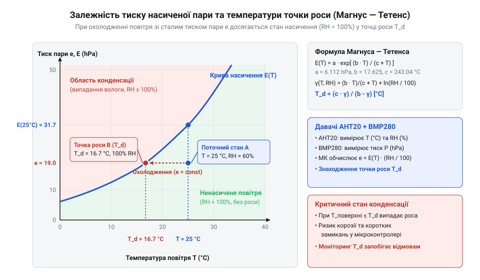
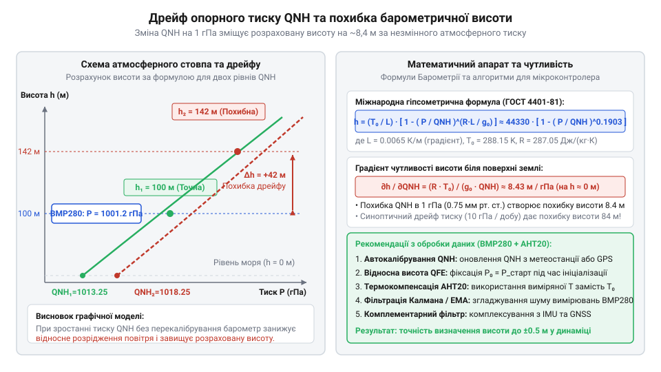

# Математичне обчислення похідних кліматичних параметрів: точки роси та барометричної висоти

<preknowlist>
- [SHT30 — температура й вологість (I2C)](root:cat-hw-sensors/sht30) — Фізичні поняття відносної вологості повітря та температурної залежності вимірювань вологості.
- [GY-21 (Si7021/HTU21D) — температура/вологість](root:cat-hw-sensors/gy-21) — Принципи калібрування й цифрового зчитування первинних кліматичних параметрів.
</preknowlist>

## Небезпека наївних вимірювань клімату й тиску

Сенсорне пристроєве середовище здатне вводити в оману, якщо сприймати його вихідні числа як остаточний результат. Коли мікроконтролер зчитує показники, які видає [первинний давач AHT20](root:cat-hw-sensors/aht20-sensor) або [популярний давач SHT30](root:cat-hw-sensors/sht30), він отримує виміряну температуру повітря T та значення, яким є @@en|відносна вологість@@ (англ. *relative humidity*). Аналогічно [барометричний сенсор BMP280](root:cat-hw-sensors/gy-bmp280) повертає поточне значення, яким є @@en|абсолютний тиск@@ (англ. *absolute pressure*). Пряме використання цих двох параметрів без математичної обробки створює серйозну загрозу для надійності всієї системи.

Головна проблема полягає в тому, що @@en|відносна вологість@@ показує не абсолютну кількість вологи в об'ємі повітря, а лише відсоток насичення водяною парою при даній конкретній температурі. Це насичення визначає фізична межа, якою є @@en|тиск насиченої пари@@ (англ. *saturation vapor pressure*) — максимально можливий парціальний тиск водяної пари за певної температури. Зі зниженням температури кінетична енергія молекул падає, тому спроможність повітря утримувати воду в газоподібному стані зменшується за експоненційним законом: при охолодженні значення тиску насиченої пари стрімко спадає. Якщо температура навколишнього середовища знижується навіть на кілька градусів при незмінній масі вологи, фактичний тиск пари наближається до цієї граничної межі, і відсоток відносної вологості стрімко зростає до 100 %. У цей момент досягається @@en|точка роси@@ (англ. *dew point*, від *dew* — роса та *point* — точка) — критична межа температури, при якій водяна пара перетворюється на рідку воду, адже газове середовище більше не здатне вмістити надлишок вологи і змушує її конденсуватися. Якщо температура плати падає нижче цього порогу, мікрокраплі конденсату осідають безпосередньо на виводах мікроконтролера та друкованих провідниках, спричиняючи коротке замикання та корозію електродів. Надійні автономні станції визначають не просто вологість, а @@en|депресія точки роси@@ (англ. *dew point depression*) — різницю між поточною температурою та точкою роси.

Друга пастка прихована в сирих вимірюваннях тиску. Атмосферний тиск зменшується з підйомом угору, що дозволяє проводити @@el|барометричне нівелювання@@ (грец. *baros* — вага та франц. *nivelement* — вирівнювання). Проте тиск у конкретній точці постійно коливається через природні погодні фронти та рух повітряних мас. Спад тиску на 1 гПа відповідає підйому приблизно на 8.4 метра. Якщо синоптичний циклон знижує тиск на 15 гПа на рівні землі, невідкалібрована система інтерпретує це як підйом висоти на 126 метрів, хоча пристрій не зрушив із місця. Щоб отримати дійсне значення висоти, математична модель повинна враховувати поточний метеорологічний @@en|QNH@@ (англ. *Query: Nautical Height*) — зведений до рівня моря опорний тиск.

## Модель Магнуса — Тетенса для точки роси

Щоб розрахувати точку роси за показниками виміряної температури T (у градусах Цельсія) та відносної вологості RH (у відсотках від 0 до 100), у метеорології та приладобудуванні застосовують напівемпіричну @@de|формула Магнуса — Тетенса@@. Вона ґрунтується на фізико-математичному зв'язку між температурою та величинами, якими є @@en|тиск насиченої пари@@ (англ. *saturated vapor pressure*) і парціальний тиск вологи.

Розрахунок виконується у два послідовних кроки. Спочатку обчислюють безрозмірний логарифмічний фактор `α`, який об'єднує в собі внесок температури та відносної вологості. За своїм фізико-математичним змістом фактор `α` є натуральним логарифмом відношення поточного парціального тиску водяної пари до тиску насичення за температури `0 °C`. Цей вираз походить із термодинамічного опису фазових переходів, який задає @@fr|рівняння Клапейрона — Клаузіуса@@. Воно пов'язує температурне зростання параметра, яким є @@en|тиск насиченої пари@@, із питомою теплотою пароутворення вологи та газовою сталою. Інтегрування цього диференціального рівняння за умови наближеної сталості теплоти випаровування приводить до експоненційної залежності Магнуса `exp((a · T) / (b + T))`. У цій математичній моделі використовуються емпіричні коефіцієнти `a = 17.27` та `b = 237.7 °C`, визначені для помірного діапазону температур від 0 °C до 60 °C. Безрозмірний коефіцієнт `a` виражає пропорційність між теплотою пароутворення та газовою сталою, а параметр `b` у градусах Цельсія відображає температурний зсув від шкали Кельвіна з урахуванням нелінійної теплоємності водяної пари. Оскільки парціальний тиск вологи дорівнює добутку тиску насичення на відсоток вологості `RH / 100`, логарифмування перетворює цей добуток на суму: доданок `(a · T) / (b + T)` виражає температурне насичення, а доданок `ln(RH / 100)` додає внесок фактичного вмісту вологи. Символ `ln` позначає натуральний логарифм.

Перед розрахунком визначимо вхідні змінні: T — виміряна температура повітря у °C, RH — відносна вологість повітря у %, a і b — сталі коефіцієнти Магнуса, α — проміжний логарифмічний показник насичення пари, T_d — розрахована температура точки роси у °C.

Покрокове математичне виведення температури точки роси виглядає так:

```
α(T, RH) = (a · T) / (b + T) + ln(RH / 100)
= (17.27 · 25.0) / (237.7 + 25.0) + ln(60.0 / 100)      [підстановка T = 25.0 °C та RH = 60.0 %]
= (431.75 / 262.7) + ln(0.6)                            [обчислення дробу та частки вологості]
= 1.64349 - 0.51083                                     [обчислення натурального логарифма]
= 1.13266                                               [проміжне значення фактора α]

T_d = (b · α) / (a - α)
= (237.7 · 1.13266) / (17.27 - 1.13266)                 [підстановка знайденого α та коефіцієнтів a, b]
= 269.23328 / 16.13734                                  [обчислення чисельника та знаменника]
= 16.68 °C                                              [підсумкова температура точки роси]
```

Отриманий вираз показує, що при температурі повітря T = 25.0 °C і вологості RH = 60.0 % водяна пара почне конденсуватися в росу, якщо поверхня охолоне до 16.68 °C. Віднявши значення T_d від поточної температури T, одержують депресію точки роси ΔT = 25.0 - 16.68 = 8.32 °C. Якщо цей запас падає нижче 2.0 °C, система вентиляції повинна вмикати підігрів або осушення.


*Залежність тиску насиченої пари та температури точки роси від відносної вологості.*

Для зчитування первинних кліматичних даних можна також використовувати [модулі на основі GY-21](root:cat-hw-sensors/gy-21), які повертають залізобетонно точно калібровані показники T та RH по шині I2C.

## Гіпсометрична формула й барометрична висота

Для розрахунку висоти над рівнем моря за показниками тиску застосовують математичну модель, якою є @@el|гіпсометрична формула@@ (грец. *hypsos* — висота та *metron* — міра). Вона базується на рівнянні стану ідеального газу та гідростатичному законі розподілу тиску в атмосферному стовпі.

У межах стандарту, який описує @@en|стандартна атмосфера ISA@@ (англ. *International Standard Atmosphere*), приймають, що в тропосфері діє постійний @@la|температурний градієнт@@ (латин. *gradiens* — той, що крокує) `L = 0.0065 K/m` (абсолютна температура повітря спадає на 6.5 °C на кожен кілометр підйому). Опорна температура на рівні моря становить `T_0 = 288.15 K` (15.0 °C), опорний тиск `P_0 = 101325 Pa` (1013.25 гПа), газова стала повітря `R = 287.058 J/(kg·K)`, а прискорення вільного падіння `g = 9.80665 m/s²`. Фізична причина гіпсометричного спаду тиску полягає в тому, що повітря стисливе, тому його густина `ρ` зменшується з висотою разом із температурою та тиском. Зміна тиску `dP` на нескінченно малому висотному кроці `dh` визначається вагою стовпа повітря, що задає @@el|основне рівняння гідростатики@@ (грец. *hydor* — вода та *statikos* — той, що утримує в рівновазі) `dP = -ρ · g · dh`. Виразивши густину `ρ` через тиск `P` та абсолютну температуру `T` за рівнянням стану ідеального газу `ρ = P / (R · T)`, отримують @@la|диференціальне рівняння@@ (латин. *differentia* — різниця) з відокремленими змінними `dP / P = -(g / (R · T)) · dh`. Підставивши лінійний профіль спаду температури `T(h) = T_0 - L · h`, виконують @@la|інтегрування@@ (латин. *integrare* — відновлювати, робити цілим) обох частин рівняння від рівня моря з тиском `P_0` до висоти `h` з тиском `P`:

```
ln(P / P_0)
= ∫(P_0..P) dP' / P'                                     [інтегрування лівої частини за тиском від P_0 до P]
= -(g / R) · ∫(0..h) dh' / (T_0 - L · h')               [підстановка профілю температури T(h) = T_0 - L · h']
= (g / (R · L)) · ln(1 - (L · h) / T_0)                 [обчислення визначеного інтеграла підстановкою u = T_0 - L · h']
```

Застосувавши @@la|потенціювання@@ (латин. *potentia* — сила, степінь) за основою експоненти `e`, виражають співвідношення тисків через висотний профіль:

```
P / P_0
= (1 - (L · h) / T_0)^(g / (R · L))                     [потенціювання обох частин рівняння]
```

Щоб виділити барометричну висоту `h`, підносять обидві частини рівняння до степеня `(R · L) / g` та вводять безрозмірний показник степеня `n = (R · L) / g`:

```
(P / P_0)^n
= 1 - (L · h) / T_0                                     [піднесення обох частин до степеня n = (R · L) / g]

(L · h) / T_0
= 1 - (P / P_0)^n                                       [перенесення доданків для ізолювання h]

h
= (T_0 / L) · (1 - (P / P_0)^n)                         [помноження на масштабувальний коефіцієнт T_0 / L]
```

Отримано остаточний математичний вираз міжнародної гіпсометричної формули, у якому коефіцієнт `T_0 / L` задає вертикальний температурний масштаб атмосфери `44330.77 m`, а безрозмірний показник `n` описує нелінійну кривизну спаду тиску.

Описуємо значення всіх символів перед обчисленням: P — виміряний абсолютний тиск у Паскалях, P_0 — опорний тиск на рівні моря у Паскалях (або метеорологічний QNH), T_0 — температура ISA на рівні моря у Кельвінах, L — температурний градієнт атмосфери у К/м, R — питома газова стала повітря, g — прискорення вільного падіння, 
 — показник степеня (R · L) / g, h — розрахована барометрична висота у метрах.

Математичне обчислення висоти за виміряним тиском виглядає так:

```
n = (R · L) / g
= (287.058 · 0.0065) / 9.80665                         [підстановка газової сталої, градієнта та g]
= 1.865877 / 9.80665                                   [обчислення чисельника]
= 0.190263                                             [безрозмірний показник степеня n]

h = (T_0 / L) · (1 - (P / P_0)^n)
= (288.15 / 0.0065) · (1 - (95000 / 101325)^0.190263)  [підстановка P = 95000 Pa та опорних параметрів]
= 44330.77 · (1 - (0.937577)^0.190263)                 [обчислення масштабу 44330.77 м та відношення тисків]
= 44330.77 · (1 - 0.987722)                            [піднесення відношення тисків до степеня n]
= 44330.77 · 0.012278                                  [обчислення різниці степеня]
= 544.3 m                                              [розрахована барометрична висота]
```

Отриманий результат означає, що при тиску P = 95000 Pa обчислена висота над рівнем моря дорівнює 544.3 m. Оскільки газова маса повітря розширюється при нагріванні, фактична температура на місці вимірювання коригує цей коефіцієнт. Якщо поточна температура відхиляється від ISA, масштабувальний множник 44330.77 m замінюють на реальну абсолютну температуру у Кельвінах T_k = T + 273.15, помножену на R / g.


*Профіль тиску та температурний градієнт в атмосферному стовпі.*

Коли вимірювання проводять пристроями з інтерфейсом 1-Wire, як-от [цифровий термометр DS18B20](root:cat-hw-sensors/ds18b20), його показники дають змогу точно компенсувати локальний термічний розширювальний дрейф повітряного стовпа.

## Вплив опорного тиску QNH на висоту

Обчислення висоти за гіпсометричною формулою у статичній атмосфері припускає, що тиск на рівні моря дорівнює постійній величині `P_0 = 1013.25 гПа`. Однак реальний атмосферний тиск на нульовій позначці постійно коливається через рух циклонів та антициклонів. Якщо у розрахункову модель підставити стандартне значення `P_0` замість фактичного приземного тиску, будь-яка погодна зміна створить хибне зміщення розрахованої висоти, яке називають @@en|погодний дрейф@@ (від нім. *Treib* — рух).

Щоб оцінити чутливість висоти до змін тиску на рівні моря, продиференціюємо гіпсометричну формулу за опорним тиском `P_0`. Відношення зміни висоти до зміни тиску визначає @@en|барометричний крок@@ (від грец. *baros* — вага та *metron* — вимірювання).

Визначимо змінні для обчислення барометричного кроку біля поверхні землі: `R` — газова стала повітря, `T_0` — абсолютна температура ISA на рівні моря, `g` — прискорення вільного падіння, `M` — молярна маса повітря (`0.0289644 кг/моль`), `P_0` — опорний тиск `1013.25 гПа`.

Математичний розрахунок барометричного кроку для умов `ISA` виглядає так:

```
b = (R · T_0) / (g · P_0)
= (8.31446 · 288.15) / (9.80665 · 0.0289644 · 101325)   [підстановка фізичних констант ISA]
= 2395.81 / 287.87                                      [обчислення чисельника та знаменника]
= 8.32 m/hPa                                            [значення барометричного кроку біля землі]
```

Розрахований результат показує, що зміна тиску всього на `1 гПа` спричиняє відхилення барометричної висоти приблизно на `8.4 метра`. Якщо метеорологічний фронт знижує приземний тиск на `10 гПа`, статична система покаже вимишлену висоту на `84 метри` вище реальної.

Для усунення цього ефекту використовують два методи. Перший — динамічне оновлення значення @@en|QNH@@ у прошивці за даними найближчої аеродромної метеостанції. Другий — обчислення, яким є @@en|відносна висота@@ щодо точки старту. При зльоті чи старті виміряний приземний тиск `P_start` приймають за нове опорне значення `P_0`, що обнуляє початкову висоту `h_rel = 0` і локально компенсує погодний дрейф. Методику отримання поточного значення тиску для авіаційного та метеорологічного калібрування детально викладено у матеріалі про [опорний барометричний тиск QNH](root:hw-sensing/qnh-reference-pressure).

## Аналіз поширення похибок первинних давачів

Вимірювальні модулі завжди мають номінальну невизначеність: давач AHT20 вимірює температуру з похибкою `ΔT = ±0.3 °C` та вологість `ΔRH = ±2 %`, а барометр BMP280 має похибку тиску `ΔP = ±0.12 гПа`. Оскільки точка роси й висота обчислюються за нелінійними формулами, первинні похибки трансформуються у підсумкову невизначеність за допомогою математичного апарату, яким є @@la|часткові похідні@@ (від лат. *pars* — частина).

Згідно з законом поширення невизначеностей, @@en|накопичена похибка@@ розрахованої величини дорівнює кореню квадратному із суми квадратів добутків часткових похідних на похибки вхідних параметрів. Для точки роси `T_d(T, RH)` основними факторами є чутливість до температури `∂T_d / ∂T ≈ 0.85` та чутливість до вологості `∂T_d / ∂RH ≈ 0.15 °C/%`.

Визначимо змінні перед обчисленням: `ΔT` — похибка температури AHT20 (`0.3 °C`), `ΔRH` — похибка вологості AHT20 (`2.0 %`), `∂T_d / ∂T` та `∂T_d / ∂RH` — часткові похідні формули Магнуса — Тетенса при `T = 20 °C` і `RH = 50 %`, `ΔT_d` — підсумкова похибка точки роси.

Математичне обчислення накопиченої похибки точки роси виглядає так:

```
ΔT_d = √((∂T_d / ∂T · ΔT)² + (∂T_d / ∂RH · ΔRH)²)
= √((0.85 · 0.3)² + (0.15 · 2.0)²)                     [підстановка часткових похідних та похибок давача]
= √(0.065025 + 0.09)                                   [обчислення квадратів складових]
= √0.155025                                            [сума квадратів невизначеностей]
= 0.39 °C                                              [абсолютна невизначеність точки роси]
```

Отримане значення `0.39 °C` задає @@en|довірчий інтервал@@ (від лат. *intervallum* — проміжок) для обчисленої точки роси. На відміну від прямого зчитування, де працюють [простіші аналогові давачі LM35DZ](root:cat-hw-sensors/lm35), у непрямих кліматичних обчисленнях невизначеність зростає.

Для висоти `h(P)` часткова похідна по тиску дорівнює барометричному кроку `8.32 м/гПа`. Похибка BMP280 `ΔP = ±0.12 гПа` дає невизначеність висоти `Δh_P = 8.32 · 0.12 = ±1.0 м`. Існують також @@en|граничні умови@@ застосування: при відносній вологості `RH < 10 %` часткова похідна `∂T_d / ∂RH` стрімко зростає через наявність натурального логарифма, через що похибка точки роси перевищує `±1.5 °C`, роблячи розрахунок неефективним, на відміну від вимірювань, які забезпечують [первинні давачі DHT11](root:cat-hw-sensors/dht11).

## Реалізація обчислень у прошивці мікроконтролера

Перенесення математичних формул у прошивку мікроконтролера вимагає врахування особливостей обчислювача. Більшість 32-бітових мікроконтролерів оснащені апаратним модулем FPU, який підтримує стандарт `@@en|IEEE 754@@` для обчислень, де застосовуються `@@en|числа з плаваючою крапкою@@` (англ. *single-precision float*). 32-бітовий тип `float` має 24-бітову мантису, що забезпечує близько 7 значущих десяткових цифр точності.

Під час обчислення гіпсометричної формули існує ризик обчислювальної пастки, якою є `@@en|катастрофічне скасування@@` (англ. *catastrophic cancellation* — втрата точності при відніманні двох близьких чисел). Коли вирази `P` та `P_0` дуже близькі, відношення `(P / P_0)^n` наближається до `0.999`. Віднімання цього числа від одиниці в рамках single-precision float призводить до втрати молодших розрядів мантиси. Щоб зберегти точність без переходу на важкі обчислення подвійної точності `double`, у прошивці обчислюють безпосередньо відносний спад тиску або використовують попередньо масштабовані коефіцієнти.

Для швидкого обчислення точки роси та висоти в реальному часі прошивка повинна перевіряти вхідні коректні межі давачів перед викликом математичних функцій `logf()` та `powf()`. Нижче наведено стійку реалізацію алгоритмів обчислення точки роси та барометричної висоти мовами C та C++.

:::tabs
:::code math-climate-derived-parameters-dewpoint-altitude/c/calculate-dew-point.c
:::code math-climate-derived-parameters-dewpoint-altitude/cpp/climatemath.cpp
:::

Представлена реалізація забезпечує високу швидкість обчислення на 32-бітових мікроконтролерах із задіянням апаратного інструкціонування FPU.
