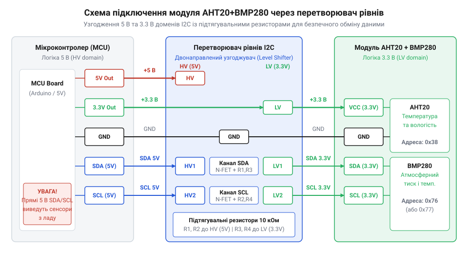
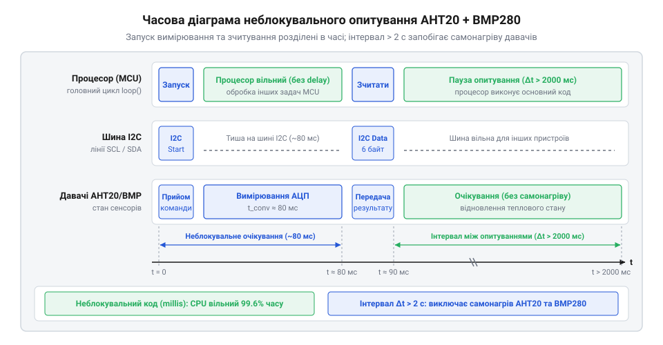

# Проєкт автономного кліматичного вимірювального вузла на мікроконтролері

<preknowlist>
- [SHT30 — температура й вологість (I2C)](root:cat-hw-sensors/sht30) — Принципи обміну даними по шині I2C та базові алгоритми зчитування вимірювальних регістрів цифрових сенсорів.
- [DHT11 — температура/вологість](root:cat-hw-sensors/dht11) — Фізичні обмеження вимірювання відносної вологості повітря та часові інтервали між опитуваннями.
</preknowlist>

## Чому побутові кліматичні вузли збоять

При тривалій роботі автономного вимірювального вузла виникають приховані фізичні ефекти, які поступово спотворюють показники температури й вологості. Якщо мікроконтролер надто часто опитує сенсорний модуль, через внутрішній кремнієвий кристал приладу безперервно протікає електричний струм. Це викликає @@en|самонагрів@@ (з англ. *self-heating* — розігрів елемента власним струмом живлення), коли виділене тепло підвищує локальну температуру чутливої зони над довкіллям. У результаті виміряна температура зростає на кілька градусів, а обчислена відносна вологість штучно падає.

Другим чинником збоїв є електричні завади в лініях зв'язку. Довгі провідники створюють @@gr|паразитну ємність@@ (з грецької *parasitos* — супутній, небажаний), яка завалює крутизну фронтів прямокутних імпульсів на @@en|шині I2C@@ (з англ. *Inter-Integrated Circuit* — міжінтегральна схема). Фізично цей ефект зумовлений тим, що виходи пристроїв I2C виконано за схемою @@en|відкритого стоку@@ (з англ. *open-drain* — типу виходу, спроможного лише притягувати лінію до землі), тому повернення шини у високий логічний стан відбувається пасивно за допомогою @@en|підтягувального резистора@@ (з англ. *pull-up resistor* — резистора підтяжки до напруги живлення). Разом із паразитною ємністю дротів цей резистор формує еквівалентний @@en|RC-ланцюг@@ (від позначень *R* — опір, *C* — ємність), який працює як фільтр низьких частот і затримує наростання напруги. Зі збільшенням довжини лінії росте її ємність `C`, через що постійна часу `τ = R × C` зростає, а прямокутний фронт імпульсу розмивається в похилу експоненціальну криву. Якщо час наростання фронту перевищує тривалість тактового імпульсу, напруга на лініях даних SDA чи тактування SCL не встигає досягти порогу зчитування високого рівня до моменту засувки відліку. У результаті мікроконтролер зчитує викривлені байти, втрачає @@en|біт підтвердження@@ (з англ. *acknowledge bit*, ACK — сигнал прийняття байта) від веденого пристрою, як-от [сенсора вологості SHT30](root:cat-hw-sensors/sht30), або взагалі пропускає розпізнавання команд. Коли ведений сенсор через втрачений тактовий імпульс застрягає в очікуванні й продовжує утримувати лінію SDA у низькому стані, майстер не може сформувати @@en|умову STOP@@ (з англ. *STOP condition* — послідовність завершення транзакції), що й викликає повне зависання шини I2C.

У реальному середовищі чутливі елементи додатково деградують від атмосферних впливів. Водяна пара при випаданні роси спричиняє @@gr|гістерезис@@ (з грецької *hysterēsis* — запізнення, відставання) полімерного шару, а осідання дрібнодисперсного пилу викликає @@nl|дрейф нуля@@ (з голландської *drijven* — відхилення, зсув) первинних калібрувальних характеристик. Прості рішення, де застосовують [дешевий датчик DHT11](root:cat-hw-sensors/dht11) або [однопровідний термометр DS18B20](root:cat-hw-sensors/ds18b20) без алгоритмічного та фізичного захисту, швидко втрачають точність.

## Схема живлення та узгодження шини I2C

Для побудови надійного кліматичного вузла поєднують давачі AHT20 та BMP280, які живляться напругою 3.3 В. Пряме підключення їхніх ліній до п'ятивольтового мікроконтролера спричиняє протікання вирівнювальних струмів через вхідні захисні діоди, що загрожує виходом з ладу чутливих кристалів. Безпечне поєднання двох кіл з різним потенціалом забезпечує @@en|двонаправлений перетворювач рівнів@@ (з англ. *bidirectional level shifter* — двосторонній зсувач напруги), побудований на польових @@en|MOSFET-транзисторах@@ (з англ. *metal-oxide-semiconductor field-effect transistor*).


*Двонаправлений перетворювач рівнів ізолює кола з різною напругою та зберігає цілісність фронтів сигналів I2C.*

Коли лінія низького рівня знаходиться в стані високого опору, транзистор закритий, а @@en|підтягувальний резистор@@ (з англ. *pull-up resistor* — затягувальний опір) утримує відповідну напругу на кожній стороні. При переході передавача низьковольтної сторони в активний стан він притягує @@en|витік@@ (з англ. *source* — джерело) транзистора до спільної землі. @@en|Затвор@@ (з англ. *gate* — засувка) транзистора з'єднаний із шиною `3.3 В`, тому падіння напруги на витоку до `0 В` збільшує напругу затвор-витік `V_GS` вище @@en|порогової напруги@@ (з англ. *threshold voltage* — межова напруга). Відкритий канал транзистора сполучає обидві сторони і притягує @@en|стік@@ (з англ. *drain* — сток) високовольтної лінії до землі. При цьому @@en|вбудований діод@@ (з англ. *body diode* — діод підкладки) транзистора залишається закритим, бо потенціал його анода на витоку `0 В` нижчий за потенціал катода на стоці `5 В`. Завдяки цьому сигнал низького рівня передається виключно через відкритий напівпровідниковий канал, а вбудований діод запобігає попаданню напруги `5 В` у низьковольтне коло.

Щоб обчислити мінімально припустимий опір `R_min`, виходять із сили струму через відкритий транзистор. Символ `V_CC` позначає напругу живлення шини, `V_OL` — максимальну напругу низького рівня на виході, а `I_OL` — граничний струм стоку відкритого ключа:

```
R_min
= (V_CC - V_OL) ÷ I_OL      [закон Ома для відкритого ключа]
= (3.3 - 0.4) ÷ 0.003       [підстановка напруги живлення та граничного струму]
= 967 Ом                    [найменша межа опору]
```

Значення 967 Ом показує межу: якщо обрати резистор із меншим опором, струм стоку перевищить припустимий поріг 3 мА і пошкодить вихідний каскад давача.

Верхню межу опору `R_max` визначають із вимог до тривалості наростання фронту сигналу `t_r` та сумарної ємності лінії `C_bus`:

```
R_max
= t_r ÷ (0.8473 × C_bus)    [час заряджання ємності лінії]
= 1000ⁿ ÷ (0.8473 × 100ᵖ)   [підстановка 1000 нс та ємності 100 пФ]
= 11.8 кОм                  [найбільша межа опору]
```

Отримане значення 11.8 кОм обмежує опір зверху: за більшого опору паразитна ємність шини не встигатиме перезаряджатися. На відміну від схем, де використовують [аналоговий термістор KY-013](root:cat-hw-sensors/ky-013-thermistor) чи [калібрований давач LM35DZ](root:cat-hw-sensors/lm35), цифровий інтерфейс вимагає розрахувати [параметри підтяжки шини](root:com-devices/i2c-bus-capacity) у діапазоні від 4.7 кОм до 10 кОм.

## Фізичний захист модуля від довкілля

Навіть за правильного електричного підключення розміщення сенсора безпосередньо на спільній друкованій платі поруч із процесором або регулятором живлення спотворює результат. Тепло від активних компонентів передається через мідні доріжки та внутрішній об'єм корпусу, що призводить до локального перегріву.

Для ізоляції від джерел тепла модуль сенсорів виносять на окрему плату або відокремлюють прорізями в текстоліті. Модуль розміщують у нижній частині захисного корпусу, щоб природна @@la|конвекція@@ (з латинської *convectio* — перенесення, доставлення) теплого повітря від процесора піднімалася вгору й не омивала чутливі елементи. Корпус оснащують вентиляційними отворами для вільного обміну з довкіллям.

Для захисту від крапель вологи, конденсату та пилу поверх чутливих отворів AHT20 і BMP280 встановлюють [паропроникну мембрану ePTFE](root:hw-sensing/protective-eptfe-membrane), яка відштовхує воду. Вона є @@gr|гідрофобною мембраною@@ (з грецької *hydor* — вода, *phobos* — острах), мікропориста структура якої пропускає молекули водяної пари, але затримує рідку воду та бруд. Через мікроскопічний розмір пор природна @@la|конвекція@@ всередину камери блокується, тому пара проникає до сенсора виключно шляхом @@la|дифузії@@ (з латинської *diffusio* — розтікання, поширення). Додатковий @@la|дифузійний опір@@ уповільнює вирівнювання концентрації вологи в замкненому об'ємі, що створює затримку вимірювання та збільшує час відгуку давача з кількох секунд до десятків секунд. Щоб краплі вологи не оминали цей захисний бар'єр збоку, мембрану фіксують із дотриманням повної @@gr|герметизації@@ (з грецької *hermetikos* — щільно закритий) суцільним клейовим кільцем уздовж периметра отвору. Будь-яка мікрощілина у сполучному контурі створює обхідний шлях, крізь який конденсат затягується безпосередньо під плівку. Без цього захисту [відкритий модуль GY-21](root:cat-hw-sensors/gy-21), підданий впливу конденсату, швидко виходить з ладу.

## Неблокувальне опитування давачів та інтервали

Спроба опитувати кліматичні давачі у звичайному циклі через блокувальні затримки зупиняє виконання всієї прошивки мікроконтролера. Поки триває пауза в очікуванні готовності вибірки, процесор не може реагувати на зовнішні події, а надто часте зчитування викликає самонагрів чутливого кристала. На відміну від [повільного сенсора DHT11](root:cat-hw-sensors/dht11), де висока частота запитів порушує таймінги, комбінований модуль `@@en|AHT20@@` + `@@en|BMP280@@` потребує чіткого розмежування фаз запуску та читання результату.

Для вирішення цієї проблеми застосовують алгоритм неблокувального опитування на основі скінченного автомата (англ. *@@en|finite-state machine@@*, @@en|FSM@@, від англ. *state* — стан) та системного таймера (англ. *@@en|system timer@@*, від *time* — час). Автомат перемикає стани за відліками системного лічильника @@en|SysTick@@ без використання затримок виконання. Робота такого автомата послідовно проходить кілька станів: очікування чергового інтервалу вимірювання (@@en|SENSOR_FSM_IDLE@@), надсилання команд запуску перетворення (@@en|SENSOR_FSM_START_MEASURE@@), неблокувальне очікування завершення апаратних пауз (@@en|SENSOR_FSM_WAIT_MEASURE@@), зчитування сирих регістрів (@@en|SENSOR_FSM_READ_DATA@@) та розрахунок відфільтрованих даних (@@en|SENSOR_FSM_PROCESS_DATA@@). При втраті зв'язку з давачем, виникненні апаратних помилок шини @@en|I2C@@ або перевищенні граничного часу очікування відповіді (англ. *@@en|timeout@@*, від *time* — час та *out* — поза) автомат запобігає заклинюванню прошивки шляхом переходу в стан помилки @@en|SENSOR_FSM_ERROR@@. У цьому стані результати вимірювання позначаються як недостовірні, а мікроконтролер витримує паузу відновлення перед наступною спробою опитування шини.

Послідовність асинхронного вимірювання містить такі кроки:
1. Очікування завершення інтервалу вимірювання (понад 2000 мс для запобігання термодинамічного самонагріву кристала).
2. Одночасна відправка команди запуску перетворення для `@@en|AHT20@@` та переведення `@@en|BMP280@@` у примусовий режим (англ. *@@en|forced mode@@*, від *force* — примушувати).
3. Пауза 80 мс без блокування головного циклу для завершення перетворення `@@en|AHT20@@` та 45 мс для `@@en|BMP280@@`.
4. Зчитання результатів по шині `@@en|I2C@@` та повернення у стан очікування.


*Часова діаграма асинхронного таймерного опитування сенсорів із неблокувальною витримкою технологічних пауз перетворення.*

:::tabs
@tab C
:::code proj-aht20-bmp280-climate-monitor-node/c/aht20_bmp280.c 188-234
@tab C++
:::code proj-aht20-bmp280-climate-monitor-node/cpp/ClimateNode.cpp 172-229
:::

## Цифрова фільтрація шумів вимірювальних даних

Первинні цифрові відліки з АЦП мікроконтролера чи сенсорних модулів завжди містять завади від наведень шини живлення та високочастотний шум. Випадковий сплеск напруги під час обміну по шині `@@en|I2C@@` здатен спотворити окремий байт даних і утворити хибний викид сигналу. Якщо передавати сирі вибірки без обробки, автоматика кліматичного вузла реагуватиме на хибні стрибки. У порівнянні з точними монолітними датчиками на кшталт [модуля SHT30 на шині](root:cat-hw-sensors/sht30) I2C, паралельні вимірювання вимагають первинної математичної очистки.

Придушення імпульсних завад (викидів) реалізують за допомогою медіанного фільтра (англ. *@@en|median filter@@*, від лат. *medianus* — посередині). Фільтр зберігає в кільцевому буфері `N` останніх вибірок, сортує їх за зростанням та обирає значення посередині масиву, повністю відсікаючи поодинокі аномальні значення. Щоб не порушувати хронологічний порядок надходження даних у кільцевому буфері, сортування виконують у тимчасовому локальному масиві `sorted`, куди копіюють лише накопичені вибірки. Для малих розмірів вікна `N` застосовують просте сортування бульбашкою (англ. *@@en|bubble sort@@*, від *bubble* — бульбашка): воно виконується детерміновано на стеку та не потребує динамічного виділення пам'яті. На етапі запуску пристрою, коли кільцевий буфер ще заповнюється і лічильник вибірок `count` менший за `N`, фільтр сортує лише `count` фактично зчитаних елементів та обирає значення за індексом `count / 2`. Це запобігає спотворенню результату нульовими значеннями незаповненого буфера та забезпечує коректне відфільтроване значення вже з першого вимірювання.

Для згладжування білого шуму АЦП застосовують фільтр ковзного усереднення (англ. *@@en|moving average filter@@*, від *move* — рухатися). Розрахунок поточного відфільтрованого значення `y_k` для вибірки `x_k` при розмірі вікна `N` здійснюється за формулою:

```
y_k
= (∑ x_i) ÷ N      [сумування N останніх вибірок у кільцевому буфері]
= (x₀ + x₁ + x₂ + x₃ + x₄) ÷ 5      [розгортка суми для розміру вікна N = 5]
```

Тут `x_i` позначає окремий виміряний відлік температури, вологості чи тиску, а `N = 5` задає глибину вікна усереднення. Оскільки `@@en|AHT20@@` та `@@en|BMP280@@` одночасно вимірюють температуру середовища, їхні значення попередньо сумуються `T_avg = (T_AHT20 + T_BMP280) ÷ 2`, що зменшує дисперсію помилки вимірювання ще до входу у фільтр.

:::tabs
@tab C
:::code proj-aht20-bmp280-climate-monitor-node/c/aht20_bmp280.c 77-115
@tab C++
:::code proj-aht20-bmp280-climate-monitor-node/cpp/MovingAverageFilter.hpp 13-47
:::

## Формування та передача кліматичних пакетів

Відфільтровані кліматичні дані необхідно передати на зовнішній контролер або радіомодем без спотворень. Передача окремих текстових рядків споживає занадто багато трафіку та обчислювальних ресурсів, а пряме пересилання двійкових структур між різними процесорними архітектурами викликає помилки через вирівнювання байтів (англ. *@@en|padding@@*) та різний порядок байтів (англ. *@@en|endianness@@*). Для надійної доставки даних створюється упакований двійковий телеметричний пакет (грец. *@@gr|telemetry@@*, від *tele* — далеко, *metron* — вимірювати).

Структура пакета об'єднує 32-бітний системний штамп часу, відфільтровані плаваючі значення температури, вологості й тиску, а також бітове поле прапорців стану. Для запобігання пошкодженню даних під час передачі в кінці пакета додається циклічний надлишковий код (англ. *@@en|cyclic redundancy check@@*, @@en|CRC@@, від *redundant* — надлишковий) — `@@en|CRC-8@@` у C-реалізації або `@@en|CRC16-CCITT@@` у C++ класі. Математичні принципи розрахунку CRC-8 та CRC16 для виявлення помилок передачі даних детально пояснено у матеріалі про [контрольну суму CRC для цифрових датчиків](root:com-protocol/checksums-crc).

Приймач вираховує контрольну суму для отриманого блоку байтів і порівнює її зі значенням `checksum`. Якщо хоч один біт пошкоджено завадою в лінії зв'язку, контрольна сума не збігається, і пакет відкидається як невалідна вибірка.

:::tabs
@tab C
:::code proj-aht20-bmp280-climate-monitor-node/c/aht20_bmp280.h 54-60
:::code proj-aht20-bmp280-climate-monitor-node/c/aht20_bmp280.c 26-39
@tab C++
:::code proj-aht20-bmp280-climate-monitor-node/cpp/ClimateNode.hpp 39-53
:::code proj-aht20-bmp280-climate-monitor-node/cpp/ClimateNode.cpp 3-19
:::
