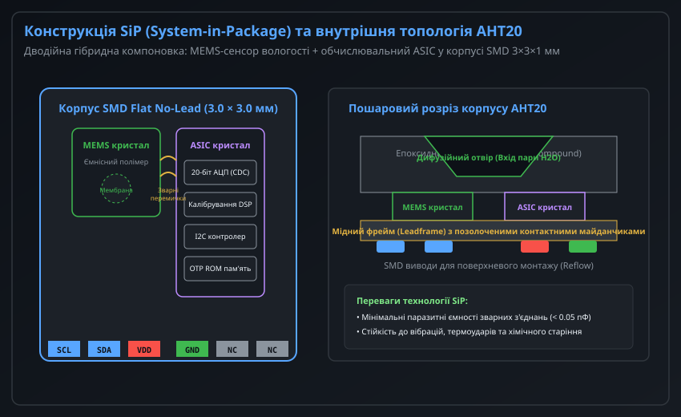
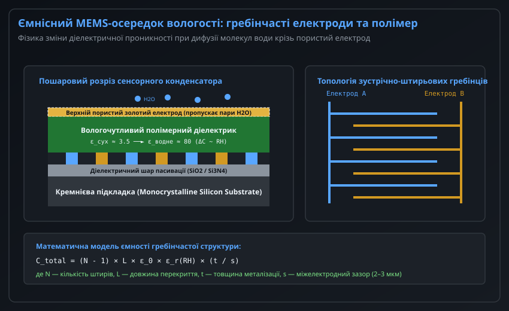
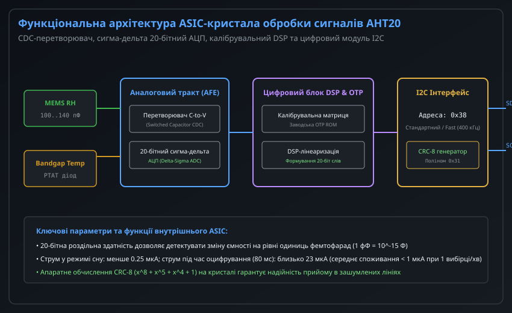
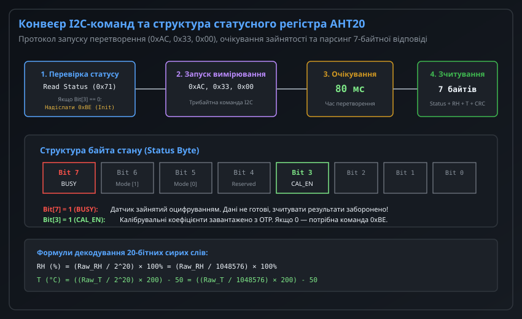
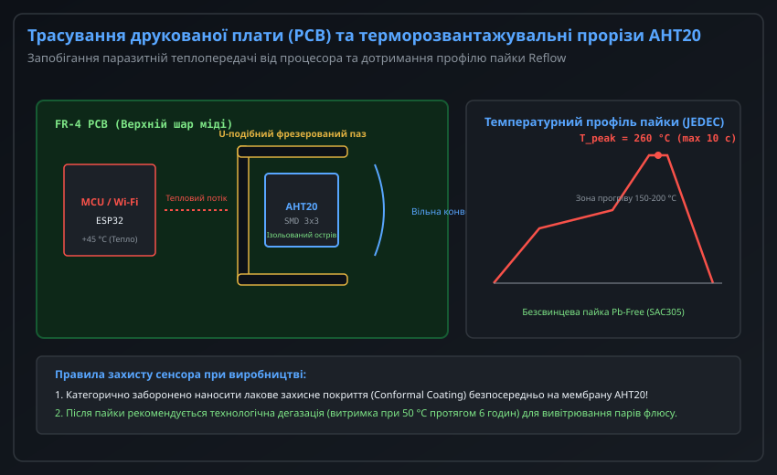

# Архітектура MEMS+ASIC давачів вологості серії AHT20

Поява інтегрованих датчиків температури та вологості серії AHT20 (виробництва ASAIR / Aosong) ознаменувала якісний технологічний стрибок у переході від дискретних корпусних сенсорів (на кшталт DHT11/DHT22) до монолітних мікроелектромеханічних систем (MEMS), суміщених зі спеціалізованими інтегральними схемами обробки сигналів (ASIC) у надкомпактному SMD-корпусі розміром 3.0 × 3.0 × 1.0 мм.

Завдяки технології упаковки System-in-Package (SiP), ємнісному MEMS-елементу нового покоління, 20-бітному сигма-дельта перетворювачу та вбудованій системі заводського калібрування, AHT20 забезпечує стабільну роботу в діапазоні від 0 до 100% RH і від -40 до +85 °C зі стандартним інтерфейсом I2C та апаратною перевіркою контрольної суми CRC-8.

---

## 1. Архітектура SiP (System-in-Package) та внутрішня компоновка AHT20

Конструктивне виконання AHT20 базується на технології System-in-Package (SiP): всередині монолітного пластикового безвивідного корпусу SMD Flat No-Lead (DFN-подібний корпус 3.0 × 3.0 мм) розміщено два фізично незалежні напівпровідникові кристали, змонтовані на спільному мідному несучому фреймі (Leadframe).



### Гібридна дводійна компоновка

1. **MEMS-кристал сенсорного осередку:** Кремнієвий кристал розміром близько 1.0 × 1.0 мм, що містить мікромеханічну ємнісну структуру, чутливу до молекул водяної пари, та напівпровідниковий термодатчик.
2. **ASIC-кристал цифрової обробки:** Виготовлений за стандартним кремнієвим КМОН-техпроцесом (CMOS), містить аналоговий фронтенд (AFE), 20-бітний сигма-дельта АЦП, цифровий сигнальний процесор (DSP), матрицю пам'яті OTP ROM з індивідуальними калібрувальними коефіцієнтами та апаратний контролер шини I2C.
3. **Зварні з'єднання (Wire Bonds):** Кристали з'єднані між собою та з зовнішніми контактними майданчиками золотими мікродротами діаметром 18–25 мкм. Завдяки мінімальній довжині провідників паразитна ємність з'єднань становить менше 0.05 пФ, що виключає вплив зовнішніх наведень на надчутливий ємнісний міст.

### Захисна порожнина та дифузійна мембрана

Для забезпечення доступу атмосферного повітря до чутливої зони MEMS-кристала епоксидний компаунд корпусу формує відкриту конвекційну камеру (Air Cavity) з верхнім отвором. На вході отвору встановлюється захисна мікропориста мембрана з гідрофобного політетрафторетилену (ePTFE), яка вільно пропускає водяну пару, але затримує рідкі краплі води, масляні аерозолі та частинки пилу розміром понад 0.2–0.5 мкм.

### Цоколівка SMD-корпусу AHT20

Нижня сторона корпусу має 6 контактних площадок:

| Номер виводу | Позначення | Тип | Опис призначення |
| :--- | :--- | :--- | :--- |
| **1** | **SCL** | Вхід | Лінія тактування шини I2C (до 400 кГц) |
| **2** | **SDA** | Ввід / Вивід | Двонаправлена лінія даних I2C (Open-Drain) |
| **3** | **VDD** | Живлення | Напруга живлення постійного струму від 2.0 В до 5.5 В |
| **4** | **GND** | Земля | Спільний вивід живлення та сигнальної землі (0 В) |
| **5** | **NC** | Вільний | Не підключати (залишити плаваючим на платі) |
| **6** | **NC** | Вільний | Не підключати (залишити плаваючим на платі) |

---

## 2. Будова та фізика ємнісного MEMS-осередку вологості

Чутливим елементом вологості в AHT20 є мікроелектромеханічний конденсатор з полімерним діелектриком, сформований методом фотолітографії та плазмового травлення безпосередньо на кремнієвій пластині.



### Пошарова структура сенсорного конденсатора

Конструкція сенсорного осередку включає такі шари:
1. **Монокристалічна кремнієва підкладка (Si Substrate):** Забезпечує механічну жорсткість кристала та електричну екранізацію з тильного боку.
2. **Шар діелектричної пасивації:** Тонка плівка діоксиду кремнію (SiO2) та нітриду кремнію (Si3N4) товщиною близько 1 мкм, яка ізолює кремній від сигнальних електродів і виключає струми витоку.
3. **Нижні зустрічно-штирьові гребінчасті електроди (Interdigitated Electrodes):** Металізовані золоті (Au) або алюмінієві мікросмужки, скомпоновані у вигляді зустрічних гребінців з міжелектродним зазором s ≈ 2–3 мкм та висотою t ≈ 0.5 мкм.
4. **Вологочутливий полімерний діелектрик:** Тонкий шар гідрофільного полііміду або зшитого полівінілового спирту товщиною 1.5–2.5 мкм, нанесений безпосередньо поверх гребінчастих електродів.
5. **Верхній пористий електрод:** Напилений напівпрозорий шар пористого золота товщиною кілька десятків нанометрів. Він одночасно служить електростатичним екраном Фарадея від зовнішніх електромагнітних полів і забезпечує швидку молекулярну дифузію парів води всередину полімеру.

### Фізичний принцип перетворення ємності

Ємність зустрічно-штирьової структури описується співвідношенням:

```
C_total = (N - 1) * L * epsilon_0 * epsilon_r(RH) * (t / s)
```

де N — кількість пальців гребінця, L — довжина їхнього взаємного перекриття, epsilon_0 — діелектрична проникність вакууму, а epsilon_r(RH) — діелектрична проникність полімеру.

У абсолютно сухому середовищі діелектрична проникність полімеру становить epsilon_dry ≈ 3.2–3.8, а базова ємність конденсатора — близько 100 пФ. При зростанні відносної вологості полярні молекули води (epsilon_water ≈ 80) проникають у мікропори полімеру, змінюючи його діелектричну проникність. При вологості 100% RH ємність досягає 135–140 пФ. 

Завдяки мікроскопічній товщині полімерного шару час дифузії вологи є надзвичайно коротким: постійна часу відгуку t_63% сенсора AHT20 становить лише 5–8 секунд (проти 15–30 секунд у датчиків серії DHT).

---

## 3. Архітектура ASIC-контролера: CDC, 20-бітний сигма-дельта АЦП та DSP

Перетворення надмалих змін ємності (близько 0.35–0.40 пФ на кожен 1% RH) у високоточний цифровий код здійснюється за допомогою спеціалізованого ASIC-кристала.



### Тракт вимірювання ємності (CDC)

В аналоговому фронтенді (AFE) AHT20 реалізовано перетворювач "ємність-у-код" (Capacitance-to-Digital Converter, CDC) на базі комутованих конденсаторів (Switched-Capacitor Architecture):
- Вимірювальний конденсатор MEMS періодично перезаряджається за допомогою високочастотних генераторних імпульсів тактової частоти 2 МГц.
- Струм заряду порівнюється з прецизійною внутрішньою інтегрованою ємністю порівняння C_ref.
- Отримана напруга надходить на диференційний сигма-дельта модулятор 2-го порядку з 20-бітною роздільною здатністю.

20-бітний вихід АЦП формує 1 048 576 градацій квантування на повну шкалу, що дає теоретичну роздільну здатність по вологості:

```
Delta_RH = 100% / 1048576 ≈ 0.000095% RH
```

У реальних умовах ефективна роздільна здатність (ENOB) обмежена тепловим шумом і становить 0.024% RH, що значно перевищує роздільну здатність 8-бітних датчиків попередніх поколінь.

### Вимірювання температури на основі Bandgap

Для температурної компенсації вологості та видачі значення температури всередині ASIC-кристала інтегровано термосенсор на основі забороненої зони кремнію (Silicon Bandgap Temperature Sensor). Різниця напруг емітер-база двох біполярних транзисторів, що працюють при різній густині струму (схема PTAT — Proportional To Absolute Temperature), дає строго лінійну залежність від абсолютної температури з крутизною близько 2 мВ/K, яка оцифровується тим самим 20-бітним АЦП.

### Цифрова лінеаризація та енергоефективність

Цифровий блок DSP зчитує сирі 20-бітні коди ємності та температури, виконує поліноміальну корекцію другого порядку за коефіцієнтами з однократно програмованої пам'яті (OTP ROM) та записує готові дані у вихідний I2C-буфер.

Енергетичні показники AHT20 оптимізовані для систем з батарейним живленням:
- Струм споживання в режимі очікування (Sleep): **0.25 мкА** (при напрузі 3.3 В).
- Струм під час вимірювання (активний стан тривалістю 80 мс): **23 мкА**.
- При опитуванні 1 раз на хвилину середній струм споживання не перевищує 0.3 мкА, що забезпечує до 10 років автономної роботи від однієї літієвої батарейки CR2032.

---

## 4. Протокол взаємодії I2C, конвеєр команд та статусний регістр

AHT20 взаємодіє з мікроконтролером через стандартний 2-провідний інтерфейс I2C з фіксованою адресою `0x38` (7-бітний адресний простір, біт читання/запису формує 0x70 для запису та 0x71 для зчитування).



### Конвеєр виконання команд та очікування

Процедура роботи з AHT20 складається з трьох послідовних етапів:

1. **Ініціалізація та перевірка готовності:**
   - Після подачі живлення МК очікує щонайменше 100 мс на стабілізацію напруги.
   - Відправляється команда опитування статусу (байт 0x71 на читання).
   - Якщо біт 3 байта стану `CAL_EN` дорівнює 0, необхідно провести примусову ініціалізацію: відправити послідовність байтів `[0x38_W] [0xBE] [0x08] [0x00]` і почекати 10 мс.
2. **Запуск перетворення:**
   - Для старту вимірювання мікроконтролер надсилає на шину трибайтну послідовність: `[0x38_W] [0xAC] [0x33] [0x00]`.
   - Внутрішній контролер AHT20 виставляє біт 7 байта стану `BUSY = 1` і починає оцифрування.
   - Час виконання вимірювання становить 80 мс. Опитувати дані раніше 80 мс заборонено.
3. **Зчитування 7-байтного фрейму даних:**
   - Мікроконтролер виконує I2C-читання 7 байтів:
     ```
     [ Байт 0: Статус ] [ Байт 1: RH_H ] [ Байт 2: RH_M ] [ Байт 3: RH_L + T_H ] [ Байт 4: T_M ] [ Байт 5: T_L ] [ Байт 6: CRC-8 ]
     ```

### Структура статусного байта (Байт 0)

| Номер біта | Назва | Стан 0 | Стан 1 | Інженерна інтерпретація |
| :--- | :--- | :--- | :--- | :--- |
| **Bit 7** | **BUSY** | Готовий | Зайнятий | Якщо 1 — датчик оцифровує дані, зчитування заборонено |
| **Bit 6:5** | **MODE** | Нормальний | Калібрувальний | Робочий режим внутрішнього процесора |
| **Bit 4** | **Reserved** | — | — | Зарезервовано |
| **Bit 3** | **CAL_EN** | Не калібрований | Калібрований | Якщо 0 — обов'язково виконати команду 0xBE |
| **Bit 2:0** | **Reserved** | — | — | Зарезервовано |

### Формули розпакування 20-бітних слів

Байт 3 є спільним для вологості та температури: його старші 4 біти належать молодшій частині вологості, а молодші 4 біти — старшій частині температури:

```
uint32_t raw_rh = ((uint32_t)Byte1 << 12) | ((uint32_t)Byte2 << 4) | ((uint32_t)Byte3 >> 4);
uint32_t raw_temp = (((uint32_t)Byte3 & 0x0F) << 16) | ((uint32_t)Byte4 << 8) | (uint32_t)Byte5;
```

Фізичні величини обчислюються за формулами:

```
RH (%) = ( (float)raw_rh / 1048576.0f ) * 100.0f
T (°C) = ( (float)raw_temp / 1048576.0f ) * 200.0f - 50.0f
```

---

## 5. Проектування друкованої плати (PCB Layout), терморозвантаження та правила пайки

Незважаючи на високу точність вимірювального тракту AHT20 (+/-2% RH, +/-0.3 °C), неправильне компонування друкованої плати може спричинити катастрофічні похибки через паразитне нагрівання від сусідніх електронних компонентів.



### Проблема теплового зсуву вологості

Відносна вологість RH за визначенням є відношенням парціального тиску пари до тиску насиченої пари при даній температурі. Відповідно до рівняння Магнуса, тиск насиченої пари експоненціально зростає з температурою:

```
e_s(T) = 6.112 * exp( (17.67 * T) / (T + 243.5) )
```

Якщо друкована плата підігріває корпус датчика лише на **+1.0 °C** вище за температуру навколишнього повітря (наприклад, через тепловиділення Wi-Fi процесора ESP32 або стабілізатора AMS1117), виміряна відносна вологість занижується на **3–5% RH** відносно реальної вологості в приміщенні!

### Заходи терморозвантаження при трасуванні плати

1. **Фрезеровані ізоляційні пази (Thermal Isolation Slots):** Навколо контактного майданчика AHT20 роблять U-подібний або прямокутний пропил у текстоліті FR-4 шириною 1.0–1.5 мм. Це перериває передачу тепла по мідних шарах плати, залишаючи датчик на теплоізольованому півострові.
2. **Видалення суцільних полігонів під сенсором (Keep-Out Zone):** У всіх шарах плати безпосередньо під корпусом AHT20 заборонено прокладати мідні полігони заземлення або живлення.
3. **Ширина сигнальних доріжок:** Провідники I2C і живлення, що підходять до датчика, повинні мати мінімальну допустиму ширину (0.15–0.2 мм) для зменшення площі теплопровідності.

### Технологічні вимоги до пайки та захисних покриттів

- **Профіль пайки оплавленням (Reflow Profile):** Пайка AHT20 повинна відповідати стандарту IPC/JEDEC J-STD-020. Пікова температура пайки не повинна перевищувати 260 °C протягом максимум 10 секунд. Тривалість перебування вище температури ліквідусу (217 °C для припою SAC305) — не більше 60–90 секунд.
- **Заборона ультразвукової відмивки:** Ультразвукові ванни для відмивання флюсу категорично заборонені — резонансні коливання понад 20 кГц руйнують тонкоплівкові полімерні мембрани MEMS-сенсора та відривають золоті зварні мікропровідники.
- **Захист від лакування (Conformal Coating):** Попадання вологозахисного лаку всередину дифузійного отвору корпусу AHT20 незворотно виводить датчик з ладу (полімер блокується лаковою плівкою). Перед лакуванням плати сенсор герметизують термостійкою каптоновою стрічкою, яку видаляють після повної полімеризації покриття.
