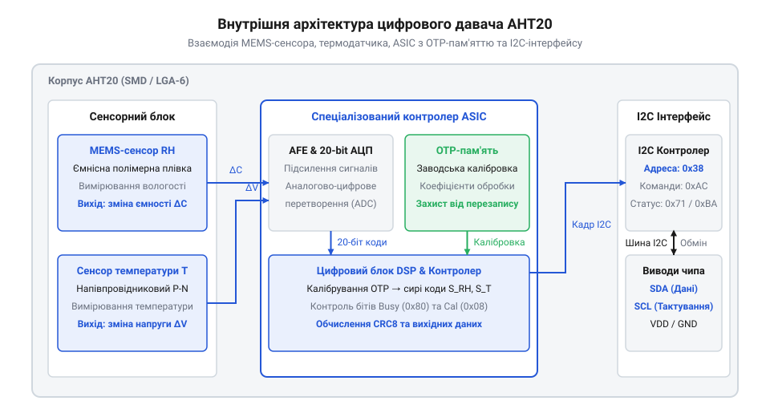
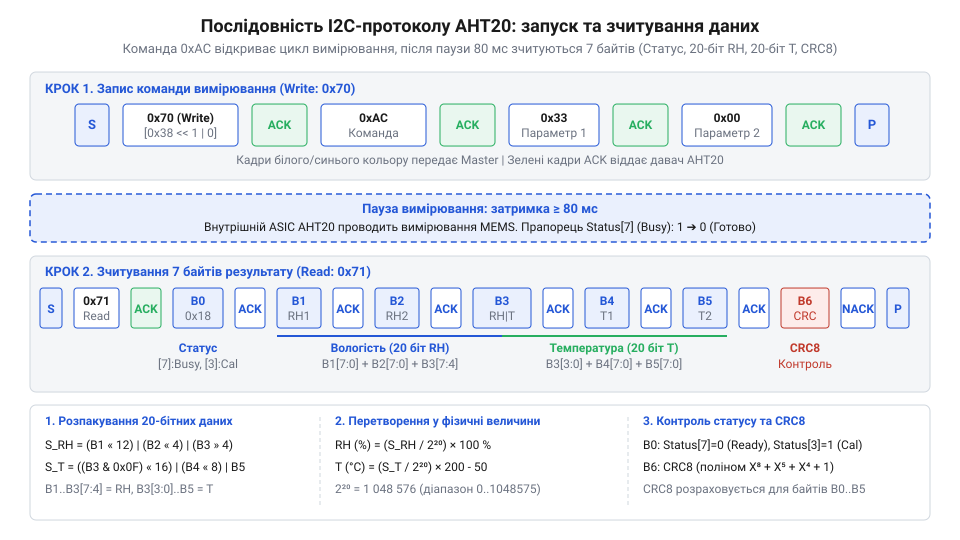
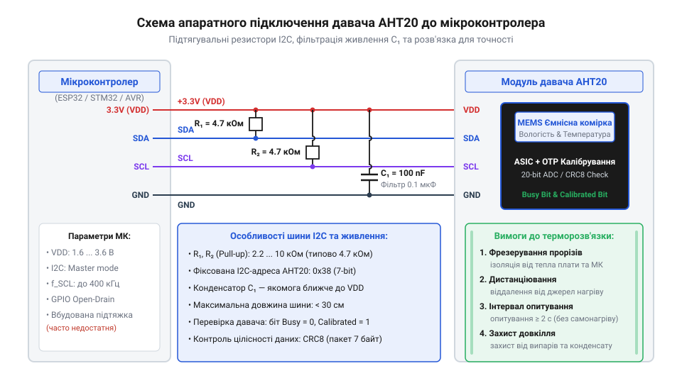

# Цифровий давач температури та вологості AHT20

<preknowlist>
- [DHT11](root:cat-hw-sensors/dht11) — принципи вимірювання відносної вологості ємнісним сенсором та базові поняття температурної компенсації
- [SHT30](root:cat-hw-sensors/sht30) — базові принципи побудови I2C-чипів моніторингу довкілля та вимірювальних циклів
- [Формула Магнуса-Тетенса для водяної пари](root:cat-hw-sensors/magnus-formula) — залежність тиску насиченої водяної пари від температури для розуміння фізики відносної вологості
</preknowlist>

## Нестабільність вимірювань вологості в автономних системах

Розробка автономних вузлів моніторингу довкілля — у промислових теплицях, фармацевтичних складах чи бездротових метеостанціях — вимагає від вимірювальних датчиків тривалої стабільності показань без систематичного ручного обслуговування та підганяння. Проте спроба побудувати вимірювальний тракт на застарілих цифрових давачах першого покоління швидко наражається на дві критичні проблеми: деградацію точності вимірювань через температурний `@@en|дрейф@@` (англійська *drift* — повільне систематичне відхилення) та прикрі падіння й блокування програмного забезпечення мікроконтролера.

Фізична сутність вимірювання відносної вологості повітря безпосередньо випливає з законів термодинаміки водяної пари. Відносна вологість виражається у відсотках як відношення поточного парціального тиску водяної пари до тиску насиченої пари за тієї ж самої температури. Оскільки тиск насиченої пари зростає залежно від температури за крутою експоненційною кривою, яка описується [формулою Магнуса-Тетенса](root:cat-hw-sensors/magnus-formula), будь-яке обчислення відносної вологості є принципово неточним без суворого врахування температури безпосередньо у зоні вимірювання.

Більшість цифрових датчиків використовує ємнісний метод первинного перетворення: тонкоплівковий полімерний діелектрик, нанесений між обкладками мікроконденсатора, адсорбує молекули води з навколишнього повітря. Дипольний момент молекул води дуже високий (відносна діелектрична проникність чистої води становить приблизно 80), тому насичення полімеру вологою збільшує загальну ємність сенсора. Однак сама діелектрична проникність сухого полімерного матеріалу та його геометричні розміри також змінюються від коливань температури.

Перші масові цифрові пристрої, такі як [застарілий давач DHT11](root:cat-hw-sensors/dht11), мали спрощену аналогову схему зчитування сигналу й були позбавлені індивідуальних цифрових таблиць калібрування. При добових коливаннях температури навколишнього середовища на 10–15 °C некомпенсований температурний `@@en|дрейф@@` призводив до викривлення показань відносної вологості на 15–20%. Крім того, тривалий вплив високої вологості викликав гістерезис полімерного діелектрика, через що повернути початкову точність без тривалого сушіння сенсора було неможливо. На практиці це викликало хибне спрацьовування виконавчих механізмів (вентиляторів чи зволожувачів) та марну витрату енергії акумуляторних батарей в автономних пристроях.

Окрім низької фізичної точності, сенсори першого покоління створили серйозну загрозу для стабільності програмного забезпечення. Заради здешевлення корпусу в них застосовували нестандартний однопровідний інтерфейс `@@en|Single Bus@@` (англійська *Single Bus* — однопровідний шинний інтерфейс). Цей протокол вимагає від мікроконтролера програмного формування мікросекундних часових затримок шляхом безпосереднього опитування виводів (так званий `@@en|bit-banging@@`, англійська *bit-banging* — програмне маніпулювання виводами) із примусовим вимкненням апаратних переривань.

У момент зчитування 40-бітного кадру мікроконтролер стає повністю «сліпим» до зовнішніх подій: він не може обробляти переривання таймерів, пакети бездротових мереж (Wi-Fi, Bluetooth чи Zigbee) або опитувати інші аварійні давачі. Якщо через утворення конденсату на платі або завади на довній лінії зв'язку давач зависав і утримував низький рівень на шині, мікроконтролер входив у безкінечний цикл очікування спаду чи наростання імпульсу. В автономних контролерах під управлінням операційних систем реального часу (RTOS) це викликало спрацьовування сторожових таймерів (Watchdog) або миттєво розряджало батарею, що повністю зупиняло виконання програмного коду.

Вимоги до надійності промислових систем зумовили перехід від дискретних сенсорів до інтегрованих мікроелектромеханічних систем (`@@en|MEMS@@`, англійська *Micro-Electro-Mechanical Systems*) зі спеціалізованими цифровими мікросхемами обробки сигналів (`@@en|ASIC@@`, англійська *Application-Specific Integrated Circuit*). Повний еволюційний шлях від перших однопровідних модулів до сучасних багатовузлових чипів детально описано в [історичному огляді сенсорів ASAIR](root:cat-hw-sensors/aht20-sensor/hist-asair-dht-to-aht20-evolution.md). Застосування стандартизованої послідовної шини `@@en|I2C@@` (англійська *Inter-Integrated Circuit* — міжінтегральна послідовна шина) усунуло потребу в суворих часових затримках і дозволило здійснювати обмін даними у фоновому режимі через апаратний периферійний модуль мікроконтролера.

## Архітектура чипа AHT20 та калібрування OTP

Сучасний цифровий давач `@@en|AHT20@@` (назва моделі давача серії AHT від компанії ASAIR) є повністю законсервованим вимірювальним мікромодулем, виконаним у плоскому пластиковому корпусі `@@en|LGA-6@@` (англійська *Land Grid Array* — корпус із матрицею плоских контактних майданчиків) розміром 3.0 × 3.0 × 1.0 мм. У верхній кришці корпуса передбачено отвір, захищений гідрофобною мембраною, яка вільно пропускає молекули водяної пари, але затримує краплі води й пил. Усередині корпуса на єдиній підкладці розміщено три основні компоненти: ємнісний `@@en|MEMS@@` сенсор вологості, напівпровідниковий давач температури та цифровий обчислювальний кристал `@@en|ASIC@@`.

Чутливий елемент вологості сформовано методом прецизійної мікромеханічної обробки кремнію. На поверхні кремнієвого кристала методом літографії виготовлено зустрічно-штирьові електроди, вкриті шар за шаром тонкою плівкою вологопоглинаючого полімеру. Молекули водяної пари з довкілля дифундують у полімер, змінюючи його діелектричну проникність пропорційно відносній вологості. Фізичні основи процесів сорбції та зміни діелектричних властивостей детально описано в [фізиці ємнісних MEMS-сенсорів](root:hw-sensing/capacitive-humidity-sensor). Безпосередньо поруч із MEMS-структурою на того самого кремнієвому кристалі сформовано напівпровідниковий p-n перехід, який працює як високоточний термометр на основі ширини забороненої зони кремнію. Розміщення обох сенсорних елементів на єдиному монолітному кристалі гарантує абсолютну термічну рівноправність: при різкій зміні температури довкілля між датчиком температури й полімером вологості немає часового запізнення, що виключає динамічні похибки обчислення відносної вологості.

Аналогові сигнали від обох сенсорних елементів надходять до блоку `@@en|ASIC@@`, де підсилюються малошумним аналоговим фронтендом і оцифровуються за допомогою 20-бітного сигма-дельта аналогово-цифрового перетворювача (`@@en|АЦП@@`, англійська *Analog-to-Digital Converter*). Проте через неминучі технологічні допуски при напиленні полімерної плівки та фотолітографії кожен виготовлений MEMS-елемент має індивідуальні відхилення початкової ємності та нелінійності вихідної характеристики. Щоб позбавити розробника від необхідності проведення складного ручного `@@en|калібрування@@` (латина *calibra* — міра, підганяння точності) на етапі виробництва готових пристроїв, кожен примірник `@@en|AHT20@@` проходить індивідуальне випробування на автоматизованому заводському стенді у контрольованій кліматичній камері.

Під час заводського випробування еталонні прилади зчитують первинні 20-бітні коди АЦП при декількох фіксованих значеннях температури й вологості. Автоматизована система обчислює унікальні корегувальні коефіцієнти для даного кристала і заносить їх у масив `@@en|OTP@@` (англійська *One-Time Programmable* — одноразово програмована пам'ять) всередині ASIC. Застосування [OTP-пам'яті для зберігання калібрування](root:hw-components/otp-memory-in-sensors-calibration) гарантує, що індивідуальні константи випалюються фізично на рівні кремнієвих мікроперемичок і не можуть бути втрачені або пошкоджені при просіданні напруги чи дії потужних електромагнітних завад.


*Внутрішня структура AHT20: взаємозв'язок MEMS-сенсора, термодатчика, ASIC-контролера та OTP-пам'яті з I2C-інтерфейсом.*

При кожному включенні живлення апаратна логіка `@@en|ASIC@@` автоматично зчитує випалені коефіцієнти з OTP-пам'яті у свої внутрішні оперативні регістри. Для безпечної обробки даних керуючий мікроконтролер перед надсиланням команди вимірювання по шині `@@en|I2C@@` (на фіксованій 7-бітній адресі `0x38`) має перевірити стан завантаження цих коефіцієнтів. Стан пристрою описується 8-бітним `@@en|регістром стану@@` (англійська *status register* — системний регістр прапорців), який давач повертає першим байтом у відповідь на будь-який запит читання.

Ключовим у регістрі стану є біт 3 — `@@en|прапорець калібрування@@` (англійська *calibrated bit* — біт підтвердження завантаження калібрувальних констант) із маскою `0x08`:
- Якщо біт 3 дорівнює `1`, це означає, що калібрувальні коефіцієнти з OTP-масиву успішно завантажені в обчислювальні регістри, і давач готовий до видачі точних 20-бітних даних. - Якщо біт 3 дорівнює `0` (це трапляється при занадто повільному наростанні напруги живлення при старті або після короткочасного просідання живлення), обчислювальна матриця неактивна, і отримані з давача показники будуть хибними.

При виявленні скинутого прапорця (біт 3 = `0`) драйвер мікроконтролера зобов'язаний виконати процедуру ініціалізації: відправити команду `0xBE` із параметрами `0x08` та `0x00`, яка примусово перезапускає зчитування OTP-таблиці в обчислювальні регістри. Після відправки цієї команди керуюча програма робить паузу у 10 мс і повторно зчитує регістр стану для підтвердження виставлення біта 3 у `1`. На відміну від дорожчих і гнучкіших пристроїв, таких як [давач вологості SHT30](root:cat-hw-sensors/sht30), які дозволяють обирати рівні повторюваності вимірювань та налаштовувати апаратне підігрів, чип AHT20 вимагає суворого дотримання цієї перевірки прапорця калібрування перед початком кожного вимірювального циклу.

## Протокол I2C та 20-бітний вимірювальний цикл

На відміну від аналогових датчиків, показання яких доступні мікроконтролеру безпосередньо у вигляді рівня напруги, цифровий давач `@@en|AHT20@@` є автономним вимірювальним вузлом. Внутрішньому обчислювальному кристалу `@@en|ASIC@@` (від англ. `@@en|Application-Specific Integrated Circuit@@`, «спеціалізована інтегральна схема») потрібен фізичний час для подачі струму на сенсорні елементи, виконання аналогово-цифрового перетворення (`@@en|АЦП@@`, від англ. `@@en|Analog-to-Digital Converter@@`, «аналогово-цифровий перетворювач») та обчислення температурної компенсації. Через це взаємодія по послідовній шині `@@en|I2C@@` (від англ. `@@en|Inter-Integrated Circuit@@`, «міжмікросхемна шина») побудована не як миттєве зчитування комірок пам'яті, а як асинхронний цикл «команда — витримка паузи — зчитування кадру».

Давач `@@en|AHT20@@` працює у режимі веденого пристрою (`@@en|slave@@`) на фіксованій 7-бітній адресі `0x38`. Це означає, що при відправці байта адреси з бітом запису (`W = 0`) керуючий мікроконтролер передає `0x70`, а при запиті зчитати дані з бітом читання (`R = 1`) — байт `0x71`.

Перш ніж починати новий вимірювальний цикл, драйвер мікроконтролера зобов’язаний переконатися у повній готовності обчислювального ядра чипа. При подачі живлення кристалу `@@en|ASIC@@` потрібно близько 5 мс для стабілізації внутрішнього генератора та завантаження заводських калібрувальних коефіцієнтів із масиву `@@en|OTP@@` (від англ. `@@en|One-Time Programmable@@`, «одноразово програмована пам'ять»). Для перевірки стану мікроконтролер виконує запит читання одного байта з адреси `0x38`. Отриманий байт є `@@en|регістром стану@@` (`State`), у якому найважливішу роль відіграє біт 3 — `@@en|Calibrated bit@@` (від англ. `@@en|calibrated bit@@`, «прапорець калібрування»):
- Якщо біт 3 дорівнює `1` (значення маски `0x08`), це підтверджує, що калібрувальні коефіцієнти з `@@en|OTP@@` успішно перенесені в оперативні регістри, і давач готовий до роботи. - Якщо біт 3 дорівнює `0` (що трапляється при занадто повільному наростанні напруги живлення при старті або після просідання живлення), обчислення будуть некоректними. У цьому разі керуюча програма має відправити команду ініціалізації `0xBE` з двома параметрами `0x08` та `0x00`, витримати паузу 10 мс і лише після цього повторно перевірити регістр стану.

Детальний перелік усіх системних команд, кодів скидання та конфігураційних бітів висвітлено в [довіднику реєстрів та протоколу AHT20](root:cat-hw-sensors/aht20-sensor/api-aht20-protocol-and-registers.md).

Коли прапорець калібрування підтверджено (біт 3 = `1`), мікроконтролер запускає процес вимірювання. Для цього по шині `@@en|I2C@@` надсилається трибайтна послідовність:
1. Байт команди `0xAC` (запуск вимірювання);
2. Перший байт параметра `0x33`;
3. Другий байт параметра `0x00`.

Передача двох додаткових байтів `0x33` та `0x00` є обов'язковою вимогою апаратної логіки `@@en|ASIC@@`: вони задають режим одночасного двоканального вимірювання температури та відносної вологості. Щойно давач підтверджує прийом третього байта імпульсом `@@en|ACK@@` (від англ. `@@en|Acknowledge@@`, «підтвердження прийому»), він негайно виставляє найстарший біт 7 у регістрі стану — `@@en|Busy bit@@` (від англ. `@@en|busy bit@@`, «прапорець зайнятості») — у значення `1`.

Упродовж наступних 75–80 мс чип `@@en|AHT20@@` перебуває у стані активного перетворення: аналоговий фронтенд подає вимірювальну напругу на полімерний `@@en|MEMS-конденсатор@@` (від англ. `@@en|Micro-Electro-Mechanical Systems@@`) та p-n перехід термодатчика, 20-бітний сигма-дельта `@@en|АЦП@@` виконує накопичення відліків, а обчислювальне ядро перераховує сирі коди з урахуванням `@@en|OTP-коефіцієнтів@@`. Протягом цього часу керуючий мікроконтролер повинен звільнити лінію тактування `@@en|SCL@@` (від англ. `@@en|Serial Clock Line@@`, «послідовна лінія тактування») та лінію даних `@@en|SDA@@` (від англ. `@@en|Serial Data Line@@`, «послідовна лінія даних») й витримати паузу не менше 80 мс.

Після завершення паузи 80 мс мікроконтролер формує старт-умову `@@en|I2C@@` та надсилає запит читання на адресу `0x38`. Давач `@@en|AHT20@@` відповідає послідовністю з 7 байтів (або 6 байтів, якщо перевірка контрольної суми вимкнена на рівні драйвера):
- **Байт 0**: актуальний стан регістра (`State`). Мікроконтролер першим ділом аналізує біт 7 (`@@en|Busy bit@@`). Якщо біт 7 дорівнює `1` (маска `0x80`), це означає, що АЦП не встиг завершити обчислення, і всі наступні байти містять застаріле чи сміттєве значення. Драйвер повинен скасувати розбір кадру, зачекати ще 10 мс і повторити читання. Якщо біт 7 дорівнює `0`, дані готове і стабільне. - **Байти 1–5**: 40 бітів об'єднаних цифрових даних, у яких упаковано 20-бітний код відносної вологості та 20-бітний код температури. - **Байт 7**: контрольна сума `@@en|CRC8@@` (від англ. `@@en|Cyclic Redundancy Check@@`, «циклічний надлишковий код»), обчислена контролером `@@en|ASIC@@` над першими 6 байтами (байтом стану та 5 байтами даних).

Послідовність шинного обміну та відповідність байтів наочно показано на часовій діаграмі:


*Часова діаграма I2C-протоколу AHT20: надсилання команди 0xAC 0x33 0x00, часова витримка 80 мс та зчитування 7 байтів даних із перевіркою біта Busy та CRC8.*

Для побудови надійного програмного забезпечення опитування `@@en|AHT20@@` не слід реалізовувати через прості жорсткі затримки без перевірки зворотного зв'язку. У реальних системах звада на шині або короткочасний сплеск напруги живлення може призвести до пропуску імпульсів `@@en|ACK@@`. Правильний алгоритм опитування побудовано як автомат станів: він перевіряє `@@en|Calibrated bit@@`, контролює прапорець `@@en|Busy bit@@`, підраховує лічильник повторних спроб і, у разі потреби, виконує м'яке скидання шини. Повний практичний приклад реалізації такого надійного алгоритму мовою C наведено в [проєкті C-драйвера AHT20](root:cat-hw-sensors/aht20-sensor/proj-aht20-i2c-driver-c.md).

Крім програмної послідовності, на стабільність `@@en|I2C-обміну@@` безпосередньо впливає апаратне оточення. Лінії `@@en|SDA@@` та `@@en|SCL@@` вимагають правильного добору підтягувальних резисторів до шини живлення (зазвичай 4.7 кОм для напруги 3.3 В), а безпосередньо біля виводів живлення чипа має стояти керамічний фільтруючий конденсатор ємністю 100 нФ. Електричні схеми підключення, вибір номіналів та захист від завад детально описано в [описі апаратного інтерфейсу AHT20](root:cat-hw-sensors/aht20-sensor/api-aht20-hardware-interface.md).

## Математика перетворення сирих даних у показники

Після завершення зчитування 7 байтів по шині `@@en|I2C@@` та перевірки скидання біта `@@en|Busy bit@@` (біт 7 = `0`), у розпорядженні мікроконтролера опиняється 5 байтів сирих даних (байти B1, B2, B3, B4 та B5). У цих 40 бітах інформації розміщено два 20-бітних безнакових цілих числа: цифровий код вологості `S_RH` та цифровий код температури `S_T`.

Оскільки більшість мікроконтролерів оперують 8-бітними байтами або 16/32-бітними словами, 20-бітні значення розділені між байтами несиметрично. Байт B3 виконує роль «містка»: його 4 найстарші біти належать до коду вологості, а 4 наймолодші біти — до коду температури.

Розпакування здійснюється за допомогою побітових зсувів та логічних масок:
- **Код вологості (`S_RH`)**: складається з 20 бітів. Байт B1 формує біти 19..12 (`@@en|MSB@@`, від англ. `@@en|Most Significant Byte@@`, «найстарший байт»), байт B2 формує біти 11..4, а 4 найстарші біти байта B3 (`B3 >> 4`) формують біти 3..0 (`@@en|LSB@@`, від англ. `@@en|Least Significant Byte@@`, «наймолодший байт»). - **Код температури (`S_T`)**: складається з 20 бітів. 4 наймолодші біти байта B3 (`B3 & 0x0F`) формують біти 19..16, байт B4 формує біти 15..8, а байт B5 формує біти 7..0.

Схема розподілу бітів по байтах B1–B5 наочно представлена нижче:


*Схема бітового розпакування: поділ байтів B1–B5 на 20-бітовий цифровий код вологості S_RH та 20-бітовий код температури S_T.*

У програмному коді розпакування 20-бітних значень у 32-бітні цілі змінні `uint32_t` реалізується двома побітовими виразами:

```
S_RH = (B1 << 12) | (B2 << 4) | (B3 >> 4)
S_T  = ((B3 & 0x0F) << 16) | (B4 << 8) | B5
```

Зняті 20-бітні цифрові коди `S_RH` та `S_T` лежать у діапазоні від `0` до `2²⁰ - 1` (де `2²⁰ = 1048576`). Для їх переведення у загальноприйняті фізичні одиниці — відносну вологість у відсотках (`%`) та температуру в градусах Цельсія (`°C`) — використовуються лінійні формули, визначені розробником чипа `@@en|ASAIR@@`.

Формула обчислення відносної вологості `RH`:
Значення `S_RH` пропорційне відносній вологості у діапазоні від `0%` до `100%`.

```
RH (%) = (S_RH ÷ 2²⁰) × 100
       = (S_RH ÷ 1048576) × 100
       = S_RH ÷ 10485.76
```

Формула обчислення температури `T`:
Значення `S_T` покриває температурний діапазон шириною `200 °C` зі зсувом `-50 °C` (від `-50 °C` до `+150 °C`).

```
T (°C) = (S_T ÷ 2²⁰) × 200 - 50
       = (S_T ÷ 1048576) × 200 - 50
       = (S_T ÷ 5242.88) - 50
```

Теоретичне обґрунтування масштабування та вибір точності змінних із плаваючою крапкою детально розібрано в [математичному описі перетворення AHT20](root:cat-hw-sensors/aht20-sensor/math-aht20-data-conversion.md).

Щоб зрозуміти роботу обчислювального тракту, розглянемо числове обчислення на конкретному прикладі. Припустимо, що в результаті зчитання з шини `@@en|I2C@@` отримано такі п'ять байтів даних: `B1 = 0x68`, `B2 = 0x4A`, `B3 = 0x56`, `B4 = 0x8D`, `B5 = 0x32`.

**Обчислення на прикладі:**

```
[Крок 1: Розпакування та обчислення коду вологості S_RH]
B1 = 0x68 (104 в десятковій)
B2 = 0x4A (74 в десятковій)
B3 >> 4 = 0x56 >> 4 = 0x05 (5 в десятковій)

S_RH = (0x68 << 12) | (0x4A << 4) | 0x05
     = 0x68000 | 0x04A0 | 0x0005
     = 0x684A5 = 427173

[Крок 2: Переведення S_RH у відносну вологість]
RH = 427173 ÷ 10485.76
   ≈ 40.74 %

[Крок 3: Розпакування та обчислення коду температури S_T]
B3 & 0x0F = 0x56 & 0x0F = 0x06 (6 в десятковій)
B4 = 0x8D (141 в десятковій)
B5 = 0x32 (50 в десятковій)

S_T = (0x06 << 16) | (0x8D << 8) | 0x32
    = 0x060000 | 0x8D00 | 0x0032
    = 0x68D32 = 429362

[Крок 4: Переведення S_T у температуру]
T = (429362 ÷ 5242.88) - 50
  = 81.894 - 50
  ≈ 31.89 °C
```

Отримані значення відповідають відносній вологості `40.74%` та температурі `31.89 °C`.

Навіть якщо зчитаний пакет байтів формально пройшов бітові зсуви, на довгих дротах або при наявності електромагнітних завад поодинокі біти можуть спотворитися. Для гарантії цілісності даних розробники `@@en|AHT20@@` передбачили обчислення 8-бітної контрольної суми `@@en|CRC8@@`, яка передається сьомим байтом (байт B6).

Алгоритм обчислення `@@en|CRC8@@` спирається на стандартний генераторний поліном `@@en|Dallas/Maxim@@`:

```
P(x) = x⁸ + x⁵ + x⁴ + 1  (початкове значення 0xFF, маска полінома 0x31)
```

Мікроконтролер послідовно обробляє перші 6 байтів кадру (байт стану `State` та байти B1–B5). Якщо обчислений локально байт `@@en|CRC8@@` збігається з байтом B6, пакет вважається повністю достовірним. Якщо виявлено розбіжність, показники відкидаються, а вимірювальний цикл повторюється. Повний алгоритм табличного та побітового обчислення контрольної суми детально розкрито в [алгоритмі обчислення CRC8 для AHT20](root:cat-hw-sensors/aht20-sensor/math-aht20-crc8-computation.md).

Окрім математичної точності, при практичній експлуатації давача важливо враховувати його фізичні граничні обмеження. Під час виконання кожного вимірювального циклу `@@en|ASIC-контролер@@` та 20-бітний `@@en|АЦП@@` споживають електричний струм, виділяючи мікроскопічну кількість тепла на кремнієвому кристалі. Якщо мікроконтролер опитує `@@en|AHT20@@` занадто часто (наприклад, 10–20 разів на секунду), це викликає систематичне самонагрівання чипа.

Оскільки чутливий ємнісний полімер розташований на тому самому кристалі, підняття температури кристала всього на 1 °C вище температури навколишнього повітря зміщує рівноважний тиск пара. За [залежністю тиску водяної пари](root:cat-hw-sensors/magnus-formula) це призводить до штучного зниження показань відносної вологості на 3–5% та завищення температури. Для запобігання самонагріванню в автономних пристроях інтервал між вимірюваннями має становити не менше 2–5 секунд. Приклади побудови енергоефективних режимів та керування періодом опитування наведено в [проєкті низькоспоживаючого логера](root:cat-hw-sensors/aht20-sensor/proj-aht20-low-power-logger.md).

## Схема підключення та живлення сенсора AHT20

Надійність цифрового обміну даними та точність вимірювання температури й вологості закладаються на етапі проектування принципової схеми та топології друкованої плати. Навіть найточніший внутрішній цифровий перетворювач мікросхеми виявиться безпорадним, якщо напруга живлення просідатиме під час вимірювальних сплесків струму, а паразитне тепло від центрального процесора проникатиме мідними доріжками безпосередньо до первинного чутливого елемента.

Цифровий давач @@en|AHT20@@ живиться від джерела постійного струму з напругою від `2.0 В` до `5.5 В` (типове значення для сучасних мікроконтролерних систем становить `3.3 В`). У стані очікування пристрій споживає мікроскопічний струм порядку `0.25 мкА`. Однак у момент запуску командного циклу вимірювання внутрішня спеціалізована інтегральна схема @@en|ASIC@@ (від англійського *Application-Specific Integrated Circuit* — «спеціалізована інтегральна схема») активує аналогово-цифровий перетворювач та внутрішній генератор тактової частоти, через що струм споживання короткочасно зростає до `980 мкА`.

Для компенсації цих високочастотних імпульсних стрибків струму та придушення завад у лінії живлення паралельно виводам живлення давача обов'язково встановлюють керамічний розв'язувальний конденсатор @@en|bypass capacitor@@ (від англійського *bypass* — «обхід, розв'язка») ємністю `100 нФ` (`0.1 мкФ`). Цей конденсатор має розміщуватися на друкованій платі @@en|PCB@@ (від англійського *Printed Circuit Board* — «друкована плата») якнайближче до фізичних ніжок корпусу @@en|LGA-6@@ (від англійського *Land Grid Array* — «масив контактних майданчиків») — на відстані не більше `3 мм`.

Обмін даними між мікроконтролером та @@en|AHT20@@ відбувається через двопровідний послідовний інтерфейс @@en|I2C@@ (від англійського *Inter-Integrated Circuit* — «міжмікросхемне з'єднання»), який складається з лінії сигналів тактування @@en|SCL@@ (від англійського *Serial Clock* — «послідовний тактовий сигнал») та лінії даних @@en|SDA@@ (від англійського *Serial Data* — «послідовні дані»). Вихідні каскади ліній @@en|SDA@@ та @@en|SCL@@ у давачі виконані за схемою з відкритим стоком. Це означає, що сам давач може лише притягувати лінію до потенціалу землі @@en|GND@@, але не здатний самостійно подавати високий логічний рівень. Тому обидві лінії шини потребують зовнішніх підтягувальних резисторів @@en|pull-up резистор@@ (від англійського *pull-up* — «підтягувати догори»), підключених до шини живлення @@en|VCC@@.

Значення опору підтягувального резистора `R_pullup` обирають на основі компромісу між швидкістю наростання сигналу та енергоспоживанням. Опір резистора разом із сумарною паразитною ємністю шини `C_bus` (яка складається з ємності доріжок плати, ємності виводів мікроконтролера та самого давача) утворює пасивний @@en|RC-ланцюг@@ (від англійських літер *R* — опір та *C* — ємність).

Мінімально можливий опір підтяжки `R_pullup_min` обмежений максимально припустимим струмом розряду `I_OL`, який здатний пропускати відкритий вихідний транзистор давача без виходу з ладу та без перевищення рівня логічного нуля `V_OL = 0.4 В` (для @@en|AHT20@@ граничний струм `I_OL = 3 мА` при `VCC = 3.3 В`). Вихідне рівняння для розрахунку найменшого допустимого опору виглядає так:

```
R_pullup_min
= (VCC - V_OL) / I_OL      [Закон Ома для граничного струму розряду]
= (3.3 - 0.4) / 0.003      [Підстановка параметрів при VCC = 3.3 В]
= 966.7 Ом                [Мінімальний дозволений опір]
```

Максимально можливий опір `R_pullup_max` визначається стандартними вимогами @@en|I2C@@ до тривалості фронту наростання напруги `t_r` від логічного нуля до логічної одиниці (рівень `0.7 × VCC`). Для стандартного режиму `100 кГц` максимальний час наростання `t_r = 1000 нс`. Для типової ємності шини `C_bus = 100 пФ` граничний опір розраховується наступним чином:

```
R_pullup_max
= t_r / (0.8473 × C_bus)          [Рівняння виходу на рівень 0.7 VCC в RC-ланцюгу]
= 10⁻⁶ / (0.8473 × 100 × 10⁻¹²)   [Підстановка t_r = 1 мкс та C_bus = 100 пФ]
= 11802 Ом                        [Максимальний дозволений опір (≈ 11.8 кОм)]
```

На практиці для коротких доріжок плати (до 10 см) та частоти шини `100 кГц` або `400 кГц` оптимальним вибором є підтягувальні резистори з номіналом `4.7 кОм`. Якщо ж пристрій працює в режимі наднизького споживання з батарейним живленням, а довжина ліній не перевищує кількох сантиметрів, опір можна збільшити до `10 кОм` для зменшення струму, що протікає через резистори під час передачі логічних нулів.


*Схема апаратного підключення давача AHT20 до мікроконтролера та конструктивне виділення ізольованої термозони на друкованій платі.*

Крім електричних параметрів, ключовим фактором точності вимірювання є термічна ізоляція давача на друкованій платі. Напівпровідникові компоненти, такі як центральний мікроконтролер, імпульсні перетворювачі напруги або лінійні стабілізатори, під час роботи виділяють тепло. Оскільки мідь друкованої плати має високу теплопровідність, це тепло швидко передається по платі до давача @@en|AHT20@@. Нагрівання корпусу давача всього на `1 °C` вище температури навколишнього повітря призводить до викривлення виміряного значення відносної вологості майже на `6%` у бік заниження.

Для запобігання тепловому впливу застосовують такі конструктивні прийоми:
1. **Ізолювальні пази в платі:** Навколо майданчика під корпус @@en|LGA-6@@ вифрезеровують П-подібні або наскрізні щілини в текстоліті, залишаючи давач на невеликому «острівці». Це різко зменшує площу поперечного перерізу матеріалу, через який може проходити тепловий потік від основної плати. 2. **Мінімізація мідних провідників:** Доріжки живлення @@en|VCC@@, @@en|GND@@, @@en|SDA@@ та @@en|SCL@@, що підходять до давача, роблять якомога вужчими (наприклад, `0.15–0.2 мм`), щоб зменшити передачу тепла міддю. 3. **Фізичне віддалення:** Модуль давача розміщують у нижній частині корпусу пристрою (оскільки тепле повітря піднімається вгору) або на окремій виносній платі.

Повний опис фізичних розмірів корпуса та монтажних контактів наведено в довіднику з [апаратного інтерфейсу AHT20](root:cat-hw-sensors/aht20-sensor/api-aht20-hardware-interface.md). На відміну від аналогових датчиків, як-от [термістором KY-013](root:cat-hw-sensors/ky-013-thermistor), де вимірювальний сигнал чутливий до падіння напруги на проводах живлення, або цифрових датчиків з однопровідним протоколом на кшталт [однопровідним давачем DS18B20](root:cat-hw-sensors/ds18b20), правильна розводка шини @@en|I2C@@ та якісна декупляція @@en|AHT20@@ гарантують завадостійку передачу цифрових даних навіть у жорстких промислових умовах.

## Захист сенсора від самонагрівання та дрейфу

Після надійного електричного та фізичного підключення давача настає етап оптимізації режимів його програмного опитування та захисту чутливого елемента від зовнішніх чинників. Навіть ідеально розрахована схема підключення не врятує від похибок, якщо мікроконтролер опитуватиме сенсор занадто часто або якщо сенсор експлуатуватиметься в агресивному хімічному середовищі.

Головним внутрішнім чинником викривлення показань є ефект самонагрівання кристала @@en|ASIC@@. Під час виконання кожного вимірювального циклу (тривалістю близько `80 мс`) внутрішня схема давача споживає електричну потужність:

```
P_meas
= VCC × I_active          [Формула електричної потужності]
= 3.3 В × 0.00098 А       [Підстановка струму вимірювання 980 мкА при 3.3 В]
= 0.003234 Вт             [Потужність споживання (≈ 3.23 мВт)]
```

Хоча потужність у `3.23 мВт` здається незначною, мікроскопічний об'єм корпусу @@en|LGA-6@@ має дуже малу теплоємність. Якщо керуюча програма мікроконтролера надсилатиме команду вимірювання `0xAC` безперервно (наприклад, 10–20 разів на секунду), виділюване тепле енергетичне розсіювання не встигатиме відводитися в навколишнє середовище. В результаті кристал @@en|AHT20@@ прогрівається на `0.5–2 °C` відносно довкілля.

Оскільки відносна вологість є відношенням поточного парціального тиску водяної пари до тиску насиченої пари при даній температурі (що описується залежністю [формули Магнуса-Тетенса](root:cat-hw-sensors/magnus-formula)), штучне підвищення температури локальної зони давача збільшує тиск насичення. В результаті давач показує підвищену температуру та суттєво занижену відносну вологість повітря, хоча параметри самого приміщення не змінилися.

Для повного усунення ефекту самонагрівання необхідно дотримуватися правильного часового інтервалу між вимірюваннями:
1. **Оптимальна частота опитування:** Для систем клімат-контролю та моніторингу довкілля оптимальний інтервал між вимірюваннями становить від `2` до `5` секунд. У приміщеннях параметри повітря не змінюються миттєво, тому опитування з такою частотою дає абсолютно точну динаміку без розігріву мікросхеми. 2. **Перехід у сплячий режим:** Після прочитання 7 байтів даних мікроконтролер повинен залишати давач у стані спокою, де його споживання падає до `0.25 мкА`, а виділення тепла практично дорівнює нулю. 3. **Періодичний вимір у логерах:** В автономних логерах з батарейним живленням вимірювання проводять один раз на `1–10 хвилин`. Мікроконтролер прокидається, ініціалізує шину @@en|I2C@@, зчитує показники, перевіряє контрольну суму @@en|CRC8@@ (від англійського *Cyclic Redundancy Check* — «циклічний надлишковий контроль») та негайно повертається в глибокий сон. Алгоритми побудови таких вузлів детально розглянуто в проєкті [логера мікроклімату](root:cat-hw-sensors/aht20-sensor/proj-aht20-low-power-logger.md).

Другим суттєвим чинником є довгостроковий часовий та хімічний дрейф показань. Чутливий елемент вологості @@en|AHT20@@ побудований на основі відкритої тонкої плівки вологочутливого полімеру, яка розташована безпосередньо у верхньому отворі корпусу. Молекули водяної пари вільно дифундують у пори полімеру, змінюючи його діелектричну проникність, що детально описано у матеріалі про фізику [ємнісних MEMS-сенсорів](root:hw-sensing/capacitive-humidity-sensor).

Однак разом із водою у пористу структуру полімеру можуть потрапляти летючі органічні сполуки @@en|VOC@@ (від англійського *Volatile Organic Compounds* — «летючі органічні сполуки»), такі як пари спиртів, ацетону, розчинників, силіконові випари від герметиків або залишки мастил. Молекули цих речовин осідають на полімерній матриці, забивають пори або вступають у зворотну хімічну взаємодію з матеріалом, що призводить до незворотного зсуву калібрувальної кривої (дрейфу) на `3–5%` вологості на рік.

Для захисту чутливої мембрани від хімічного забруднення та конденсату застосовують наступні заходи:
- **Захисні паропроникні мембрани:** На корпус давача або на вентиляційні отвори зовнішнього захисного кожуха встановлюють фторопластові мембрани з політетрафторетилену @@en|PTFE@@ (від англійського *Polytetrafluoroethylene* — «політетрафторетилен»). Пори цієї мембрани мають розмір близько `0.1–0.2 мкм`, що дозволяє молекулам водяної пари вільно проходити, але затримує краплі води, пил, аерозолі та масляний туман. - **Уникання силіконів при монтажі:** Під час складання приладів суворо заборонено використовувати силіконові герметики або випарні клейові суміші поблизу давача, оскільки силіконові випари отруюють полімерний шар без можливості відновлення. - **Процедура рекондиціонування:** Якщо давач зазнав тривалого впливу високої вологості (понад `80%` протягом кількох тижнів) або легкої хімічної загазованості, його можна відновити процедурою прогреву. Пристрій витримують при температурі `+60...+70 °C` та низькій вологості протягом 10–12 годин (для випаровування поглинутих забруднень), після чого витримують при `+20...+30 °C` та вологості `50%` протягом доби для регідратації полімерної плівки.

Порівняно з іншими цифровими інтегральними рішеннями, наприклад [датчиками вологості SHT30](root:cat-hw-sensors/sht30) або іншими представниками [давачів родини ASAIR](root:cat-hw-sensors/asair-aht-sensor-family-overview), дотримання правил програмного інтервалу опитування та захисту від хімічних чинників дозволяє давачу @@en|AHT20@@ зберігати високу точність вимірювання протягом багатьох років без необхідності повторного заводського калібрування.