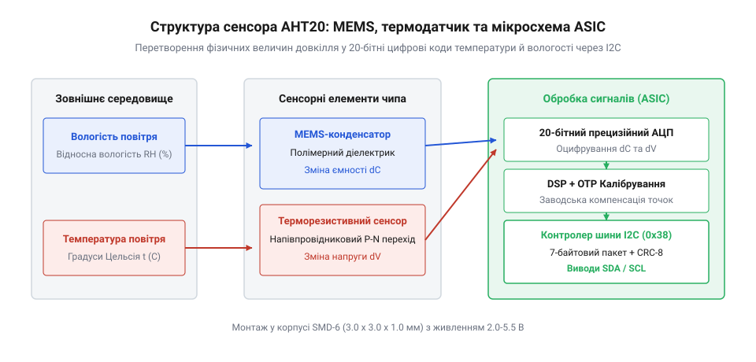
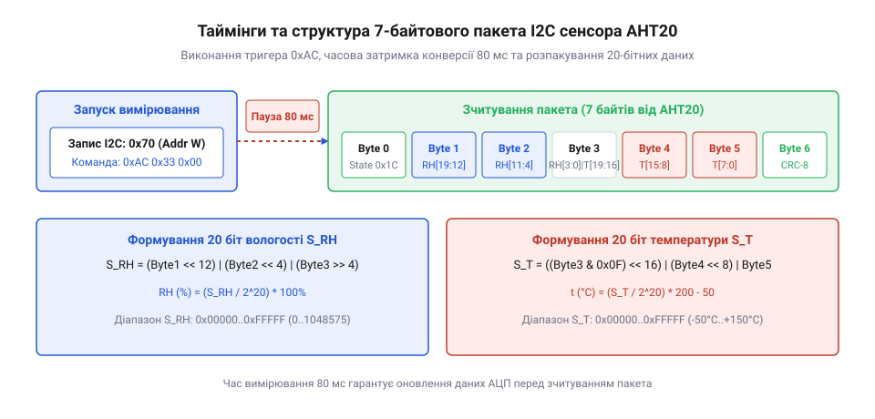

# Цифровий давач температури та вологості AHT20

<preknowlist>
- [DHT11](root:cat-hw-sensors/dht11) — Принцип побудови першого покоління цифрових давачів вологості та обмеження однопровідного протоколу.
- [SHT30](root:cat-hw-sensors/sht30) — Базові поняття адресації та обміну даними через шину I2C у цифрових давачах клімату.
</preknowlist>

## Принцип вимірювання та будова @@en|AHT20@@

При вимірюванні вологості й температури в автономних пристроях застарілі датчики створювали проблеми через дрейф параметрів і низьку завадостійкість. На відміну від [застарілого DHT11](root:cat-hw-sensors/dht11) із повільним однопровідним протоколом, компанія @@en|ASAIR@@ випустила чип @@en|AHT20@@, який об'єднує всі вимірювальні елементи на одному кристалі.


*Схематична структура чипа AHT20: вхідний ємнісний MEMS-сенсор вологості, кремнієвий датчик температури та інтегрована система ASIC.*

Основою вимірювання вологості є ємнісна мікроелектромеханічна система (від англ. @@en|MEMS@@, *Micro-Electro-Mechanical Systems*). Вона являє собою конденсатор з пористим полімерним діелектриком. Молекули водяної пари проникають у пори полімеру, змінюючи діелектричну проникність середовища та ємність елемента. Поруч розташовано напівпровідниковий датчик температури. Аналогові сигнали обробляє вбудована мікросхема (від англ. @@en|ASIC@@, *Application-Specific Integrated Circuit*), яка видає відкалібровані цифрові дані.

## Статус пристрою та ініціалізація 0xBE

Після подачі живлення @@en|VDD@@ процесор @@en|ASIC@@ потребує часу для зчитання калібрувальних коефіцієнтів з пам'яті @@en|OTP@@. Першим обов'язковим кроком після паузи 100 мс є зчитання статусного байта за адресою `0x38` шини @@en|I2C@@. Порівняти її з іншими датчиками можна в огляді [кліматичного давача SHT30](root:cat-hw-sensors/sht30).

Статус містить два ключових біти: біт 7 (прапорець @@en|Busy Bit@@) вказує на виконання вимірювання, а біт 3 (прапорець @@en|Calibrated Bit@@) підтверджує наявність калібровки. Якщо біт 3 дорівнює `0`, мікроконтролер відправляє команду ініціалізації `0xBE 0x08 0x00` і витримує паузу 10 мс для перезавантаження коефіцієнтів у оперативні регістри.

## Запуск вимірювання та розпакування даних

Для запуску вимірювального циклу мікроконтролер надсилає команду-тригер `0xAC 0x33 0x00` на адресу `0x38`. Блок @@en|ASIC@@ оцифровує покази протягом 80 мс, утримуючи біт @@en|Busy Bit@@ у байти статусу рівним `1`.


*Часова діаграма передачі команди 0xAC по шині I2C та структура отриманого 7-байтного пакета даних зі статусом і вимірами.*

Після закінчення затримки зчитують 7 байтів даних. 20-бітні сирі кодові значення вологості `S_RH` та температури `S_T` витягують побітовими зсувами:

```
S_RH = (Байт1 << 12) | (Байт2 << 4) | (Байт3 >> 4)
RH = (S_RH / 1048576) × 100%

S_T = ((Байт3 & 0x0F) << 16) | (Байт4 << 8) | Байт5
T = (S_T / 1048576) × 200 - 50 °C
```

## Перевірка CRC-8 та захист від конденсату

Для запобігання використанню спотворених даних у 7-байтовому пакеті сьомий байт містить контрольну суму @@en|CRC-8@@ (від англ. *Cyclic Redundancy Check*). Вона обчислюється для перших 6 байтів за поліномом `0x31` (`x⁸ + x⁵ + x⁴ + 1`) з початковим значенням `0xFF`. При розбіжності сум відлік відкидається.

У разі наближення відносної вологості до 100% краплі рідкої води залипають у порах полімеру. Для надійної роботи рекомендується опитувати сенсор не частіше одного разу на 2–5 секунд для уникнення самонагріву та використовувати захисні гідрофобні мембрани з матеріалу @@en|ePTFE@@.
