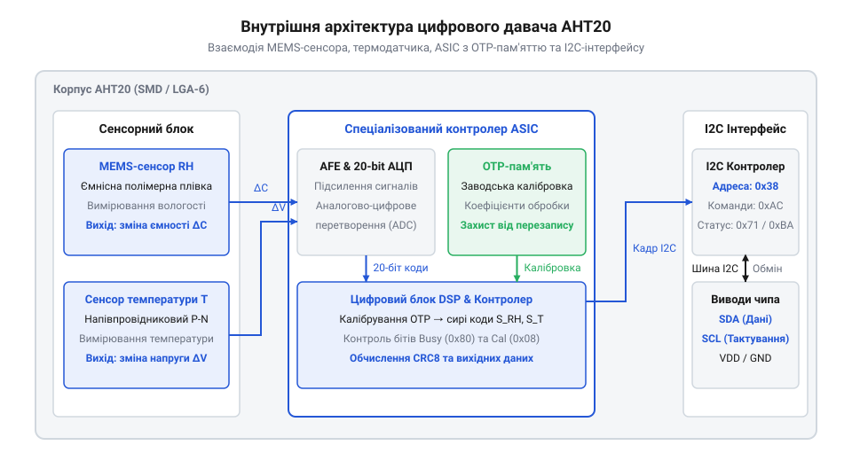
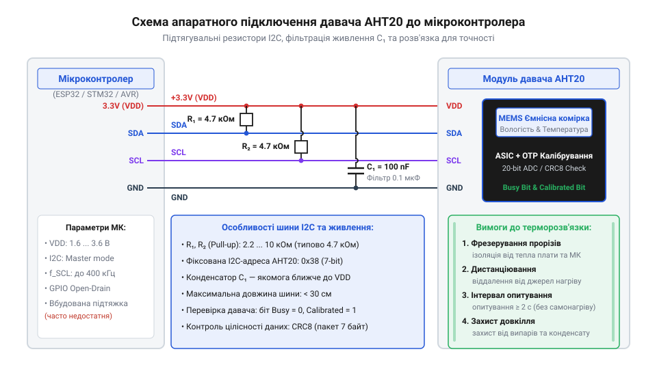

# Цифровий давач температури та вологості AHT20

<preknowlist>
- [DHT11](root:cat-hw-sensors/dht11) — принципи вимірювання відносної вологості ємнісним сенсором та базові поняття температурної компенсації
- [SHT30](root:cat-hw-sensors/sht30) — базові принципи побудови I2C-чипів моніторингу довкілля та вимірювальних циклів
- [Формула Магнуса-Тетенса для водяної пари](root:cat-hw-sensors/magnus-formula) — залежність тиску насиченої водяної пари від температури для розуміння фізики відносної вологості
</preknowlist>

## Нестабільність вимірювань вологості в автономних системах

Розробка автономних пристроїв моніторингу довкілля часто наражається на хибні показники вологості та раптові зависання керуючих контролерів. Використання [застарілих сенсорів вологості](root:cat-hw-sensors/dht11) першого покоління викликає системні збої через застосування однопровідного протоколу `@@en|bit-banging@@` (англ. *bit-banging*, програмне формування сигналів). Такий підхід блокує переривання та викликає затримки в операційних системах реального часу.

Крім того, вимірювання відносної вологості описується [фізичним зв'язком з температурою](root:cat-hw-sensors/magnus-formula), адже тиск насиченої пари зростає експоненційно під час нагрівання. Найменша похибка визначення температури або зміщення затримок опитування призводить до накопичення паразитного дрейфу. Для стабільної роботи систем потрібен перехід на інтегровані `@@en|MEMS@@` (англ. *microelectromechanical systems*, мікроелектромеханічні системи) структури із цифровою обробкою сигналів на базі `@@en|ASIC@@` та стандартизованого шинного інтерфейсу `@@en|I2C@@`.

## Архітектура чипа AHT20 та калібрування OTP

Сенсор `@@en|AHT20@@` об'єднує в одному корпусі ємнісний `@@en|MEMS@@`-сенсор вологості, напівпровідниковий термометр на монолітному кремнієвому кристалі та обчислювальне ядро `@@en|ASIC@@` (англ. *application-specific integrated circuit*, спеціалізована інтегрована мікросхема).


*Функціональна схема AHT20, яка ілюструє інтеграцію первинних чутливих елементів із обчислювальним ядром ASIC.*

Під час виготовлення чипа на заводі виконується індивідуальне калібрування, а коефіцієнти записуються в `@@en|OTP@@` (англ. *one-time programmable*, одноразово програмована) пам'ять. При подачі живлення `@@en|ASIC@@` зчитує ці значення для корекції сирих сигналів. Готовність до роботи контролюється через байт стану: біт 3 (калібрувальний прапорець `0x08`) має дорівнювати одиниці. Якщо біт скинуто, мікроконтролер надсилає команду ініціалізації `0xBE 0x08 0x00` для перезавантаження коефіцієнтів з `@@en|OTP@@`-осередків.

## Протокол I2C та 20-бітний вимірювальний цикл

Обмін даними з `@@en|AHT20@@` здійснюється за фіксованою адресою `0x38` шини `@@en|I2C@@`. Вимірювальний цикл запускається надсиланням трьохбайтної команди `0xAC 0x33 0x00`.


*Часова діаграма шини I2C для запускання вимірювання, витримання паузи перетворення та зчитування кадру даних.*

Після надсилання команди чип запускає аналого-цифровий перетворювач. Мікроконтролер повинен витримати паузу щонайменше 80 мс без опитування шини, щоб не збити процес перетворення. Після паузи зчитується 7-байтний кадр: перший байт містить прапорці стану, наступні п'ять — коди вологості й температури, а сьомий — контрольну суму `@@en|CRC8@@`. Перед розпакуванням даних обов'язково перевіряється біт 7 (Busy `0x80`): значення 0 свідчить про завершення АЦП-перетворення.

## Математика перетворення сирих даних у показники

Зчитані п'ять байтів вимірювальних даних містять 20-бітний код вологості `S_RH` та 20-бітний код температури `S_T`. Четвертий байт кадру розділений між ними: його старші 4 біти належать вологості, а молодші 4 біти — температурі.


*Принцип бітового розпакування кадру даних AHT20 для виділення 20-бітних цілочисельних значень.*

Після бітового зсуву та об'єднання байтів отримані коди перераховуються у фізичні величини:

```
RH = (S_RH / 1048576) × 100%    [перерахунок 20-бітного коду у відносну вологість]
```

```
T = (S_T / 1048576) × 200 - 50  [перерахунок 20-бітного коду в температуру °C]
```

Цілісність кадру верифікується обчисленням `@@en|CRC8@@` з поліномом `x⁸ + x⁵ + x⁴ + 1` (початкове значення `0xFF`) для перших шести байтів та порівнянням результату із сьомим байтом кадру.

## Схема підключення та живлення сенсора AHT20

Для надійної роботи `@@en|AHT20@@` вимагає дотримання правил проектування друкованої плати та підключення ліній `@@en|I2C@@`.


*Принципова схема підключення AHT20 з елементами фільтрації живлення та завадозахисту шини I2C.*

Безпосередньо біля виводів живлення VDD та GND чипа встановлюється керамічний розв'язувальний конденсатор ємністю 100 нФ для пригнічення високочастотних завад. Лінії SDA та SCL підтягуються до лінії живлення резисторами nominal 4.7 кОм. Для запобігання нагріванню сенсора від центрального процесора на платі виконують фрезеровані ізолювальні пази навколо зони монтажу `@@en|AHT20@@`.

## Захист сенсора від самонагрівання та дрейфу

Тривала точність вимірювань `@@en|AHT20@@` залежить від режиму експлуатації та захисту вологочутливого полімерного шару. Часте опитування сенсора (частіше ніж один раз на секунду) викликає внутрішнє самонагрівання кристала струмом АЦП. За [формулою Магнуса-Тетенса](root:cat-hw-sensors/magnus-formula) локальне підвищення температури навіть на 0.5 °C занижує показник відносної вологості на кілька відсотків, тому оптимальний інтервал опитування становить 2–5 секунд.

Для захисту від пилу, крапель води та агресивних хімічних парів корпус покривають паропроникною мембраною з `@@en|PTFE@@` (англ. *polytetrafluoroethylene*, політетрафторетилен). У разі хімічного отруєння або дрейфу застосовують процедуру рекондиціонування: прогрівання при 80 °C протягом декількох годин із наступною гідратацією при високій вологості.