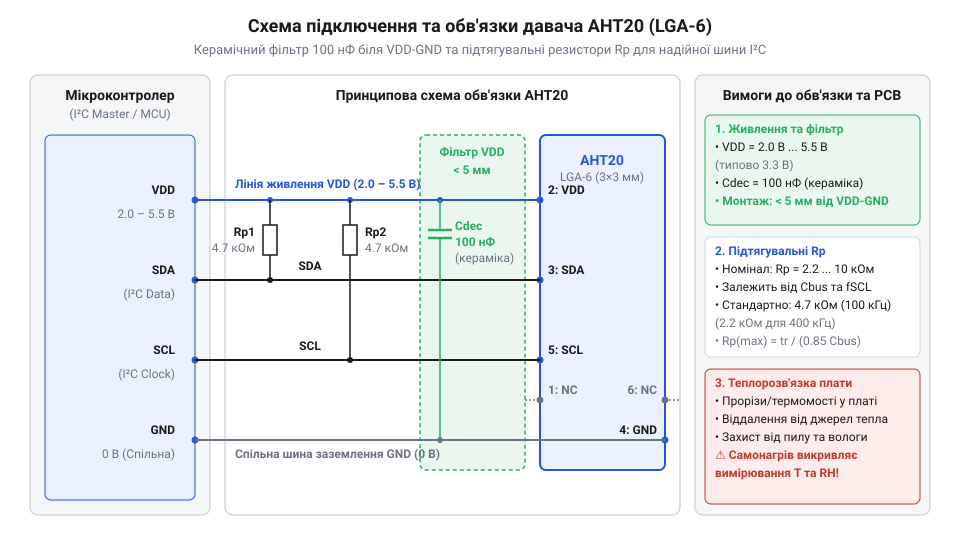
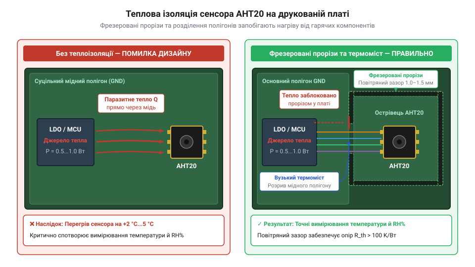

# Апаратний інтерфейс AHT20: розводка ніжок, схеми підключення I2C та термічна ізоляція

## Паразитні завади та самонагрів сенсора

Розробка цифрових пристроїв моніторингу мікроклімату часто наражається на прикрий випадок: після збирання компактної плати давач температури й вологості @@en|AHT20@@ демонструє викривлені значення або взагалі блокує обмін даними. Температура на екрані виявляється вищою за реальну кімнатну на 2–4 °C, а відносна вологість занижується на 10–15%. Водночас під час увімкнення потужного споживача, як-от радіомодуля чи реле, зчитування даних зупиняється через помилки передачі. Причина полягає не в дефекті самóго чипа, а в нехтуванні фізичними законами поширення тепла та високочастотних завад у матеріалі друкованої плати.

Датчик @@en|AHT20@@ об'єднує в єдиному корпусі мікроелектромеханічний елемент @@en|MEMS@@ (англ. @@en|Micro-Electro-Mechanical Systems@@ — "мікроелектромеханічні системи") та оброблювальну мікросхему @@en|ASIC@@ (англ. @@en|Application-Specific Integrated Circuit@@ — "спеціалізована інтегральна схема"). Коли поруч із сенсором на платі розташовано лінійний стабілізатор напруги або мікроконтролер, мідні доріжки та текстоліт FR-4 перетворюються на ефективний теплопровідний міст. Теплова енергія від гарячих компонентів безперешкодно потрапляє до контактних майданчиків корпуса @@en|LGA-6@@ (англ. @@en|Land Grid Array@@ — "масив майданчиків під пайку"), локально нагріваючи сенсорну мембрану.

Вплив локального перегріву на вимірювання вологості є критичним через фізику вологого повітря. Відносна вологість розраховується як відношення парціального тиску водяної пари до тиску насичення за поточної температури. Оскільки тиск насичення зростає експоненційно з підвищенням температури (що описується [формулою Магнуса-Тетенса](root:cat-hw-sensors/magnus-formula)), штучне підвищення температури сенсора всього на 1 °C відносно довкілля спричиняє падіння виміряної відносної вологості приблизно на 5–6%.

На відміну від простих аналогових компонентів, як-от [аналоговий термістор KY-013](root:cat-hw-sensors/ky-013-thermistor) або [пороговий давач KY-028](root:cat-hw-sensors/ky-028-temp), цифровий чип @@en|AHT20@@ містить чутливий аналого-цифровий перетворювач та внутрішній контролер станів. Швидкі перехідні процеси в колах живлення, спричинені імпульсним споживанням струму цифровими мікросхемами, створюють високочастотні пульсації напруги. Без належного електричного фільтрування ці завади призводять до збоїв у роботі аналогового фронтенду, викривлення контрольних сум CRC та зависання інтерфейсу @@en|I2C@@ (англ. @@en|Inter-Integrated Circuit@@ — "міжінтегральна схема").

Для забезпечення паспортної точності вимірювань розрядність та алгоритми цифрової обробки є безпорадими без комплексної апаратної обв'язки. Інженер мусить одночасно вирішити два завдання: забезпечити чистоту живлення на електричному рівні та мінімізувати тепловий і механічний вплив на топологічному рівні.

## Призначення виводів LGA-6 та обв'язка

Цифровий сенсор @@en|AHT20@@ випускається в надкомпактному корпусі @@en|SMD@@ (англ. @@en|Surface-Mount Device@@ — "пристрій для поверхневого монтажу") типу @@en|LGA-6@@ із габаритами 3 × 3 × 1.0 мм. Корпус має шість пласких контактних майданчиків, розташованих по периметру нижньої грані чипа. Давач розрахований на роботу в широкому діапазоні напруг живлення від 2.0 В до 5.5 В, що робить його сумісним із логічними рівнями 2.5 В, 3.3 В та 5.0 В без застосування додаткових перетворювачів рівнів.

Призначення кожного з шести виводів корпуса @@en|LGA-6@@ визначено електричною специфікацією вигляд за годинниковою стрілкою від першого виводу:

| Номер виводу | Позначення | Тип виводу | Призначення та електричний режим |
| :--- | :--- | :--- | :--- |
| 1 | @@en|NC@@ | Не підключено | Фізичний вивід (англ. @@en|No Connect@@ — "не підключати"). Залишається ізольованим у топології. |
| 2 | @@en|VDD@@ | Живлення | Вхід позитивної напруги живлення постійного струму в діапазоні від 2.0 В до 5.5 В. |
| 3 | @@en|SDA@@ | Вхід / Вихід | Послідовна лінія даних (англ. @@en|Serial Data@@ — "послідовні дані") шини @@en|I2C@@ з відкритим стоком. |
| 4 | @@en|GND@@ | Земля | Спільний вивід живлення та заземлення схеми. |
| 5 | @@en|SCL@@ | Вхід | Послідовна лінія тактування (англ. @@en|Serial Clock@@ — "послідовний тактовий сигнал") шини @@en|I2C@@ з відкритим стоком. |
| 6 | @@en|NC@@ | Не підключено | Другий ізольований вивід корпуса, не використовується у схемі. |

Під час виконання циклу вимірювання внутрішній блок @@en|ASIC@@ короткочасно збільшує споживання струму від 0.25 мкА у стані спокою до приблизно 350 мкА. Ці імпульсні кидки струму в поєднанні з паразитною індуктивністю підвідних доріжок викликають високочастотні просідання напруги живлення. Для пригнічення цих завад безпосередньо біля виводів @@en|VDD@@ (вивід 2) та @@en|GND@@ (вивід 5) необхідно монтувати @@en|декуплювальний конденсатор@@ (англ. @@en|decoupling capacitor@@ — "розв'язувальний конденсатор") ємністю 100 нФ.

Застосовувати слід керамічний конденсатор із діелектриком типу X7R або X5R у корпусі 0603 або 0402. Головна вимога топології — довжина доріжок від контактних майданчиків чипа до виводів конденсатора має бути мінімальною (не більше 2 мм). Якщо відстань буде більшою, паразитні індуктивності провідників знівелюють ефект фільтрації на високочастотних гармоніках.


*Принципова схема підключення сенсора AHT20: декуплювальний керамічний конденсатор 100 нФ розміщено паралельно між виводами VDD та GND для фільтрації високочастотного шуму.*

На відміну від готових інтегрованих рішень, як-от [модуль вологості SHT30](root:cat-hw-sensors/sht30) або [цифровий сенсор GY-21](root:cat-hw-sensors/gy-21), де фільтрувальні компоненти вже розпаяні на друкованій платі модуля, під час проективання власного пристрою на базі чистого чипа @@en|AHT20@@ відповідальність за розведення фільтрів повністю покладається на розробника. Також можна зустріти готові розширювальні платформи, наприклад [комбінований модуль AHT20 та BMP280](root:cat-hw-sensors/aht20-bmp280), де на єдиній платі поєднано сенсори атмосферного тиску та вологості зі спільною обв'язкою живлення.

## Розрахунок підтягувальних резисторів шини I2C

Сигнальні лінії @@en|SDA@@ та @@en|SCL@@ шини @@en|I2C@@ побудовані за схемою з відкритим стоком (англ. @@en|open drain@@ — "відкритий стік"). Це означає, що внутрішні N-канальні польові транзистори сенсора @@en|AHT20@@ та мікроконтролера здатні лише примусово притягувати лінію до потенціалу землі @@en|GND@@ (формуючи логічний 0). Повернення лінії до високого потенціалу @@en|VDD@@ (формування логічної 1) відбувається пасивно за рахунок зовнішніх компонентів — @@en|підтягувальний резистор@@ (англ. @@en|pull-up resistor@@ — "підтягувальний резистор") `R_pullup`, підключених між відповідною сигнальною лінією та шиною живлення. Для поглибленого вивчення фізичних параметрів сигнальних ліній, ємнісних обмежень та часових діаграм інтерфейсу перегляньте матеріал про [електричну специфікацію та фізичний рівень шини I2C](root:com-devices/i2c-bus).

Вибір номіналу підтягувальних резисторів є інженерним компромісом між швидкістю наростання фронту сигналу та енергоспоживанням пристрою:

1. Занадто великий опір `R_pullup` у поєднанні з паразитною ємністю лінії `C_bus` створює RC-фільтр низьких частот. Пологий підйом напруги не встигає досягти порогу логічної одиниці за відведений часовий інтервал `t_r`, що призводить до завалив фронтів та помилок зчитування даних. 2. Занадто малий опір `R_pullup` спричиняє проходження надмірного струму через вихідні транзистори притягування. Це підвищує залишковий рівень напруги логічного нуля `V_OL` вище допустимої межі (0.4 В) і додатково нагріває вихідні каскади чипа @@en|AHT20@@.

Для визначення допустимого діапазону опорів підтяжки застосовують розрахунок двох граничних значень: мінімального `R_min` та максимального `R_max`.

Мінімально допустимий опір `R_min` обмежується максимально допустимим втікаючим струмом вихідного транзистора `I_OL` (для специфікації @@en|I2C@@ це 3 мА) при збереженні рівня напруги логічного нуля `V_OL,max = 0.4 В`:

Розрахунок мінімального опору підтяжки `R_min` виводиться з закону Ома для кола відкритого стоку:

```
R_min = (VDD - V_OL,max) ÷ I_OL
```

Максимально допустимий опір `R_max` визначається максимально припустимим часом наростання фронту `t_r,max` (згідно зі стандартом @@en|I2C@@: 1000 нс для режиму Standard-Mode 100 кГц та 300 нс для Fast-Mode 400 кГц) і сумарною паразитною ємністю шини `C_bus`. Експоненційне зростання напруги від порогу логічного нуля 0.3 · VDD до порогу логічної одиниці 0.7 · VDD описується коефіцієнтом 0.8473:

```
R_max = t_r,max ÷ (0.8473 · C_bus)
```

де `t_r,max` вимірюється в секундах, а `C_bus` — у фарадах.

**Приклад розрахунку для реальної схеми з живленням 3.3 В:**

Вихідні дані: напруга живлення `VDD = 3.3 В`, сумарна паразитна ємність шини `C_bus = 50 пФ` (включає ємність доріжок плати, виводів @@en|AHT20@@ та мікроконтролера), режим роботи шини — Fast-Mode 400 кГц (`t_r,max = 300 нс`).

[Обчислення граничних значень опору підтяжки]
```
R_min = (3.3 - 0.4) ÷ 0.003
= 2.9 ÷ 0.003                             [обчислення різниці напруг]
≈ 966.7 Ω                                 [найменший безпечний опір]

R_max = 300 × 10⁻⁹ ÷ (0.8473 × 50 × 10⁻¹²)
= 300 × 10⁻⁹ ÷ (4.2365 × 10⁻¹⁰)            [обчислення знаменника]
≈ 7081.5 Ω                                [найбільший дозволений опір]
```

Отриманий розрахунковий діапазон становить від 967 Ом до 7.08 кОм. Для практичної реалізації обирають стандартне значення з ряду E24, наприклад **2.2 кОм**, **3.3 кОм** або **4.7 кОм**. Для коротких доріжок плати з низькою ємністю номінал 4.7 кОм забезпечує оптимальний баланс між крутизною фронтів та мінімальним струмовим навантаженням.

На відміну від систем із послідовним опитуванням, як-от [однопровідні давачі DS18B20](root:cat-hw-sensors/ds18b20), де застосовується єдина лінія даних із фіксованим підтягувальним резистором 4.7 кОм, шина @@en|I2C@@ вимагає встановлення двох однакових резисторів: одного для лінії @@en|SDA@@, іншого для лінії @@en|SCL@@. При цьому категорично не варто покладатися на внутрішні підтягувальні резистори мікроконтролера (які зазвичай мають опір від 20 кОм до 50 кОм), оскільки їхній опір значно перевищує розраховане значення `R_max`, що спричинить регулярні збої інтерфейсу. Порівняно з аналоговими давачами прямого виходу, як-от [перетворювач LM35DZ](root:cat-hw-sensors/lm35), які передають напругу пропорційно температурі без цифрових ліній, правильно розрахована шина @@en|I2C@@ забезпечує повну завадостійкість передачі даних.

## Топологія плати та термоізоляція сенсора

Навіть при ідеально фільтрованому живленні та правильно розрахованих підтягувальних резисторах вимірювання @@en|AHT20@@ будуть хибними, якщо не вжити заходів із топологічної термоізоляції чипа на етапі трасування друкованої плати. Теплопередача від гарячих зон плати до корпусу сенсора відбувається переважно за рахунок високої теплопровідності мідних доріжок (близько 385 Вт/(м·К)) та склотекстоліту FR-4 (близько 0.25 Вт/(м·К)). Оскільки площа суцільних мідних полігонів заземлення та живлення значна, вони діють як ефективні радіатори, що підводять паразитне тепло безпосередньо до виводів чипа.

Для захисту сенсора від паразитного самонагріву та зовнішніх чинників застосовують такі комплексні топологічні прийоми:

1. **Геометричне віддалення та острівне розміщення**: Давач @@en|AHT20@@ слід розміщувати на краї друкованої плати або у спеціально винесеній консольній зоні, якнайдалі від мікроконтролерів, силових транзисторів та стабілізаторів живлення. 2. **Фрезеровані термоізоляційні прорізи**: Найефективнішим методом блокування кондуктивного тепла є створення прорізів у склотекстоліті навколо корпусу сенсора. П-подібний або прямокутний проріз завширшки 1.0–1.5 мм залишає чип на невеликому «острівці», з'єднаному з основною платою вузьким містком. Це зменшує площу перетину теплопровідного матеріалу на 80–90%. 3. **Мінімізація мідних полігонів та тонкі доріжки**: У зоні розташування @@en|AHT20@@ необхідно повністю видалити суцільні полігони заземлення @@en|GND@@ та живлення @@en|VDD@@ на всіх шарах плати. Провідники сигнальних ліній @@en|SDA@@ та @@en|SCL@@, а також ліній живлення, які підходять до виводів чипа, мають бути максимально тонкими (шириною 0.15–0.2 мм) для збільшення їхнього теплового опору. 4. **Захист від пилу та конденсату**: Для роботи в жорстких умовах довкілля електронні компоненти плати покривають спеціальним захисним лаком — @@en|конформне покриття@@ (англ. @@en|conformal coating@@ — "покриття, що повторює форму"). Під час нанесення лаку оптичне вікно сенсора @@en|AHT20@@ обов'язково маскують. Для захисту самого сенсорного елемента від прямого попадання крапель води та пилу поверх отвору чипа встановлюють гідрофобну мембрану — @@en|PTFE-мембрана@@ (англ. @@en|Polytetrafluoroethylene@@ — "політетрафторетилен"), яка вільно пропускає молекули водяної пари, але затримує рідку фазу й механічні частки.


*Топологія друкованої плати для AHT20: фрезеровані прорізи створюють термоізоляційну острівцеву зону, мінімізуючи передачу тепла від навколишніх компонентів.*

Ретельна термоізоляція друкованої плати є стандартною вимогою для будь-яких високоточних вимірювальних систем. Схожі принципи топологічного розділення тепла та захисту чутливих кіл застосовуються під час побудови вимірювальних трактів для [платинових давачів температури PT100](root:cat-hw-sensors/pt100-rtd) та їхніх вимірювальних перетворювачів [чипів MAX31865](root:cat-hw-sensors/max31865-rtd-converter), регламентованих вимогами [міжнародного стандарту IEC 60751](root:cat-hw-sensors/iec-60751-standard-for-rtd). На відміну від простих кліматичних сенсорів начального рівня, як-от [комбінований давач DHT11](root:cat-hw-sensors/dht11), де пластиковий корпус створює додатковий тепловий бар'єр, викриваючи динаміку вимірювань, відкритий SMD-корпус @@en|AHT20@@ у поєднанні з правильною топологією забезпечує мінімальну теплову інерційність та високу точність. Загальні засади вибору терморезистивних компонентів детально описані в [оглядовому матеріалі родини RTD](root:cat-hw-sensors/rtd-resistance-temperature-detectors-family-overview).