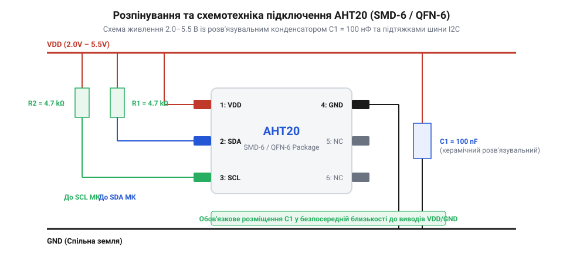

# Апаратне розпінування та схемотехніка підключення AHT20

## Проблема нестабільності живлення та завад шини

Цифрові сенсори температури й вологості, такі як @@en|AHT20@@, вимірюють мікроскопічні зміни ємності внутрішніх мікроелектромеханічних структур (@@en|MEMS@@, від англ. *Micro-Electro-Mechanical Systems* — мікроелектромеханічні системи). Під час кожного циклу вимірювання внутрішній аналогово-цифровий перетворювач (@@en|ADC@@, від англ. *Analog-to-Digital Converter* — аналогово-цифровий перетворювач) і кристал чипа короткочасно споживають імпульсний струм. Якщо лінія живлення сенсора позбавлена локальної фільтрації, цей струмовий сплеск викликає миттєве просідання напруги. У результаті сенсор скидає внутрішні регістри конфігурації або повертає некоректні дані вологості й температури.

На відміну від однопровідних датчиків, таких як [цифровий термометр DS18B20](root:cat-hw-sensors/ds18b20), двопровідна шина @@en|I2C@@ (від англ. *Inter-Integrated Circuit* — міжінтегральна схема) вимагає активного підтримання високого логічного рівня на лініях зв'язку. Виводи даних @@en|SDA@@ та тактування @@en|SCL@@ у пристроїв @@en|I2C@@ побудовані за схемою з відкритим стоком (@@en|Open-Drain@@). Це означає, що як сам @@en|AHT20@@, так і мікроконтролер здатні лише притягувати лінію до спільного проводу (@@en|GND@@), але не здатні самостійно формувати високий логічний рівень.

Без зовнішніх підтягувальних резисторів (@@en|Pull-Up@@, від англ. *pull-up* — підтягувальний) лінії @@en|SDA@@ та @@en|SCL@@ залишаються у неокресленому ("плаваючому") стані. Найменші електромагнітні завади (@@en|EMI@@, від англ. *Electromagnetic Interference* — електромагнітні завади) або наведення від сусідніх провідників плати створюють помилкові імпульси. Це призводить до втрати бітів підтвердження (@@en|ACK@@, від англ. *Acknowledge* — підтвердження прийому) та повного блокування шини @@en|I2C@@. Підключення @@en|AHT20@@ без розв'язувального конденсатора та резисторів @@en|Pull-Up@@ робить роботу сенсора хаотичною: пристрій час від часу втрачає зв'язок із майстром шини або повертає помилки зчитування.

## Цокольовка та електричні параметри @@en|AHT20@@

Сенсор @@en|AHT20@@ випускається у надкомпактному поверхнево-монтованому корпусі @@en|SMD-6@@ / @@en|QFN-6@@ (від англ. *Quad Flat No-leads* — плоский корпус без виводів) із габаритами 3 × 3 × 1.0 мм. Корпус має 6 металізованих контактних майданчиків, розташованих по периметру нижньої грані чипа.


*Схема розпінування AHT20 в корпусі SMD-6 з підключенням фільтруючого конденсатора 100нФ та підтягуючих резисторів шини I2C.*

Кожен із шести виводів корпусу @@en|SMD-6@@ має чітко визначене схемотехнічне призначення:

1. **`NC` (Pin 1):** Не підключений контакт (від англ. *Not Connected* — не підключений). Всередині корпусу вивід не з'єднаний із напівпровідниковим кристалом. На друкованій платі його рекомендується залишати непідключеним або розводити на ізольований майданчик.
2. **`VDD` (Pin 2):** Контакт основної напруги живлення (від англ. *Voltage Drain Drain* — напруга живлення). Прийшов на зміну застарілим сенсорам із вузьким діапазоном напруг.
3. **`SDA` (Pin 3):** Послідовна лінія даних (від англ. *Serial Data Line* — послідовна лінія даних) інтерфейсу @@en|I2C@@ з виходом типу відкритий сток.
4. **`GND` (Pin 4):** Спільний контакт живлення (від англ. *Ground* — земля) та сигнального нуля.
5. **`SCL` (Pin 5):** Послідовна лінія тактування (від англ. *Serial Clock Line* — послідовна лінія тактування) інтерфейсу @@en|I2C@@ з виходом типу відкритий сток.
6. **`NC` (Pin 6):** Другий не підключений контакт, аналогічний виводу 1.

Електричні характеристики живлення та сигналу @@en|AHT20@@:

- **Діапазон напруги живлення `VDD`:** від 2.0 В до 5.5 В. Номінальне значення для більшості сучасних систем становить 3.3 В.
- **Струм у режимі вимірювання:** близько 980 мкА при напрузі 3.3 В.
- **Струм у режимі спокою (сон / @@en|Sleep Mode@@):** не більше 0.25 мкА, що дозволяє застосовувати сенсор у пристроях із автономним батарейним живленням.
- **Логічні рівні шини @@en|I2C@@:** низький рівень напруги входу `V_IL` становить від 0 В до `0.3 × VDD`, високий рівень `V_IH` — від `0.7 × VDD` до `VDD + 0.2 В`.

Як і при використанні інших комбінованих пристроїв, наприклад [комбінована плата AHT20 та BMP280](root:cat-hw-sensors/aht20-bmp280), або автономних модулів на кшталт [сучасні сенсори SHT30](root:cat-hw-sensors/sht30), дотримання цих електричних меж є обов'язковою умовою надійності схеми.

## Розрахунок підтягуючих резисторів та фільтрації

Для побудови надійної схеми підключення @@en|AHT20@@ необхідно обчислити параметри трьох пасивних компонентів: одного розв'язувального конденсатора живлення та двох резисторів підтяжки @@en|Pull-Up@@ для ліній шини @@en|I2C@@.

**Фільтрація напруги живлення:**
У безпосередній близькості до виводів `VDD` (Pin 2) та `GND` (Pin 4) на відстані не більше 2–3 мм встановлюють керамічний багатошаровий конденсатор (@@en|MLCC@@, від англ. *Multi-Layer Ceramic Capacitor* — багатошаровий керамічний конденсатор) ємністю 100 нФ (0.1 мкФ). Рекомендується обирати конденсатор із диелектриком X7R або X5R. Цей елемент компенсує високочастотні імпульсні кидки струму під час оцифрування даних і захищає сенсор від наведень по лінії живлення.

**Обчислення опору резисторів @@en|Pull-Up@@:**
Опір підтягувальних резисторів `R_pull-up` обмежується двома граничними значеннями:
- Мінімальний опір `R_min` задається максимальним струмом `I_OL = 3 мА`, який може пропустити відкритий транзистор виводу `SDA`/`SCL` при напрузі низького рівня `V_OL = 0.4 В`.
- Максимальний опір `R_max` задається максимально припустимим часом наростання фронту сигналу `t_r` та сумарною паразитною ємністю лінії `C_b`.

Для розрахунку візьмемо типову схему з напругою живлення `VDD = 3.3 В`, робочою частотою шини 400 кГц (@@en|Fast Mode@@, де за специфікацією `t_r = 300 нС`) та ємністю шини `C_b = 100 пФ`.

Перед обчисленням визначимо мінімальний опір `R_min` з умови захисту вихідного транзистора:

```
R_min = (VDD - V_OL) ÷ I_OL
= (3.3 - 0.4) ÷ 0.003          [підстановка напруги живлення та струму]
= 2.9 ÷ 0.003                  [різниця потенціалів на резисторі]
= 966.67 Ом                    [найменший допустимий опір]
```

Отже, опір резистора підтяжки не повинен бути меншим за 967 Ом. На практиці значення нижче 1 кОм не використовують.

Тепер обчислимо максимальний допустимий опір `R_max` для частоти 400 кГц:

```
R_max = t_r ÷ (0.8473 × C_b)
= (300 × 10⁻⁹) ÷ (0.8473 × 100 × 10⁻¹²)      [підстановка часу наростання та ємності]
= (300 × 10⁻⁹) ÷ (8.473 × 10⁻¹¹)            [знаменник через сталу часу RC]
= 3540.6 Ом                                  [найбільший допустимий опір]
```

Отриманий діапазон опорів резисторів @@en|Pull-Up@@ для частоти 400 кГц становить від 1.0 кОм до 3.5 кОм. Стандартним і оптимальним вибором для більшості друкованих плат є резистори опором **2.2 кОм**. Якщо шина @@en|I2C@@ працює на частоті 100 кГц (@@en|Standard Mode@@, де допустимий `t_r = 1000 нС`), опір можна збільшити до **4.7 кОм**, що зменшує енергоспоживання системи.

## Правила компонування й трасування друкованої плати

Сенсор @@en|AHT20@@ вимірює відносну вологість повітря шляхом аналізу температури та ємності внутрішнього полімерного шару. За законами фізики відносна вологість прямо залежить від температури навколишнього середовища: підвищення температури повітря на 1 °C при незмінній абсолютній вологості викликає падіння виміряної відносної вологості приблизно на 2–3%. Трасування друкованої плати (@@en|PCB layout@@, від англ. *Printed Circuit Board layout* — топологія друкованої плати) повинне виключати передачу тепла від силових елементів до чипа.

При проектуванні топології плати слід дотримуватися чотирьох обов'язкових правил:

1. **Теплова ізоляція та розміщення:**
Сенсор @@en|AHT20@@ необхідно розміщувати на крайніх ділянках або винесених кутах друкованої плати. Його слід віддаляти від джерел підвищеного тепловиділення: мікроконтролерів, лінійних стабілізаторів напруги (@@en|LDO@@, від англ. *Low Dropout* — стабілізатор з малим падінням напруги), потужних транзисторів та бездротових модулів.

2. **Термоізоляційні вирізи (@@en|thermal relief slots@@):**
Матеріал склотекстоліту (@@en|FR4@@, від англ. *Flame Retardant 4* — склотекстоліт) та мідні провідники добре проводять тепло. Щоб розірвати тепловий міст між основною платою та сенсором, навколо майданчика @@en|AHT20@@ роблять наскрізні фрезеровані вирізи (пази) у платі (@@en|thermal relief slots@@, від англ. *thermal relief slots* — термоізоляційні вирізи). Сенсор залишають на вузькому консольному острівці, який з'єднується з платою лише мінімальною кількістю тонких провідників.

3. **Заборона суцільних мідних полігонів (@@en|Ground Plane Keepout@@):**
Безпосередньо під корпусом @@en|AHT20@@ на всіх шарах плати заборонено заливати суцільні полігони землі `GND` або живлення `VDD` (@@en|Ground Plane Keepout@@, від англ. *ground plane keepout* — зона заборони мідного полігону). Масивна мідь працює як акумулятор тепла і збільшує теплову інерційність сенсора. До контактних майданчиків підводять лише тонкі провідники шириною 0.15–0.2 мм.

4. **Захист від завад та конвекція:**
Провідники ліній `SDA` та `SCL` розводять паралельно з мінімальною довжиною, уникаючи трасування поруч із силовими імпульсними лініями чи сигналами широтно-імпульсної модуляції (@@en|PWM@@). У корпусі готового пристрою безпосередньо над сенсором @@en|AHT20@@ слід передбачити вентиляційні отвори для вільного газообміну з навколишнім середовищем.
