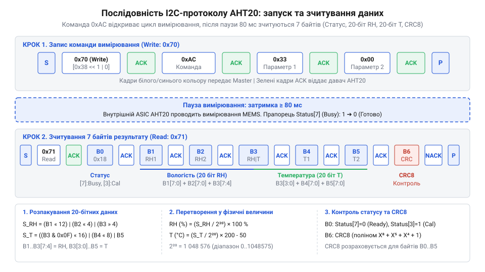

# Програмний інтерфейс та протокол обміну @@en

## Апаратний розсинхрон та викривлення даних @@en|I2C@@

Невдала спроба зчитати покази температури й вологості з давача одразу після ввімкнення живлення нерідко завершується отриманням хаотичних значень `0xFF` або повним блокуванням послідовної шини. Цифровий давач @@en|AHT20@@ не є простим масивом регістрів прямого доступу, а являє собою складну мікроелектронну систему. Всередині нього працює спеціалізована контролерна матриця @@en|ASIC@@ (від англ. *Application-Specific Integrated Circuit* — спеціалізована інтегральна схема), яка керує ємнісним @@en|MEMS@@ елементом вологості та напівпровідниковим сенсором температури. При подачі живлення внутрішній керувальний автомат потребує щонайменше 5 мс (типово до 40 мс) для завершення фази початкового зчитування заводських калібрувальних коефіцієнтів з енергонезалежної пам'яті @@en|OTP@@ (від англ. *One-Time Programmable memory* — пам'ять з одноразовим програмуванням) у внутрішні регістри @@en|SRAM@@. Спроба звернення до пристрою до завершення цього внутрішнього процесу призводить до того, що біт відкаліброваності в статусному регістрі залишається скинутим, а обчислені покази виявляються некоректними.

Якщо керувальний мікроконтролер запитує результати в той момент, коли аналогово-цифровий перетворювач пристрою ще виконує заміри, або коли внутрішній прошивальний блок не встиг завантажити калібрувальні коефіцієнти, вихідний потік даних викривляється. На відміну від ситуацій з [простішими однопровідними давачами](root:cat-hw-sensors/dht11), обмін по шині @@en|I2C@@ (від англ. *Inter-Integrated Circuit* — міжмікросхемна шина) вимагає суворого дотримання часових інтервалів і квитування станів.

Переривання транзакції на пів дорозі залишає внутрішній зсувний регістр @@en|AHT20@@ у стані очікування тактових імпульсів. У результаті лінія даних @@en|SDA@@ залишається притиснутою до землі, що блокує роботу будь-яких інших пристроїв на цій самій шині, показуючи важливість обробки прапорців готовності.

## Фіксована адреса @@en|I2C@@ та статусний байт @@en|AHT20@@

Давач @@en|AHT20@@ адресується на шині за допомогою фіксованого 7-бітного значення @@en|0x38@@ (у 8-бітному побітовому поданні зі зсувом це відповідає `0x70` для запису та `0x71` для зчитування). На відміну від пристроїв із можливістю апаратного вибору адреси через зовнішні виводи, кілька екземплярів @@en|AHT20@@ не можуть працювати на одній шині @@en|I2C@@ без використання зовнішнього мультиплексора.

Кожна операція зчитання з давача починається зі статусного байта (англ. *Status Byte*), який відображає поточний стан апаратного ядра пристрою.

Структура статусного байта складається з таких ключових бітів:

- @@en|Busy bit[7]@@ (біт 7): прапорець зайнятості пристрою. Значення `1` вказує на те, що внутрішній цифровий сигнальний процесор перебуває у процесі оцифрування аналогових сигналів чи обробки команди. Зчитування даних у цей момент дає хибні результати. Значення `0` свідчить про готовність до видачі результатів.
- @@en|Calibrated bit[3]@@ (біт 3): прапорець фабричної калібровки. Значення `1` означає, що калібрувальні коефіцієнти з внутрішньої пам'яті @@en|OTP@@ (від англ. *One-Time Programmable* — одноразово програмована пам'ять) успішно завантажені у робочі регістри @@en|SRAM@@. Якщо біт дорівнює `0`, пристрій видасть необроблені сирі коди, і йому потрібна примусова процедура ініціалізації.
- Резервні біти (6, 5, 4, 2, 1, 0): використовуються внутрішніми службовими алгоритмами пристрою для контролю живлення та системних режимів.

Перевірка @@en|Busy bit[7]@@ та @@en|Calibrated bit[3]@@ перед обробкою виміряних значень є обов'язковою умовою для отримання точних метрик вологості та температури, аналогічно до вимог в [інших I2C давачах](root:cat-hw-sensors/sht30).

Якщо прапорець @@en|Busy bit[7]@@ тривалий час (понад 100 мс) залишається в одиничному стані, це свідчить про зависання конвеєра вимірювання чи апаратний розсинхрон шини. Для програмного скидання заблокованого стану на давач надсилають команду м'якого перезапуску @@en|0xBA@@ або виконують процедуру примусового створення 9 тактових імпульсів на лінії @@en|SCL@@ при відпущеній лінії @@en|SDA@@, що звільняє вихідний транзистор @@en|AHT20@@ та повертає статусний байт у стан готовності.

## Ініціалізація та м'яке скидання пристрою

Після подачі живлення мікроконтролер має зчитати статусний байт пристрою. Якщо @@en|Calibrated bit[3]@@ виявляється рівним `0`, давач перебуває в неоткаліброваному стані й вимагає запуску процедури ініціалізації (від англ. *initialization* — започаткування, налаштування). При виконанні цієї процедури або після надсилання команди м'якого скидання @@en|0xBA@@ керуюча програма повинна витримати паузу тривалістю щонайменше 20 мс перед наступним зверненням по шині @@en|I2C@@, що гарантує завершення перезавантаження внутрішнього автомата станів @@en|ASIC@@ і повну готовність регістрів до прийому нових команд.

Для цього на адресу @@en|0x38@@ надсилається команда ініціалізації @@en|0xBE@@ разом із двома фіксованими параметрами `0x08` та `0x00`:

```
[Старт] -> [Адреса 0x38 + Запис] -> [0xBE] -> [0x08] -> [0x00] -> [Стоп]
```

Після передачі команди необхідно витримати затримку тривалістю щонайменше 10 мс, аби внутрішнє ядро @@en|AHT20@@ встигло переписати коефіцієнти з @@en|OTP@@ пам'яті у конфігураційні регістри.

У разі збоїв у живленні, виникнення електромагнітних завад або втрати синхронізації шини @@en|I2C@@ застосовують процедуру м'якого скидання (від англ. *soft reset* — програмний перезапуск). Для цього надсилається команда @@en|0xBA@@ без додаткових параметрів:

```
[Старт] -> [Адреса 0x38 + Запис] -> [0xBA] -> [Стоп]
```

Команда @@en|0xBA@@ перезапускає внутрішній автомат станів @@en|AHT20@@ та скидає регістри обміну без необхідності зняття апаратного живлення з виводу `VCC`. Тривалість паузи після м'якого скидання становить не менше 20 мс.

## Алгоритм запуску вимірювання та зчитування

Вимірювання температури й вологості відбувається за запитом мікроконтролера. Алгоритм складається з трьох послідовних кроків: відправки тригера вимірювання, витримання паузи для перетворення та зчитування 7-байтового пакета відповіді. При розпакуванні 20-бітних сирих даних із третього байта масиву (де 4 старші біти належать вологості, а 4 молодші — температурі) навіть якщо проміжне значення залишку після побітового зсуву дорівнює нулю, операція логічного додавання `|` зберігає цілісність розрядів без викривлення суміжних бітових полів.

Для запуску циклу вимірювання на адресу @@en|0x38@@ надсилається команда-тригер @@en|0xAC@@ із параметрами `0x33` та `0x00`:

```
[Старт] -> [Адреса 0x38 + Запис] -> [0xAC] -> [0x33] -> [0x00] -> [Стоп]
```

Після відправки команди мікроконтролер зобов'язаний витримати паузу тривалістю **80 мс**. Протягом цього часу внутрішній @@en|АЦП@@ проводить вибірку сигналів із сенсорних елементів. Після закінчення затримки виконується зчитання 7 байтів даних:

1. Байт 0: Статус (перевіряється @@en|Busy bit[7]@@, який має дорівнювати `0`).
2. Байт 1: Старші 8 бітів вологості `H[19:12]`.
3. Байт 2: Середні 8 бітів вологості `H[11:4]`.
4. Байт 3: Старші 4 біти — молодші біти вологості `H[3:0]`, молодші 4 біти — старші біти температури `T[19:16]`.
5. Байт 4: Середні 8 бітів температури `T[15:8]`.
6. Байт 5: Молодші 8 бітів температури `T[7:0]`.
7. Байт 6: Контрольна сума @@en|CRC-8@@.


*Часова діаграма послідовності викликів команд ініціалізації, тригера вимірювання 0xAC, затримки 80 мс та структура 7-байтового пакета даних.*

Обчислення 20-бітних сирих кодів вологості `S_H` та температури `S_T` виконується за схемою:

```
S_H = (Байт1 << 12) | (Байт2 << 4) | (Байт3 >> 4)      [об'єднання 20 бітів вологості]
RH = (S_H / 2²⁰) × 100                                [обчислення відносної вологості в %]
```

```
S_T = ((Байт3 & 0x0F) << 16) | (Байт4 << 8) | Байт5    [об'єднання 20 бітів температури]
T = (S_T / 2²⁰) × 200 - 50                            [обчислення температури в °C]
```

Такий алгоритм опитування застосовується і в [суміщених модулях вимірювання тиску](root:cat-hw-sensors/aht20-bmp280).

Приклади програмної реалізації опитування @@en|AHT20@@ для платформ ESP-IDF та Arduino наведено у вкладках:

:::tabs
:::code api-aht20-i2c-protocol-and-registers/c/esp-idf/aht20-calculate-crc8.c
:::code api-aht20-i2c-protocol-and-registers/cpp/arduino/calculatecrc8.cpp
:::

## Валідація даних контрольною сумою @@en|CRC-8@@

На довгих провідниках шини @@en|I2C@@ або в умовах підвищеного рівня електромагнітних завад імпульси даних можуть спотворюватися. Для запобігання використанню пошкоджених вимірювань у 7-байтовому пакеті @@en|AHT20@@ сьомий байт (Байт 6) відведено під контрольну суму @@en|CRC-8@@ (від англ. *Cyclic Redundancy Check* — циклічний надлишковий код). Для оптимізації обчислень на малопотужних 8-бітних мікроконтролерах замість побітового циклу часто використовують заздалегідь розраховану лукап-таблицю (від англ. @@en|Lookup Table@@) на 256 елементів у PROGMEM або ROM. Такий підхід скорочує обчислення з 8 операцій зсуву й побітового XOR до єдиної табличної вибірки `crc = crc_table[crc ^ data[i]]` для кожного з 6 вхідних байтів пакета, суттєво економлячи такти процесора в батарейних пристроях.

Контрольна сума обчислюється для перших 6 байтів пакета (від статусного байта 0 до байта даних 5 включно) за нормалізованим твірним поліномом `x⁸ + x⁵ + x⁴ + 1` (у шістнадцятковому вираженні маска дорівнює @@en|0x31@@).

Алгоритм обчислення базується на побітовому покроковому зсуві регістру з початковим значенням `0xFF`:

```
CRC₀ = 0xFF
CRC₁ = CRC₀ ⊕ Байт₀                     [побітове виключне АБО з черговим байтом]
CRC₂ = (CRC₁ << 1) ⊕ 0x31               [зсув ліворуч та XOR з маскою 0x31 при MSB == 1]
...
CRC_обчислено = CRC                      [підсумкове значення порівнюється з Байтом 6]
```

Якщо підраховане значення @@en|CRC-8@@ збігається з переданим Байтом 6, дані вважаються достовірними й передаються на обробку. Якщо виявлено розбіжність, поточний відлік відкидається. При систематичних помилках контрольної суми рекомендується виконати команду м'якого скидання @@en|0xBA@@ для відновлення коректного фреймінгу обміну.
