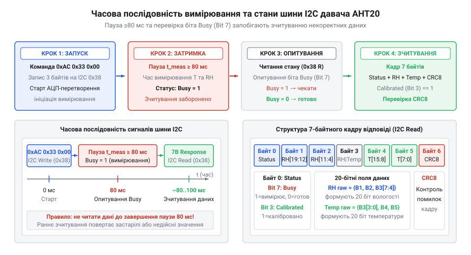
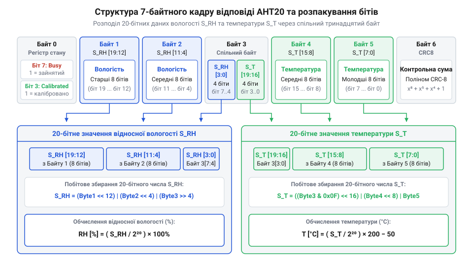

# Програмний інтерфейс AHT20: карта команд I2C, регістр стану та таймінги вимірювання

<preknowlist>
- [SHT30 — температура й вологість (I2C)](root:cat-hw-sensors/sht30) — принципи командного керування та зчитування кадру даних цифрових датчиків вологості по шині I2C
- [AHT20 + BMP280 — температура, вологість, тиск](root:cat-hw-sensors/aht20-bmp280) — конструктивні особливості модуля AHT20 та загальна організація апаратної частини
- [Формула Магнуса-Тетенса для водяної пари](root:cat-hw-sensors/magnus-formula) — теоретичний зв'язок виміряної відносної вологості й температури з точкою роси
</preknowlist>

## Чому пряме зчитування AHT20 повертає сміття

Спроба проінспектувати стан цифрового давача довкілля одразу після подачі живлення здається найпростішим шляхом перевірки його працездатності: розробник надсилає адресний запит зчитати зауважені байти й очікує отримати коректні значення відносної вологості та температури. Однак при використанні давача @@en|AHT20@@ такий підхід призводить до зчитування сміттєвих даних, нескінченних таймаутів або навіть блокування шини @@en|I2C@@ (від англ. @@en|Inter-Integrated Circuit@@ — міжмікросхемна шина). Причина полягає в будові пристрою: @@en|AHT20@@ — це не просто пасивний сенсорний елемент, а комбінований аналого-цифровий вузол із вбудованим @@en|DSP@@ (від англ. @@en|Digital Signal Processor@@ — цифровий сигнальний процесор) та @@en|АЦП@@ (від англ. @@en|Analog-to-Digital Converter@@ — аналого-цифровий перетворювач). Пристрій потребує строго визначеної послідовності ініціалізації, тактування та часових інтервалів для виконання обчислень усередині чіпа.

Коли на @@en|AHT20@@ подається напруга живлення, внутрішньому контролеру потрібен час для виходу на робочий режим (понад 100 мс для завершення стартового скидання та стабілізації внутрішнього генератора). У цей період сенсорний елемент @@en|MEMS@@ (від англ. @@en|Micro-Electro-Mechanical Systems@@ — мікроелектромеханічні системи) ще не сформував стабільну ємність, а @@en|DSP@@ не завантажив заводські калібрувальні коефіцієнти з внутрішньої @@en|OTP@@ (від англ. @@en|One-Time Programmable@@ — одноразово програмована) пам'яті. Якщо мікроконтролер надсилає операцію читання по шині @@en|I2C@@ без попередньої команди вимірювання, давач віддає вміст свого внутрішнього буфера регістра стану або невизначені значення, які сприймаються як випадкове сміття (`0xFF` або `0x00`).

Друга суттєва причина сміттєвих даних — ігнорування тривалості фізичного вимірювання. На відміну від простих компонентів у комбінованих модулях на кшталт [AHT20 та BMP280](root:cat-hw-sensors/aht20-bmp280), де кожен сенсор має власні регістри даних, @@en|AHT20@@ виконує квантування аналогового сигналу @@en|MEMS@@-капсули лише за зовнішнім запитом. Перетворення ємності первинного елемента у 20-бітний цифровий код триває десятки мілісекунд. Зчитування даних до завершення цієї процедури змушує чіп віддавати незавершені проміжні значення або застарілий результат попереднього циклу. Крім того, переривання передачі байтів на шині @@en|I2C@@ без витримування біта готовності може залишити лінію @@en|SDA@@ (від англ. @@en|Serial Data Line@@ — послідовна лінія даних) притиснутою до землі, що блокує подальший обмін до перезапуску шини.

## Карта команд і регістр стану AHT20

Щоб уникнути зчитування невалідного кадру, взаємодія з @@en|AHT20@@ завжди починається з інспектування його внутрішнього регістра стану. Давач відповідає по шині @@en|I2C@@ за фіксованою 7-бітною адресою `0x38`. На відміну від пристроїв із розгалуженим простором регістрів, @@en|AHT20@@ повертає 8-бітний статус у першому ж байті відповіді під час будь-якої сесії зчитання.

Регістр стану має таку бітову структуру:

- **Біт 7** (`@@en|Busy@@`): прапорець зайнятості. Значення `1` вказує, що давач перебуває у процесі вимірювання або внутрішньої обробки даних @@en|DSP@@. Значення `0` свідчить про завершення обчислень та готовність даних до зчитування. - **Біт 6 та Біт 5**: біти режиму роботи (зазвичай `00` для нормального вимірювального режиму). - **Біт 3** (`@@en|Calibrated@@`): прапорець завантаження калібрувальних коефіцієнтів. Значення `1` означає, що фабрична матриця калібрування успішно завантажена в @@en|RAM@@ (від англ. @@en|Random Access Memory@@ — оперативна пам'ять) чіпа. Значення `0` сигналізує про відсутність калібрувальних даних, через що виміряні показники будуть недовірливими. - **Біти 4, 2, 1, 0**: зарезервовані внутрішні статусні прапорці чіпа.

Якщо після подачі живлення та перевірки регістра стану біт `@@en|Calibrated@@` (біт 3) дорівнює `0`, мікроконтролер зобов'язаний виконати процедуру ініціалізації. На відміну від [цифрового датчика SHT30](root:cat-hw-sensors/sht30), де конфігурація задається вибором розрядності чи періодичності, @@en|AHT20@@ вимагає надсилання суворо визначеної командної послідовності з трьох байтів: `0xBE 0x08 0x00`. У цій трійці код `0xBE` слугує безпосередньою командою ініціалізації, а перший параметр `0x08` містить бітову маску (у якій встановлено саме біт 3), що вмикає режим калібрування та дозволяє внутрішньому контролеру зчитати константи з @@en|OTP@@-пам'яті в оперативні регістри @@en|RAM@@. Другий параметр `0x00` виконує роль вирівнювального байта-заповнювача: внутрішній автомат станів чіпа очікує фіксовану довжину кадру в 3 байти, і без цього підтверджувального нуля транзакція вважається незавершеною, через що давач ігнорує запит і залишає біт `@@en|Calibrated@@` скинутим.

- **Байт 0**: `0xBE` — команда ініціалізації. - **Байт 1**: `0x08` — перший параметр налаштування регістрів калібрування. - **Байт 2**: `0x00` — другий параметр (резервний байт узгодження).

Після відправлення послідовності `0xBE 0x08 0x00` мікроконтролер повинен витримати паузу щонайменше 10 мс для завантаження констант з @@en|OTP@@-пам'яті в робочий регістр чіпа, після чого повторне опитування статусу має показати прапорець `@@en|Calibrated@@` в одиничному стані.

## Запуск вимірювання та часовий регламент затримок

Процес отримання оновлених значень температури й вологості є активним циклом, який запускається спеціальною трибайтною командою `0xAC 0x33 0x00`. Запис цієї послідовності в давач змушує @@en|DSP@@ увімкнути аналогову частину @@en|АЦП@@, опитати ємнісний елемент вологості та терморезистор, після чого провести лінеаризацію сигналу.

Послідовність байтів команди запуску має такий вигляд:

- **Байт 0**: `0xAC` — команда запуску вимірювання. - **Байт 1**: `0x33` — параметр вибору вимірювальних каналів (вологість і температура). - **Байт 2**: `0x00` — вирівнювальний параметр.

Після надсилання команди `0xAC 0x33 0x00` давачу потрібен час для завершення обчислень. Мінімальний регламентований часовий інтервал становить 80 мс. Протягом цього часу біт `@@en|Busy@@` (біт 7) у регістрі стану залишається рівним `1`.


*Діаграма часової послідовності вимірювального циклу AHT20 від надсилання команди 0xAC до зчитування 7-байтного кадру.*

На відміну від однодротових датчиків на кшталт [температурного датчика DS18B20](root:cat-hw-sensors/ds18b20), де перетворення може тривати до 750 мс, @@en|AHT20@@ гарантує готовність у межах 80–100 мс при кімнатній температурі. Розробник має два варіанти організації затримки:

1. **Блокуюча затримка**: витримування фіксованої паузи (80–100 мс) за допомогою системного таймера з наступним одноразовим зчитуванням кадру. 2. **Опитування прапорця (Polling)**: витримування початкової паузи 80 мс із подальшим періодичним опитуванням 1-байтного статусу по @@en|I2C@@ кожні 5–10 мс до обнулення біта `@@en|Busy@@`.

Для запобігання зависанню програми в разі відмови давача обов'язково реалізують таймаут очікування (зазвичай 150 мс). Якщо біт `@@en|Busy@@` не скидається в `0` після 150 мс, система фіксує помилку вимірювального циклу та ініціює програмне скидання давача командою `0xBA`.

## Структура кадру та розпакування 20-бітних даних

Після скидання біта `@@en|Busy@@` в `0` мікроконтролер виконує операцію зчитування кадру по шині @@en|I2C@@. Повний кадр відповіді @@en|AHT20@@ складається з 7 байтів.


*Розподіл прапорців регістра стану, 20-бітних полів вологості й температури та байта CRC8 у кадрі AHT20.*

Розподіл даних по батах кадру відповіді впорядковано наступним чином:

- **Байт 0**: Регістр стану (біт 7 — `@@en|Busy@@`, біт 3 — `@@en|Calibrated@@`). - **Байт 1**: `S_RH[19..12]` — найстарший байт @@en|MSB@@ (від англ. @@en|Most Significant Byte@@ — найстарший байт) 20-бітного значення вологості. - **Байт 2**: `S_RH[11..4]` — середній байт 20-бітного значення вологості. - **Байт 3**: Спільний розщеплений байт:
  - Старші 4 біти (`[7..4]`): `S_RH[3..0]` — наймолодший півбайт вологості. - Молодші 4 біти (`[3..0]`): `S_T[19..16]` — найстарший півбайт температури. - **Байт 4**: `S_T[15..8]` — середній байт 20-бітного значення температури. - **Байт 5**: `S_T[7..0]` — наймолодший байт @@en|LSB@@ (від англ. @@en|Least Significant Byte@@ — наймолодший байт) 20-бітного значення температури. - **Байт 6**: Контрольна сума @@en|CRC8@@ (від англ. @@en|Cyclic Redundancy Check 8-bit@@ — 8-бітний циклічний надлишковий код).

Подібно до компактних [перетворювачів серії GY-21](root:cat-hw-sensors/gy-21), де розрядність впливає на компоновку даних, 20-бітна структура @@en|AHT20@@ вимагає застосування побітових зсувів та маскування.

Для вилучення сирого цілого числа відносної вологості `S_RH` виконується зсув та об'єднання байтів 1, 2 і старшої половини байта 3:

```
S_RH = (byte[1] << 12) | (byte[2] << 4) | (byte[3] >> 4)
```

Для вилучення сирого цілого числа температури `S_T` виділяється молодший півбайт із байта 3 та об'єднується з байтами 4 і 5:

```
S_T = ((byte[3] & 0x0F) << 16) | (byte[4] << 8) | byte[5]
```

Змінні `S_RH` та `S_T` приймають цілочисельні значення в діапазоні від `0` до `2²⁰ - 1` (тобто від `0` до `1048575`).

## Математичний розрахунок показників і перевірка CRC8

Отримані 20-бітні цілочисельні значення `S_RH` та `S_T` є сирими кодами @@en|DSP@@. Для їх переведення у фізичні величини відносної вологості (у відсотках `%RH`) та температури (у градусах Цельсія `°C`) використовуються лінійні математичні співвідношення.

Розрахунок відносної вологості `RH` здійснюється шляхом нормування сирого коду `S_RH` відносно максимального діапазону `2²⁰` (або `1048576`) з подальшим множенням на `100%`:

```
RH = (S_RH / 2²⁰) × 100%
   = (S_RH / 1048576) × 100%      [підстановка 2²⁰ = 1048576]
```

Перетворення 20-бітного коду температури `S_T` охоплює діапазон вимірювань від `-50 °C` до `+150 °C` (загальна шкала охоплює `200 °C`):

```
T = (S_T / 2²⁰) × 200 - 50
  = (S_T / 1048576) × 200 - 50    [підстановка 2²⁰ = 1048576]
```

На відміну від [аналогових датчиків LM35DZ](root:cat-hw-sensors/lm35) або [термісторів серії KY-013](root:cat-hw-sensors/ky-013-thermistor), де вимірювання схильне до наведень в аналоговому тракті, цифровий кадр @@en|AHT20@@ захищений 8-бітним контрольним кодом @@en|CRC8@@. Для перевірки цілісності 6 байтів даних (від Байта 0 до Байта 5) обчислюється контрольна сума за поліномом `x⁸ + x⁵ + x⁴ + 1` (значення полінома `0x31`) з початковим значенням регістра `0xFF`. Якщо обчислений результат збігається з 7-м байтом кадру (`byte[6]`), дані вважаються валідними.

Отримані показники вологості та температури можна використати з [формулою Магнуса-Тетенса](root:cat-hw-sensors/magnus-formula) для розрахунку точки роси у розширених системах моніторингу довкілля.

Нижче наведено повні приклади реалізації драйвера @@en|AHT20@@ для платформ @@en|ESP-IDF@@ та @@en|Arduino@@:

:::tabs
@tab C (ESP-IDF)
:::code api-aht20-protocol-and-registers/c/esp-idf/aht20-calc-crc8.c
@tab C++ (Arduino)
:::code api-aht20-protocol-and-registers/cpp/arduino/aht20sensor.cpp
:::