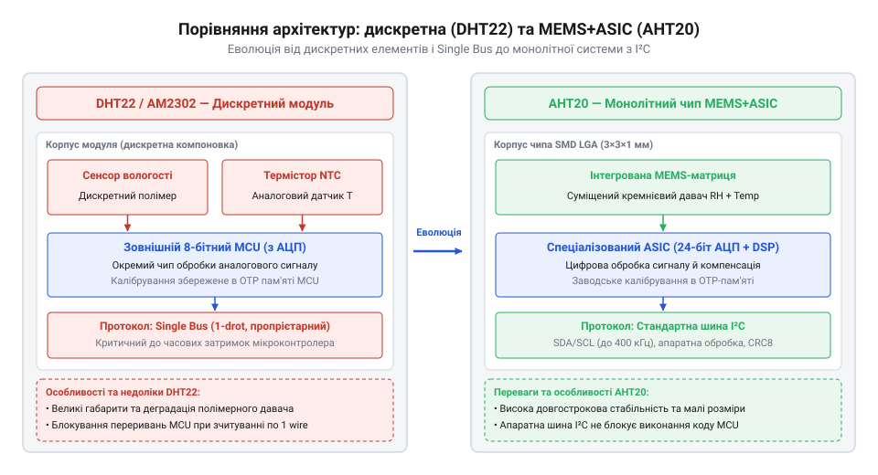
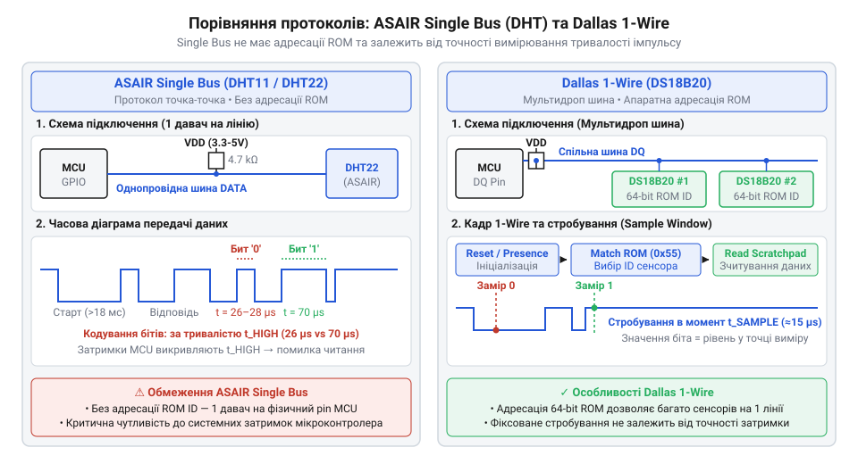

# Еволюція цифрових сенсорів ASAIR: від однопровідних DHT11/DHT22 до I2C-чипа AHT20

<preknowlist>
- [DHT11](root:cat-hw-sensors/dht11) — базові принципи зчитування вологості та специфіку роботи ранніх дискретних модулів ASAIR
- [DS18B20](root:cat-hw-sensors/ds18b20) — принципи побудови справжнього протоколу Dallas 1-Wire з ROM-адресацією для порівняння з пропрієтарним Single Bus
- [SHT30](root:cat-hw-sensors/sht30) — концепцію побудови сучасних цифрових датчиків вологості з шиною I2C
</preknowlist>

## Проблема дискретних давачів DHT11

Вимірювання відносної вологості на аналогових сенсорах вимагало складного схематичного обв'язування, аналогово-цифрових перетворювачів (@@en|ADC@@, від англ. *analog-to-digital converter* — «аналогово-цифровий перетворювач») та кастомного калібрування. Подібно до [аналогових термісторів серії KY-013](root:cat-hw-sensors/ky-013-thermistor) або [лінійних аналогових давачів](root:cat-hw-sensors/lm35), показання вимагали математичних формул у коді мікроконтролера (@@en|MCU@@, від англ. *microcontroller unit* — «мікроконтролерний блок»).

Першим масовим кроком до спрощення цієї схеми стала поява цифрового давача @@en|DHT11@@ від компанії Guangzhou Aosong Electronics (@@en|ASAIR@@). У спільному корпусі виробник об'єднав дискретний резистивний елемент вологості, аналоговий термістор NTC та 8-бітний @@en|MCU@@. Внутрішній мікроконтролер сенсора самостійно зчитував опір полімеру, підставляв табличні коефіцієнти калібрування з вбудованої пам'яті й видавав готовий цифровий результат.

Однак цифрове підключення породило проблему залежності від мікросекундних затримок. Для зв'язку компанія @@en|ASAIR@@ розробила власну часово-залежну шину @@en|Single Bus@@ (від англ. *single bus* — «одинарна шина»). Вона використовувала одну лінію даних, але вимагала суворого дотримання інтервалів: хост-контролер притискав лінію до нуля щонайменше на 18 мілісекунд, після чого давач у відповідь утримував 80 мікросекунд LOW, 80 мікросекунд HIGH і починав передачу 40 біт даних.

Кожен біт у протоколі @@en|Single Bus@@ кодується тривалістю високого рівня:
```
Логічний '0': пауза 50 мкс (LOW) + імпульс 26–28 мкс (HIGH)
Логічний '1': пауза 50 мкс (LOW) + імпульс 70 мкс (HIGH)
```
Оскільки значення біта визначається різницею тривалості високого стану всього у 40 мікросекунд, процесор хоста змушений вимірювати ширину імпульсів із високою точністю. Будь-яка затримка виконання коду — наприклад, переривання від таймера чи @@en|UART@@ — призводить до викривлення часових відрізків і втрати всієї пачки даних. У результаті розробники були змушені блокувати всі переривання @@en|MCU@@ на час опитування @@en|DHT11@@ або реалізовувати прямо маніпулювання бітами (@@en|bit-banging@@, від англ. *bit banging* — «пряме маніпулювання бітами»).

Окрім часової чутливості, резистивний полімерний елемент @@en|DHT11@@ мав фізичні обмеження: вузький діапазон вимірювання вологості (від 20% до 90% відносної вологості @@en|RH@@, від англ. *relative humidity* — «відносна вологість») та високу похибку ±5% @@en|RH@@. Лише цілочисельна розрядність робила [цифровий давач DHT11](root:cat-hw-sensors/dht11) придатним тільки для найпростіших навчальних проєктів.

## Спроба виправлення: DHT22 та AM2302

Щоб подолати низьку точність DHT11, компанія @@en|ASAIR@@ випустила давач @@en|DHT22@@ (відомий як @@en|AM2302@@). Оновлена модель обіцяла розширений діапазон (0–100% @@en|RH@@, -40…+80 °C) та 16-бітну розрядність @@en|ADC@@. Для цього резистивний елемент замінили на ємнісний сенсор вологості (@@en|capacitive humidity sensor@@), у якому полімерний конденсатор змінює ємність залежно від поглинутої з повітря вологи.

Проте всередині корпусу залишилася дискретна платформа: окремий сенсорний елемент, термістор та обв'язка, розпаяні на спільній друкованій платі.


*Порівняння внутрішньої архітектури дискретного давача DHT22 з окремим контролером та інтегрованої системи AHT20 на основі MEMS та ASIC.*

Дискретна компоновка створила три фундаментальні проблеми:
1. **Аналогові втрати й наводки.** Довгі доріжки плати між ємнісною коміркою та @@en|ADC@@ сприймали електромагнітні завади й мали паразитну ємність. 2. **Деградація полімеру.** Відкрита плівка за тривалої вологості (>80% @@en|RH@@) незворотно набрякала й забруднювалася. 3. **Дрейф калібрування.** Заводські коефіцієнти розраховувалися під початкові параметри деталей. Зі старінням полімеру та термістора виникав незворотний дрейф показань (@@en|drift@@, від англ. *drift* — «зміщення показань»).

Підвищення розрядності @@en|ADC@@ до 16 біт створило ілюзію точності, але [цифровий давач DHT22](root:cat-hw-sensors/dht22) лише видавав спотворені старінням дані з більшою кількістю знаків після коми. Дискретна плата вичерпала свій потенціал, що змусило перейти до монолітних чипів із @@en|MEMS@@ (від англ. *micro-electromechanical systems* — «мікроелектромеханічні системи») та @@en|ASIC@@ (від англ. *application-specific integrated circuit* — «інтегральна схема спеціального призначення»).

## Криза Single Bus та міф 1-Wire

Паралельно з фізичним зносом матеріалів виникла системна криза програмного інтерфейсу. Поширення одноплатних комп'ютерів (@@en|SBC@@, від англ. *single-board computer* — «одноплатний комп'ютер») під управлінням Linux викрило непридатність часово-залежного протоколу @@en|Single Bus@@.

У багатозадачній операційній системі ядерний планувальник довільно перериває обробку процесів користувача. Переривання контексту навіть на 30–50 мікросекунд під час зчитування тривалості імпульсу перетворює логічний нуль (28 мкс) на логічну одиницю (70 мкс). Через це понад третина запитів до давачів @@en|DHT11@@ та @@en|DHT22@@ завершувалася помилкою контрольної суми.

На тлі цих збоїв укорінився небезпечний міф: фірмовий протокол @@en|ASAIR@@ @@en|Single Bus@@ вважали тотожним класичній шині @@en|Dallas 1-Wire@@. Плутанина виникла через схожу назву та використання одного фізичного проводу для передачі даних, що призводило до помилок апаратного підключення.


*Порівняльний аналіз часових діаграм і топології підключення пропрієтарного протоколу ASAIR Single Bus та адресованої шини Dallas 1-Wire.*

Насправді між цими протоколами існує фундаментальна апаратно-архітектурна відмінність:

1. **Адресація та топологія шини.** [Цифровий давач DS18B20](root:cat-hw-sensors/ds18b20) на шині @@en|Dallas 1-Wire@@ має унікальний 64-бітний номер у постійній пам'яті (@@en|ROM@@, від англ. *read-only memory* — «постійний запам'ятовувальний пристрій»). Це дозволяє підключати десятки давачів паралельно до одного виводу @@en|GPIO@@. Протокол @@en|ASAIR@@ @@en|Single Bus@@ взагалі не має адресації і працює лише за топологією «точка-точка». 2. **Арбітраж та часові слоти.** У шині @@en|Dallas 1-Wire@@ ініціатором кожного бітового слота виступає хост. У @@en|Single Bus@@ хост лише дає стартовий імпульс, після чого ведений сенсор автономно вистрілює пачку з 40 бітів із власними таймінгами, вимагаючи жорсткої прив'язки процесора.

Неможливість надійної роботи в операційних системах та відсутність адресації зробили пропрієтарний @@en|Single Bus@@ глухим кутом розвитку. Щоб конкурувати з сучасними рішеннями на кшталт [промислових модулів SHT30](root:cat-hw-sensors/sht30), компанія @@en|ASAIR@@ мала відмовитися від часово-залежного протоколу.

Відповіддю на еволюційну кризу став монолітний чип AHT20 із стандартизованим апаратним інтерфейсом @@en|I2C@@ (від англ. *inter-integrated circuit* — «міжінтегральна схема»), який розв'язав проблеми таймінгів. Детальний аналіз використання сучасної зв'язки цього чипа з барометром висвітлено в описі [комбінованого модуля AHT20 та BMP280](root:cat-hw-sensors/aht20-bmp280).

## Архітектурний прорив MEMS+ASIC у AHT20

Перші покоління давачів вологості @@en|ASAIR@@ зіштовхнулися із системними кризами конструкції. Модулі DHT11 та DHT22 являли собою компромісну збірку: відсутність герметизації призводила до деградації провідників і полімеру від вологи. Додатково часова залежність протоколу @@en|Single Bus@@ змушувала керуючий @@en|MCU@@ вимикати переривання під час зчитування, що викликало збої в операційних системах та втрати даних.

Відповіддю стала відмова від дискретної архітектури на користь монолітного кремнієвого виготовлення. У 2020 році компанія @@en|ASAIR@@ випустила сенсор @@en|AHT20@@, де чутливий елемент й обробка сигналів об'єднані у спільному мікрокомпоненті. Основою пристрою стала мікроелектромеханічна система @@en|MEMS@@ (від @@en|Micro-Electro-Mechanical Systems@@ — мікроелектромеханічні системи) та спеціалізована інтегральна схема @@en|ASIC@@ (від @@en|Application-Specific Integrated Circuit@@ — спеціалізована інтегральна схема) на єдиному кристалі. Увесь вузол загерметизували у поверхнево-монтованому корпусі @@en|DFN@@ (від @@en|Dual Flat No-leads@@ — двосторонній плаский корпус без виводів) розміром 3 × 3 × 1 мм. Захисний шар з оксиду кремнію над мембраною @@en|MEMS@@ надав сенсору стійкості до крапель води й агресивних газів, зупинивши руйнування діелектрика. Детальний розбір фізичної структури чутливого елемента та функціональних блоків інтегральної схеми наведено у статті про [архітектуру MEMS+ASIC давачів вологості серії AHT20](root:cat-hw-sensors/aht20-mems-architecture).

Проривом у @@en|AHT20@@ став процес первинного калібрування, який усунув високий розкид параметрів дискретних модулів. Кожен виготовлений кристал піддається автоматизованому калібруванню в атмосферній камері на лінії збирання. Індивідуальні коефіцієнти корекції записуються в одноразово програмовану пам'ять @@en|OTP@@ (від @@en|One-Time Programmable@@ — одноразово програмована пам'ять), інтегровану в @@en|ASIC@@. Під час кожного ввімкнення живлення чип @@en|ASIC@@ автоматично зчитує коефіцієнти з пам'яті @@en|OTP@@ та виконує апаратну поліноміальну компенсацію температури для кожного заміру відносної вологості @@en|RH@@. Центральний процесор отримує вже скориговані фізичні величини, що позбавляє потреби в ручних формулах у коді.

Перехід до апаратного протоколу @@en|I2C@@ завершив еволюційний стрибок ASAIR. Сенсор @@en|AHT20@@ працює на шині @@en|I2C@@ з адресою `0x38` на частоті до 400 кГц. Це усунуло потребу в часових затримках та програмному опитуванні ніжок @@en|bit-banging@@, які блокували виконання інших задач у керуючому мікроконтролері. Наявність апаратного обчислення контрольної суми @@en|CRC@@-8 у вихідному пакеті гарантує виявлення помилок передачі. Поєднання технології MEMS+ASIC, пам'яті OTP та шини I2C забезпечило @@en|AHT20@@ перевагу над попередніми поколіннями DHT у стабільності вимірювань, довговічності та простоті програмної інтеграції. Докладніше про апаратні характеристики, карту регістрів шини I2C та процедуру опитування читайте в матеріалі про [давач температури й вологості AHT20](root:cat-hw-sensors/aht20).

## Практичні уроки та сучасний вибір

Використання [застарілого давача DHT11](root:cat-hw-sensors/dht11) або DHT22 у нових розробках створює технічний борг через щорічний дрейф на 0.5–1% @@en|RH@@, тривалий час відгуку та високе навантаження на ядро через тривале утримання лінії @@en|Single Bus@@. Інтеграція чипа @@en|AHT20@@ зберігає низьку собівартість пристрою, підвищуючи точність вимірювання вологості до ±2% @@en|RH@@ і температури до ±0.3°C без ризику зависання контролера.

Чип @@en|AHT20@@ є оптимальним для побутових пристроїв, проте інженер враховує й альтернативи: промисловий [чип SHT30](root:cat-hw-sensors/sht30) від @@en|Sensirion@@ має апаратний нагрівач для висушування діелектрика, [модулі типу GY-21](root:cat-hw-sensors/gy-21) забезпечують сумісність із застарілими платами, а суміщений [модуль AHT20 та BMP280](root:cat-hw-sensors/aht20-bmp280) додає вимірювання тиску на єдиній шині @@en|I2C@@.

Окрему увагу приділяють виявленню деградованих чи фальсифікованих модулів. Для перевірки @@en|AHT20@@ застосовують діагностику шини: після відправки команди ініціалізації `0xBE` чип має повернути байт статусу зі встановленим бітом калібрування `0x08`. Суцільні нулі, відсутній біт готовності або незмінна контрольна сума @@en|CRC@@ свідчать про дефектну чи незаписану пам'ять @@en|OTP@@.

Для побутових пристроїв @@en|AHT20@@ повністю витіснив DHT-модулі. Однак для промислових агресивних середовищ, де потрібен розрахунок точки роси за [формулою Магнуса-Тетенса](root:cat-hw-sensors/magnus-formula) при високих температурах, напівпровідникові чипи поступаються стійкішим рішенням — у таких умовах обирають [металеві датчики PT100](root:cat-hw-sensors/pt100-rtd) із [перетворювачем MAX31865](root:cat-hw-sensors/max31865-rtd-converter).