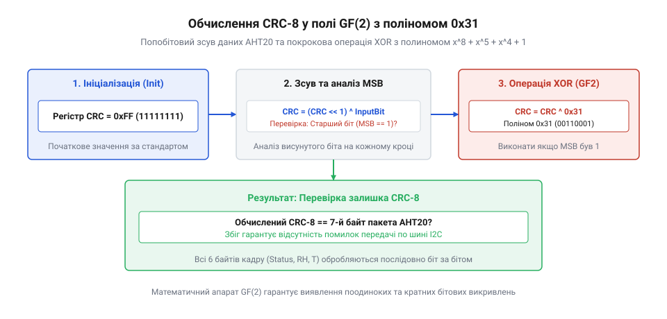

# Математична модель та обчислення контрольної суми @@en

<preknowlist>
- [AHT20 + BMP280](root:cat-hw-sensors/aht20-bmp280) — Структура кадру даних сенсора @@en|AHT20@@, порядок передачі байтів вологості й температури по шині @@en|I2C@@.
</preknowlist>

## Виявлення спотворень даних шини @@en|I2C@@

Під час зчитування вимірювань цифрових датчиків по шині @@en|I2C@@ на довгих провідниках або в умовах електромагнітних завад виникають спотворення сигналів. Якщо на лінії зв'язку відбудеться одиночний збій напруги, мікроконтролер може отримати некоректні сирі байти температури та вологості. Без додаткової перевірки цілісності прошивка сприйме хибне значення (наприклад, стрибок з 22 °C до 150 °C) як реальний вимір, що призведе до аварійного відключення або помилкових рішень автоматики.

Найпростіші методи контролю цілісності не здатні захистити кадр вимірювань. Перевірка на @@en|паритет@@ (від лат. *paritas* — рівність) додає один біт парності до кожного байта, але виявляє лише непарну кількість інвертованих бітів. Якщо завада спотворить одразу два біти в байті, паритет залишиться незмінним. Арифметична сума байтів кадру за модулем 256, яка застосовується в [простіших кліматичних датчиках](root:cat-hw-sensors/dht11), не бачить ситуацій, коли спотворення в одному байті компенсується протилежною помилкою в іншому (наприклад, збільшенням одного значення на 4 і зменшенням сусіднього на 4).

Для надійного захисту [кадру вимірювань сенсора](root:cat-hw-sensors/aht20-bmp280) застосовують циклічний надлишковий код @@en|CRC-8@@ (англ. @@en|Cyclic Redundancy Check@@, від грец. *ϗύϗλος* — коло та лат. *redundantia* — надмірність). Цей математичний апарат розглядає весь пакет даних як єдине двійкове число або поліном. Обчислення ділення цього полінома на фіксований твірний поліном дає контрольний залишок із високою чутливістю до будь-яких групових чи одиночних бітових зсувів.

## Математика ділення поліномів у @@en|GF(2)@@

Математичною основою коду @@en|CRC-8@@ є арифметика в скінченному полі Галуа @@en|GF(2)@@ (англ. @@en|Galois Field@@, названому на честь математика Еваріста Галуа). У цьому полі всі обчислення виконуються над двійковими числами 0 та 1, а операції додавання й віднімання еквівалентні та виконуються за модулем 2 без перенесення розрядів. З погляду цифрової логіки це відповідає побітовій операції виключального АБО — @@en|XOR@@:

```
1 + 1 = 0      [додавання за модулем 2 без перенесення]
1 + 0 = 1      [додавання за модулем 2 без перенесення]
0 + 0 = 0      [додавання за модулем 2 без перенесення]
```

Послідовність байтів кадру подається у вигляді двійкового полінома `M(x)` (від грец. *πολύς* — численний та *ὄνομα* — ім'я), де кожен біт є коефіцієнтом при відповідному степені `x`. Для сенсора @@en|AHT20@@ стандартизовано твірний поліном `G(x)` степеня 8:

```
G(x) = x^8 + x^5 + x^4 + 1
```

У двійковій формі коефіцієнти полінома `G(x)` записують як `100110001_2`. Оскільки старший біт при `x^8` завжди дорівнює 1, у 8-бітових регістрах використовують молодші вісім бітів `00110001_2`, що в шістнадцятковій системі відповідає значенню `0x31`.

Перед початком ділення вхідне повідомлення `M(x)` помножують на `x^8` (зсувають на 8 бітів уліво для звільнення місця під 8-бітовий залишок) та ініціалізують вектором ініціалізації `0xFF` (англ. @@en|initialization vector@@, від лат. *initium* — початок та *vector* — носій). Вектор `0xFF` підготовлює регістр і запобігає ситуації, коли нульовий кадр даних продукував би нульову контрольну суму без виявлення втрати байтів.


*Послідовне ділення кадру даних на твірний поліном 0x31 у полі GF(2) утворює восьмибітовий залишок, який стає контрольною сумою.*

Процес обчислення полягає в знаходженні залишку `R(x)` від ділення вихідного полінома на `G(x)` у полі @@en|GF(2)@@:

```
M(x) * x^8 + IV(x) = Q(x) * G(x) + R(x)     [ділення поліномів у GF(2)]
```

Тут `Q(x)` позначено як частку від ділення, а отриманий залишок `R(x)` степеня менше 8 є шуканою контрольною сумою @@en|CRC-8@@.

## Попобітовий алгоритм розрахунку контрольної суми

Попобітовий алгоритм реалізує математичне ділення поліномів через послідовний @@en|регістр@@ (від лат. *registrum* — список) зсуву зі зворотним зв'язком. Зсувний регістр розміром 1 байт ініціалізується значенням `0xFF`. Кожен вхідний байт із кадру вимірювань @@en|AHT20@@ додається до поточного стану регістра через операцію @@en|XOR@@.

Далі для кожного з восьми бітів байта аналізується старший розряд — @@en|MSB@@ (від англ. @@en|Most Significant Bit@@ — найстарший значущий біт). Якщо @@en|MSB@@ дорівнює `1`, це означає, що поточний старший степінь ділиться на твірний поліном: регістр зсувається ліворуч на 1 біт, і до нього застосовується @@en|XOR@@ з маскою `0x31`. Якщо @@en|MSB@@ дорівнює `0`, виконується лише зсув ліворуч без застосування полінома.

Головна перевага попобітового підходу — мінімальне використання оперативної пам'яті @@en|RAM@@: для роботи потрібні лише дві змінні в регістрах @@en|CPU@@. Це ідеально підходить для обмежених мікроконтролерів із малими обсягами пам'яті.

Нижче наведено практичну реалізацію попобітового алгоритму для сенсора @@en|AHT20@@ мовами C та C++:

:::tabs
:::code math-aht20-crc8-checksum-calculation/c/mcu/aht20-crc8-bitwise.c
:::code math-aht20-crc8-checksum-calculation/cpp/mcu/snippet-2.cpp
:::

## Табличне прискорення обчислення контрольної суми

Попобітовий розрахунок вимагає виконання циклу з 8 ітерацій та умовних розгалужень для кожного байта каду. На високочастотних опитуваннях або під час обробки значного потоку вимірювань це створює помітне обчислювальне навантаження на процесор @@en|CPU@@.

Табличний алгоритм усуває циклічні зсуви за рахунок попереднього розрахунку залишків для всіх 256 можливих значень байта (від `0x00` до `0xFF`). Оскільки операція @@en|XOR@@ лінійна в полі @@en|GF(2)@@, результатом восьми зсувів байта є готове 8-бітове значення із заздалегідь згенерованої таблиці. Під час обробки чергового байта поточний стан `crc` складається за модулем 2 з вхідним байтом, і отримана величина слугує індексом для вибірки з таблиці:

```
crc = table[crc ^ data[i]]     [вибірка залишку з таблиці за індексом]
```

Компроміс між методами полягає у виборі ресурсу:
- **Попобітовий метод**: зберігає 256 байтів флеш-пам'яті @@en|ROM@@, але потребує близько 60–80 інструкцій @@en|CPU@@ на один байт.
- **Табличний метод**: займає 256 байтів у постійній пам'яті @@en|ROM@@ (або @@en|PROGMEM@@), але скорочує обчислення до однієї операції @@en|XOR@@ та одного звернення до пам'яті (близько 3–5 інструкцій на байт).

Реалізація табличного прискорення для @@en|AHT20@@ мовами C та C++:

:::tabs
:::code math-aht20-crc8-checksum-calculation/c/mcu/aht20-crc8-table.c
:::code math-aht20-crc8-checksum-calculation/cpp/mcu/snippet-4.cpp
:::

## Доведення спроможності виявлення похибок коду

Здатність алгоритму виявляти спотворення спирається на алгебраїчні властивості твірного полінома `G(x)`. Нехай переданий кадр разом із правильною контрольною сумою утворює поліном `T(x)`. За визначенням ділення в полі @@en|GF(2)@@, поліном `T(x)` ділиться на `G(x)` без залишку.

Якщо під час передачі по шині @@en|I2C@@ виникає завада, прийнятий кадр дорівнює `T'(x) = T(x) + E(x)`, де `E(x)` позначено як поліном помилки. Приймач обчислює залишок від ділення `T'(x)` на `G(x)`:

```
T'(x) / G(x) = (T(x) + E(x)) / G(x) = E(x) / G(x)     [визначення залишку помилки в GF(2)]
```

Спотворення залишиться невиявленим лише в єдиному випадку — якщо поліном помилки `E(x)` кратний твірному поліному `G(x)` і ділиться на нього без залишку.

Оцінимо спроможність виявлення різних типів похибок:
1. **Поодинокі бітові помилки**: спотворення одного біта в позиції `k` описується поліномом `E(x) = x^k`. Оскільки `G(x) = x^8 + x^5 + x^4 + 1` містить чотири доданки й має степінь 8, він не може ділити одночлен `x^k`. Отже, алгоритм виявляє **100% поодиноких помилок**.
2. **Непарна кількість спотворених бітів**: поліном `G(x)` розкладається на множники й містить дільник `(x + 1)`, адже підстановка `x = 1` дає `1 + 1 + 1 + 1 = 0` у полі @@en|GF(2)@@. Будь-який поліном із множником `(x + 1)` ділить лише поліноми з парною кількістю ненульових коефіцієнтів. Це гарантує **100% виявлення будь-якої непарної кількості помилкових бітів**.
3. **Пакетні похибки (burst errors)**: сплеск завад довжиною `L <= 8` бітів описується у вигляді `E(x) = x^k * B(x)`, де степінь полінома `B(x)` не перевищує 7. Оскільки степінь `G(x)` дорівнює 8, твірний поліном не може націло поділити `B(x)`. Це забезпечує **100% виявлення пакетних похибок довжиною до 8 бітів включно**.

Для випадкових спотворень довжиною понад 8 бітів ймовірність пропускання помилки становить `1 / 2^8 = 1 / 256 ≈ 0.39%`. Отже, @@en|CRC-8@@ верифікує понад 99.61% довільних довгих завад, що робить його математично надійним інструментом захисту вимірювальних даних сенсора @@en|AHT20@@.
