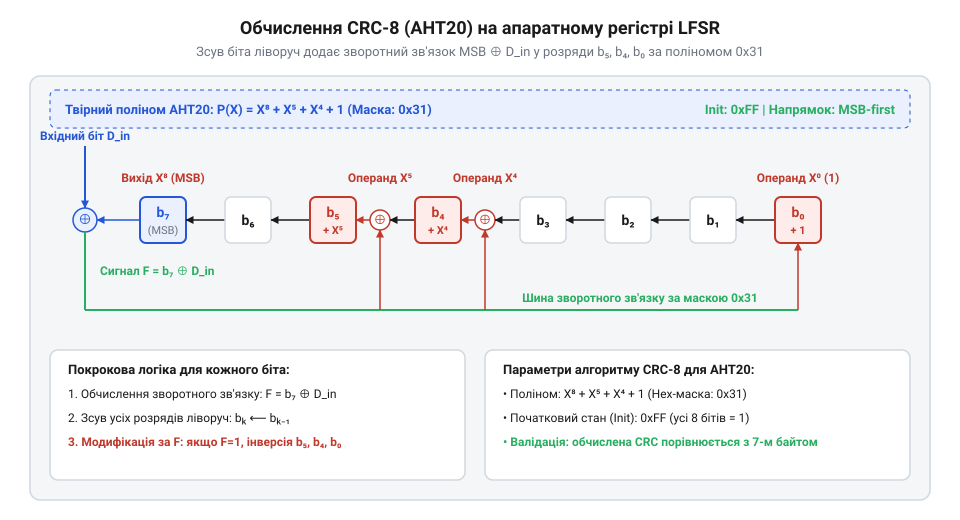

# Алгоритм обчислення та перевірки контрольної суми CRC8 для AHT20

<preknowlist>
- [AHT20 + BMP280 — температура, вологість, тиск](root:cat-hw-sensors/aht20-bmp280) — Структура кадру даних вимірювання AHT20, що складається з 6 байтів показників та 7-го контрольного байта CRC8
</preknowlist>

## Ризик прихованих помилок у шині I2C

Цифрові давачі клімату у промислових або побутових системах щосекунди надсилають мікроконтролеру дані про температуру та відносну вологість. Коли давач @@en|AHT20@@ передає вимірювальні значення двопровідною шиною @@en|I2C@@, електричні імпульсні завади від електродвигунів, реле або наведень силових кабелів можуть спотворити напругу на лініях @@en|SDA@@ та @@en|SCL@@. Шинний протокол @@en|I2C@@ передбачає підтвердження прийняття кожного байта за допомогою біта підтвердження (від англ. *acknowledge* — визнавати) @@en|ACK@@, проте цей механізм перевіряє лише сам факт наявності зв'язку з пристроєм, а не вміст переданих бітів. Якщо завада змінює один або кілька бітів усередині байта, приймач не отримує жодного сповіщення про апаратний збій, адже фізична послідовність тактових імпульсів залишається коректною.

Внаслідок такого спотворення керуюча програма приймає пошкоджений пакунок за достовірні дані. Наприклад, один інвертований біт у другому байті кадру вимірювання @@en|AHT20@@ змінює обчислене значення вологості з нормальних 45% на критичні 95%. Якщо цей давач працює у складі [комбінованого модуля AHT20 та BMP280](root:cat-hw-sensors/aht20-bmp280), система автоматики миттєво ухвалить хибне рішення: увімкне осушувач повітря чи вимкне вентиляцію, що спричинить перевитрату енергії або аварійний зупин технологічного процесу. Подібні приховані помилки не викликають збоїв на рівні драйвера шини @@en|I2C@@, тому нативний фізичний протокол не спроможний захистити обчислювальний вузол від хибної інформації.

Виходом із цієї ситуації є впровадження математичного контролю цілісності кожного кадру даних безпосередньо на прикладному рівні. Для цього цифровий давач @@en|AHT20@@ після 6 байтів даних додає 7-й контрольний байт — циклічний надлишковий код @@en|CRC8@@. Мікроконтролер обчислює контрольне значення за тим самим алгоритмом над отриманими байтами й порівнює його з 7-м байтом від давача. Якщо значення не збігаються, пакунок вважається спотвореним і беззастережно відкидається.

## Поліном CRC8 та арифметика Галуа

Математичним підґрунтям контролю цілісності є циклічний надлишковий код (від англ. *cyclic redundancy check*, де *cyclic* походить від грецького *kyklos* — коло, а *redundancy* від латинського *redundare* — переповнюватися) @@en|CRC8@@, побудований на арифметиці скінченного поля Галуа (названого на честь французького математика Евариста Галуа) @@en|Galois Field@@ GF(2). У цьому полі всі елементи набувають значень 0 або 1, а арифметичні операції додавання та віднімання виконуються за модулем 2. Це означає, що додавання та віднімання є тотожними і відповідають побітовій операції виключального «АБО» (від англ. *exclusive OR*) @@en|XOR@@: `0 ⊕ 0 = 0`, `1 ⊕ 0 = 1`, `0 ⊕ 1 = 1` та `1 ⊕ 1 = 0`. Оскільки переносу розрядів у такій арифметиці немає, математичні обчислення суттєво спрощуються.

У математичній моделі @@en|CRC8@@ послідовність переданих бітів розглядається як коефіцієнти інформаційного полінома `M(x)` високого степеня. Процес обчислення контрольної суми полягає у діленні цього полінома на фіксований твірний поліном `G(x)` у полі GF(2). Твірний поліном для давача @@en|AHT20@@ має вигляд `G(x) = X^8 + X^5 + X^4 + 1`. Специфічний вибір коефіцієнтів визначає його двійкове подання `100110001` (степінь 8), де молодші 8 бітів у шістнадцятковому форматі утворюють значення `0x31` (або `0b00110001`).

Обчислення остачі від ділення поліномів описується виразом, де початковий 8-бітний стан ініціалізується значенням `0xFF` (усі одиниці), що запобігає пропусканню нульових байтів на початку пакунка:

        R(x) = (M(x) · X^8 ⊕ Init(x)) mod G(x)
        = Remainder(M(x), G(x))      [ділення за модулем 2 у полі GF(2)]

Отримана остача `R(x)` розміром у 8 бітів і є підсумковим значенням @@en|CRC8@@.

Вибір твірного полінома `0x31` гарантує високу математичну здатність до виявлення спотворень у пакунках даних:
1. Одиночні помилки (зміна 1 біта): Будь-яка одиночна помилка описується поліномом `E(x) = X^i`. Оскільки твірний поліном `G(x)` містить більше одного доданку, він не ділить `X^i` без остачі, тому 100% одиночних помилок будуть гарантовано виявлені. 2. Подвійні помилки (зміна 2 бітів): Помилка описується поліномом `E(x) = X^i + X^j = X^j · (X^(i-j) + 1)`. Структура полінома `0x31` підбирається таким чином, щоб `G(x)` не ділив `X^k + 1` для всіх `k`, менших за довжину кадру даних, що гарантує виявлення всіх подвійних помилок. 3. Групові помилки (пакетні завади): Будь-яке групове спотворення послідовних бітів довжиною до 8 бітів включно ділиться на `G(x)` лише тоді, коли всі біти помилки дорівнюють нулю. Отже, групові завади довжиною ≤ 8 бітів виявляються зі стовідсотковою ймовірністю.

Такі математичні властивості роблять поліном `0x31` ідеальним інструментом для перевірки коротких кадрових послідовностей, які використовуються у давачі @@en|AHT20@@ та подібних пристроях, таких як [цифровий давач SHT30](root:cat-hw-sensors/sht30) чи [модуль GY-21](root:cat-hw-sensors/gy-21).

## Побітовий алгоритм зсуву та XOR

Реалізація ділення поліномів у полі GF(2) на обчислювальному ядрі мікроконтролера не потребує важких операцій арифметичного ділення. Натомість воно виконується за допомогою лінійного регістра зсуву із зворотним зв'язком (від англ. *linear feedback shift register*, де *linear* походить від латинського *linearis* — лінійний, а *feedback* — зворотний зв'язок) @@en|LFSR@@, який послідовно обробляє потік бітів за допомогою операцій лівого зсуву `<<` та виключального «АБО» @@en|XOR@@.

*Схема роботи регістра зсуву LFSR з побітовими операціями XOR для обчислення CRC8.*

У 8-бітному регістрі @@en|LFSR@@ кожен вхідний байт спочатку об'єднується з поточним станом регістра операцією @@en|XOR@@. Далі регістр обробляє кожен із 8 бітів байта покроково, починаючи від старшого біта (від англ. *most significant bit*) @@en|MSB@@. Якщо старший біт регістра перед зсувом дорівнює 1, це означає, що поточний поліном ділиться на `G(x)`, тому після зсуву ліворуч на 1 біт до регістра застосовується маска твірного полінома `0x31` через операцію @@en|XOR@@. Якщо ж старший біт дорівнює 0, ділення не відбувається, і здійснюється лише зсув.

Покроковий алгоритм оновлення регістра @@en|CRC8@@ для одного вхідного байта `data` можна виразити наступною послідовністю обчислень:

        crc = crc ⊕ data
        = (crc << 1) ⊕ (0x31 якщо (crc & 0x80) ≠ 0)      [обробка старшого біта MSB]

Розглянемо практичний приклад побітового обчислення остачі для байта `0x35` (двійкове `00110101`) за умови початкового стану регістра `crc = 0x00`:

        crc = 0x00 ⊕ 0x35
        = 0x35                                                       [початковий XOR регістра та вхідного байта]
        = 0x6A                                                       [крок 1 (біт 7): зсув без XOR, біт MSB був 0]
        = 0xD4                                                       [крок 2 (біт 6): зсув без XOR, біт MSB був 0]
        = 0xA8 ⊕ 0x31                                                [крок 3 (біт 5): зсув із висуненням MSB 1]
        = 0x99                                                       [результат XOR із маскою 0x31]

Послідовне проходження всіх 8 бітів для кожного байта з масиву даних формує підсумковий 8-бітний результат @@en|CRC8@@, готовий для зіставлення з контрольною сумою давача.

## Обчислення та фільтрація даних AHT20

Під час читання кадру вимірювання давач @@en|AHT20@@ повертає 7 послідовних байтів шиною @@en|I2C@@. Перший байт містить статус пристрою (стан калібрування та готовності), наступні 5 байтів містять 20-бітні сирі значення відносної вологості та температури, а 7-й байт є апаратно обчисленою контрольною сумою @@en|CRC8@@.

Для перевірки цілісності мікроконтролер має виконати функцію обчислення @@en|CRC8@@ над першими 6 байтами та порівняти результат із 7-м байтом. Якщо обчислений результат точно дорівнює отриманому 7-му байту, дані вважаються достовірними. Сирі 20-бітні значення конвертуються у фізичні величини за допомогою градуйовальних формул. У разі неспівпадіння байт контрольної суми свідчит про спотворення даних на лінії, тому виміряні показники відкидаються, а система залишає попередні валідні значення або ініціалізує повторне опитування давача.

Нижче наведено програмну реалізацію алгоритму перевірки контрольної суми @@en|CRC8@@ для давача @@en|AHT20@@ двома мовами програмування: C для фреймворку @@en|ESP-IDF@@ та C++ для середовища @@en|Arduino@@.

:::tabs
@tab C (ESP-IDF)
:::code math-aht20-crc8-computation/c/esp-idf/aht20-calculate-crc8.c

@tab C++ (Arduino)
:::code math-aht20-crc8-computation/cpp/arduino/aht20crc.cpp
:::

Використання обчислення @@en|CRC8@@ гарантує, що жодне спотворене вимірювання не потрапить до математичних алгоритмів розрахунку точки роси за [формулою Магнуса-Тетенса](root:cat-hw-sensors/magnus-formula) або до блоку керування кліматичною системою.